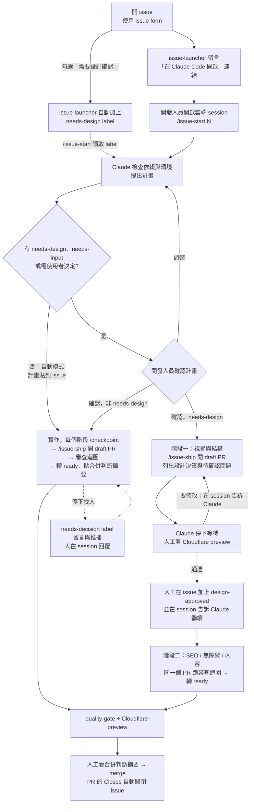

# tpi-website-ai-poc

TPIsoftware（昕力資訊）官方網站的完整改版專案，素材來源為 https://www.tpisoftware.com。

本專案同時是「AI 輔助開發工作流程」的實證：需求以 GitHub issue 管理，開發人員在 Claude Code 雲端 session 中讓 Claude 實作，人工負責設計確認與 review。GitHub Actions 只負責品質關卡與專案管理自動化。

- 部署：Cloudflare Pages（僅 `*.pages.dev` 與 PR preview）。本專案驗證 AI 開發官網的品質，不上線，不設正式網域，不做 Search Console、GTM 的實際設定
- 本站不可被搜尋引擎收錄（`X-Robots-Tag: noindex, nofollow` + `robots.txt` Disallow all）
- 技術棧：Astro static、TypeScript strict、CSS custom properties，詳見 [ADR 0001](docs/decisions/0001-tech-stack.md)
- 目前進度：[docs/status.md](docs/status.md)

## 工作流程



- 雲端 session 不會監看 issue 的 label。加上 `design-approved` 後，要在 session 中告訴 Claude 才會進入階段二
- M2、M3 的關卡 issue 與分階段流程的策略 issue 流程相同，只是確認用的 label 依階段不同：`ia-approved`（M2）、`wireframe-approved`（M3-01）、`design-approved`（M3-02 起、設計概念）、`strategy-approved`（策略）
- 新頁面、改版、內容大改走分階段流程（研究、策略、設計概念、製作、評審），每個階段由 `.claude/agents/` 的角色執行，見 [docs/workflow.md](docs/workflow.md)「分階段流程」
- 每一步的操作與需要人工介入的時機見 [docs/workflow.md](docs/workflow.md)

## 如何開需求

1. 到 Issues → New issue，選擇表單：
   - **變更需求**：新功能、內容、樣式變更。需要設計確認時勾選「需要設計確認」
   - **錯誤回報**：頁面或功能異常
   - **Milestone 任務**：規劃中的 milestone 工作
2. issue 建立後會自動出現「在 Claude Code 開啟」連結，點擊即以 `tpi-website-ai-poc` 環境開啟雲端 session
3. 之後的流程（`/issue-start`、`/checkpoint`、`/issue-ship`、`/pr-review`、`/next-issue`）見 [docs/workflow.md](docs/workflow.md)

## Labels

| Label | 意義 |
|---|---|
| `needs-design` | 需要設計確認，走兩階段流程 |
| `design-approved` | 設計已確認，可進入階段二 |
| `ia-approved` | 資訊架構（M2 sitemap / 導覽）已確認 |
| `wireframe-approved` | 低保真 wireframe（M3）已確認 |
| `strategy-approved` | messaging 與 content brief 已確認（分階段流程的策略關卡） |
| `type:feature` | 新功能或頁面 |
| `type:bug` | 錯誤修正 |
| `type:content` | 內容盤點、撰寫或遷移 |
| `type:docs` | 文件、規格、研究報告 |
| `type:chore` | 工具、設定、維護 |
| `needs-input` | 需要人工提供資訊才能進行 |
| `needs-decision` | Claude 停下等人決定，問題在 issue 或 PR 的留言 |

## 指令

```bash
npm ci
```

```bash
npm run dev
```

```bash
npm run check
```

`npm run check` 執行的步驟見 [`CLAUDE.md` 的指令表](./CLAUDE.md#指令)。Lighthouse CI 門檻：SEO = 1，其餘 ≥ 0.95；本機需要 Chrome。

## 首次設定

1. **Claude GitHub App**：安裝在本 repo（雲端 session clone / push 與 Auto-fix 需要）
2. **雲端環境**：在 claude.ai/code 建立名為 `tpi-website-ai-poc` 的 environment，network access 與 Allowed domains 照 [docs/onboarding.md](docs/onboarding.md) 第 3 步
3. **Cloudflare Pages**：連接本 repo，build command `npm run build`、output `dist`、環境變數 `NODE_VERSION` 與 `.nvmrc` 一致；production branch `main`，啟用 preview deployments
4. **Branch protection**：`main` 要求 PR 與 `quality-gate / check` 通過
5. **Bootstrap**：Actions → `bootstrap` → Run workflow，建立 labels、milestones 與 issues（可重複執行，已存在者略過）

新成員設定步驟見 [docs/onboarding.md](docs/onboarding.md)。

## GitHub Actions

| Workflow | 觸發 | 用途 |
|---|---|---|
| `quality-gate` | pull_request | `npm run check`，Lighthouse 分數寫入 job summary；只改文件的 PR 跳過 Lighthouse（ADR 0004） |
| `issue-launcher` | issues opened / edited | 留言 Claude Code 開啟連結；依表單勾選加上 `needs-design` |
| `bootstrap` | workflow_dispatch | 依 `.github/bootstrap/` 冪等建立 labels、milestones、issues |
