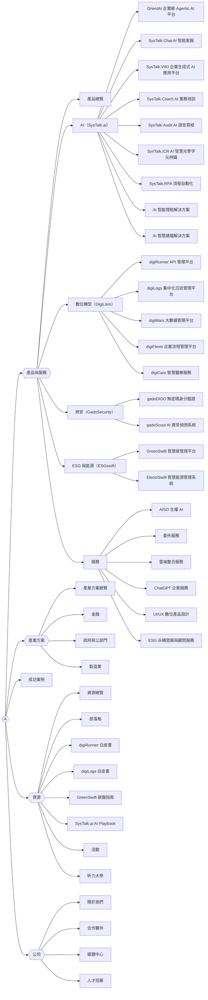

```mermaid
flowchart LR
  B_root(("B"))
  B_0{{"產品"}}
  B_root --> B_0
  B_1["產品總覽"]
  B_0 --> B_1
  B_2["AI（SysTalk.ai）"]
  B_0 --> B_2
  B_3["OrientAI 企業級 Agentic AI 平台"]
  B_2 --> B_3
  B_4["SysTalk.Chat AI 智能客服"]
  B_2 --> B_4
  B_5["SysTalk.VIKI 企業生成式 AI 應用平台"]
  B_2 --> B_5
  B_6["SysTalk.Coach AI 業務培訓"]
  B_2 --> B_6
  B_7["SysTalk.Audit AI 語音質檢"]
  B_2 --> B_7
  B_8["SysTalk.ICR AI 智慧光學字元辨識"]
  B_2 --> B_8
  B_9["SysTalk.RPA 流程自動化"]
  B_2 --> B_9
  B_10["AI 智能理賠解決方案"]
  B_2 --> B_10
  B_11["AI 智慧建檔解決方案"]
  B_2 --> B_11
  B_12["數位轉型（DigiLism）"]
  B_0 --> B_12
  B_13["digiRunner API 管理平台"]
  B_12 --> B_13
  B_14["digiLogs 集中化日誌管理平台"]
  B_12 --> B_14
  B_15["digiMars 大數據管理平台"]
  B_12 --> B_15
  B_16["digiFlexis 企業流程管理平台"]
  B_12 --> B_16
  B_17["digiCare 智慧醫療服務"]
  B_12 --> B_17
  B_18["資安（GadoSecurity）"]
  B_0 --> B_18
  B_19["gadoDIDO 無密碼身分驗證"]
  B_18 --> B_19
  B_20["gadoScout AI 異常偵測系統"]
  B_18 --> B_20
  B_21["ESG 與能源（ESGswift）"]
  B_0 --> B_21
  B_22["GreenSwift 智慧碳管理平台"]
  B_21 --> B_22
  B_23["ElectriSwift 智慧能源管理系統"]
  B_21 --> B_23
  B_24{{"產業方案"}}
  B_root --> B_24
  B_25["產業方案總覽"]
  B_24 --> B_25
  B_26["金融"]
  B_24 --> B_26
  B_27["政府與公部門"]
  B_24 --> B_27
  B_28["製造業"]
  B_24 --> B_28
  B_29{{"服務"}}
  B_root --> B_29
  B_30["服務總覽"]
  B_29 --> B_30
  B_31["AISO 主權 AI"]
  B_29 --> B_31
  B_32["委外服務"]
  B_29 --> B_32
  B_33["雲端整合服務"]
  B_29 --> B_33
  B_34["ChatGPT 企業服務"]
  B_29 --> B_34
  B_35["UI/UX 數位產品設計"]
  B_29 --> B_35
  B_36["ESG 永續發展與顧問服務"]
  B_29 --> B_36
  B_37["成功案例"]
  B_root --> B_37
  B_38{{"資源"}}
  B_root --> B_38
  B_39["資源總覽"]
  B_38 --> B_39
  B_40["部落格"]
  B_38 --> B_40
  B_41["digiRunner 白皮書"]
  B_38 --> B_41
  B_42["digiLogs 白皮書"]
  B_38 --> B_42
  B_43["GreenSwift 碳盤指南"]
  B_38 --> B_43
  B_44["SysTalk.ai AI Playbook"]
  B_38 --> B_44
  B_45["活動"]
  B_38 --> B_45
  B_46["昕力大學"]
  B_38 --> B_46
  B_47{{"公司"}}
  B_root --> B_47
  B_48["關於我們"]
  B_47 --> B_48
  B_49["合作夥伴"]
  B_47 --> B_49
  B_50["媒體中心"]
  B_47 --> B_50
  B_51["人才招募"]
  B_47 --> B_51
```

# 導覽設計（M2-02）

新站 header、footer 與行動版選單的兩個方案，以及推薦。sitemap 節點與順序以 [`sitemap.md`](./sitemap.md)（#8）為準，本檔只決定哪些節點放進導覽、放在哪裡。

- 輸入：[`nodes.csv`](./nodes.csv)、現站三語 header／footer（[`inventory.csv`](../research/inventory.csv) 的 `nav_location`）、[`audience-and-goals.md`](../research/audience-and-goals.md)
- 範圍：選單的結構與項目。視覺、版面與互動細節屬 M3-01 wireframe；選單文字的 en、vi 版本屬 M7
- 選單文字暫用 zh-TW 節點名稱，正式文案在 M5 定

## 推薦：方案 B（對齊 sitemap 第一層）

header 第一層：產品｜產業方案｜服務｜成功案例｜資源｜公司，右側工具列放搜尋、語系切換與「聯絡我們」按鈕。

理由：

1. 導覽、麵包屑、URL 都用 `nodes.csv` 同一棵樹。M4 可以從同一份資料產生三者，不用維護另一份導覽對照
2. 主要受眾的三個任務各有入口：依產品找（產品）、依產業找（產業方案）、找導入與顧問服務（服務）。方案 A 把服務收進產品選單的一欄，找服務的人要先打開「產品與服務」
3. 方案 A 的「產品與服務」選單有 5 欄（4 個產品家族 + 服務）、30 個項目，桌機需要很寬的 mega menu，行動版要捲很久；方案 B 拆開後產品選單 4 欄、23 項

方案 B 的代價：第一層 6 項加上工具列，en 標籤較長（例如 Success Stories），M3 要確認 1280px 寬度下不換行。放不下時先把「成功案例」移到「資源」底下，不改其他結構。

## 兩個方案的差異

| | 方案 A：沿用現站分組 | 方案 B：對齊 sitemap |
|---|---|---|
| header 第一層 | 產品與服務｜產業方案｜成功案例｜資源｜公司 | 產品｜產業方案｜服務｜成功案例｜資源｜公司 |
| 服務放哪裡 | 「產品與服務」mega menu 的最後一欄 | 獨立的第一層下拉選單 |
| footer | 產品與服務、產業方案、資源、公司、法務 | 產品、產業方案、服務、資源、公司、法務 |
| 與現站的距離 | 近：現站 zh-TW 第一層就是「產品與服務」 | 多一個「服務」、多一個「產業方案」 |
| 與 sitemap 的關係 | 導覽和 sitemap 分組不同（sitemap 的服務在第一層） | 一致 |

兩個方案相同的部分：

- 「產業方案」都是新的第一層。現站沒有依產業的入口，受眾是金融、政府與公部門、製造業三個產業（`audience-and-goals.md`）
- 「成功案例」都是直接連結。現站下拉的 8 個產業分類都連到同一個 `/success-story`，改成列表頁內的篩選
- 「資源」與「公司」兩個下拉選單內容相同

## 兩個方案共用的規則

### 工具列

| 項目 | 說明 |
|---|---|
| logo | 回首頁 |
| 搜尋 | 按鈕開啟搜尋框，M6 以 Pagefind 實作 |
| 語系切換 | zh-TW／en／vi，切換到同一節點的其他語系版本；該語系沒有這頁時的行為由 M2-03 決定 |
| 聯絡我們 | 主要轉換，用按鈕樣式，桌機與行動版都常駐 |

「預約 demo」是次要轉換，放在產品與服務頁內，不放進 header。

### 下拉選單

- 有下拉的第一層項目是按鈕，不是連結：點擊或按 Enter 展開，不只靠 hover。總覽頁（產品總覽、產業方案總覽等）放在選單第一項
- 產品選單的欄標題是產品家族名稱，可以點到家族頁
- 第四層（`digirunner-cloud`、`digilogs-iso27001`、`digilogs-detection`）不進 header，從上一層產品頁連結。現站 vi header 有放 digiRunner on Cloud 與 ISO 27001，新站統一不放

### 行動版

- 漢堡按鈕開啟全螢幕選單，第一層是手風琴，展開後顯示第二層
- 產品選單在行動版只展開到家族；點家族名稱再展開該家族的產品，不一次列出 18 個產品
- 「聯絡我們」按鈕固定在選單底部，語系切換在按鈕上方
- 搜尋按鈕留在收合狀態的 header 上，不收進選單

### 不進導覽的節點

| 節點 | 原因 | 從哪裡連到 |
|---|---|---|
| `textualanalysis`、`interactivehealth`、`insurebrick`、`insurering`、`gis` | sitemap 標為「待確認是否仍銷售」，現站也不在導覽 | 所屬產品家族頁或產業頁內文 |
| `digilogs-detection` | 同上，且為第四層 | digiLogs 產品頁 |
| 部落格 5 個分類 | 部落格頁內的分類篩選 | 部落格列表頁 |
| `utilities` 群組（搜尋結果、訂閱流程、感謝頁、404 等） | 功能頁 | 搜尋按鈕、表單送出後；電子報訂閱另放在 footer |

## 個別項目的決定

| 項目 | 現站 | 推薦 | 理由 |
|---|---|---|---|
| OrientAI 位置（`sitemap.md` 待確認） | zh-TW、en 為獨立的「Agentic AI」群組；vi 放在 DigiLism 下 | AI（SysTalk.ai）家族的第一項，加「Agentic AI」標記 | sitemap 已放在 `family-ai`；獨立群組只有一個產品，會讓產品選單多一欄。三語統一 |
| AISO | zh-TW、en、vi 都是 header 第一層的單一連結 | 服務選單的第一項 | sitemap 放在 `services` 底下；第一層留給受眾任務 |
| 合作夥伴 | en、vi 是第一層，zh-TW 不在 header | 「公司」選單與 footer | 合作夥伴不是本站受眾（`audience-and-goals.md`）；zh-TW 現站內容幾乎為空 |
| 法務頁 | footer，連到 PDF | 只在 footer 最底列 | 同 sitemap；PDF 改 HTML 頁 |
| 昕力大學、人才招募 | 昕力大學在「資源」；人才招募不在導覽 | 昕力大學在「資源」，人才招募在「公司」，都是外部連結 | 獨立應用，只放入口（`sitemap.md`）；人才招募提供求職者入口但不建頁 |

## 與現站 header 第一層的對照

| 現站（zh-TW） | 方案 A | 方案 B |
|---|---|---|
| 產品與服務 | 產品與服務 | 產品、服務 |
| — | 產業方案 | 產業方案 |
| 成功案例 | 成功案例 | 成功案例 |
| 資源 | 資源 | 資源 |
| 公司 | 公司 | 公司 |
| AISO 主權 AI | 移到產品與服務 > 服務 | 移到服務 |
| 聯絡我們 | 工具列按鈕 | 工具列按鈕 |
| 合作夥伴（en、vi） | 移到公司 | 移到公司 |

## 待確認

| 項目 | 誰確認 | 影響 |
|---|---|---|
| 選方案 A 或 B | 專案負責人，`ia-approved` 審核時 | M3-01 wireframe、M4-04 header／footer |
| 「個別項目的決定」整張表 | 專案負責人 | 同上 |
| en、vi 標籤在 1280px 寬度能否放進一列 | M3-01／M3-02 實測 | 放不下時「成功案例」移到「資源」 |
| 既有客戶、媒體與投資人在導覽要找什麼（`audience-and-goals.md` 問題 1 未回答） | 專案負責人 | 目前只有媒體中心；若需要客戶支援入口或投資人資訊，要加節點 |
| 第一層選單的命名（「公司」沿用現站，或改「關於我們」） | 專案負責人、M5 文案 | 只影響文字 |

## 重現方式

```bash
node scripts/ia/navigation.mjs
```

| 檔案 | 內容 | 維護方式 |
|---|---|---|
| [`navigation.csv`](./navigation.csv) | 各方案的導覽項目：`option`、`area`（`utility`／`header`／`footer`／`none`）、`parent`、`node`、`label`、`note`；列的順序就是呈現順序 | 手寫，方案的唯一來源 |
| 本檔「自動產生的段落」 | 結構圖、footer 欄位、節點位置對照、統計 | `navigation.mjs` 產生 |

`navigation.csv` 的寫法：

- `node` 是 `nodes.csv` 的 id；只用來展開選單、沒有頁面的項目（例如「產品」「公司」）`node` 留空，寫 `label`
- `label` 留空時用節點的 `title`
- `parent` 填上層項目的 `node`，上層沒有 `node` 時填它的 `label`；上層必須寫在前面的列
- `area` 為 `none` 表示刻意不放進導覽，`note` 必須寫原因

script 不連網路，同一份輸入重跑，輸出逐位元組相同。下列情況以 exit 1 結束：

- 方案少於兩個
- `node` 不在 `nodes.csv`，或同一方案、同一區域重複出現
- `parent` 找不到，或寫在子項目之後
- `legal`、`utilities` 底下的節點出現在 header 選單
- sitemap 深度 3 以內的頁面與外部連結（`utilities` 群組除外）沒有出現在任何區域，也沒列為 `none`
- `none` 的列沒寫 `note`，或同一節點同時在 `none` 與其他區域

## 自動產生的段落

以下由 `node scripts/ia/navigation.mjs` 產生，不要手改。

<!-- generated by scripts/ia/navigation.mjs: start -->

### 方案 A

#### header

方框為連到頁面的項目，六角形為只用來展開選單、沒有連結的項目。



#### footer

| 產品與服務 | 產業方案 | 資源 | 公司 | 法務 |
|---|---|---|---|---|
| 產品總覽 | 金融 | 成功案例 | 關於我們 | 隱私權政策 |
| AI（SysTalk.ai） | 政府與公部門 | 部落格 | 合作夥伴 | 使用條款 |
| 數位轉型（DigiLism） | 製造業 | 活動 | 媒體中心 | 免責聲明 |
| 資安（GadoSecurity） |  | 昕力大學 | 人才招募 | 資訊安全政策 |
| ESG 與能源（ESGswift） |  |  | 聯絡我們 |  |
| 服務總覽 |  |  | 訂閱電子報 |  |

### 方案 B

#### header

方框為連到頁面的項目，六角形為只用來展開選單、沒有連結的項目。



#### footer

| 產品 | 產業方案 | 服務 | 資源 | 公司 | 法務 |
|---|---|---|---|---|---|
| 產品總覽 | 金融 | 服務總覽 | 成功案例 | 關於我們 | 隱私權政策 |
| AI（SysTalk.ai） | 政府與公部門 | AISO 主權 AI | 部落格 | 合作夥伴 | 使用條款 |
| 數位轉型（DigiLism） | 製造業 | 委外服務 | 活動 | 媒體中心 | 免責聲明 |
| 資安（GadoSecurity） |  | 雲端整合服務 | 昕力大學 | 人才招募 | 資訊安全政策 |
| ESG 與能源（ESGswift） |  | ChatGPT 企業服務 |  | 聯絡我們 |  |
|  |  | UI/UX 數位產品設計 |  | 訂閱電子報 |  |
|  |  | ESG 永續發展與顧問服務 |  |  |  |

### 節點在各方案的位置

sitemap 中深度 3 以內的頁面與外部連結（不含功能頁群組）都要出現在 header、footer 或工具列，或列為「不進導覽」並寫理由。script 依此檢查。

| 節點 | 方案 A | 方案 B |
|---|---|---|
| 首頁（`home`） | 工具列：（logo） | 工具列：（logo） |
| 　產品總覽（`products`） | header：產品與服務 > 產品總覽<br/>footer：產品與服務 > 產品總覽 | header：產品 > 產品總覽<br/>footer：產品 > 產品總覽 |
| 　　AI（SysTalk.ai）（`family-ai`） | header：產品與服務 > AI（SysTalk.ai）<br/>footer：產品與服務 > AI（SysTalk.ai） | header：產品 > AI（SysTalk.ai）<br/>footer：產品 > AI（SysTalk.ai） |
| 　　　SysTalk.Chat AI 智能客服（`systalk-chat`） | header：產品與服務 > AI（SysTalk.ai） > SysTalk.Chat AI 智能客服 | header：產品 > AI（SysTalk.ai） > SysTalk.Chat AI 智能客服 |
| 　　　SysTalk.VIKI 企業生成式 AI 應用平台（`systalk-viki`） | header：產品與服務 > AI（SysTalk.ai） > SysTalk.VIKI 企業生成式 AI 應用平台 | header：產品 > AI（SysTalk.ai） > SysTalk.VIKI 企業生成式 AI 應用平台 |
| 　　　SysTalk.Coach AI 業務培訓（`systalk-coach`） | header：產品與服務 > AI（SysTalk.ai） > SysTalk.Coach AI 業務培訓 | header：產品 > AI（SysTalk.ai） > SysTalk.Coach AI 業務培訓 |
| 　　　SysTalk.Audit AI 語音質檢（`systalk-audit`） | header：產品與服務 > AI（SysTalk.ai） > SysTalk.Audit AI 語音質檢 | header：產品 > AI（SysTalk.ai） > SysTalk.Audit AI 語音質檢 |
| 　　　SysTalk.ICR AI 智慧光學字元辨識（`systalk-icr`） | header：產品與服務 > AI（SysTalk.ai） > SysTalk.ICR AI 智慧光學字元辨識 | header：產品 > AI（SysTalk.ai） > SysTalk.ICR AI 智慧光學字元辨識 |
| 　　　SysTalk.RPA 流程自動化（`systalk-rpa`） | header：產品與服務 > AI（SysTalk.ai） > SysTalk.RPA 流程自動化 | header：產品 > AI（SysTalk.ai） > SysTalk.RPA 流程自動化 |
| 　　　AI 智能理賠解決方案（`smartclaim`） | header：產品與服務 > AI（SysTalk.ai） > AI 智能理賠解決方案 | header：產品 > AI（SysTalk.ai） > AI 智能理賠解決方案 |
| 　　　AI 智慧建檔解決方案（`smartfilling`） | header：產品與服務 > AI（SysTalk.ai） > AI 智慧建檔解決方案 | header：產品 > AI（SysTalk.ai） > AI 智慧建檔解決方案 |
| 　　　SysTalk.Detect AI 文本分析（`textualanalysis`） | 不進導覽：待確認是否仍銷售；從所屬家族頁或產業頁內文連結 | 不進導覽：待確認是否仍銷售；從所屬家族頁或產業頁內文連結 |
| 　　　OrientAI 企業級 Agentic AI 平台（`orient-ai`） | header：產品與服務 > AI（SysTalk.ai） > OrientAI 企業級 Agentic AI 平台 | header：產品 > AI（SysTalk.ai） > OrientAI 企業級 Agentic AI 平台 |
| 　　數位轉型（DigiLism）（`family-dx`） | header：產品與服務 > 數位轉型（DigiLism）<br/>footer：產品與服務 > 數位轉型（DigiLism） | header：產品 > 數位轉型（DigiLism）<br/>footer：產品 > 數位轉型（DigiLism） |
| 　　　digiRunner API 管理平台（`digirunner`） | header：產品與服務 > 數位轉型（DigiLism） > digiRunner API 管理平台 | header：產品 > 數位轉型（DigiLism） > digiRunner API 管理平台 |
| 　　　digiLogs 集中化日誌管理平台（`digilogs`） | header：產品與服務 > 數位轉型（DigiLism） > digiLogs 集中化日誌管理平台 | header：產品 > 數位轉型（DigiLism） > digiLogs 集中化日誌管理平台 |
| 　　　digiMars 大數據管理平台（`digimars`） | header：產品與服務 > 數位轉型（DigiLism） > digiMars 大數據管理平台 | header：產品 > 數位轉型（DigiLism） > digiMars 大數據管理平台 |
| 　　　digiFlexis 企業流程管理平台（`digiflexis`） | header：產品與服務 > 數位轉型（DigiLism） > digiFlexis 企業流程管理平台 | header：產品 > 數位轉型（DigiLism） > digiFlexis 企業流程管理平台 |
| 　　　digiCare 智慧醫療服務（`digicare`） | header：產品與服務 > 數位轉型（DigiLism） > digiCare 智慧醫療服務 | header：產品 > 數位轉型（DigiLism） > digiCare 智慧醫療服務 |
| 　　　互動式健康管理服務平台（`interactivehealth`） | 不進導覽：待確認是否仍銷售；從所屬家族頁或產業頁內文連結 | 不進導覽：待確認是否仍銷售；從所屬家族頁或產業頁內文連結 |
| 　　資安（GadoSecurity）（`family-security`） | header：產品與服務 > 資安（GadoSecurity）<br/>footer：產品與服務 > 資安（GadoSecurity） | header：產品 > 資安（GadoSecurity）<br/>footer：產品 > 資安（GadoSecurity） |
| 　　　gadoDIDO 無密碼身分驗證（`gadodido`） | header：產品與服務 > 資安（GadoSecurity） > gadoDIDO 無密碼身分驗證 | header：產品 > 資安（GadoSecurity） > gadoDIDO 無密碼身分驗證 |
| 　　　gadoScout AI 異常偵測系統（`gadoscout`） | header：產品與服務 > 資安（GadoSecurity） > gadoScout AI 異常偵測系統 | header：產品 > 資安（GadoSecurity） > gadoScout AI 異常偵測系統 |
| 　　ESG 與能源（ESGswift）（`family-esg`） | header：產品與服務 > ESG 與能源（ESGswift）<br/>footer：產品與服務 > ESG 與能源（ESGswift） | header：產品 > ESG 與能源（ESGswift）<br/>footer：產品 > ESG 與能源（ESGswift） |
| 　　　GreenSwift 智慧碳管理平台（`greenswift`） | header：產品與服務 > ESG 與能源（ESGswift） > GreenSwift 智慧碳管理平台 | header：產品 > ESG 與能源（ESGswift） > GreenSwift 智慧碳管理平台 |
| 　　　ElectriSwift 智慧能源管理系統（`electriswift`） | header：產品與服務 > ESG 與能源（ESGswift） > ElectriSwift 智慧能源管理系統 | header：產品 > ESG 與能源（ESGswift） > ElectriSwift 智慧能源管理系統 |
| 　產業方案（`industries`） | header：產業方案 > 產業方案總覽 | header：產業方案 > 產業方案總覽 |
| 　　金融（`industry-finance`） | header：產業方案 > 金融<br/>footer：產業方案 > 金融 | header：產業方案 > 金融<br/>footer：產業方案 > 金融 |
| 　　　InsureBrick 保險科技模組化平台（`insurebrick`） | 不進導覽：待確認是否仍銷售；從所屬家族頁或產業頁內文連結 | 不進導覽：待確認是否仍銷售；從所屬家族頁或產業頁內文連結 |
| 　　　InsureRing 保險自動化規則檢核（`insurering`） | 不進導覽：待確認是否仍銷售；從所屬家族頁或產業頁內文連結 | 不進導覽：待確認是否仍銷售；從所屬家族頁或產業頁內文連結 |
| 　　政府與公部門（`industry-government`） | header：產業方案 > 政府與公部門<br/>footer：產業方案 > 政府與公部門 | header：產業方案 > 政府與公部門<br/>footer：產業方案 > 政府與公部門 |
| 　　　GIS 空間數據解決方案（`gis`） | 不進導覽：待確認是否仍銷售；從所屬家族頁或產業頁內文連結 | 不進導覽：待確認是否仍銷售；從所屬家族頁或產業頁內文連結 |
| 　　製造業（`industry-manufacturing`） | header：產業方案 > 製造業<br/>footer：產業方案 > 製造業 | header：產業方案 > 製造業<br/>footer：產業方案 > 製造業 |
| 　服務總覽（`services`） | header：產品與服務 > 服務<br/>footer：產品與服務 > 服務總覽 | header：服務 > 服務總覽<br/>footer：服務 > 服務總覽 |
| 　　AISO 主權 AI（`aiso`） | header：產品與服務 > 服務 > AISO 主權 AI | header：服務 > AISO 主權 AI<br/>footer：服務 > AISO 主權 AI |
| 　　委外服務（`outsourcing`） | header：產品與服務 > 服務 > 委外服務 | header：服務 > 委外服務<br/>footer：服務 > 委外服務 |
| 　　雲端整合服務（`cloudservice`） | header：產品與服務 > 服務 > 雲端整合服務 | header：服務 > 雲端整合服務<br/>footer：服務 > 雲端整合服務 |
| 　　ChatGPT 企業服務（`chatgpt-enterprise`） | header：產品與服務 > 服務 > ChatGPT 企業服務 | header：服務 > ChatGPT 企業服務<br/>footer：服務 > ChatGPT 企業服務 |
| 　　UI/UX 數位產品設計（`uiux`） | header：產品與服務 > 服務 > UI/UX 數位產品設計 | header：服務 > UI/UX 數位產品設計<br/>footer：服務 > UI/UX 數位產品設計 |
| 　　ESG 永續發展與顧問服務（`esg-advisory`） | header：產品與服務 > 服務 > ESG 永續發展與顧問服務 | header：服務 > ESG 永續發展與顧問服務<br/>footer：服務 > ESG 永續發展與顧問服務 |
| 　成功案例（`success-stories`） | header：成功案例<br/>footer：資源 > 成功案例 | header：成功案例<br/>footer：資源 > 成功案例 |
| 　資源（`resources`） | header：資源 > 資源總覽 | header：資源 > 資源總覽 |
| 　　部落格（`blog`） | header：資源 > 部落格<br/>footer：資源 > 部落格 | header：資源 > 部落格<br/>footer：資源 > 部落格 |
| 　　　AI（`blog-ai`） | 不進導覽：部落格頁內的分類篩選 | 不進導覽：部落格頁內的分類篩選 |
| 　　　數位轉型（`blog-digital-transformation`） | 不進導覽：部落格頁內的分類篩選 | 不進導覽：部落格頁內的分類篩選 |
| 　　　企業管理（`blog-enterprise-management`） | 不進導覽：部落格頁內的分類篩選 | 不進導覽：部落格頁內的分類篩選 |
| 　　　ESG 與綠色轉型（`blog-esg`） | 不進導覽：部落格頁內的分類篩選 | 不進導覽：部落格頁內的分類篩選 |
| 　　　應用情境（`blog-use-cases`） | 不進導覽：部落格頁內的分類篩選 | 不進導覽：部落格頁內的分類篩選 |
| 　　digiRunner 白皮書（`whitepaper-digirunner`） | header：資源 > digiRunner 白皮書 | header：資源 > digiRunner 白皮書 |
| 　　digiLogs 白皮書（`whitepaper-digilogs`） | header：資源 > digiLogs 白皮書 | header：資源 > digiLogs 白皮書 |
| 　　GreenSwift 碳盤指南（`whitepaper-greenswift`） | header：資源 > GreenSwift 碳盤指南 | header：資源 > GreenSwift 碳盤指南 |
| 　　SysTalk.ai AI Playbook（`whitepaper-systalk-ai`） | header：資源 > SysTalk.ai AI Playbook | header：資源 > SysTalk.ai AI Playbook |
| 　　活動（`events`） | header：資源 > 活動<br/>footer：資源 > 活動 | header：資源 > 活動<br/>footer：資源 > 活動 |
| 　　昕力大學（`tpu`） | header：資源 > 昕力大學<br/>footer：資源 > 昕力大學 | header：資源 > 昕力大學<br/>footer：資源 > 昕力大學 |
| 　關於我們（`about`） | header：公司 > 關於我們<br/>footer：公司 > 關於我們 | header：公司 > 關於我們<br/>footer：公司 > 關於我們 |
| 　　合作夥伴（`partners`） | header：公司 > 合作夥伴<br/>footer：公司 > 合作夥伴 | header：公司 > 合作夥伴<br/>footer：公司 > 合作夥伴 |
| 　　媒體中心（`media-center`） | header：公司 > 媒體中心<br/>footer：公司 > 媒體中心 | header：公司 > 媒體中心<br/>footer：公司 > 媒體中心 |
| 　　人才招募（`hr`） | header：公司 > 人才招募<br/>footer：公司 > 人才招募 | header：公司 > 人才招募<br/>footer：公司 > 人才招募 |
| 　聯絡我們（`contact`） | 工具列：聯絡我們<br/>footer：公司 > 聯絡我們 | 工具列：聯絡我們<br/>footer：公司 > 聯絡我們 |
| 　　隱私權政策（`privacy`） | footer：法務 > 隱私權政策 | footer：法務 > 隱私權政策 |
| 　　使用條款（`terms`） | footer：法務 > 使用條款 | footer：法務 > 使用條款 |
| 　　免責聲明（`disclaimer`） | footer：法務 > 免責聲明 | footer：法務 > 免責聲明 |
| 　　資訊安全政策（`security-policy`） | footer：法務 > 資訊安全政策 | footer：法務 > 資訊安全政策 |

### 統計

| 方案 | header 第一層 | header 項目 | footer 欄 | footer 項目 | 不進導覽 |
|---|--:|--:|--:|--:|--:|
| A | 5 | 51 | 5 | 23 | 10 |
| B | 6 | 52 | 6 | 29 | 10 |

<!-- generated by scripts/ia/navigation.mjs: end -->
