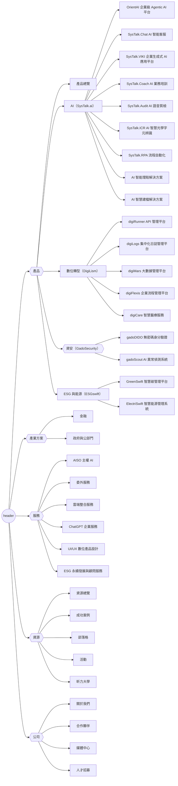

# 新站導覽（M2-02）

新站 header、footer、工具列與行動版選單的結構與規則。sitemap 節點與順序以 [`sitemap.md`](./sitemap.md)（#8）為準，本檔決定哪些節點放進導覽、放在哪裡。M3-01 wireframe 與 M4-04 header／footer 以本檔為依據。

- 輸入：[`nodes.csv`](./nodes.csv)、現站三語 header／footer（[`inventory.csv`](../research/inventory.csv) 的 `nav_location`）、[`audience-and-goals.md`](../research/audience-and-goals.md)
- 範圍：選單的結構、項目與行為規則。視覺與版面屬 M3；選單文字的 en、vi 版本屬 M7
- 選單文字暫用 zh-TW 節點名稱，正式文案在 M5 定
- 完整的項目清單見[自動產生的段落](#自動產生的段落)；導覽項目的唯一來源是 [`navigation.csv`](./navigation.csv)

## 第一層對齊 sitemap

header 第一層：產品｜產業方案｜服務｜資源｜公司。右側工具列放搜尋、語系切換與「聯絡我們」按鈕。

| 第一層 | 類型 | 內容 |
|---|---|---|
| 產品 | mega menu | 產品總覽，加上 4 欄產品家族：AI（SysTalk.ai）、數位轉型（DigiLism）、資安（GadoSecurity）、ESG 與能源（ESGswift），共 23 項 |
| 產業方案 | 下拉選單 | 金融、政府與公部門。產業方案總覽與製造業未上線（#138） |
| 服務 | 下拉選單 | 6 項服務，AISO 主權 AI 排第一。服務總覽未上線（#138） |
| 資源 | 下拉選單 | 資源總覽、成功案例、部落格、活動、昕力大學（外部連結）。4 份白皮書未上線（#138） |
| 公司 | 下拉選單 | 關於我們、合作夥伴、媒體中心、人才招募（外部連結） |

footer 有 5 欄：產品、產業方案、服務、資源、公司。欄的下方是最底列，放版權聲明與 4 個法務頁，法務頁只出現在這裡。現站也是這樣排（首頁 HTML 的 `footer-bottom`，法務連結與版權聲明同一區）。

### 工具列

| 項目 | 說明 |
|---|---|
| logo | 回首頁 |
| 搜尋 | 按鈕開啟搜尋框，M6 以 Pagefind 實作 |
| 語系切換 | zh-TW／en／vi，切換到同一節點的其他語系版本；缺翻譯時的目標見 [ADR 0002「缺翻譯的頁面」](../decisions/0002-url-and-locale.md#缺翻譯的頁面)，元件 `LocaleSwitcher` |
| 聯絡我們 | 主要轉換，用按鈕樣式，桌機與行動版都常駐 |

「預約 demo」是次要轉換，放在產品與服務頁內，不放進 header。

## 互動規則

### 下拉選單

- 有下拉的第一層項目是按鈕，不是連結。總覽頁（產品總覽、資源總覽）放在選單第一項
- 點擊或按 Enter／Space 展開，不只靠 hover。同一時間只展開一個選單
- 產品選單的欄標題是產品家族名稱，可以點到家族頁。家族頁還沒建出時（資安，#138），`navigation.csv` 寫成只有 `label` 的欄標題，顯示為不可點的文字，手機選單直接列出它底下的產品
- OrientAI 在 AI 家族第一項，加「Agentic AI」標記
- 第四層（`digirunner-cloud`、`digilogs-iso27001`、`digilogs-detection`）不進 header，從上一層產品頁連結。現站 vi header 有放 digiRunner on Cloud 與 ISO 27001，新站統一不放

### 行動版

- 漢堡按鈕開啟全螢幕選單，第一層是手風琴，展開後顯示第二層
- 產品選單在行動版只展開到家族；點家族名稱再展開該家族的產品，不一次列出 18 個產品
- 「聯絡我們」按鈕固定在選單底部，語系切換在按鈕上方
- 搜尋按鈕留在收合狀態的 header 上，不收進選單

### 無障礙

M4-04 實作、M4-05 axe 檢查時對照下列項目。

- header 選單、footer 各用一個 `<nav>`，以 `aria-label` 區分（例如「主選單」「頁尾選單」）；頁首放「跳到主要內容」連結，鍵盤聚焦時才顯示
- 下拉選單用 disclosure 模式：觸發按鈕帶 `aria-expanded` 與 `aria-controls`，不使用 `role="menu"`
- 按 Esc 收合選單，焦點回到觸發按鈕；焦點移出選單時收合
- 行動版選單開啟時，焦點移到選單內，背景內容不可聚焦；關閉後焦點回到漢堡按鈕
- 目前所在頁面的連結帶 `aria-current="page"`
- 語系切換的每個選項用該語言書寫自己的名稱，並加上對應的 `lang` 屬性
- 觸控目標至少 24×24 CSS px（WCAG 2.2 AA 2.5.8）

### SEO

- 所有選單連結都輸出在靜態 HTML 中，以一般的 `<a href>` 呈現。不可在 client 端才產生連結：現站下拉選單在 client 端渲染（`docs/research/inventory.md`），搜尋引擎不一定讀得到
- 選單展開前的隱藏內容用 CSS 或 `hidden` 處理，連結仍要在 HTML 中
- 麵包屑用 `nodes.csv` 的 `parent` 產生，與導覽是同一棵樹；`BreadcrumbList` JSON-LD 由 M4-03 實作
- 不進 header 的頁面要有其他內部連結，見下一節「從哪裡連到」

### 語系

選單、footer、麵包屑、子頁卡片與 `BreadcrumbList` 的名稱都由 `src/lib/ia/navigation.ts` 依頁面語系決定（#114）：

- zh-TW 取 `nodes.csv` 的 `title` 與 `navigation.csv` 的 `label`
- en、vi 取 `docs/i18n/glossary.csv`：節點用 `node:<id>` 列，選單標籤用 `nav:<標籤>` 列；標籤和某個節點的 `title` 相同時用該節點的列（`glossary.md`「分類」）
- 沒有譯名（沒有這一列，或該語系的欄位是空的）時，產生那一頁的 build 失敗，不 fallback 到 zh-TW。只有 zh-TW 字串檔時不會查 glossary，所以 en、vi 欄位的空白不影響現在的 build
- 連結指向該語系的頁面；該語系沒有這一頁（例如 vi 不產生法務頁）時連到 zh-TW 版，見 [ADR 0002「缺翻譯的頁面」](../decisions/0002-url-and-locale.md#缺翻譯的頁面)

## 不進導覽的節點

| 節點 | 原因 | 從哪裡連到 |
|---|---|---|
| `textualanalysis`、`interactivehealth`、`insurebrick`、`insurering`、`gis` | sitemap 標為「待確認是否仍銷售」，現站也不在導覽 | 所屬產品家族頁或產業頁內文 |
| `digilogs-detection` | 同上，且為第四層 | digiLogs 產品頁 |
| `digirunner-cloud`、`digilogs-iso27001` | 第四層 | 上一層產品頁（digiRunner、digiLogs） |
| 部落格 5 個分類（`blog-ai`、`blog-digital-transformation`、`blog-enterprise-management`、`blog-esg`、`blog-use-cases`） | 部落格頁內的分類篩選 | 部落格列表頁 |
| `utilities` 群組（搜尋結果、訂閱流程、感謝頁、404 等） | 功能頁；script 豁免，不列在 `navigation.csv` 的 `none` | 搜尋按鈕、表單送出後；電子報訂閱另放在 footer |

## 個別項目的決定

| 項目 | 現站 | 決定 | 理由 |
|---|---|---|---|
| OrientAI 位置 | zh-TW、en 為獨立的「Agentic AI」群組；vi 放在 DigiLism 下 | AI（SysTalk.ai）家族的第一項，加「Agentic AI」標記 | sitemap 已放在 `family-ai`；獨立群組只有一個產品，會讓產品選單多一欄。三語統一 |
| AISO | zh-TW、en、vi 都是 header 第一層的單一連結 | 服務選單的第一項 | sitemap 放在 `services` 底下；第一層留給受眾任務 |
| 合作夥伴 | en、vi 是第一層，zh-TW 不在 header | 「公司」選單與 footer | 合作夥伴不是本站受眾（`audience-and-goals.md`）；zh-TW 現站內容幾乎為空 |
| 法務頁 | footer 最底列，與版權聲明同列，連到 PDF | 只在 footer 最底列，不另成一欄 | 沿用現站位置；PDF 改 HTML 頁 |
| 昕力大學、人才招募 | 昕力大學在「資源」；人才招募不在導覽 | 昕力大學在「資源」，人才招募在「公司」，都是外部連結 | 獨立應用，只放入口（`sitemap.md`）；人才招募提供求職者入口但不建頁 |
| 第一層命名 | 公司 | 沿用「公司」 | 現站三語都用；不會跟子項目「關於我們」重複 |
| 成功案例 | 現站 header 第一層，下拉 8 個產業分類都連到同一個 `/success-story` | 「資源」選單第二項（總覽之後）；產業分類改成列表頁內的篩選 | M3-01 實測第一層 6 項在 1280px 時，vi 與 en 的長譯名放不下（[`nav-fit.md`](../design/nav-fit.md)），使用者於 2026-10-21 決定採用備案、三語統一。只改導覽：`nodes.csv` 的 parent 與 URL 不變，麵包屑仍是「首頁 > 成功案例」，與 footer 原本就放在「資源」欄一致 |
| 既有客戶、媒體與投資人的專屬入口 | 無 | 先不加 | 媒體用「公司 > 媒體中心」，既有客戶用「聯絡我們」；有具體需求時再加節點（`audience-and-goals.md` 問題 1） |

## 與現站 header 第一層的對照

| 現站（zh-TW） | 新站 |
|---|---|
| 產品與服務 | 拆成「產品」與「服務」 |
| — | 產業方案（新增） |
| 成功案例 | 移到「資源」 |
| 資源 | 資源 |
| 公司 | 公司 |
| AISO 主權 AI | 移到「服務」 |
| 聯絡我們 | 工具列按鈕 |
| 合作夥伴（en、vi） | 移到「公司」 |

## 決策紀錄：為什麼不沿用現站分組

階段一（PR #60）提出兩個方案，專案負責人於 2026-10-20 選定方案 B，即本檔的導覽。

| | 方案 A：沿用現站分組 | 方案 B：對齊 sitemap（選定） |
|---|---|---|
| header 第一層 | 產品與服務｜產業方案｜成功案例｜資源｜公司 | 產品｜產業方案｜服務｜成功案例｜資源｜公司 |
| 服務放哪裡 | 「產品與服務」mega menu 的最後一欄 | 獨立的第一層下拉選單 |
| 產品選單大小 | 5 欄、30 項 | 4 欄、23 項 |
| 與 sitemap 的關係 | 導覽和 sitemap 分組不同（sitemap 的服務在第一層） | 一致 |

選 B 的理由：

1. 導覽、麵包屑、URL 都用 `nodes.csv` 同一棵樹。M4 可以從同一份資料產生三者，不用維護另一份導覽對照
2. 主要受眾的三個任務各有入口：依產品找（產品）、依產業找（產業方案）、找導入與顧問服務（服務）
3. 產品選單比方案 A 小，桌機不需要過寬的 mega menu，行動版不用捲很久

B 的代價：第一層 6 項加上工具列，en 標籤較長（例如 Success Stories）。M3-01 實測 vi 與 en 的長譯名放不下，「成功案例」改放「資源」底下，第一層剩 5 項，見「個別項目的決定」。

## 重現方式

```bash
node scripts/ia/navigation.mjs           # 產生本檔的自動產生段落
node scripts/ia/navigation.mjs --check   # 同樣的檢查，不寫檔；本檔過期時 exit 1
```

`npm run check` 的第一步 `npm run check:ia` 會執行兩支 IA script 的 `--check`，改了 `navigation.csv` 或 `nodes.csv` 沒重跑就會失敗。

| 檔案 | 內容 | 維護方式 |
|---|---|---|
| [`navigation.csv`](./navigation.csv) | 導覽項目：`area`（`utility`／`header`／`footer`／`footer-bottom`／`none`）、`parent`、`node`、`label`、`note`；列的順序就是呈現順序 | 手寫，導覽的唯一來源 |
| 本檔「自動產生的段落」 | header 結構圖、footer 欄位與最底列、節點位置對照、統計 | `navigation.mjs` 產生 |

`navigation.csv` 的寫法：

- `node` 是 `nodes.csv` 的 id；只用來展開選單、沒有頁面的項目（例如「產品」「公司」）`node` 留空，寫 `label`
- `label` 留空時用節點的 `title`
- `parent` 填上層項目的 `node`，上層沒有 `node` 時填它的 `label`；上層必須寫在前面的列
- `area` 為 `footer` 是欄：欄標題一列（只寫 `label`），底下的項目 `parent` 填欄標題
- `area` 為 `footer-bottom` 是欄下方的最底列，與版權聲明同列；只放節點，不寫 `parent`
- `area` 為 `none` 表示刻意不放進導覽，`note` 必須寫原因

script 不連網路，同一份輸入重跑，輸出逐位元組相同。下列情況以 exit 1 結束：

- `node` 不在 `nodes.csv`，或同一區域重複出現
- 工具列、header、footer 放了 `kind` 不是 `page`／`external` 的節點（群組、集合、下載檔沒有單一頁面可連）
- `label` 含 `"` 或 `|`（會破壞產生的 Mermaid 與表格）
- footer 的欄標題不是 `label`，或 footer 超過兩層
- footer 最底列的列寫了 `parent`，或沒有 `node`
- `parent` 找不到，或寫在子項目之後
- `legal`、`utilities` 本身或底下的節點出現在 header 選單
- sitemap 的頁面與外部連結（`utilities` 群組除外，不限深度）沒有出現在任何區域，也沒列為 `none`
- `none` 的列沒寫 `note`，或同一節點同時在 `none` 與其他區域

## 自動產生的段落

以下由 `node scripts/ia/navigation.mjs` 產生，不要手改。

<!-- generated by scripts/ia/navigation.mjs: start -->

### header

方框為連到頁面的項目，六角形為只用來展開選單、沒有連結的項目。



### footer

| 產品 | 產業方案 | 服務 | 資源 | 公司 |
|---|---|---|---|---|
| 產品總覽 | 金融 | AISO 主權 AI | 成功案例 | 關於我們 |
| AI（SysTalk.ai） | 政府與公部門 | 委外服務 | 部落格 | 合作夥伴 |
| 數位轉型（DigiLism） |  | 雲端整合服務 | 活動 | 媒體中心 |
| ESG 與能源（ESGswift） |  | ChatGPT 企業服務 | 昕力大學 | 人才招募 |
|  |  | UI/UX 數位產品設計 |  | 聯絡我們 |
|  |  | ESG 永續發展與顧問服務 |  | 訂閱電子報 |

最底列：

版權聲明｜資訊安全政策｜隱私權政策｜使用條款｜免責聲明

### 節點在導覽中的位置

sitemap 中所有頁面與外部連結（不含功能頁群組）都要出現在 header、footer 或工具列，或列為「不進導覽」並寫理由。script 依此檢查。

| 節點 | 位置 |
|---|---|
| 首頁（`home`） | 工具列：（logo） |
| 　產品總覽（`products`） | header：產品 > 產品總覽<br/>footer：產品 > 產品總覽 |
| 　　AI（SysTalk.ai）（`family-ai`） | header：產品 > AI（SysTalk.ai）<br/>footer：產品 > AI（SysTalk.ai） |
| 　　　SysTalk.Chat AI 智能客服（`systalk-chat`） | header：產品 > AI（SysTalk.ai） > SysTalk.Chat AI 智能客服 |
| 　　　SysTalk.VIKI 企業生成式 AI 應用平台（`systalk-viki`） | header：產品 > AI（SysTalk.ai） > SysTalk.VIKI 企業生成式 AI 應用平台 |
| 　　　SysTalk.Coach AI 業務培訓（`systalk-coach`） | header：產品 > AI（SysTalk.ai） > SysTalk.Coach AI 業務培訓 |
| 　　　SysTalk.Audit AI 語音質檢（`systalk-audit`） | header：產品 > AI（SysTalk.ai） > SysTalk.Audit AI 語音質檢 |
| 　　　SysTalk.ICR AI 智慧光學字元辨識（`systalk-icr`） | header：產品 > AI（SysTalk.ai） > SysTalk.ICR AI 智慧光學字元辨識 |
| 　　　SysTalk.RPA 流程自動化（`systalk-rpa`） | header：產品 > AI（SysTalk.ai） > SysTalk.RPA 流程自動化 |
| 　　　AI 智能理賠解決方案（`smartclaim`） | header：產品 > AI（SysTalk.ai） > AI 智能理賠解決方案 |
| 　　　AI 智慧建檔解決方案（`smartfilling`） | header：產品 > AI（SysTalk.ai） > AI 智慧建檔解決方案 |
| 　　　SysTalk.Detect AI 文本分析（`textualanalysis`） | 不進導覽：待確認是否仍銷售；從所屬家族頁或產業頁內文連結 |
| 　　　OrientAI 企業級 Agentic AI 平台（`orient-ai`） | header：產品 > AI（SysTalk.ai） > OrientAI 企業級 Agentic AI 平台 |
| 　　數位轉型（DigiLism）（`family-dx`） | header：產品 > 數位轉型（DigiLism）<br/>footer：產品 > 數位轉型（DigiLism） |
| 　　　digiRunner API 管理平台（`digirunner`） | header：產品 > 數位轉型（DigiLism） > digiRunner API 管理平台 |
| 　　　　digiRunner on Cloud（`digirunner-cloud`） | 不進導覽：第四層，從上一層產品頁連結 |
| 　　　digiLogs 集中化日誌管理平台（`digilogs`） | header：產品 > 數位轉型（DigiLism） > digiLogs 集中化日誌管理平台 |
| 　　　　ISO27001 日誌存錄（`digilogs-iso27001`） | 不進導覽：第四層，從上一層產品頁連結 |
| 　　　　digiLogs 日誌分析（`digilogs-detection`） | 不進導覽：待確認是否仍銷售；第四層，從 digiLogs 產品頁連結 |
| 　　　digiMars 大數據管理平台（`digimars`） | header：產品 > 數位轉型（DigiLism） > digiMars 大數據管理平台 |
| 　　　digiFlexis 企業流程管理平台（`digiflexis`） | header：產品 > 數位轉型（DigiLism） > digiFlexis 企業流程管理平台 |
| 　　　digiCare 智慧醫療服務（`digicare`） | header：產品 > 數位轉型（DigiLism） > digiCare 智慧醫療服務 |
| 　　　互動式健康管理服務平台（`interactivehealth`） | 不進導覽：待確認是否仍銷售；從所屬家族頁或產業頁內文連結 |
| 　　資安（GadoSecurity）（`family-security`） | 不進導覽：未上線（#138）：沒有內容來源，之後要做時另開 issue |
| 　　　gadoDIDO 無密碼身分驗證（`gadodido`） | header：產品 > 資安（GadoSecurity） > gadoDIDO 無密碼身分驗證 |
| 　　　gadoScout AI 異常偵測系統（`gadoscout`） | header：產品 > 資安（GadoSecurity） > gadoScout AI 異常偵測系統 |
| 　　ESG 與能源（ESGswift）（`family-esg`） | header：產品 > ESG 與能源（ESGswift）<br/>footer：產品 > ESG 與能源（ESGswift） |
| 　　　GreenSwift 智慧碳管理平台（`greenswift`） | header：產品 > ESG 與能源（ESGswift） > GreenSwift 智慧碳管理平台 |
| 　　　ElectriSwift 智慧能源管理系統（`electriswift`） | header：產品 > ESG 與能源（ESGswift） > ElectriSwift 智慧能源管理系統 |
| 　產業方案（`industries`） | 不進導覽：未上線（#138）：沒有內容來源，之後要做時另開 issue |
| 　　金融（`industry-finance`） | header：產業方案 > 金融<br/>footer：產業方案 > 金融 |
| 　　　InsureBrick 保險科技模組化平台（`insurebrick`） | 不進導覽：待確認是否仍銷售；從所屬家族頁或產業頁內文連結 |
| 　　　InsureRing 保險自動化規則檢核（`insurering`） | 不進導覽：待確認是否仍銷售；從所屬家族頁或產業頁內文連結 |
| 　　政府與公部門（`industry-government`） | header：產業方案 > 政府與公部門<br/>footer：產業方案 > 政府與公部門 |
| 　　　GIS 空間數據解決方案（`gis`） | 不進導覽：待確認是否仍銷售；從所屬家族頁或產業頁內文連結 |
| 　　製造業（`industry-manufacturing`） | 不進導覽：未上線（#138）：沒有內容來源，之後要做時另開 issue |
| 　服務總覽（`services`） | 不進導覽：未上線（#138）：沒有內容來源，之後要做時另開 issue |
| 　　AISO 主權 AI（`aiso`） | header：服務 > AISO 主權 AI<br/>footer：服務 > AISO 主權 AI |
| 　　委外服務（`outsourcing`） | header：服務 > 委外服務<br/>footer：服務 > 委外服務 |
| 　　雲端整合服務（`cloudservice`） | header：服務 > 雲端整合服務<br/>footer：服務 > 雲端整合服務 |
| 　　ChatGPT 企業服務（`chatgpt-enterprise`） | header：服務 > ChatGPT 企業服務<br/>footer：服務 > ChatGPT 企業服務 |
| 　　UI/UX 數位產品設計（`uiux`） | header：服務 > UI/UX 數位產品設計<br/>footer：服務 > UI/UX 數位產品設計 |
| 　　ESG 永續發展與顧問服務（`esg-advisory`） | header：服務 > ESG 永續發展與顧問服務<br/>footer：服務 > ESG 永續發展與顧問服務 |
| 　成功案例（`success-stories`） | header：資源 > 成功案例<br/>footer：資源 > 成功案例 |
| 　資源（`resources`） | header：資源 > 資源總覽 |
| 　　部落格（`blog`） | header：資源 > 部落格<br/>footer：資源 > 部落格 |
| 　　　AI（`blog-ai`） | 不進導覽：部落格頁內的分類篩選 |
| 　　　數位轉型（`blog-digital-transformation`） | 不進導覽：部落格頁內的分類篩選 |
| 　　　企業管理（`blog-enterprise-management`） | 不進導覽：部落格頁內的分類篩選 |
| 　　　ESG 與綠色轉型（`blog-esg`） | 不進導覽：部落格頁內的分類篩選 |
| 　　　應用情境（`blog-use-cases`） | 不進導覽：部落格頁內的分類篩選 |
| 　　digiRunner 白皮書（`whitepaper-digirunner`） | 不進導覽：未上線（#138）：沒有內容來源，之後要做時另開 issue |
| 　　digiLogs 白皮書（`whitepaper-digilogs`） | 不進導覽：未上線（#138）：沒有內容來源，之後要做時另開 issue |
| 　　GreenSwift 碳盤指南（`whitepaper-greenswift`） | 不進導覽：未上線（#138）：沒有內容來源，之後要做時另開 issue |
| 　　SysTalk.ai AI Playbook（`whitepaper-systalk-ai`） | 不進導覽：未上線（#138）：沒有內容來源，之後要做時另開 issue |
| 　　活動（`events`） | header：資源 > 活動<br/>footer：資源 > 活動 |
| 　　昕力大學（`tpu`） | header：資源 > 昕力大學<br/>footer：資源 > 昕力大學 |
| 　關於我們（`about`） | header：公司 > 關於我們<br/>footer：公司 > 關於我們 |
| 　　合作夥伴（`partners`） | header：公司 > 合作夥伴<br/>footer：公司 > 合作夥伴 |
| 　　媒體中心（`media-center`） | header：公司 > 媒體中心<br/>footer：公司 > 媒體中心 |
| 　　人才招募（`hr`） | header：公司 > 人才招募<br/>footer：公司 > 人才招募 |
| 　聯絡我們（`contact`） | 工具列：聯絡我們<br/>footer：公司 > 聯絡我們 |
| 　　隱私權政策（`privacy`） | footer 最底列：隱私權政策 |
| 　　使用條款（`terms`） | footer 最底列：使用條款 |
| 　　免責聲明（`disclaimer`） | footer 最底列：免責聲明 |
| 　　資訊安全政策（`security-policy`） | footer 最底列：資訊安全政策 |
| 　　站內搜尋（`search`） | 工具列：搜尋 |
| 　　電子報訂閱（`subscribe`） | footer：公司 > 訂閱電子報 |

### 統計

| header 第一層 | header 項目 | footer 欄 | footer 項目 | footer 最底列 | 不進導覽 |
|--:|--:|--:|--:|--:|--:|
| 5 | 45 | 5 | 22 | 4 | 21 |

<!-- generated by scripts/ia/navigation.mjs: end -->
