# 新站 sitemap 與模板對應（M2-01）

新站的頁面階層、每個節點使用的模板，以及現站每個 keep／rewrite／merge 頁面在新站的位置。M2-02 導覽、M2-03 URL 規則、M2-04 內容模型、M2-05 redirect map 以本檔為依據。

- 輸入：[`inventory.csv`](../research/inventory.csv) 的 M1-02 處置（#3）、[`audience-and-goals.md`](../research/audience-and-goals.md)（#6）
- 範圍：本檔決定頁面放在哪個節點、用哪個模板。正式 URL 與語系前綴（M2-03）、選單呈現（M2-02）、模板欄位（M2-04）、301 對照（M2-05）不在本檔
- 三語系共用同一棵樹。各語系缺頁見 [`audit-summary.json`](../research/audit-summary.json) 的 `localeGaps`，M7 處理

## 重現方式

```bash
node scripts/inventory/audit.mjs      # 處置有改動時（audit 規則或 audit-overrides.csv）
node scripts/ia/blog-categories.mjs   # 需要連到現站；更新 blog 文章的子分類
node scripts/ia/sitemap.mjs           # 產生 page-map.csv、sitemap-summary.json 與本檔的自動產生段落
```

- `sitemap.mjs` 不連網路，結果固定：同一份輸入重跑，輸出逐位元組相同
- 下列情況 script 以 exit 1 結束：keep／rewrite／merge 的列找不到節點；route-map 指向不存在的節點，或有沒被任何列用到的路由；節點的 parent、kind、模板不合法；沒有對應列的節點沒寫備註

| 檔案 | 內容 | 維護方式 |
|---|---|---|
| [`nodes.csv`](./nodes.csv) | sitemap 節點：`id`、`parent`、`title`、`template`、`kind`、`path`（暫定）、`note`；列的順序就是同層的排序 | 手寫，階層的唯一來源 |
| [`templates.csv`](./templates.csv) | 模板 id 與用途 | 手寫 |
| [`route-map.csv`](./route-map.csv) | 現站路由 → 節點。路由取 `final_url`、去掉 `/en`、`/vn` 前綴、轉小寫；`/prefix/*` 表示整個路徑底下 | 手寫 |
| [`blog-categories.csv`](./blog-categories.csv) | 每篇 blog 文章在現站 blog API 的主分類與子分類 | `blog-categories.mjs` 產生 |
| [`page-map.csv`](./page-map.csv) | inventory 每個 keep／rewrite／merge 列的節點、模板、新 blog 分類 | `sitemap.mjs` 產生 |
| [`sitemap-summary.json`](./sitemap-summary.json) | 各節點、各模板的列數 | `sitemap.mjs` 產生 |

`kind` 的值：`page`（一頁）、`collection`（一個模板產生多頁，如文章、新聞、顧問）、`external`（外部連結，不建頁）、`asset`（下載檔案）、`group`（只用來分組，沒有頁面）。

## 結構怎麼決定的

- **頂層依受眾任務排**：決策者與 IT 主管要「了解產品與方案、找成功案例、聯絡業務」（`audience-and-goals.md`），所以產品、產業方案、服務、成功案例、聯絡我們都在第一層
- **產品沿用現站的四個產品家族**：AI（SysTalk.ai）、數位轉型（DigiLism）、資安（GadoSecurity）、ESG 與能源（ESGswift）。zh-TW 導覽與 vi 導覽都已用這個分組，不新增分類。`/products/systalk-ai`、`/products/digilism`、`/products/esgswift` 改為家族頁；資安家族現站沒有對應頁，是新頁
- **新增產業方案**：受眾是金融、政府與公部門、製造業三個產業，現站沒有依產業的入口。金融、政府頁有現成內容可承接（開放銀行、開放政府頁）；製造業頁現站沒有內容
- **新增服務總覽**：現站服務散在「產品與服務 > 服務」選單，沒有總覽頁
- **公司資訊放在「關於我們」底下**：合作夥伴、媒體中心、人才招募不另設公司總覽頁
- **模板 11 個**：產品、產品子頁、解決方案、服務共用 `offering`；blog 與新聞內頁共用 `article`；所有列表頁共用 `listing`。差異用 M2-04 的欄位處理，不另開模板


## 決策紀錄

下列決策在計畫階段（#8）由 Claude 提出推薦，使用者核准計畫時沒有另外修改，因此依推薦實作。`ia-approved` 審核時請一併確認；要改的項目改 `nodes.csv`、`route-map.csv` 或 `audit-overrides.csv` 後重跑 script。

### audience-and-goals.md「尚未回答的問題」

| # | 問題 | 採用 | 理由 |
|---|---|---|---|
| 2 | 三個產業的優先順序 | 金融 → 政府與公部門 → 製造業（`nodes.csv` 中 `industry-*` 的列順序） | 依現站既有內容量：金融有 InsureBrick、InsureRing、AI 智能理賠、開放銀行與 fintech／insurtech 文章；政府有開放政府、GIS；現站成功案例分類（交通、保險、政府、科技、醫療、金融、電信）沒有製造業。改順序只要調整列順序，不影響結構 |
| 5 | 10 個行銷 landing page 去留 | 全部不獨立成頁，內容併入所屬產品頁 | 目前沒有投放廣告；這些頁不在導覽。對應見下表 |

| landing page | 併入 |
|---|---|
| `/products/systalk-ai-phison`（zh-TW、en、vi） | `/products/systalk-ai`（AI 家族頁） |
| `/products/systalk-viki/vikibundle` | `/products/systalk-viki` |
| `/products/systalk-audit/quality-analysis`、`/quiz` | `/products/systalk-audit` |
| `/products/systalk-rpa/enterp-diagnosis` | `/products/systalk-rpa` |
| `/products/digirunner/awsmarketplace`（zh-TW、en、vi） | `/products/digirunner-cloud` |

兩個問卷頁（`enterp-diagnosis`、`quality-analysis/quiz`）的問卷功能是否保留，依問題 4 在 M6 決定；保留時以 `utility` 模板放在產品頁底下。AWS Marketplace 買家指南 PDF 保留為下載檔（`digirunner-aws-guide`）。

### content-audit.md「M2 資訊架構要決定」

| # | 項目 | 採用 |
|---|---|---|
| 1 | 日文版 | 不支援。`/ja`、`/ja/partners` 都回 500，日文不在受眾語系（zh-TW、en、vi）。M2-05 將 `/ja/*` 301 到 `/en` |
| 2 | 不在導覽的產品／方案 | 保留節點，但不進主導覽，`note` 標「待確認」：`textualanalysis`、`digilogs-detection`、`interactivehealth`、`insurebrick`、`insurering`、`gis`。M5 遷移前內容負責人沒有確認仍在銷售的，改 merge 到所屬產品或產業頁。開放銀行、開放政府見第 3 項 |
| 3 | 主題重疊的頁面 | `/genai-solution` 併入 `/products/systalk-chat` 的導入服務段落；`/products/open-banking` 併入「金融」產業頁、`/products/open-government` 併入「政府與公部門」產業頁，digiRunner 頁連到這兩頁；`/products/esgswift` 改為 ESGswift 家族頁，GreenSwift、ElectriSwift 為子頁；`/carbon` 併入 GreenSwift（原為 drop） |
| 4 | 舊 `/solutions/*` 路由 | `bnpl`、`devops`、`ibmb`、`smartbuilding`、`smartpushnotifications` 不建對應頁。M2-05 將它們 301 到最相關的產業頁或產品總覽，不再導到首頁（導到首頁容易被搜尋引擎視為 soft 404）。其他仍有內容的 `/solutions/*` 已放進產品家族、產業方案或服務 |
| 5 | blog 分類 | 三語共用一套單層分類，見下表。現站子分類與 `Featured` 改為 tag（M2-04 定欄位）；52 個分類頁 merge 到對應的新分類 |

處置有改變的頁面已寫回 `inventory.csv`：landing page 與 `/carbon` 改在 `scripts/inventory/audit.mjs` 的規則，開放銀行、開放政府、`/genai-solution` 改在 `audit-overrides.csv`。結果 rewrite 183 → 164、merge 60 → 80、drop 414 → 413。

### blog 分類對應

新分類的 slug 用英文，三語共用。文章依現站 blog API 的子分類歸類（`blog-categories.csv`），沒有子分類時依主分類。

| 新分類 | zh-TW 現站分類 | en 現站分類 | vi 現站分類 |
|---|---|---|---|
| AI（`blog-ai`） | `ai`（`AIapplication`、`chatbot`、`icr`、`rpa`） | `artifintell`（`aiapplication`、`aichatbot`） | — |
| 數位轉型（`blog-digital-transformation`） | `dx`（全部子分類）、`Featured`（`Neo4j`） | `dt`（全部子分類） | `digital-transformation`（全部子分類） |
| 企業管理（`blog-enterprise-management`） | `smartm`（`apim`、`cloud-service`、`enterprise-security`、`logm`、`openbanking`） | `smartmgmt`（`apimgmt`、`logmgmt`、`openbank`） | `enterprise-management`（全部子分類） |
| ESG 與綠色轉型（`blog-esg`） | `smartm/esg` | `smartmgmt/esg-sustainability` | `green-transformation`（全部子分類） |
| 應用情境（`blog-use-cases`） | `scenario`（全部子分類） | `businessscenario`（全部子分類） | — |

zh-TW 的 `/blog/en` 分類頁沒有文章，併入 blog 首頁。

### 其他

- `/partners` 保留在「關於我們」底下。zh-TW 現站內容幾乎為空，zh-TW 版需要人工提供內容
- `/hr`（人才招募）、`/tpu`（昕力大學）是獨立應用，只放入口連結，不建頁

## 待確認

| 項目 | 誰確認 | 影響 |
|---|---|---|
| 上方決策紀錄（產業順序、landing page、日文版、重疊頁面、舊路由、blog 分類） | 專案負責人，`ia-approved` 審核時 | M2 其餘 issue |
| `note` 標「待確認」的 6 個產品／方案是否仍在銷售 | 內容負責人 | M5 前未確認則改 merge |
| 新頁的介紹文字：資安家族、產業方案總覽、金融、政府、製造業、服務總覽 | 內容負責人（不由 Claude 撰寫） | M5 |
| OrientAI 放在 AI 家族（zh-TW 導覽是獨立的「Agentic AI」群組，vi 導覽放在 DigiLism 下） | 專案負責人 | M2-02 導覽 |
| `Featured/Neo4j` 3 篇（以 Neo4j 偵測金融詐欺）歸到數位轉型 | 專案負責人 | M5 |
| 成功案例內頁：現站沒有內頁，案例清單與客戶名稱授權未確認（`content-audit.md`「內容負責人要確認」第 4 項） | 內容負責人 | 確認後才建 `case-study` |

## 給 M2 其他 issue 的輸入

- M2-02 導覽：頂層與產品家族見上方階層；`group` 節點（法務與政策、功能頁）只在 footer 或不出現
- M2-03 URL 規則：`path` 欄為暫定，有現站頁面的沿用現站路徑。正式規則決定後改 `nodes.csv` 的 `path`
- M2-04 內容模型：每個模板的欄位；`offering` 要能區分產品、解決方案、服務；blog 分類與 tag。已完成，見 [`content-model.md`](./content-model.md)
- M2-05 redirect map：`page-map.csv` 的每一列（現站 URL → 節點）是 301 的來源；merge 列已指到合併後的節點。drop 列不在 `page-map.csv`，轉址策略由 M2-05 決定

## 自動產生的段落

以下由 `node scripts/ia/sitemap.mjs` 產生，不要手改。

<!-- generated by scripts/ia/sitemap.mjs: start -->

### 頁面階層

圖例：方框為單一頁面，雙框為集合（一個模板產生多頁），旗形為外部連結，圓柱為下載檔案，六角形為只用於分組的節點。框內第二行為模板。

```mermaid
flowchart LR
  home["首頁<br/>home"]
  products["產品總覽<br/>hub"]
  family_ai["AI（SysTalk.ai）<br/>hub"]
  systalk_chat["SysTalk.Chat AI 智能客服<br/>offering"]
  systalk_viki["SysTalk.VIKI 企業生成式 AI 應用平台<br/>offering"]
  systalk_coach["SysTalk.Coach AI 業務培訓<br/>offering"]
  systalk_audit["SysTalk.Audit AI 語音質檢<br/>offering"]
  systalk_icr["SysTalk.ICR AI 智慧光學字元辨識<br/>offering"]
  systalk_rpa["SysTalk.RPA 流程自動化<br/>offering"]
  smartclaim["AI 智能理賠解決方案<br/>offering"]
  smartfilling["AI 智慧建檔解決方案<br/>offering"]
  textualanalysis["SysTalk.Detect AI 文本分析<br/>offering"]
  orient_ai["OrientAI 企業級 Agentic AI 平台<br/>offering"]
  family_dx["數位轉型（DigiLism）<br/>hub"]
  digirunner["digiRunner API 管理平台<br/>offering"]
  digirunner_cloud["digiRunner on Cloud<br/>offering"]
  digirunner_aws_guide[("digiRunner on AWS Marketplace 買家指南（PDF）<br/>asset")]
  digilogs["digiLogs 集中化日誌管理平台<br/>offering"]
  digilogs_iso27001["ISO27001 日誌存錄<br/>offering"]
  digilogs_detection["digiLogs 日誌分析<br/>offering"]
  digimars["digiMars 大數據管理平台<br/>offering"]
  digiflexis["digiFlexis 企業流程管理平台<br/>offering"]
  digicare["digiCare 智慧醫療服務<br/>offering"]
  interactivehealth["互動式健康管理服務平台<br/>offering"]
  family_security["資安（GadoSecurity）<br/>hub"]
  gadodido["gadoDIDO 無密碼身分驗證<br/>offering"]
  gadoscout["gadoScout AI 異常偵測系統<br/>offering"]
  family_esg["ESG 與能源（ESGswift）<br/>hub"]
  greenswift["GreenSwift 智慧碳管理平台<br/>offering"]
  electriswift["ElectriSwift 智慧能源管理系統<br/>offering"]
  industries["產業方案<br/>hub"]
  industry_finance["金融<br/>hub"]
  insurebrick["InsureBrick 保險科技模組化平台<br/>offering"]
  insurering["InsureRing 保險自動化規則檢核<br/>offering"]
  industry_government["政府與公部門<br/>hub"]
  gis["GIS 空間數據解決方案<br/>offering"]
  industry_manufacturing["製造業<br/>hub"]
  services["服務總覽<br/>hub"]
  aiso["AISO 主權 AI<br/>offering"]
  outsourcing["委外服務<br/>offering"]
  cloudservice["雲端整合服務<br/>offering"]
  chatgpt_enterprise["ChatGPT 企業服務<br/>offering"]
  uiux["UI/UX 數位產品設計<br/>offering"]
  esg_advisory["ESG 永續發展與顧問服務<br/>offering"]
  esg_advisor[["ESG 顧問個人頁<br/>person"]]
  success_stories["成功案例<br/>listing"]
  case_study[["成功案例內頁<br/>case-study"]]
  resources["資源<br/>hub"]
  blog["部落格<br/>listing"]
  blog_ai["AI<br/>listing"]
  blog_digital_transformation["數位轉型<br/>listing"]
  blog_enterprise_management["企業管理<br/>listing"]
  blog_esg["ESG 與綠色轉型<br/>listing"]
  blog_use_cases["應用情境<br/>listing"]
  blog_post[["blog 文章<br/>article"]]
  whitepaper_digirunner["digiRunner 白皮書<br/>gated-download"]
  whitepaper_digilogs["digiLogs 白皮書<br/>gated-download"]
  whitepaper_greenswift["GreenSwift 碳盤指南<br/>gated-download"]
  whitepaper_systalk_ai["SysTalk.ai AI Playbook<br/>gated-download"]
  events["活動<br/>listing"]
  tpu>"昕力大學<br/>external"]
  about["關於我們<br/>content"]
  partners["合作夥伴<br/>content"]
  media_center["媒體中心<br/>listing"]
  news_article[["新聞<br/>article"]]
  hr>"人才招募<br/>external"]
  contact["聯絡我們<br/>contact"]
  legal{{"法務與政策<br/>group"}}
  privacy["隱私權政策<br/>content"]
  terms["使用條款<br/>content"]
  disclaimer["免責聲明<br/>content"]
  security_policy["資訊安全政策<br/>content"]
  utilities{{"功能頁<br/>group"}}
  search["站內搜尋<br/>utility"]
  subscribe["電子報訂閱<br/>utility"]
  subscribe_result["訂閱結果<br/>utility"]
  unsubscribe["取消訂閱<br/>utility"]
  cancelrecord["取消訂閱紀錄<br/>utility"]
  thanks["感謝頁<br/>utility"]
  download[["檔案下載中繼頁<br/>utility"]]
  not_found["404<br/>utility"]
  home --> products
  products --> family_ai
  family_ai --> systalk_chat
  family_ai --> systalk_viki
  family_ai --> systalk_coach
  family_ai --> systalk_audit
  family_ai --> systalk_icr
  family_ai --> systalk_rpa
  family_ai --> smartclaim
  family_ai --> smartfilling
  family_ai --> textualanalysis
  family_ai --> orient_ai
  products --> family_dx
  family_dx --> digirunner
  digirunner --> digirunner_cloud
  digirunner_cloud --> digirunner_aws_guide
  family_dx --> digilogs
  digilogs --> digilogs_iso27001
  digilogs --> digilogs_detection
  family_dx --> digimars
  family_dx --> digiflexis
  family_dx --> digicare
  family_dx --> interactivehealth
  products --> family_security
  family_security --> gadodido
  family_security --> gadoscout
  products --> family_esg
  family_esg --> greenswift
  family_esg --> electriswift
  home --> industries
  industries --> industry_finance
  industry_finance --> insurebrick
  industry_finance --> insurering
  industries --> industry_government
  industry_government --> gis
  industries --> industry_manufacturing
  home --> services
  services --> aiso
  services --> outsourcing
  services --> cloudservice
  services --> chatgpt_enterprise
  services --> uiux
  services --> esg_advisory
  esg_advisory --> esg_advisor
  home --> success_stories
  success_stories --> case_study
  home --> resources
  resources --> blog
  blog --> blog_ai
  blog --> blog_digital_transformation
  blog --> blog_enterprise_management
  blog --> blog_esg
  blog --> blog_use_cases
  blog --> blog_post
  resources --> whitepaper_digirunner
  resources --> whitepaper_digilogs
  resources --> whitepaper_greenswift
  resources --> whitepaper_systalk_ai
  resources --> events
  resources --> tpu
  home --> about
  about --> partners
  about --> media_center
  media_center --> news_article
  about --> hr
  home --> contact
  home --> legal
  legal --> privacy
  legal --> terms
  legal --> disclaimer
  legal --> security_policy
  home --> utilities
  utilities --> search
  utilities --> subscribe
  subscribe --> subscribe_result
  utilities --> unsubscribe
  utilities --> cancelrecord
  utilities --> thanks
  utilities --> download
  utilities --> not_found
```



### 模板清單

| 模板 | 用途 | 節點數 | 對應 inventory 列數 |
|---|---|--:|--:|
| `home` | 首頁 | 1 | 3 |
| `hub` | 產品總覽、產品家族、產業方案、服務總覽、資源：介紹 + 子頁卡片 + 相關案例與文章 | 11 | 22 |
| `offering` | 產品、產品子頁、解決方案、服務共用：功能、情境、案例、CTA（聯絡業務／預約 demo）；差異由 M2-04 的欄位處理 | 32 | 102 |
| `listing` | blog 首頁與分類、媒體中心、活動、成功案例列表：卡片列表 + 篩選 + 分頁 | 9 | 64 |
| `article` | blog 文章、新聞內頁 | 2 | 622 |
| `case-study` | 成功案例內頁（現站沒有內頁，先保留模板位置） | 1 | 0 |
| `person` | ESG 顧問個人頁 | 1 | 25 |
| `gated-download` | 白皮書與文件索取：摘要 + 表單，送出後取得檔案 | 4 | 9 |
| `content` | 關於我們、合作夥伴、法務頁等以文字為主的頁面 | 6 | 14 |
| `contact` | 聯絡我們：聯絡表單、據點與聯絡資訊 | 1 | 3 |
| `utility` | 搜尋、訂閱流程、感謝頁、下載中繼頁、404 | 8 | 24 |

### 節點與模板對應

路徑為暫定：有現站頁面的沿用現站路徑（去掉語系前綴），新頁為新路徑；正式 URL 由 M2-03 決定。列數為對應到該節點的 inventory 列數（keep／rewrite／merge）。

| 節點 | 模板 | 暫定路徑 | zh-TW | en | vi | 備註 |
|---|---|---|--:|--:|--:|---|
| 首頁（`home`） | `home` | `/` | 1 | 1 | 1 |  |
| 　產品總覽（`products`） | `hub` | `/products` | 1 | 1 | 1 |  |
| 　　AI（SysTalk.ai）（`family-ai`） | `hub` | `/products/systalk-ai` | 2 | 2 | 1 |  |
| 　　　SysTalk.Chat AI 智能客服（`systalk-chat`） | `offering` | `/products/systalk-chat` | 2 | 2 | 2 | 併入 /genai-solution 導入服務 |
| 　　　SysTalk.VIKI 企業生成式 AI 應用平台（`systalk-viki`） | `offering` | `/products/systalk-viki` | 2 | 1 | 1 |  |
| 　　　SysTalk.Coach AI 業務培訓（`systalk-coach`） | `offering` | `/products/systalk-coach` | 1 | 1 | 0 |  |
| 　　　SysTalk.Audit AI 語音質檢（`systalk-audit`） | `offering` | `/products/systalk-audit` | 3 | 0 | 0 |  |
| 　　　SysTalk.ICR AI 智慧光學字元辨識（`systalk-icr`） | `offering` | `/products/systalk-icr` | 1 | 0 | 0 |  |
| 　　　SysTalk.RPA 流程自動化（`systalk-rpa`） | `offering` | `/products/systalk-rpa` | 2 | 1 | 1 |  |
| 　　　AI 智能理賠解決方案（`smartclaim`） | `offering` | `/solutions/smartclaim` | 1 | 1 | 1 |  |
| 　　　AI 智慧建檔解決方案（`smartfilling`） | `offering` | `/solutions/smartfilling` | 1 | 1 | 1 |  |
| 　　　SysTalk.Detect AI 文本分析（`textualanalysis`） | `offering` | `/solutions/textualanalysis` | 1 | 1 | 1 | 待確認：不在導覽，是否仍銷售 |
| 　　　OrientAI 企業級 Agentic AI 平台（`orient-ai`） | `offering` | `/orient-ai` | 2 | 1 | 2 | zh-TW 導覽為獨立的 Agentic AI 群組，vi 導覽放在 DigiLism 下 |
| 　　數位轉型（DigiLism）（`family-dx`） | `hub` | `/products/digilism` | 1 | 1 | 1 |  |
| 　　　digiRunner API 管理平台（`digirunner`） | `offering` | `/products/digirunner` | 1 | 1 | 1 |  |
| 　　　　digiRunner on Cloud（`digirunner-cloud`） | `offering` | `/products/digirunner-cloud` | 2 | 2 | 2 | 併入 AWS Marketplace landing page |
| 　　　　　digiRunner on AWS Marketplace 買家指南（PDF）（`digirunner-aws-guide`） | asset |  | 2 | 0 | 1 | 原檔保留，zh-TW 與 en 各一份 |
| 　　　digiLogs 集中化日誌管理平台（`digilogs`） | `offering` | `/products/digilogs` | 1 | 1 | 1 |  |
| 　　　　ISO27001 日誌存錄（`digilogs-iso27001`） | `offering` | `/products/digilogs/iso27001logging` | 1 | 1 | 1 |  |
| 　　　　digiLogs 日誌分析（`digilogs-detection`） | `offering` | `/products/digilogs/log-detection` | 1 | 0 | 1 | 待確認：不在導覽，是否仍銷售 |
| 　　　digiMars 大數據管理平台（`digimars`） | `offering` | `/products/digimars` | 1 | 1 | 1 |  |
| 　　　digiFlexis 企業流程管理平台（`digiflexis`） | `offering` | `/products/digiflexis` | 1 | 1 | 1 |  |
| 　　　digiCare 智慧醫療服務（`digicare`） | `offering` | `/products/digicare` | 1 | 0 | 0 |  |
| 　　　互動式健康管理服務平台（`interactivehealth`） | `offering` | `/solutions/interactivehealth` | 1 | 1 | 1 | 待確認：不在導覽，是否仍銷售 |
| 　　資安（GadoSecurity）（`family-security`） | `hub` | `/products/gadosecurity` | 0 | 0 | 0 | 新頁：現站沒有對應頁，介紹文字需人工提供 |
| 　　　gadoDIDO 無密碼身分驗證（`gadodido`） | `offering` | `/products/gadodido` | 2 | 2 | 2 |  |
| 　　　gadoScout AI 異常偵測系統（`gadoscout`） | `offering` | `/products/gadoscout` | 1 | 1 | 1 |  |
| 　　ESG 與能源（ESGswift）（`family-esg`） | `hub` | `/products/esgswift` | 1 | 1 | 0 |  |
| 　　　GreenSwift 智慧碳管理平台（`greenswift`） | `offering` | `/products/greenswift` | 2 | 1 | 1 | 併入 /carbon 推廣頁 |
| 　　　ElectriSwift 智慧能源管理系統（`electriswift`） | `offering` | `/products/electriswift` | 1 | 1 | 1 |  |
| 　產業方案（`industries`） | `hub` | `/industries` | 0 | 0 | 0 | 新頁：介紹文字需人工提供；子頁順序待確認（audience-and-goals.md 問題 2） |
| 　　金融（`industry-finance`） | `hub` | `/industries/finance` | 1 | 1 | 1 | 新頁：承接 /products/open-banking 內容，其餘介紹需人工提供 |
| 　　　InsureBrick 保險科技模組化平台（`insurebrick`） | `offering` | `/products/insurebrick` | 1 | 1 | 1 | 待確認：不在導覽，是否仍銷售 |
| 　　　InsureRing 保險自動化規則檢核（`insurering`） | `offering` | `/solutions/insurering` | 1 | 1 | 1 | 待確認：不在導覽，是否仍銷售 |
| 　　政府與公部門（`industry-government`） | `hub` | `/industries/government` | 1 | 1 | 1 | 新頁：承接 /products/open-government 內容，其餘介紹需人工提供 |
| 　　　GIS 空間數據解決方案（`gis`） | `offering` | `/solutions/gis` | 1 | 1 | 1 | 待確認：不在導覽，是否仍銷售 |
| 　　製造業（`industry-manufacturing`） | `hub` | `/industries/manufacturing` | 0 | 0 | 0 | 新頁：現站沒有製造業內容，需人工提供 |
| 　服務總覽（`services`） | `hub` | `/services` | 0 | 0 | 0 | 新頁：現站沒有服務總覽頁，介紹文字需人工提供 |
| 　　AISO 主權 AI（`aiso`） | `offering` | `/aiso` | 1 | 1 | 1 |  |
| 　　委外服務（`outsourcing`） | `offering` | `/outsourcing` | 1 | 1 | 1 |  |
| 　　雲端整合服務（`cloudservice`） | `offering` | `/cloudservice` | 1 | 1 | 1 |  |
| 　　ChatGPT 企業服務（`chatgpt-enterprise`） | `offering` | `/chatgpt-enterprise` | 1 | 0 | 0 |  |
| 　　UI/UX 數位產品設計（`uiux`） | `offering` | `/solutions/uiux` | 1 | 1 | 1 |  |
| 　　ESG 永續發展與顧問服務（`esg-advisory`） | `offering` | `/esg-advisory` | 1 | 1 | 1 |  |
| 　　　ESG 顧問個人頁（`esg-advisor`） | `person` | `/esg-advisory/{slug}` | 8 | 9 | 8 |  |
| 　成功案例（`success-stories`） | `listing` | `/success-story` | 1 | 1 | 1 |  |
| 　　成功案例內頁（`case-study`） | `case-study` | `/success-story/{slug}` | 0 | 0 | 0 | 現站沒有內頁，案例清單與客戶授權確認後才建 |
| 　資源（`resources`） | `hub` | `/resource` | 1 | 1 | 1 |  |
| 　　部落格（`blog`） | `listing` | `/blog` | 2 | 1 | 1 |  |
| 　　　AI（`blog-ai`） | `listing` | `/blog/ai` | 5 | 3 | 0 |  |
| 　　　數位轉型（`blog-digital-transformation`） | `listing` | `/blog/digital-transformation` | 8 | 6 | 3 |  |
| 　　　企業管理（`blog-enterprise-management`） | `listing` | `/blog/enterprise-management` | 6 | 4 | 4 |  |
| 　　　ESG 與綠色轉型（`blog-esg`） | `listing` | `/blog/esg` | 1 | 1 | 4 |  |
| 　　　應用情境（`blog-use-cases`） | `listing` | `/blog/use-cases` | 3 | 3 | 0 |  |
| 　　　blog 文章（`blog-post`） | `article` | `/blog/{category}/{slug}` | 106 | 67 | 299 |  |
| 　　digiRunner 白皮書（`whitepaper-digirunner`） | `gated-download` | `/whitepaper/api-strategies` | 1 | 1 | 1 |  |
| 　　digiLogs 白皮書（`whitepaper-digilogs`） | `gated-download` | `/whitepaper/digiLogs` | 1 | 1 | 1 |  |
| 　　GreenSwift 碳盤指南（`whitepaper-greenswift`） | `gated-download` | `/whitepaper/greenswift` | 1 | 0 | 0 |  |
| 　　SysTalk.ai AI Playbook（`whitepaper-systalk-ai`） | `gated-download` | `/whitepaper/systalk-ai` | 1 | 1 | 0 |  |
| 　　活動（`events`） | `listing` | `/events` | 1 | 1 | 1 |  |
| 　　昕力大學（`tpu`） | external | `/tpu` | 1 | 0 | 0 | 獨立子站，只放入口連結 |
| 　關於我們（`about`） | `content` | `/about-us` | 1 | 1 | 1 |  |
| 　　合作夥伴（`partners`） | `content` | `/partners` | 1 | 1 | 1 | zh-TW 現站內容幾乎為空，zh-TW 版需人工提供內容 |
| 　　媒體中心（`media-center`） | `listing` | `/media-center` | 1 | 1 | 1 |  |
| 　　　新聞（`news-article`） | `article` | `/media-center/{id}` | 60 | 48 | 42 |  |
| 　　人才招募（`hr`） | external | `/hr` | 1 | 0 | 0 | 獨立應用，只放入口連結 |
| 　聯絡我們（`contact`） | `contact` | `/contact-us` | 1 | 1 | 1 |  |
| 　法務與政策（`legal`） | group |  | 0 | 0 | 0 | 只在 footer 出現 |
| 　　隱私權政策（`privacy`） | `content` | `/privacy` | 2 | 0 | 1 | PDF 轉 HTML |
| 　　使用條款（`terms`） | `content` | `/terms` | 2 | 0 | 0 | PDF 轉 HTML |
| 　　免責聲明（`disclaimer`） | `content` | `/disclaimer` | 2 | 0 | 0 | PDF 轉 HTML |
| 　　資訊安全政策（`security-policy`） | `content` | `/security-policy` | 1 | 0 | 0 | PDF 轉 HTML |
| 　功能頁（`utilities`） | group |  | 0 | 0 | 0 | 不進導覽 |
| 　　站內搜尋（`search`） | `utility` | `/search` | 1 | 1 | 1 |  |
| 　　電子報訂閱（`subscribe`） | `utility` | `/subscribe` | 1 | 1 | 1 |  |
| 　　　訂閱結果（`subscribe-result`） | `utility` | `/subscribe/result` | 1 | 1 | 1 |  |
| 　　取消訂閱（`unsubscribe`） | `utility` | `/unsubscribe` | 1 | 1 | 1 |  |
| 　　取消訂閱紀錄（`cancelrecord`） | `utility` | `/cancelrecord` | 1 | 1 | 1 |  |
| 　　感謝頁（`thanks`） | `utility` | `/thanks` | 1 | 1 | 1 |  |
| 　　檔案下載中繼頁（`download`） | `utility` | `/download/{product}` | 2 | 2 | 2 |  |
| 　　404（`not-found`） | `utility` | `/404` | 0 | 0 | 0 | 新頁 |

<!-- generated by scripts/ia/sitemap.mjs: end -->
