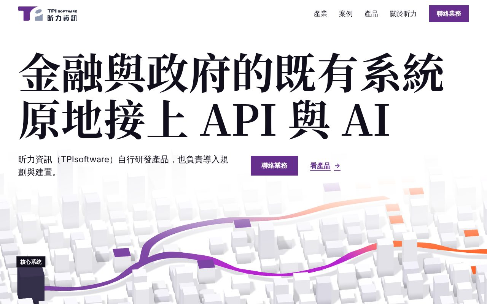
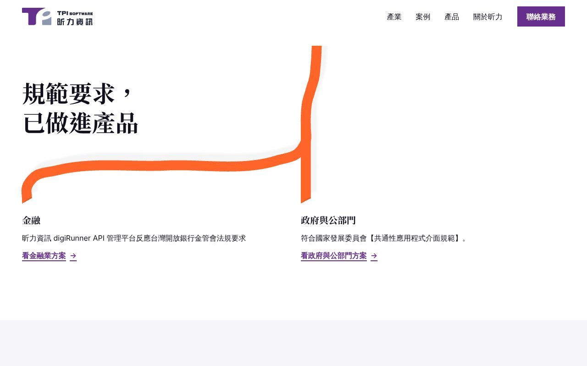
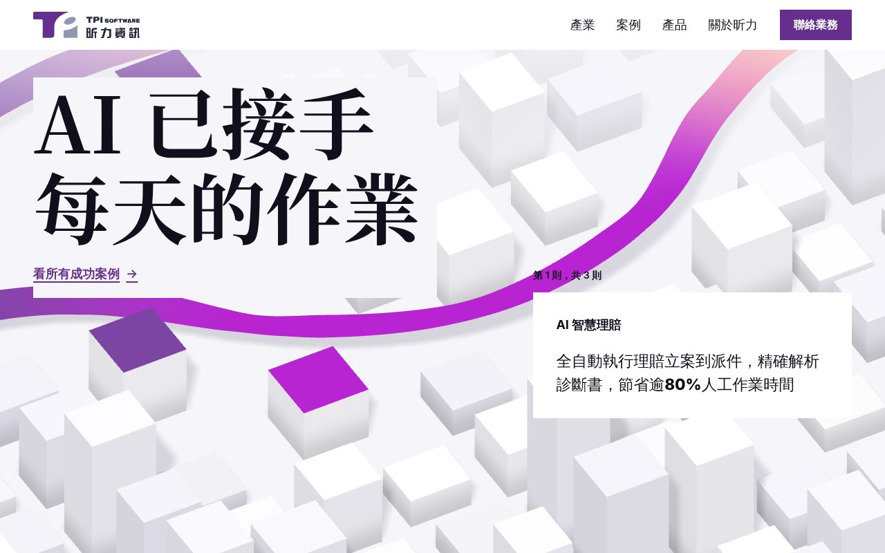

# ribbon-route

白色的系統地圖上，一條品牌色的緞帶從既有系統出發，彎過每一段，把它們接上新的服務。規格見 [`../directions.md`](../directions.md)「方向二：`ribbon-route`」，文字照 [`../copy-deck.md`](../copy-deck.md)。

打開 `index.html`（file:// 可離線開）。桌機寬度（64rem 以上、不是觸控指標）且沒有要求減少動態時載入 WebGL；其他情況顯示靜態版。

## 驚豔點

- 第一屏：白底上兩行 112px 的襯線大字，下方一片從白霧裡浮出來的灰白方塊地圖。載入後 1.2 秒內，緞帶從深灰的「核心系統」方塊畫出來，經過頂面塗紫的昕力產品、品紅的 AI 模型、橘色的新服務，由紫轉品紅再轉橘，最後從地圖前緣往下伸出畫面。地圖上 5 個 HTML 標籤說明每種方塊是什麼：核心系統、既有系統、昕力的產品、AI 模型、新的服務
- 往下捲：文字往上退出，鏡頭從 21° 俯角升到正上方，地圖變成平面圖；接著地圖跟著頁面一起往上走（同一個 canvas，1 個 CSS 像素對 1 個像素的地圖），同一條緞帶離開地圖、落到產業段的白紙上，往右移到第 7 欄的左緣，分成兩支，各停在「金融」「政府與公部門」兩個入口的標題上方
- AI 成果段：文字在左 5 欄（h2、第幾則、作業名稱、成果原文、連結），右 6 欄是一個 4:3 的框，鏡頭沿同一條緞帶的品紅那一段往前走，三個方塊依序亮起品紅，框裡的標籤跟著亮起的方塊寫出作業名稱
- 收尾：整片紫色的聯絡段，一條橘色帶（緞帶的終點色）從左邊緣進來，末端斜切，停在「聯絡業務」左邊

動態截圖（SwiftShader，1280×800，非減少動態，`.taste-skill/ribbon-route/build/motion.mjs`）：

| Hero，緞帶畫完 | 第 2 段，緞帶從地圖下來分叉 | AI 成果段，第 2 則 |
|---|---|---|
|  |  |  |

減少動態的版本是 `shot-1280.jpg`、`shot-375.png`（`concept-shots.mjs` 產生）。

## 5 段的畫面與捲動

全頁一套 12 欄格線（`.grid`：`repeat(12, minmax(0, 1fr))`，欄距 `--gutter`，左右邊界 `--margin`），每段的文字都從同一條左邊界開始。

| 段 | 主角 | 畫面 | 捲動（桌機 WebGL） | 減少動態、手機 |
|---|---|---|---|---|
| 1 Hero | h1＋緞帶 | h1 兩行跨 12 欄；下一列說明句（1–6 欄）、「聯絡業務」與「依產業看方案」（7–12 欄）；下半是 3D 地圖與 5 個標籤 | 第 1、2 段共用一個 sticky canvas（`#route .route__stage`）。hero pin 1 個螢幕高：文字在 0.08–0.38 上移淡出，鏡頭從 21° 升到 90°；地圖前緣一直貼著畫面底，hero 放開時正好是第 2 段的頂端 | 文字在上、地圖靜態圖在下（桌機 `hero-wide.webp` 2560×1120，手機 `hero-tall.webp` 900×1080 裁成 900×820），標籤以百分比疊在圖上；緞帶從圖的底邊伸出 |
| 2 產業 | 兩個入口 | h2（段標字級，1–6 欄）；緞帶從段落頂端第 58% 寬的位置下來，移到第 7 欄左緣，分成兩支；兩個入口在第 1、7 欄，入口標題是內文字級的襯線粗體，下面一則事實與連結，整塊是連結 | 不 pin。鏡頭跟著頁面平移，緞帶的尾段與分叉由 `.fork__img` 的位置算出（與靜態圖同一個形狀），兩支末端落在兩個入口的左緣 | 段落頂端是 `fork-wide.webp`（手機 `fork-tall.webp`）：同一個世界的平面圖，主幹從 hero 圖的緞帶離開的位置進來，h2 疊在圖左上方的空白上。手機兩個入口並排兩欄，兩支末端各落在一欄的左緣 |
| 3 AI 成果 | 成果文字 | 左 5 欄：h2、「第 1 則，共 3 則」、作業名稱、成果原文（數字加粗）、該則的連結；右 6 欄：4:3 的框，近景地圖，標籤寫作業名稱 | pin 3 個螢幕高，scrub：鏡頭沿品紅段平移，三個方塊在 0、0.3、0.63 亮起；文字 0.28–0.34、0.61–0.67 交接；框在 pin 開始前先顯示第 1 站的靜態圖（同一個視角），pin 後換成 canvas | 三則各一列：文字 1–6 欄、靜態圖 8–12 欄（手機上下排）；圖是同一條緞帶的三個停止點，標籤寫作業名稱 |
| 4 產品 | 索引 | 桌機 h2 在 1–6 欄，右側 7–12 欄是 4 列索引（縮圖＋產品名）；下面一條 `--purple-900` 的帶：OrientAI 的主張以段標字級放在 1–6 欄，旁邊是 `fact:orientai-on-prem-data` 原文與連結，圖在 8–12 欄 | 不 pin。滑鼠或 focus 在某列時其他列降到 40% 透明度、該列名稱右移 | 64rem 以下 h2 與索引上下排 |
| 5 信任與聯絡 | CTA | 整片 `--purple-700`，h2、三則紀錄（各 4 欄），橘色帶接白底紫字的大按鈕「聯絡業務」，email 與電話 | header 進入這段時 300ms 換成紫底白字；橘色帶進入畫面時用 `clip-path` 展開一次（800ms） | 橘色帶縮短成邊界加 2.5rem 的一截，仍接在按鈕左邊 |

手機（64rem 以下或觸控指標）不載 three.js 與 GSAP。緞帶只出現在 hero 的地圖圖與第 2 段的分叉圖兩張渲染圖上（緞帶從地圖伸出、往下分到兩個入口），以及第 3 段三張近景圖、第 4 段縮圖裡；沒有獨立的裝飾線。

## 字級

全頁 4 種（inspector 量：1440 寬 `16 / 20 / 52 / 112 px`；Playwright 量 375 寬 `16 / 18 / 27.35 / 30.67 px`）：

| token | 1280 寬 | 用在 |
|---|--:|---|
| `--step-display` | 112px | 只有 hero h1 |
| `--step-head` | 約 51px（1440 寬 52px） | 每段 h2，含 OrientAI 的主張 |
| `--step-text` | 20px | 說明句、成果原文、OrientAI 的事實原文；入口標題、作業名稱、產品名、紀錄的年份用同一字級的襯線粗體 |
| `--step-small` | 16px | 導覽、按鈕、連結、產業事實、紀錄原文、地圖標籤、頁尾 |

## 主要視覺決定

| 決定 | 對應 |
|---|---|
| 全頁只有一條緞帶：從核心系統出發，經過昕力的產品、AI 模型、新的服務，離開地圖後在第 2 段分到兩個產業；第 3 段是同一條緞帶品紅那一段的近景，第 5 段的橘色帶是它的終點色 | P3 |
| 地圖上的 5 個標籤用 copy-deck／directions 的用語，標出各種方塊的意思（評審 D2「讀不出各是什麼」） | P3 |
| h1、說明句、兩個動作在 HTML 裡、第一個 frame 就有；地圖在 h1 下方 | P1 |
| 第 3 段一次一則成果，原文照引，數字只加粗不拆出；圖是該作業的位置，不是封面 | P2、P5 |
| 灰＝既有系統、紫＝昕力（緞帶起點、產品方塊、按鈕）、品紅＝AI（AI 模型、成果方塊、OrientAI）、橘＝接上的服務；緞帶的漸層順序就是這個對應 | P4 |
| 放寬 house rule「no gradients」：只在緞帶的 three.js vertex color 上（靜態圖也是同一個渲染）；CSS 與 SVG 沒有任何漸層，手機的 SVG 緞帶已拿掉 | 漸層表示流動的方向 |
| 放寬 P4「克制」：3D 方塊有方向光與陰影、底部變暗（假 AO）；沒有光暈、沒有 bloom、HTML 沒有陰影 | 3D 光照，不是裝飾 |
| 放寬設計系統「影像只用抽象 3D 渲染，不放文字」：標籤在 HTML 層，不畫進圖裡 | `directions.md` 已列 |
| 放寬 P5 的 8 段、P2 的「紀錄格式」 | 使用者 2026-11-01 決定 5 段精簡版 |
| 放寬 `design-system`「不載中文 webfont」：Noto Serif TC 700，只取襯線字用到的字 | 第四輪的決定 |
| 放寬 JS 預算（延後載入 140 KB） | 見下方「JS 大小」 |

## 與 `directions.md` 不同的地方

| directions.md | 本原型 | 理由 |
|---|---|---|
| 第 4 段是 5 列索引（含 OrientAI）、hover 才出現的預覽圖 | 4 列產品名，每列常駐一張縮圖；OrientAI 獨立成一條深紫帶 | copy-deck 第 5 項要 OrientAI 跟產品分開；inspector 在動態版只算看得見的 ``，hover 才出現的圖會讓 `few-pictures` FAIL |
| 手機第 4 段改手風琴 | 不改手風琴，縮圖放名稱左側 | 每列本身就是連結，手風琴要多一次點擊 |
| 手機整頁左邊距一條 12px 的 SVG 緞帶 | 拿掉；手機的緞帶只在渲染圖裡（hero 圖與第 2 段的分叉圖接成一條） | 使用者 2026-11-01：左側直條看不出用途、壓在圖上 |
| hero 鏡頭 30° 升到 90°，緞帶在地圖上分岔 | 21° 升到 90°；地圖上的緞帶不分岔，到第 2 段才分成兩支 | 分叉要落在兩個產業入口上；21° 讓地圖留在 h1 與動作的下方 |
| 第 5 段頁尾 curtain footer | 一般頁尾 | sticky 頁尾在 full-page 截圖裡顯示不出來（`concept-shots.mjs` 截到白色） |
| 手機條件 `(width < 64rem), (pointer: coarse)` | 載 WebGL 的條件寫成「64rem 以上且不是 `pointer: coarse`」 | headless Chromium 的 `pointer` 是 `none`，用 `pointer: fine` 判斷會讓 inspector 看到靜態版 |
| 產品段 h2 一行 | 「API、AI、資安<br>與碳管理，各有產品」兩行，斷行位置改了 | h2 放在 6 欄寬，原斷行第一行約 11.75 字寬，52px 放不下（inspector `headline-lines`） |

## JS 大小

`assets/scene.js` 是一個 IIFE（classic script），由 inline script 在符合條件時動態插入；減少動態、手機、`saveData` 時不下載。量法：`wc -c`、`gzip -9c <file> | wc -c`。

| 項目 | 未壓縮 | gzip | 怎麼量 |
|---|--:|--:|---|
| three.js 0.186.1（tree-shaken） | 約 531 KB | 約 128 KB | 整包減掉下面兩項 |
| GSAP 3.15.0 core＋ScrollTrigger | 117.5 KB | 46.3 KB（28.3＋18.0） | `dist/gsap.min.js`、`dist/ScrollTrigger.min.js` |
| 本方向的場景程式 | 15.2 KB | 6.7 KB | `ext.config.mjs`：同一個 vite config 把 three、gsap 設成 external 再 build |
| `assets/scene.js` 合計 | 664.1 KB | 181.4 KB | `wc -c`、`gzip -9c \| wc -c` |
| 頁面 inline script（tier 判斷、進場、header） | 約 2 KB | — | |

延後載入預算 140 KB（`docs/design/motion.md`），桌機超出約 41 KB，與 `directions.md` 的估計一致；手機 0 KB。

Lighthouse：未測。原型是單一 HTML，不在 `npm run check` 的量測範圍。預估：行動版不載 three.js，LCP 是 h1 或 hero 靜態圖；桌機 three.js 在 h1 畫出後才下載與執行，LCP 不受影響，TBT 會因 shader 編譯與陰影貼圖增加。

## 字型

| 檔案 | 內容 | 大小 |
|---|--:|--:|
| `assets/fonts/serif.woff2` | Noto Serif TC 700，襯線字用到的 107 個字（含空白、標點、拉丁字母；修正後入口標題、作業名稱、產品名、紀錄年份也用襯線），從 fontsource 的 12 個切片取字後合成一個檔 | 21.4 KB |
| `assets/fonts/inter.woff2` | Inter Variable（保留字重軸），Basic Latin 加幾個符號 | 25.2 KB |

2 個檔，合計 46.6 KB（修正前 44.4 KB）。內文中文用系統字。`assets/fonts/fonts.css` 另宣告 `size-adjust` 的 local fallback。授權：`assets/LICENSE-noto.txt`、`assets/LICENSE-inter.txt`（OFL-1.1）。

改了襯線字的文字要重新取字（本次修正已照這個做法重跑）：

```bash
python3 -m venv /tmp/ribbon-route/ft && /tmp/ribbon-route/ft/bin/pip install fonttools brotli
cd /tmp/ribbon-route && mkdir -p dl-noto && cd dl-noto && npm pack @fontsource/noto-serif-tc && tar xzf *.tgz
cd <repo> && node .taste-skill/ribbon-route/build/fonts.mjs
```

## 靜態圖

12 張 WebP（合計約 529 KB），都由同一個 three.js 世界渲染：`assets/scene.js` 加 `?capture` 時不建頁面，改提供 `window.__ribbon.shot(job)`，回傳圖與各標籤錨點在圖上的位置（寫到 `.taste-skill/ribbon-route/labels.json`，再抄進 `index.html`）。圖上沒有文字，標籤在 HTML 層。

| 檔案 | 用在 |
|---|---|
| `hero-wide.webp`、`hero-tall.webp` | 第 1 段靜態版（桌機、手機），地圖前緣在圖的底邊 |
| `fork-wide.webp`、`fork-tall.webp` | 第 2 段頂端：同一條緞帶的平面圖，主幹的 x 位置取自 hero 圖上緞帶離開底邊的位置，兩圖上下接起來是一條 |
| `case-1.webp`～`case-3.webp` | 第 3 段的三個停止點（靜態版每則一張；動態版第 1 張也是框的起始畫面） |
| `prod-*.webp`（4 張） | 第 4 段每列的縮圖 |
| `orientai.webp` | OrientAI 帶的圖 |

## 重建

建置工具放在 `.taste-skill/ribbon-route/build/`（gitignored，沒有進 repo）；場景程式的原始碼另存一份在 `assets/scene.src.js`。

```bash
cd /tmp/ribbon-route && mkdir -p dl-gsap && cd dl-gsap && npm pack gsap@3.15.0 && tar xzf gsap-3.15.0.tgz
cd <repo>
node_modules/.bin/vite build --config .taste-skill/ribbon-route/build/vite.config.mjs   # → assets/scene.js
node .taste-skill/ribbon-route/build/capture.mjs                                          # → assets/img/*.webp
node .taste-skill/ribbon-route/build/fonts.mjs                                            # → assets/fonts/
node .taste-skill/ribbon-route/build/motion.mjs                                           # motion-1280-{hero,fork,cases}.jpg
node .taste-skill/ribbon-route/build/frames.mjs 1280 800 <dir>                            # 每 0.9 屏一張（加 reduce 為減少動態）
node scripts/strategy/concept-shots.mjs --only ribbon-route
```

授權：three.js（MIT）`assets/LICENSE-three.txt`；GSAP（Standard no-charge license，套件沒有獨立授權檔）`assets/LICENSE-gsap.txt`。

## 檢查結果

| 檢查 | 結果 |
|---|---|
| `node scripts/strategy/concept-shots.mjs --only ribbon-route` | exit 0（沒有外部請求、缺檔、console error、橫向溢出；有 noindex） |
| `lint.mjs` | 0 FAIL、0 WARN |
| `inspect.mjs --allow palette-purple`（1440、768、390） | 0 FAIL、1 WARN；字級 `16 / 20 / 52 / 112 px` |
| 動態版（Playwright＋SwiftShader，1280 與 375，每 0.9 屏一張，`frames.mjs`） | 1280：緞帶從 hero 的地圖畫面連續延伸到第 2 段，兩支末端落在兩個入口上方；375：沒有左側直條，hero 圖與分叉圖的緞帶接成一條；兩個寬度都沒有白框壓在地圖上；無 console error（SwiftShader 截圖時的 `GPU stall due to ReadPixels` 驅動 warning 除外） |

保留的 WARN：

- `no-footage`：沒有影片。本站的影像策略是場景本身（P3），沒有自家影片可放，`design-concept` 第三輪的決定也不用開放圖庫

## 已知問題

- 視窗跨過 64rem 縮放時不會切換 tier，要重新載入
- 第 2 段動態版的分叉位置照靜態圖的比例（左支在 4.6%、右支在 52.1% 寬），1280–1440 寬與入口的左緣對齊；更寬或更窄的桌機會差幾個像素
- 手機 hero 圖只放得下 4 個標籤（「新的服務」在直式構圖外）；手機的兩個入口並排兩欄，事實原文每行約 9 字
- 第 3 段 h2 在 pin 期間停在畫面上 3 個螢幕（`directions.md` 寫「整段不換」）；inspector 不把 `.scene.is-live` 裡的字算進 `long-pin`
- 平面圖上緞帶的陰影偏右下，主幹在轉彎處看起來略有起伏
- Lighthouse 未測

## 修正紀錄（2026-11-01 使用者意見）

使用者：「排版文字太過雜亂。第二個 section 的線條也出現的很突然，不連續，而且手機版時的線條都會靠左，不明白是什麼用途。大量文字都放的很大也是故意的設計嗎？」

| # | 意見 | 修正前 | 修正後 |
|---|---|---|---|
| 1 | 第 2 段的線條突然、不連續 | hero 是 3D 緞帶，第 2 段另外冒出一條平面 SVG 紫色粗線（`preserveAspectRatio="none"`）分叉到「金融」「政府」，跟 hero 的緞帶不相連、顏色與質感都不同 | 拿掉 SVG。hero 與第 2 段共用一個 sticky canvas：鏡頭升到正上方後跟著頁面平移，同一條 3D 緞帶從地圖前緣伸出、在第 2 段分成兩支（`ribbon.build()` 由 `.fork__img` 的位置算出尾段）。靜態版用同一個世界渲染的 `hero-*.webp` 與 `fork-*.webp`，分叉圖主幹的 x 位置取自 hero 圖上緞帶離開的位置，兩圖上下接成一條 |
| 2 | 手機的線條都靠左，看不出用途 | 375 寬左邊距一條 12px 的紫色直條（`.rail`）貫穿全頁，壓在 hero 與 OrientAI 的圖上，聯絡段另有一截橘色殘段 | 拿掉 `.rail` 與它的 SVG 漸層。手機不載 WebGL 照舊；緞帶只出現在 hero 圖（從核心系統出發、從地圖前緣伸出）與第 2 段開頭的分叉圖（往下分到並排的兩個入口），兩張圖接成一條；聯絡段的橘色帶縮短成接在按鈕左邊的一截 |
| 3 | 大量文字都放很大 | 字級 9 種（14／16／17／18／20／23／40／96／112）；每段 h2 是 96–112px 的襯線大字，「金融」「政府」也是 112px | 4 種：只有 hero h1 是 112px；段標 52px（1440 寬，1280 寬約 51px）；內文 20px；小字 16px。「金融」「政府與公部門」改成入口卡的標題（`h3`，20px 襯線粗體）；產品名從 40px、紀錄年份從 40px 都降到 20px |
| 4 | 排版雜亂 | 案例段的文字放在浮在地圖上的白框裡；各段各自用 `7fr 5fr`、`1fr 1fr`、`5fr 7fr` 等不同的欄 | 拿掉白框：案例段文字在左 5 欄，近景地圖在右 6 欄的 4:3 框裡，兩者不重疊。全頁改用同一套 12 欄格線與同一條左邊界（`.grid`）。每段一個主角：hero 是 h1＋緞帶、產業是兩個入口、案例是成果文字、產品是索引、聯絡是 CTA |

第四輪評審（`review.md`）的重點：

| 評審 | 處理 |
|---|---|
| D2 地圖除了「核心系統」沒有標籤 | 加上「既有系統」「昕力的產品」「AI 模型」「新的服務」，桌機動態版跟著方塊投影的位置走；地圖上新增一塊 AI 模型（品紅頂面）與一塊既有系統（灰色）當標籤的錨點 |
| D2／D3 案例圖是同一張地圖的裁切、像封面 | 三張圖改成沿緞帶的近景、各自標出作業名稱（AI 智慧理賠、AI 智慧建檔、金融聯防阻詐平台），放在文字旁較小的 4:3 框；成果文字在左側先讀到 |
| D3 OrientAI 的主張縮在下方、接近內文 | 主張改成段標字級的 h2，旁邊放 `fact:orientai-on-prem-data` 原文；整屏 sticky 的方塊特寫拿掉，圖縮到 8–12 欄 |
| C4 hero 次要動作是「看產品」 | 改「依產業看方案」→ `#industries` |
| C5／D5 三則案例沒有各自的連結 | 理賠 → `/solutions/smartclaim`、建檔 → `/solutions/smartfilling`、阻詐 → `/success-story` |
| C6「AI 已接手每天的作業」說得比事實強 | 改「AI 已用在每天的作業」 |
| C6 產業名「政府」與其他地方不一致 | 入口標題改「政府與公部門」 |
| C6 頁尾「聯絡我們」 | 改「聯絡業務」 |
| D2 緞帶與 rail 用漸層 | rail 已拿掉；3D 緞帶的漸層保留（第四輪放寬，見「主要視覺決定」），原則未寫回，待 `design-principles.md` 定案 |
| 沒有處理 | D2「至少 4 張 HTML 介面片段」、C2／C3 產品每列一句說明或事實、D5 信任段補其他事實、C4 聯絡處的標題。這些需要新的文字或改原則，不在本次使用者意見的範圍 |

其他數字的前後：JS `scene.js` 661.8 KB／180.5 KB gzip → 663.6 KB／181.2 KB（場景程式 13.4／6.0 → 15.2／6.7 KB）；字型 44.4 KB → 46.6 KB（serif 98 → 107 字）；靜態圖 10 張約 513 KB → 12 張約 529 KB。

### 第二次修正：hero 文字與地圖標籤重疊

使用者回報桌機寬螢幕（約 1880×830）的 hero：說明句「規劃與建置」壓在「核心系統」標籤上，按鈕與說明句底下是實心的方塊。原因：鏡頭的構圖只依畫面寬度決定（`halfW` 固定），畫面越寬越矮，城市與標籤就往上長到文字區。

| 修正 | 做法 |
|---|---|
| 標籤一律在文字下方 | `heroView()` 先投影五個標籤的錨點，最高的錨點高於「文字底緣＋標籤高度＋24px」時，以前緣為基準把鏡頭拉遠（正交鏡頭下，錨點到畫面底的距離依倍數縮短），最多 1.8 倍 |
| 拉遠到上限仍不夠時 | hero 文字還看得到的期間，壓到文字的標籤不顯示 |
| 說明句與按鈕（使用者指定） | 說明句在 48rem 以上不換行、佔滿整列；「聯絡業務」與「依產業看方案」從右側移到說明句下方，兩者都跨 12 欄 |
| 矮螢幕的 h1 | 3D 版的 h1 字級上限加上 `13svh`（600 高約 78px），讓地圖在文字下方仍有空間 |
| 文字底下的方塊 | `.hero__copy` 加一層地面色的底（92%），下緣 1.5rem 漸層淡出，隨文字一起淡出 |

實測（SwiftShader，標籤上緣 y 與文字底緣比較）：1880×830、1440×700、1280×800、1024×600、1920×1080 五個尺寸，五個標籤都在文字下方（1024×600 已到拉遠上限，「核心系統」「既有系統」兩個標籤彼此略有重疊）；寬度不到 3D 門檻（64rem）的畫面仍用靜態圖，地圖排在文字下方，不會重疊。`scene.js` 663.6／181.2 KB gzip → 664.1／181.4 KB。

### 待人審的文字

頁面上已照改，`copy-deck.md` 未改：

| 位置 | copy-deck | 頁面 | 原因 |
|---|---|---|---|
| 第 1 段次要動作 | 看產品 → `#products` | 依產業看方案 → `#industries` | 評審 C4、使用者同意（copy-deck 第 2 項原本是使用者指定「看產品」） |
| 第 3 段 h2 | AI 已接手每天的作業 | AI 已用在每天的作業 | 「接手」暗示取代人工，比事實（節省逾 80% 人工作業時間、降低 40% 維護人力）說得強 |
| 第 2 段入口名 | 金融、政府與公部門（copy-deck 的小標） | 入口標題「政府與公部門」（修正前大字「政府」） | 與連結文字、頁尾一致 |
| 第 3 段每則的連結（新增） | 只有段落連結「看所有成功案例」 | 「看 AI 智慧理賠方案」「看 AI 智慧建檔方案」「看所有成功案例」（第 3 則用原本的段落連結文字） | copy-deck 第 3 項「每段一個出口」改為每則一個出口；連結文字是新寫的表述 |
| 第 4 段 h2 斷行 | API、AI、資安與碳管理，<br>各有產品 | API、AI、資安<br>與碳管理，各有產品 | 版面放在 6 欄，字不改 |
| OrientAI 事實（新增） | 「依據（不顯示）」 | 顯示原文「不會。OrientAI 只會部署於企業端，資料掌控權為企業所有。」 | 評審 C3。原文是現站 FAQ 的回答，開頭的「不會。」沒有問句承接，讀起來突兀；是否改用 `fact:orientai-governance-layer` 或在前面加問句，待人決定 |
| 頁尾 | 聯絡我們 | 聯絡業務 | 主要動作只叫「聯絡業務」（copy-deck 規則） |
| 地圖標籤（新增） | — | 核心系統、既有系統、昕力的產品、AI 模型、新的服務 | 用 copy-deck／directions 的用語；是表述，沒有夾帶事實 |

## 待補

- `copy-deck.md`「需要人決定」的各項（字數、h1 用詞、產品挑選等）仍待使用者決定；本原型照 copy-deck 目前的版本
- en、vi 版本
