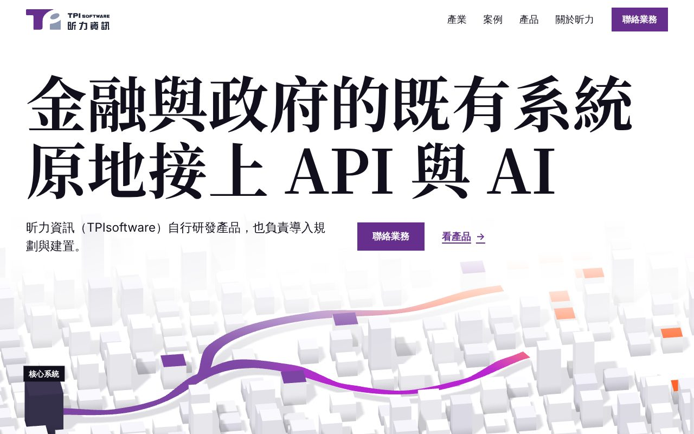

# ribbon-route

白色的系統地圖上，一條品牌色的緞帶從既有系統出發，彎過每一段，把它們接上新的服務。規格見 [`../directions.md`](../directions.md)「方向二：`ribbon-route`」，文字照 [`../copy-deck.md`](../copy-deck.md)。

打開 `index.html`（file:// 可離線開）。桌機寬度（64rem 以上、不是觸控指標）且沒有要求減少動態時載入 WebGL；其他情況顯示靜態版。

## 驚豔點

- 第一屏：白底上兩行 112px 的襯線大字，下方一片從白霧裡浮出來的灰白方塊城市。載入後 1.2 秒內，紫到品紅到橘的緞帶從深灰的「核心系統」方塊畫出來，在方塊之間分成兩支，接到頂面塗橘的方塊（新的服務）
- 往下捲：文字往上退出，鏡頭從 31° 俯角升到正上方，城市變成平面圖，看得出緞帶分成兩支；白色的產業段像一張紙從下方蓋上來，那條緞帶以平塗紫帶從段落頂端進來，分岔到「金融」「政府」
- AI 成果段：鏡頭降到 42° 近景，沿緞帶的品紅那一段往前走，三個方塊依序亮起品紅頂面，右側說明板一次換一則
- 收尾：整片紫色的聯絡段，一條橘色帶（緞帶的終點色）從左邊緣進來，末端斜切，停在「聯絡業務」左邊

動態截圖（SwiftShader，1280×800，非減少動態）：

| 載入 0.4 秒，緞帶畫到一半 | 載入完成 | AI 成果段，第 1 則 |
|---|---|---|
|  |  |  |

減少動態的版本是 `shot-1280.jpg`、`shot-375.png`（`concept-shots.mjs` 產生）。

## 5 段的畫面與捲動

| 段 | 畫面 | 捲動（桌機 WebGL） | 減少動態、手機 |
|---|---|---|---|
| 1 Hero | h1、說明句、「聯絡業務」、「看產品」在上半；下半是 3D 地圖，「核心系統」是 HTML 標籤，跟著方塊投影的位置走 | Scene 1，pin 1 個螢幕高：0.1–0.44 文字上移淡出，0.06–0.94 鏡頭從 31° 升到 89.5°（平面圖）。載入時緞帶畫一次，不等捲動 | 文字在上、地圖靜態圖在下（桌機 2560×1120、手機直式 900×1080 裁成 900×820），標籤以百分比疊在圖上 |
| 2 產業 | h2 兩行在左上，紫色緞帶（SVG）從段落頂端右側下來，分岔成兩支，各指向「金融」「政府」兩個 112px 大字，下面各一則事實與連結，整塊是連結 | 不 pin。緞帶用 CSS scroll-driven `clip-path` 由上往下展開，不支援時直接是完成狀態；h2 與兩塊連結進場一次 | 手機兩塊上下排，產業名 72px，分岔改由左邊距的緞帶表現 |
| 3 AI 成果 | Scene 2：`--ink-50` 底的近景地圖，h2 墊同色平塗底在左上，右側白色說明板（案例名、成果原文 lead 字級、80%／40% 加粗），板上一行「第 1 則，共 3 則」 | pin 3 個螢幕高，scrub：鏡頭沿品紅段平移，三個方塊在 0、0.3、0.63 亮起；說明板 0.27–0.34、0.6–0.67 交接（舊的往上退、新的從下進） | 三則改成「靜態圖＋文字」三列上下排，圖是同一個場景的三個停止點 |
| 4 產品平台 | 96px 兩行 h2，下面 4 列 40px 襯線字的產品名索引，每列右側一張該產品在地圖上那一區的縮圖（紫頂方塊＝昕力的產品）；接著一張全寬 OrientAI 靜態圖（品紅方塊被一圈灰色方塊圍住），`--purple-900` 的面板從下方蓋上來，放 OrientAI 那一句與連結 | 不 pin。滑鼠或 focus 在某列時其他列降到 40% 透明度、該列名稱右移；OrientAI 圖是 `position: sticky`，面板捲上來蓋住它（純 CSS） | 同一個版面，縮圖移到名稱左側 |
| 5 信任與聯絡 | 整片 `--purple-700`，h2 一行 112px，三則紀錄（2005、2008、資安認證＋原文），白底紫字的大按鈕「聯絡業務」，左邊一條 36px 高的橘色帶從畫面邊緣進來、末端斜切；email 與電話在按鈕右側 | header 進入這段時 300ms 換成紫底白字；橘色帶進入畫面時用 `clip-path` 展開一次（800ms） | 手機左邊距的緞帶在這段是橘色，轉一個短彎接到按鈕 |

手機（64rem 以下或觸控指標）不載 three.js 與 GSAP：整頁左邊距放一條 12px 寬的 SVG 緞帶，各段依序是紫、紫（分成兩股再合回）、紫轉品紅、品紅轉橘、橘，用 CSS scroll-driven animation（`animation-timeline: view()`）隨捲動畫出，不支援或減少動態時直接畫完。

## 主要視覺決定

| 決定 | 對應 |
|---|---|
| 緞帶從深灰的「核心系統」方塊出發，終點接頂面塗橘的方塊；灰白方塊（既有系統）一直在畫面裡 | P3 |
| h1、說明句、兩個動作在 HTML 裡、第一個 frame 就有；地圖只在 h1 下方的空白區，背後幾排方塊在霧裡淡成白色 | P1 |
| 第 2 段用產業名當大字，h1 後第一屏就是產業入口 | P1、P5 |
| 第 3 段一次一則成果，原文照引，數字只加粗不拆出 | P2 |
| 灰＝既有系統、紫＝昕力（緞帶起點、產品方塊、按鈕）、品紅＝AI（成果方塊、OrientAI）、橘＝接上的服務；緞帶的漸層順序就是這個對應 | P4 |
| 兩個 scene 之間隔著產業段（安靜段），第 5 段用整片色塊收尾 | P5 的節奏 |
| 放寬 house rule「no gradients」：只在緞帶（three.js 的 vertex color、手機緞帶的 SVG `linearGradient`）上；CSS 沒有任何漸層 | 漸層表示流動的方向；inspector 只量 CSS 漸層，所以沒有 `gradient` FAIL |
| 放寬 P4「克制」：3D 方塊有方向光與陰影、底部變暗（假 AO）；沒有光暈、沒有 bloom、HTML 沒有陰影 | 3D 光照，不是裝飾 |
| 放寬設計系統「影像只用抽象 3D 渲染，不放文字」：「核心系統」標籤在 HTML 層，不畫進圖裡 | `directions.md` 已列 |
| 放寬 P5 的 8 段、P2 的「紀錄格式」 | 使用者 2026-11-01 決定 5 段精簡版 |
| 放寬 `design-system`「不載中文 webfont」：Noto Serif TC 700，只取大字用到的字 | 第四輪的決定 |
| 放寬 JS 預算（延後載入 140 KB） | 見下方「JS 大小」 |

## 與 `directions.md` 不同的地方

| directions.md | 本原型 | 理由 |
|---|---|---|
| 第 4 段是 5 列索引（含 OrientAI）、hover 才出現的預覽圖 | 4 列產品名，每列常駐一張縮圖；OrientAI 獨立成「全寬圖＋紫色面板蓋上來」 | copy-deck 第 5 項要 OrientAI 跟產品分開；inspector 在動態版只算看得見的 ``（`<canvas>` 不算），hover 才出現的圖會讓 `few-pictures` FAIL |
| 第 4 段紫色面板蓋在索引上（sticky 疊層） | 面板蓋在 OrientAI 那張圖上 | 索引加 h2 比一個螢幕高，sticky 會被裁掉 |
| 手機第 4 段改手風琴 | 不改手風琴，縮圖放名稱左側 | 每列本身就是連結，手風琴要多一次點擊 |
| 產業名「政府」 | 大字「政府」，連結文字「看政府與公部門方案」帶完整名稱 | 「政府與公部門」6 個字放不進半欄 112px |
| 字級四種 | 實際 9 種（14／16／17／18／20／23／40／96／112，inspector 量） | 第 4 段 h2「API、AI、資安與碳管理，」一行約 11.75 字寬，112px 放不下，改 96px；產品名與紀錄用 40px；16／17／20／23 是 header、按鈕與手機的字級 |
| 第 5 段頁尾 curtain footer | 一般頁尾 | sticky 頁尾在 full-page 截圖裡顯示不出來（`concept-shots.mjs` 截到白色） |
| 第 3 段 h2 在左上 | h2 墊一塊 `--ink-50` 平塗底 | 42° 近景的地圖會延伸到 h2 後面，構圖留不出空白 |
| 手機條件 `(width < 64rem), (pointer: coarse)` | 載 WebGL 的條件寫成「64rem 以上且不是 `pointer: coarse`」 | headless Chromium 的 `pointer` 是 `none`，用 `pointer: fine` 判斷會讓 inspector 看到靜態版 |

## JS 大小

`assets/scene.js` 是一個 IIFE（classic script），由 inline script 在符合條件時動態插入；減少動態、手機、`saveData` 時不下載。量法：`wc -c`、`gzip -9c <file> | wc -c`。

| 項目 | 未壓縮 | gzip | 怎麼量 |
|---|--:|--:|---|
| three.js 0.186.1（tree-shaken） | 約 531 KB | 約 128 KB | 整包減掉下面兩項 |
| GSAP 3.15.0 core＋ScrollTrigger | 117.5 KB | 46.3 KB（28.3＋18.0） | `dist/gsap.min.js`、`dist/ScrollTrigger.min.js` |
| 本方向的場景程式 | 13.4 KB | 6.0 KB | 同一個 vite config 把 three、gsap 設成 external 再 build |
| `assets/scene.js` 合計 | 661.8 KB | 180.5 KB | |
| 頁面 inline script（tier 判斷、進場、header） | 約 2 KB | — | |

延後載入預算 140 KB（`docs/design/motion.md`），桌機超出約 40 KB，與 `directions.md` 的估計一致；手機 0 KB。

Lighthouse：未測。原型是單一 HTML，不在 `npm run check` 的量測範圍。預估：行動版不載 three.js，LCP 是 h1 或 hero 靜態圖；桌機 three.js 在 h1 畫出後才下載與執行，LCP 不受影響，TBT 會因 shader 編譯與陰影貼圖增加。

## 字型

| 檔案 | 內容 | 大小 |
|---|--:|--:|
| `assets/fonts/serif.woff2` | Noto Serif TC 700，大字用到的 98 個字（含空白、標點、拉丁字母），從 fontsource 的 11 個切片取字後合成一個檔 | 19.3 KB |
| `assets/fonts/inter.woff2` | Inter Variable（保留字重軸），Basic Latin 加幾個符號 | 25.2 KB |

2 個檔，合計 44.4 KB。內文中文用系統字。`assets/fonts/fonts.css` 另宣告 `size-adjust` 的 local fallback。授權：`assets/LICENSE-noto.txt`、`assets/LICENSE-inter.txt`（OFL-1.1）。

改了大字的文字要重新取字：

```bash
python3 -m venv /tmp/ribbon-route/ft && /tmp/ribbon-route/ft/bin/pip install fonttools brotli
cd /tmp/ribbon-route && mkdir -p dl-noto && cd dl-noto && npm pack @fontsource/noto-serif-tc && tar xzf *.tgz
cd <repo> && node .taste-skill/ribbon-route/build/fonts.mjs
```

## 靜態圖

10 張 WebP（合計約 513 KB），都由同一個 three.js 世界渲染：`assets/scene.js` 加 `?capture` 時不建 scroll scene，改提供 `window.__ribbon.shot(view, w, h)`。圖上沒有文字，標籤在 HTML 層。

| 檔案 | 用在 |
|---|---|
| `hero-wide.webp`、`hero-tall.webp` | 第 1 段靜態版（桌機、手機） |
| `case-1.webp`～`case-3.webp` | 第 3 段靜態版的三個停止點 |
| `prod-*.webp`（4 張） | 第 4 段每列的縮圖 |
| `orientai.webp` | OrientAI 那張全寬圖 |

## 重建

建置工具放在 `.taste-skill/ribbon-route/build/`（gitignored，沒有進 repo）；場景程式的原始碼另存一份在 `assets/scene.src.js`。

```bash
cd /tmp/ribbon-route && mkdir -p dl-gsap && cd dl-gsap && npm pack gsap@3.15.0 && tar xzf gsap-3.15.0.tgz
cd <repo>
node_modules/.bin/vite build --config .taste-skill/ribbon-route/build/vite.config.mjs   # → assets/scene.js
node .taste-skill/ribbon-route/build/capture.mjs                                          # → assets/img/*.webp
node .taste-skill/ribbon-route/build/fonts.mjs                                            # → assets/fonts/
node .taste-skill/ribbon-route/build/motion.mjs                                           # 動態截圖到 .taste-skill/ribbon-route/motion/
node scripts/strategy/concept-shots.mjs --only ribbon-route
```

授權：three.js（MIT）`assets/LICENSE-three.txt`；GSAP（Standard no-charge license，套件沒有獨立授權檔）`assets/LICENSE-gsap.txt`。

## 檢查結果

| 檢查 | 結果 |
|---|---|
| `node scripts/strategy/concept-shots.mjs --only ribbon-route` | exit 0（沒有外部請求、缺檔、console error、橫向溢出；有 noindex） |
| `lint.mjs` | 0 FAIL、0 WARN |
| `inspect.mjs --allow palette-purple --film`（1440、768、390） | 0 FAIL、1 WARN |
| `scenes.mjs` | 兩個 scene 在桌機都是 running；手機與減少動態是完成狀態 |
| 動態版（Playwright＋SwiftShader，1280） | 場景正常渲染，無 console warning 或 error；SwiftShader 下一個 frame 約 200 ms（`scenes.mjs` 量的中位數），實機 GPU 會快很多 |

保留的 WARN：

- `no-footage`：沒有影片。本站的影像策略是場景本身（P3），沒有自家影片可放，`design-concept` 第三輪的決定也不用開放圖庫

## 已知問題

- 視窗跨過 64rem 縮放時不會切換 tier，要重新載入
- 第 3 段的近景偶爾有高的方塊被說明板擋住一半，看起來像說明板上方多一塊淺色
- 產業段的 SVG 緞帶用 `preserveAspectRatio="none"`，寬螢幕下分岔的彎角會被水平拉長
- 手機第 5 段左邊距的緞帶終點用固定的 `11.1rem` 對齊按鈕，文字換行數不同時會差幾個像素
- 第 3 段 h2 在 pin 期間停在畫面上 4 個螢幕（`directions.md` 寫「整段不換」）；inspector 不把 `.scene.is-live` 裡的字算進 `long-pin`
- Lighthouse 未測

## 待補

- `copy-deck.md`「需要人決定」的各項（字數、h1 用詞、產品挑選等）仍待使用者決定；本原型照 copy-deck 目前的版本
- en、vi 版本
