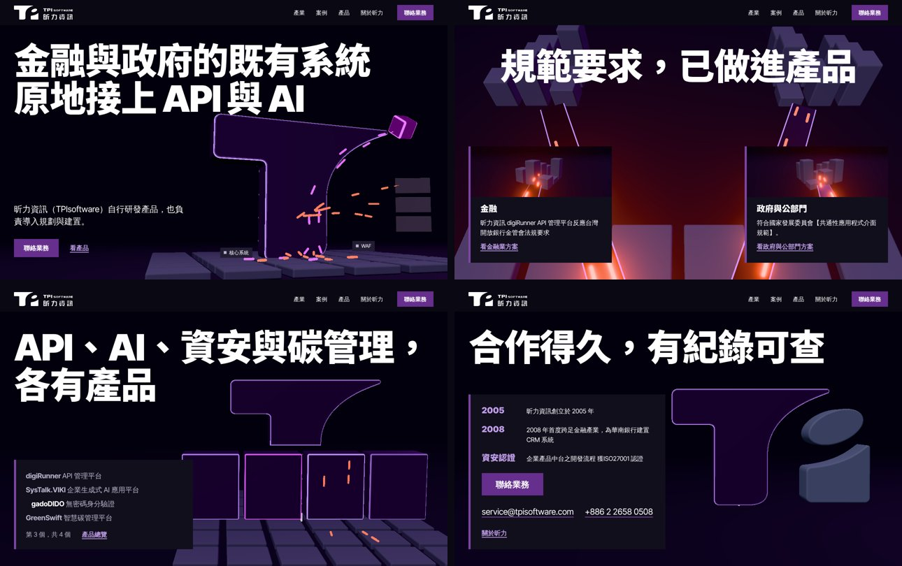
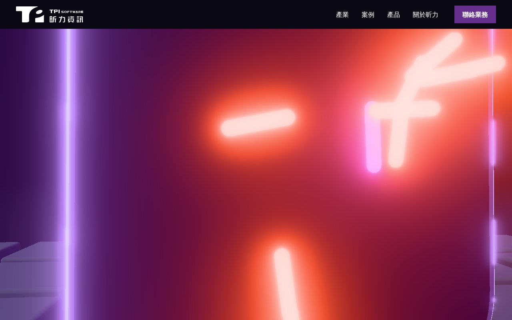

# t-gateway

昕力 logo 的 T 是一道閘門：深色空間裡，既有系統的資料從下方流進 T，經過它接到新的服務與 AI；捲動時鏡頭穿過這道閘門，最後所有零件收攏成 logo。

規格：[`../directions.md`](../directions.md)「方向一：`t-gateway`」。文字：[`../copy-deck.md`](../copy-deck.md)，事實照原文，沒有加數字或客戶名。





## 驚豔點

- 第一眼：右下一座用 logo 紫色 path 擠出的立體 T，斜角一圈紫色邊光，站在灰色的系統平板上。橘色脈衝從平板沿柱身流向右側三片服務面板，品紅脈衝沿 T 右端那道弧線流向一塊 AI 方塊
- 往下捲：鏡頭俯衝、穿過 T 的柱身，脈衝從鏡頭兩側擦過，出來後升到 T 的背後，兩條紫色邊光的通道向左右分開，通往金融與政府的系統群
- 產品段：T 的柱身裂成四塊，排成一列後長高成四座模組，依序亮起；最後一塊品紅 AI 方塊被四面灰牆圍住（OrientAI：資料留在企業端）
- 收尾：模組收回柱身、平板收攏成 logo 右下的灰色方塊、AI 方塊變成灰色橢圓，停在 logo 符號

## 5 段的畫面與捲動

全頁一個固定的 WebGL canvas（`.world`），三個 scene 是同一個世界的不同鏡頭，GSAP ScrollTrigger 的 scrub 線性綁在捲軸上，不攔截滾輪。

| 段 | 1280 寬的畫面 | 捲動時 | 375 寬 |
|---|---|---|---|
| 1 Hero | h1 兩行在上方，說明句、「聯絡業務」、「看產品」在左下；T 在右下，站在平板上 | Scene 1（`t-gateway-gate`，hold 2）。0–0.18：文字往上淡出；0.12–0.54：鏡頭俯衝穿過柱身，升到 T 背後 | 上方 44svh 是即時 canvas（正面構圖），文字在下方平塗底上，捲動時鏡頭上仰 |
| 2 產業 | h2 置中在上；兩條通道往左右分開到兩群系統；左下、右下兩扇門（平塗 `--ink-900`，左側紫色帶），各有該群系統的渲染、產業名、事實原文、產業頁連結 | Scene 1 後段。0.4–0.62：通道長出、脈衝分流；0.48：h2 進場；0.58：兩扇門進場；之後停住 | 靜態圖加兩扇門上下排 |
| 3 AI 成果 | 安靜段，平塗 `--ink-900`，canvas 被蓋住時暫停。h2，三列：案例名稱、成果原文、右側一張 AI 方塊的渲染 | 不 pin。h2 與三列各進場一次（上移 28px＋淡入，expo） | 單欄，圖在上 |
| 4 產品平台 | h2 兩行；左下一塊平塗面板列出四個產品與「第 N 個，共 4 個」「產品總覽」；右側四座模組，T 的頭懸在上方 | Scene 2（`t-gateway-modules`，hold 3）。0.05–0.24：柱身裂開、排列、長高；0.2–0.7：一次亮一座，清單同步；0.7–0.9：四面牆升起，OrientAI 一句與連結接在清單下方 | 靜態圖、清單、OrientAI 面板 |
| 5 信任與聯絡 | h2 在上；左下一塊平塗面板：三則紀錄、「聯絡業務」、email 與電話、「關於昕力」；右側 logo 符號 | Scene 3（`t-gateway-logo`，hold 1，從進入畫面起算）。0.05–0.75 零件收攏，之後停住 | 靜態圖在文字上方 |

## 主要視覺決定

| 決定 | 對應 |
|---|---|
| 用 logo 的 T 當閘門，灰色系統平板一直在 T 下方，脈衝從系統流進 T 再分出去 | P3 |
| h1、說明句、按鈕都在 HTML，第一個 frame 就畫出；WebGL 準備好之前顯示同構圖的 poster 圖 | P1 |
| 灰＝既有系統、紫＝昕力（T、模組、按鈕）、橘＝API 與資料（脈衝）、品紅＝AI（AI 方塊、SysTalk.VIKI 模組、AI 成果標記），全頁固定 | P4 |
| 第二屏就是金融、政府兩條通道與兩扇門 | P5 |
| 成果的 80%、40% 只在原文裡、直接寫在 HTML，用字重強調，沒有跳數字 | P2 |
| 放寬 house rule 的 no glow：T 的斜角邊光、脈衝、AI 方塊有 bloom（`UnrealBloomPass`）。HTML 元素沒有光暈與陰影 | directions.md「色彩與光」，代價：bloom 多一次 render pass |
| 放寬 P5 的 8 段與 P2 的紀錄格式：5 段，每段一句大標題 | 使用者 2026-11-01 決定 |
| 文字下墊平塗底（門、產品面板、聯絡面板），不用玻璃 | ADR 0003 第 8 點的替代，比原規則嚴 |
| 中文標題 webfont：Noto Sans TC Black，只含標題用到的 48 個字 | design-system 目前不載中文 webfont，這裡放寬 |

## 與 directions.md 不同的地方

| directions.md | 本原型 | 理由 |
|---|---|---|
| hero：左 5 欄 h1、右 7 欄 T；h1 約 120px | h1 跨全寬在上（104px），T 在右下 | h1 第一行 10 個字，120px 就佔滿 1200px，左 5 欄放不下；改成上下構圖，T 站在畫面底部的平板上 |
| 第 1 段次要連結「依產業看方案」 | 「看產品」→ `#products` | copy-deck.md 第 2 項 |
| 第 4 段四個產品家族、各一句話與家族頁連結 | 四個產品名稱（連到產品頁）＋OrientAI 一句 | copy-deck.md 第 5、6 項 |
| 第 4 段牆上寫「企業端」 | 牆上沒有字，意思由 OrientAI 那一句承擔 | 畫面上的字只在 HTML，「企業端」已在那一句裡 |
| 第 5 段「聯絡業務」與「預約 demo」 | 只有「聯絡業務」 | copy-deck.md 第 9 項 |
| 375 寬：產品段橫向拖曳列、第 5 段進場播收攏動畫 | 手機只有 hero 是即時 canvas，其他段用靜態圖 | 橫向拖曳列會觸發 inspector 的 `side-scroll`；靜態圖已是場景的完成畫面，手機少一個 GPU 負擔 |
| 只放各段靜態圖 | 另加兩扇門的系統群渲染、三則 AI 成果的渲染 | 動態版的 canvas 不算圖片，inspector 的 `few-pictures`（至少 4 張）在動態版會失敗；這 5 張是同一世界的渲染，各自說該段的內容 |
| 產品清單 24px | 動態版 20px | 清單、OrientAI 面板與兩行 h2 要同時放進 800px 高的畫面 |

## 降級

| 情況 | 顯示什麼 |
|---|---|
| 桌機（寬 ≥ 64rem 且 `pointer: fine`），動態允許 | `.motion.live`：固定 canvas＋三個 scene，bloom 開，DPR 上限 1.75 |
| 手機或觸控 | `.motion`：靜態版版面，hero 圖換成即時 canvas（DPR 上限 1.5、脈衝減半、不開 bloom、不穿越），捲動時鏡頭上仰 |
| `prefers-reduced-motion: reduce`、`saveData`、不支援 WebGL 2、script 載入失敗 | 不載 `scene.js`（three、GSAP 都不載），每段一張靜態圖，文字照完成狀態排列；`concept-shots.mjs` 截的就是這個版本 |

`<head>` 的 inline script 在第一次繪製前決定版本，所以沒有版面跳動。WebGL 建立失敗時只 `console.warn`。

靜態圖全是場景本身渲染的 WebP（`build/capture.mjs` 呼叫 `window.__tg.capture`），共 11 張、約 200 KB。

## 大小

| 項目 | 未壓縮 | gzip -9 | 來源 |
|---|--:|--:|---|
| `assets/scene.js` 合計（three＋GSAP＋場景程式，單一 IIFE） | 750,757 B | 207,487 B | `wc -c`、`gzip -9c assets/scene.js \| wc -c` |
| 其中 GSAP core＋ScrollTrigger | — | 約 46.3 KB | `npm pack gsap@3.15.0` 的 `dist/*.min.js` 單獨 gzip（28.3＋18.0 KB），打包後的實際佔比未拆量 |
| 其中場景程式（`build/main.js` 原始碼） | 36,002 B | 12,548 B | 原始碼未壓縮，打包後更小 |
| 其中 three.js（tree-shaken，含 `EffectComposer`、`UnrealBloomPass`、`SVGLoader`、`RoundedBoxGeometry`） | — | 約 150 KB | 合計減去上兩項，估計 |

延後載入的預算是 140 KB（`docs/design/motion.md`），本方向超出約 67 KB，與 directions.md 的預估（195–210 KB）一致。

字型：2 個檔，共 33,260 B。

| 檔案 | 大小 | 內容 |
|---|--:|---|
| `assets/fonts/noto-sans-tc-900-headlines.woff2` | 8,980 B | Noto Sans TC 900，只含 h1、h2、產業名、紀錄項目用到的 48 個字（9 個 fontsource 切片以 `pyftsubset` 取字後 `pyftmerge`） |
| `assets/fonts/inter-tight-latin.woff2` | 24,280 B | Inter Tight Variable，ASCII＋© |

改了大標題的文字要重新取字：

```sh
python3 -m venv /tmp/ft && /tmp/ft/bin/pip install fonttools brotli
cd /tmp && npm pack @fontsource/noto-sans-tc @fontsource-variable/inter-tight   # 各自解開到空目錄
node docs/strategy/concepts/t-gateway/build/fonts.mjs docs/strategy/concepts/t-gateway <noto 解開的 package> <inter-tight 解開的 package> /tmp/ft/bin
```

Lighthouse：未測。預估：three.js 在 LCP 之後才載入（`DOMContentLoaded` 才插入 script），LCP 是 h1 文字，不受影響；主要代價是 TBT（750 KB 的 parse、shader 編譯、bloom 的兩次 render）。行動版只有 hero canvas、不開 bloom，但仍載入整包 `scene.js`，performance 可能低於 0.95。

## 重建

```sh
# scene.js（從 repo 根目錄；vite.config.mjs 要放在 repo 內才解析得到 vite，例如 .taste-skill/t-gateway/）
cp docs/strategy/concepts/t-gateway/build/vite.config.mjs .taste-skill/t-gateway/
# main.js 放到 /tmp/t-gateway/build/main.js、GSAP 解開到 /tmp/t-gateway/x-gsap（路徑寫在 vite.config.mjs）
OUT=$PWD/docs/strategy/concepts/t-gateway/assets node_modules/.bin/vite build --config .taste-skill/t-gateway/vite.config.mjs
# 靜態圖（Playwright，非減少動態）
node docs/strategy/concepts/t-gateway/build/capture.mjs
# 動態截圖：node docs/strategy/concepts/t-gateway/build/live.mjs <prefix> 1280 800 gate:0 gate:0.3 mod:0.45 logo:1
```

`build/` 的 script 要從 repo 根目錄執行（`capture.mjs`、`live.mjs` 讀相對路徑）。

授權：`assets/LICENSE-three.txt`（MIT）、`assets/LICENSE-gsap.txt`（GSAP Standard no-charge license）、`assets/LICENSE-noto.txt`、`assets/LICENSE-inter-tight.txt`（OFL-1.1）。

## 檢查結果

| 檢查 | 結果 |
|---|---|
| `node scripts/strategy/concept-shots.mjs --only t-gateway` | exit 0（無外部請求、缺檔、console error、橫向溢出；有 noindex） |
| `inspect.mjs --allow palette-purple`（1440、768、390） | 0 FAIL、1 WARN |
| `lint.mjs index.html` | 0 FAIL、0 WARN |
| `scenes.mjs` | 三個 scene 在桌機都 running，手機是完成構圖；無 console error |
| headless WebGL | Playwright Chromium＋SwiftShader 正常渲染（bloom 開），見上方兩張動態截圖；`scenes.mjs` 量到 frame 中位數約 430 ms（軟體算圖，實機 GPU 不代表） |

保留的 WARN：

- `no-footage`：頁面沒有影片。動態版的主角是即時 WebGL 場景，再加一段影片會和場景搶同一個位置；開放圖庫也沒有能說「接進既有系統」的片段

directions.md 預期的 `scene-heavy` 沒有出現：三個 scene 共 hold 6 個螢幕，inspector 量到在門檻內。

修過的 inspector 發現（記錄用）：`few-pictures`（加門與成果的渲染）、`off-centre`（成果圖移到右欄）、`empty-screens`（產品清單與聯絡內容墊平塗面板，OrientAI 接在清單下而不是取代它）。目前只剩第 1 段穿越 T 的那一個螢幕是近乎全暗的畫面，這是刻意的一次停頓。

## 已知問題

- 穿過柱身的那一刻（第 1 段約 40%）畫面幾乎全暗，只有一瞬間；如果評審覺得斷掉，可以讓柱身內側的邊光更亮
- 產品段鏡頭拉近到圍牆時，最右邊的模組被畫面切掉一部分
- 手機版也載入整包 `scene.js`（只為了 hero 的 canvas）；製作時應拆成手機不載 bloom 與 GSAP 的小包
- `.world` 的 canvas 在動態版每個 frame 都畫（第 3 段被蓋住時才暫停）；捲動時 GPU 負擔比現行 hero 大
- 視窗跨過 64rem 斷點時直接重新載入頁面
- 「TG Display Fallback」的 `local()` 字在多數機器上找不到，只在有 Noto Sans TC Black 或 PingFang TC 的系統生效

## 待補

- 開放圖庫圖片出處：本方向沒有用開放圖庫的圖，全部是自己的渲染；頁尾那行說明照寫
- Lighthouse 實測（未測）
- 參考網站 Linear、Vercel 未查看（directions.md「參考的網站」）
