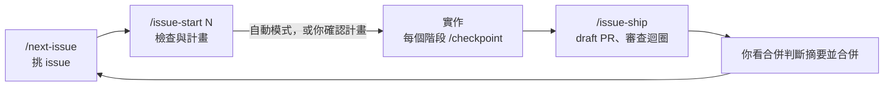

# 工作流程

一張 issue 對應一個雲端 session。人工負責啟動、需要時做決定、看合併判斷摘要後合併；中間的計畫、實作、開 PR、審查與修正由 Claude 跑完。本文件說明每一步要做什麼、什麼時候需要你介入。環境設定見 [`onboarding.md`](./onboarding.md)，Claude 遵守的規則見 [`CLAUDE.md`](../CLAUDE.md)。



## 1. 挑選下一張 issue

在任一 session 輸入：

```
/next-issue
```

Claude 依 milestone 順序、每張 issue 的「## 依賴」與關卡 label，列出：

- **可開始**：依賴都已完成，可以平行開不同 session
- **進行中**：已有 open PR
- **需人工決定**：帶 `needs-decision`，Claude 停下等你回覆
- **需人工提供**：帶 `needs-input`，內容要由你提供
- **等待中**：還有依賴沒完成

最後會給一段可直接貼到新 session 的提示詞。`/next-issue` 只查詢，不修改任何東西。

## 2. 開始一張 issue

從 issue 留言的「在 Claude Code 開啟」連結進入，或在新的雲端 session 輸入：

```
/issue-start 4
```

需要補充背景時，寫在第二行起，例如「本 issue 需要連現站量測 Lighthouse」。

Claude 會依序：

1. 決定工作 branch：issue 已有 open PR 就用 PR 的 head branch；否則用 session 指定的 branch，有進度檔就從進度檔所在的 branch 接續，沒有就從最新的 `main` 開始。issue 已關閉或 PR 已結束時會停下，列出帶進度檔的 branch 與時間，讓你選擇接續或重做
2. 讀 issue、`CLAUDE.md`、`docs/status.md` 與前置 issue 的產出
3. 檢查依賴是否關閉、關卡 label 是否齊全
4. 拿 `docs/status.md` 對照 GitHub 上 issue 與 PR 的實際狀態；對不上的列進計畫，在這張 issue 的 PR 一起修，不另開同步 PR
5. 執行環境檢查：Node 版本與 `.nvmrc` 一致、`node_modules` 存在、`npm run check` 通過；issue 需要時測試現站連線
6. 回報環境檢查表，提出計畫。計畫會把實作拆成幾個階段，每個階段寫出完成條件

接下來分兩種：

- **自動模式**：issue 沒有 `needs-design`、`needs-input`，計畫也沒有「需使用者決定」時，Claude 把計畫貼到 issue 留言，直接開始實作，一路做到 PR 轉 ready。你不用做任何事，除非被通知要做決定
- **等你確認**：其他情況以 Plan 模式提出計畫。看環境檢查表與計畫，回覆確認或要修改的地方，「需使用者決定」要逐項回答

輸入 `/issue-start N`（自動模式）或確認計畫，就等於同意這張 issue 的 checkpoint、commit、push、開 PR 與審查迴圈，範圍只限工作 branch 與本 issue 的 PR。合併一律由你決定。任一項檢查失敗時 Claude 會停下回報，不會開始實作。

## 3. 實作中

每完成一個階段，以及停下等你回覆之前，Claude 會執行 `/checkpoint`：

- 把工作以 `wip:` commit push 到工作 branch。還沒開 PR，所以不會跑 CI，也不會出現 preview
- 更新 `.claude/progress/<N>.md`，記錄階段計畫、目前狀態、待你決定的事項。每個階段完成了沒，由 commit message 推算（`node scripts/checkpoint/status.mjs <N>`），進度檔不手動維護

雲端容器閒置太久會被回收，checkpoint 過的工作不會消失。session 中斷後，開新 session 輸入 `/issue-start <N>`，Claude 會在 remote 找到進度檔，回報進度後從下一個階段繼續，不再重新提計畫。你也可以隨時輸入 `/checkpoint` 要求保存。`wip:` commit 與進度檔會在 `/issue-ship` 時整理掉，不會進入 `main`。規則見 [`checkpoint/SKILL.md`](../.claude/skills/checkpoint/SKILL.md)。

一般 issue 不需要介入。以下情況 Claude 會停下來等你，條件與做法見 [`checkpoint` 的「停下找人」](../.claude/skills/checkpoint/SKILL.md#停下找人)：

| 情況 | Claude 的行為 | 你要做的事 |
|---|---|---|
| issue 帶 `needs-design`，階段一完成 | push 並開 draft PR，列出設計決策與待確認問題 | 看 preview，確認後在 issue 加上 `design-approved`（M2、M3 的關卡用 `ia-approved`、`wireframe-approved`），再告訴 Claude 繼續 |
| issue 帶 `needs-input`、計畫外的取捨、審查跑滿輪數上限還沒過 | checkpoint，在 PR（還沒開 PR 時在 issue）留言寫問題與推薦，加上 `needs-decision`，推播通知 | 到 session 回覆。Claude 會拿掉 label 繼續 |

## 4. 收尾與審查迴圈

最後一個階段完成後，Claude 自動執行 `/issue-ship`，不再詢問：

1. 確認變更範圍（包含 `wip:` commit），刪除進度檔，排除暫存檔與 secrets
2. 執行 `npm run check`。失敗就停下，不會 push
3. 更新 `docs/status.md`，寫成這個 PR 合併後的狀態，寫法見 [`issue-ship` 第 3 步](../.claude/skills/issue-ship/SKILL.md#3-更新-docsstatusmd)
4. commit、push 到工作 branch。有 `wip:` commit 時先合併成一個 commit，再以 `--force-with-lease` push
5. 開 **draft** PR，監看 CI 與留言。PR body 裡要看 CI 才知道的證據先寫「待 CI」
6. 審查迴圈：每一輪先等目前 head 的 CI 跑完，把 PR body 的 CI 證據換成目前 head 的 run 連結，再開新的子代理跑 `/pr-review`，結論貼到 PR（開頭「AI 審查第 N 輪」）。有 Act on 就修正、push、等 CI、再審一輪；第 2 輪起會逐項確認上一輪的發現修好了沒。CI 判斷方式見 [`issue-ship` 第 7 步](../.claude/skills/issue-ship/SKILL.md#7-審查迴圈)
7. 審查沒有發現、驗收條件都有證據、CI 是綠的，就把 PR 轉為 ready，貼「合併判斷摘要」，推播通知你

完成條件與摘要格式見 [`issue-ship` 第 8 步](../.claude/skills/issue-ship/SKILL.md#8-完成條件轉-ready)。審查跑滿輪數上限還沒過，Claude 會停下找你（第 3 節）。

## 5. 合併

收到通知後，看 PR 上的「合併判斷摘要」：結論、驗收條件的證據、審查紀錄、沒處理的 Consider、你要看的地方。決定合併就在 GitHub 上合併，合併後 issue 會由 `Closes #N` 自動關閉，回到第 1 步。

要自己再審查一次，或審查別人的 PR 時，在任一 session 輸入：

```
/pr-review 60
```

也可以直接說「review PR #60」。Claude 會讀 PR 的 diff、body 與 `Closes #N` 的 issue，然後：

1. 逐條對照 issue 的驗收條件找反例
2. 執行專案固定檢查，清單見 [`pr-review/SKILL.md`](../.claude/skills/pr-review/SKILL.md) 第 4 步
3. 程式碼變更交給 `/code-review`，必要時加 `/security-review`
4. 把發現分成 Act on／Consider，輸出一段可以直接貼到 PR 的審查意見

`/pr-review` 手動執行時只輸出到對話，不會在 PR 上留言。要發成留言時明確說「發到 PR」。審查的是同一個 session 寫的變更時（包括 `/issue-ship` 的審查迴圈），Claude 會開子代理審查，避免作者看不到自己的盲點。不帶參數時審查目前 branch，帶 `<base>..<head>` 時審查指定的 commit 範圍。

PR 開了之後 session 會持續監看，CI 失敗、review 留言都會自動喚醒 session 處理。

## 自動套用的 skill

下列 skill 不需要手動呼叫，Claude 依工作內容自動讀取：

| Skill | 何時套用 | 內容 |
|---|---|---|
| `seo-checklist` | 新增或修改頁面、版型、內容 | 每頁必備的 SEO 項目與驗收方式 |
| `design-system` | 撰寫樣式、元件 | 只能用 `tokens.css` 的 design tokens |
| `content-migration` | 搬移現站內容 | 保留事實、不捏造、frontmatter 與圖片規則 |
| `typescript-best-practices` | 編輯 `.ts`、`.astro`、`.mjs` | 型別設計、邊界驗證、Astro 慣例 |
| `writing-style` | 寫文件、PR、commit、網站文案 | 正體中文去 AI 腔規則與文件結構 |

想強制套用時，直接輸入 `/<skill 名稱>`。

## 常見狀況

| 狀況 | 處理 |
|---|---|
| 環境檢查 `npm run check` 失敗 | 先看 Claude 回報的錯誤；SessionStart hook 問題見 `onboarding.md` 的「SessionStart hook 行為」 |
| 沒有出現計畫確認畫面（session 重啟後常見） | Claude 會把計畫貼在對話中，直接回覆確認即可 |
| 舊 issue 的「在 Claude Code 開啟」連結 | #50 以前（含）建立的 issue 帶的是舊 prompt，仍可使用；也可以改在新 session 輸入 `/issue-start N` |
| 個人設定的 stop hook 要求 commit | 這是個人層級的 `~/.claude` 設定，不屬於本 repo；需要時自行調整 |
| session 中斷、容器被回收，或 context 被摘要後不確定進度 | 開新 session 輸入 `/issue-start N`。找到進度檔就接續，上次 checkpoint 之後沒 push 的工作會遺失。找不到進度檔但 branch 上有未合併的 commit 時，Claude 會停下問你要接續還是重開 |
| PR 的「待確認」列出待刪除的舊 branch | 接續時留下的舊 branch。雲端 session 刪除 remote branch 會被 403 擋下，請在 GitHub 上手動刪除。issue 已關閉或 PR 已結束時，`/issue-start` 會停下，列出帶進度檔的 branch、各自最後 commit 時間與 PR 關閉時間；比 PR 關閉時間早的通常已經過時，選重做即可 |
| 上一張 PR 已合併，session 想沿用同一個 branch | `/issue-start` 會從最新的 `main` 重開 branch，不會帶入已合併的 commit |

## 修改流程

流程定義在 `.claude/skills/issue-start/`、`checkpoint/`、`issue-ship/`、`pr-review/`、`next-issue/` 的 `SKILL.md`。專案固定檢查只寫在 `pr-review/SKILL.md`。修改 skill 時同步更新本文件、`CLAUDE.md` 的「雲端 session 工作規則」；新增或移除 skill 時，另外更新 `README.md` 的流程圖與「如何開需求」、`CLAUDE.md` 的目錄結構。
