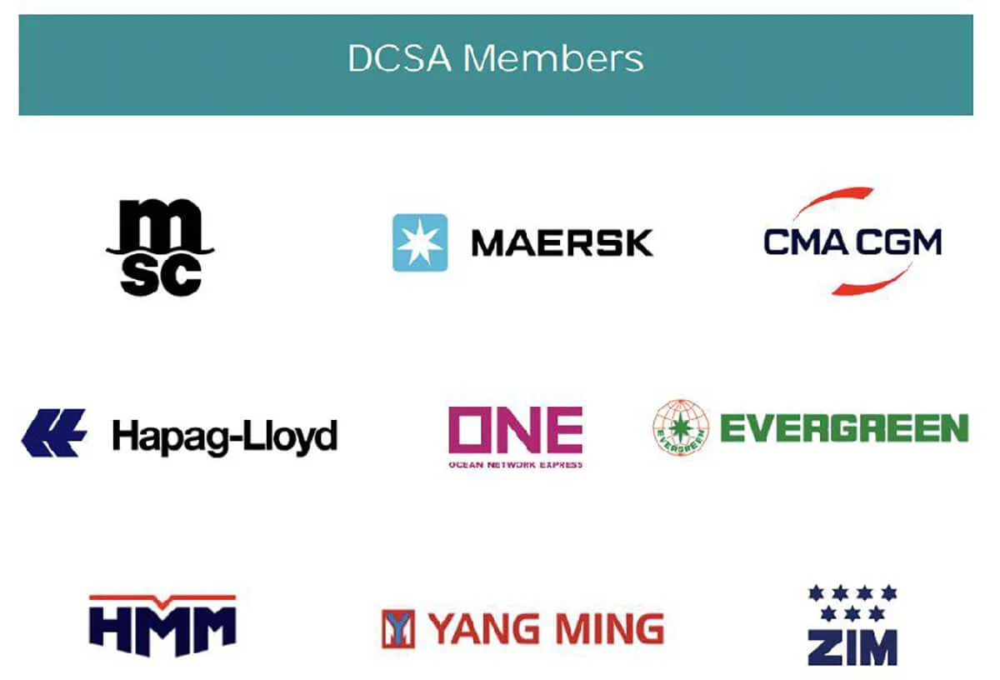
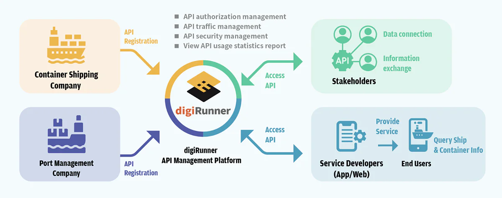

## About Shipping

Shipping refers to the transportation of commodities, cargo and passengers by land, sea or air. Since the 15th century, the vigorous development of shipping has enabled people to travel between countries, and goods have been able to circulate across continents and international borders. Currently, maritime transport accounts for 80% to 90% of international trade, including passenger ships and cargo ships. Generally speaking, all kinds of ports and watercrafts such as ships and containers are also included. (Source: Wikipedia)

Take Taiwan’s Keelung Port as an example. More than 10,000 ships entering and leaving the port in 2020, and the number of passengers reached 260,000 with a volume of unloaded cargo reaching 1.5 million.

*Image: Containers in port (Ref: iStockphoto)*

### Digital Transformation

In the past, container transport was regarded as a “conventional” type of shipping. However, as technology advances, shipping is undergoing a digital transformation. Maersk, Mediterranean Shipping Company (MSC), Hapag-LIoyd and Ocean Network Express (ONE), the leading companies in the global container shipping industry, founded the Digital Container Shipping Alliance (DCSA) in 2019. DCSA aims to facilitate digitalization in the container shipping industry in which customers are provided with interconnected and easy-to-use shipping services to meet their business and sustainability goals. Through consistency and standardization of interface standards, DCSA is dedicated to shaping the digital future of container shipping with transparent, reliable, easy-to-use, secure and environmentally friendly services. Developed based on input from DCSA members, industry stakeholders and technical experts in other industries, DCSA’s open source standards are available to everyone for free. (Source: DCSA)

In the same year, Taiwanese shipping companies such as Yang Ming Marine Transport Corp. and Evergreen also announced their participation in DCSA in close collaboration with other container shipping companies in the hope of digitalizing shipping services and unlocking more business opportunities through standardization.

*Image: DCSA members (Ref: Digital Contain Shipping Association, DCSA)*

### Smart Port

According to a report released by the International Association of Ports and Harbors (IAPH) and the shipping industry, only 49 out of the 174 members of the International Maritime Organization (IMO) have an effective port community system, and other ports still rely on manual and paperwork. The outbreak of COVID-19 pandemic has accelerated the digitalization of ports worldwide, and a secure data exchange approach has been adopted to simplify the operation process and achieve effective control, which fuels the development of Smart Port.

The development of Smart Port requires the openness and interconnectivity of data. DCSA has established a set of standardized data opening specifications, and the main framework follows the OpenAPI Specifications. The open data needs APIs to connect the data among various container carriers. In addition to enabling digitalization and interoperability for stakeholders, APIs can also help port operators effectively track and manage passengers/freighters, exhibiting the strength of Smart Port.

To improve the API management efficiency of the port authority and the container transport industry, a reliable API management platform is indispensable. The API management platforms provide unified connection formats and data encryption features. Since it requires cross-company and cross-functional cooperation for port authority and container transport, a huge amount of data needs to be open to relevant personnel or external personnel. With a platform featuring connectivity and dynamic API authorizations, the efficiency of API management can be greatly improved. Moreover, a graphical operation interface allows any user to immediately get started, which saves not only code development effort but also management time.

The API management platform digiRunner developed by TPIsoftware is your trusted helper for Smart Port. Compliant with the OpenAPI Specification (OAS), digiRunner ensures standardization of APIs and robust information security mechanisms with various API authorizations and data encryption features such as OAuth 2.0 and JWT settings, which can be configured and adjusted according to your needs, reducing development effort and security risks.

*Image: digiRunner connects shipping data and facilitates the digitization of Smart Port and container transport (Ref: TPIsoftware)*

The API management platform digiRunner developed by TPIsoftware is your trusted helper for Smart Port. Compliant with the OpenAPI Specification (OAS), digiRunner ensures standardization of APIs and robust information security mechanisms with various API authorizations and data encryption features such as OAuth 2.0 and JWT settings, which can be configured and adjusted according to your needs, reducing development effort and security risks.

References:

1.  Wikipedia, Open Government ([https://zh.wikipedia.org/wiki/%E8%88%AA%E8%BF%90](https://zh.wikipedia.org/wiki/%E8%88%AA%E8%BF%90))

2.  DCSA ([https://dcsa.org/](https://dcsa.org/))
