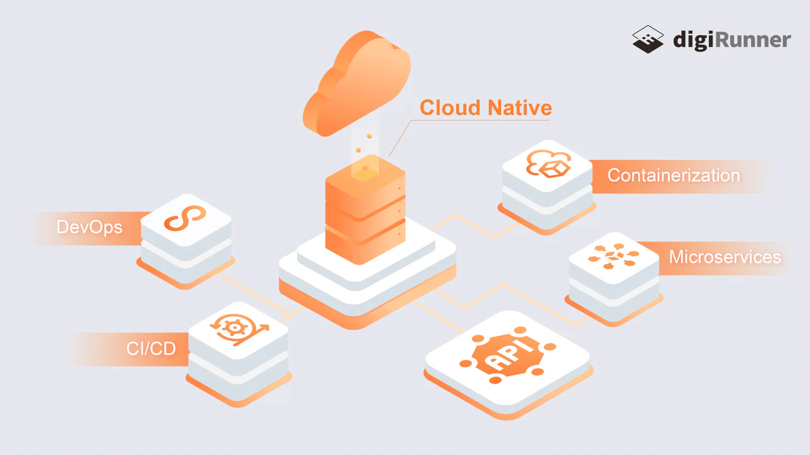
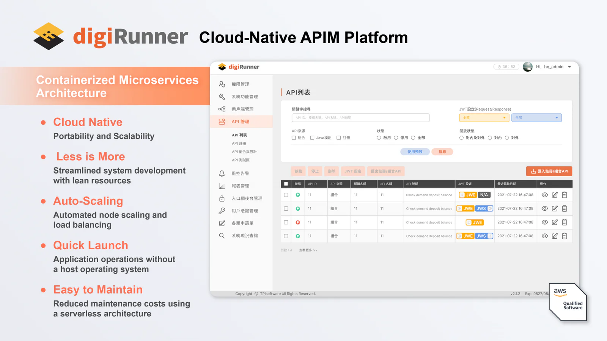

Users’ needs keep growing, and so do the intricacies of commercial software. To keep up with this upward trend, organizations are seeking ways to accelerate their service updates and adopt a software architecture that is faster, more reliable and more flexible. To realize these objectives, organizations need to go cloud-native. But first, what does it mean to be cloud native?

## What is Cloud Native?

According to the Cloud Native Computing Foundation (CNCF), an open source, vendor-neutral hub of cloud native computing where several big names like AWS, Google Cloud and Microsoft Azure are among their member listing, the [definition](https://github.com/cncf/toc/blob/main/DEFINITION.md) of cloud native is stated as:

*Cloud native practices empower organizations to develop, build, and deploy workloads in computing environments (public, private, hybrid cloud) to meet their organizational needs at scale in a programmatic and repeatable manner. It is characterized by loosely coupled systems that interoperate in a manner that is secure, resilient, manageable, sustainable, and observable. Cloud native technologies and architectures typically consist of some combination of containers, service meshes, multi-tenancy, microservices, immutable infrastructure, serverless, and declarative APIs — this list is non-exhaustive.*

Although CNCF seems to have clarified what it means to be cloud-native and explained the way it works, there is no precise definition of cloud-native when it comes to understanding the term. However, we can try to think of it as a concept of how applications are architected and run using a cloud-based approach. That being said, simply migrating existing services to the cloud will not be considered an adoption of a cloud-based architecture as the method, by its nature, lacks agility and competitiveness—the two key differentiators that define what it means to be cloud-native.

### Advantages of Cloud-Native Application Development​

Traditionally, a monolithic architecture is used to build, test and deploy applications, with all components contained in a single codebase or unit. This model offers simplicity in terms of deployment, making it faster to launch a service, and thus faster time-to-market. However, as application systems continue to scale, the monolithic architecture becomes incapable of handling large volumes of requests, posing difficulties for management and scalability, and consequently resulting in server overloads.

*Image source: TPIsoftware*

A cloud-native architecture, on the other hand, uses a cloud-based approach when developing software from the outset with combined practices such as containerization, microservices architectures, APIs, DevOps, and CI/CD. This orchestration provides agility for flexible deployment and expansion, allowing API (re-)composition without dealing with service outages.

In comparison with a monolithic architecture, a cloud-native architecture has the advantages of rapid iteration, platform ownership, scalability and enhanced security, which are essential to accelerating innovation and helping enterprises build, execute, and deploy scalable applications in any environment. However, implementing a cloud-native architecture introduces organizations to a more complex API development lifecycle. Therefore, coping with this complexity becomes a significant challenge.

### Cloud-Native API Management Platform

With the advent of cloud-native services, APIs sprawling within enterprises are increasing. This is when and where a robust APIM system comes in.

digiRunner is an enterprise-level API management platform that facilitates digital transformation and creates an Open API ecosystem. It is a comprehensive middleware designed for mission-critical success. With an API-first strategy, digiRunner features a built-in load balancer and low-code development using a cloud-native architecture, ensuring seamless integration and greater flexibility.

*Image source: TPIsoftware*

Certified by AWS, digiRunner leverages a Backend for Frontend pattern which leads to rapid development and improved user experience. The platform also supports deployment across on-premises and clouds with a Kubernetes architecture, achieving auto-scaling and high availability.
