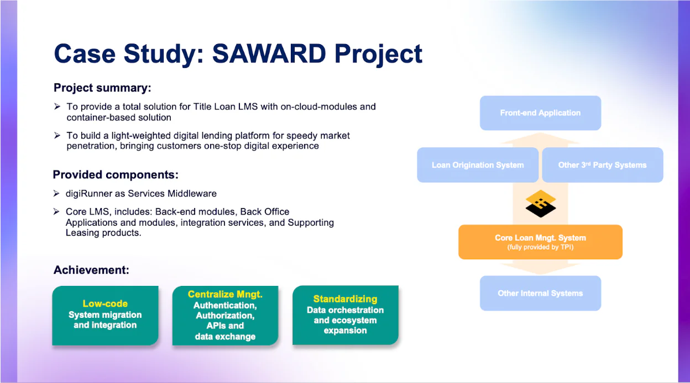

APIs serve as the backbone of modern software systems that facilitates seamless communication across applications. However, as APIs grow in significance, they become a target for cyberattacks. Unprotected APIs can lead to the exposure of sensitive data, resulting in severe breaches and significant financial repercussions.

For businesses, particularly in emerging markets such as Vietnam, Thailand, and Indonesia, ensuring robust API security is not just a technical necessity but also a crucial element in safeguarding digital assets and preserving business reputation. It is imperative for businesses to understand the risks associated with API security and implement comprehensive security measures to protect their data from cyber threats.

The risks associated with unprotected APIs are not uncommon. In fact, they are even more prevalent in today’s digital landscape. Several leading corporations have shown us how severe the consequence can be when API security is compromised. In 2018, Facebook discovered a massive API breach that exposed 50 million users’ personal information. In 2020, a security flaw in Experian’s API led to a huge data leak, affecting 220 million users. In December 2021, 5.4 million Twitter users’ data was scraped and leaked online. The list of reported data leaks and breaches goes on and on. Such incidents underscore the risk API vulnerabilities pose to organizational security, causing substantial financial loss. The global average cost of a data breach in 2024 is $4.88 million—a 10% increase over last year and the highest total ever, according to an [IBM 2024 report](https://www.ibm.com/reports/data-breach).

And the worst comes to the worst. Customers lose trust in you as a service provider. You lose them forever.

## Importance of API security

API security is undeniably crucial when it comes to protecting sensitive information—whether it is performing a bank transfer or checking your medical record. Transmitting and storing data in a secure way is essential.

APIs function as a gateway to internal systems and databases, fending off unauthorized access to mitigate the risk of cyberattacks. Compliance with data protection regulations, such as European Union’s General Data Protection Regulation (GDPR) and Vietnam’s Decree of Personal Data Protection (PDPD)  issued in April 2023 necessitates stringent data security measures.

Ensuring API security, therefore, has become vital for preserving customer trust and safeguarding the reputation of a business.

### Challenges of API security

As the need for APIs grows, so do the associated risks. APIs that are left unprotected, unmonitored or unmanaged are especially susceptible to various types of attacks, including injection attacks, cross-site scripting (XSS), and distributed denial-of-service (DDoS) attacks.

As cyberattacks keep evolving, enterprises need an API security measure that allows them to swiftly address new threats. Managing authentication and authorization also presents a significant challenge, especially in complex environments.

Regulatory compliance with privacy and data security laws established by regulation bodies at local, national or international levels become added complexity to API security.

### How digiRunner can help

The digiRunner API management platform is a robust solution designed to enhance API security and address the aforementioned challenges. A notable feature of digiRunner is its comprehensive data security framework for APIs. This framework seamlessly integrates authentication processes for both frontend and backend, providing a unified and secure approach to identity verification and access management.

digiRunner offers a variety of mechanisms to prevent security threats, ensuring a comprehensive and robust defense system for APIs. One of its key features is the centralization of all security settings in a single platform, streamlining management and enhancing security oversight. In addition to its native security capabilities, digiRunner allows seamless integration with both internal and external access systems, ensuring reliable authentication and authorization across the board.

The platform also supports a clear and secure authentication flow, simplifying the process while maintaining high standards of protection. Furthermore, digiRunner provides granular access control, enabling organizations to manage permissions in detail. This allows businesses to define who can perform specific functions, access certain features, or view sensitive data, reinforcing internal security and ensuring that only authorized individuals have the appropriate level of access

To tackle the complexity of diverse security requirements and legal regulations, digiRunner integrates multiple layers of security. This includes SSL/mTLS for secure data transmission, API keys for public APIs, and OAuth2/OIDC protocols for robust authentication and authorization. digiRunner is fully equipped to comply with the OWASP API Security Top 10 standards. Together, these features enable businesses to effectively adhere to legal regulations and meet stringent data protection standards with confidence.

