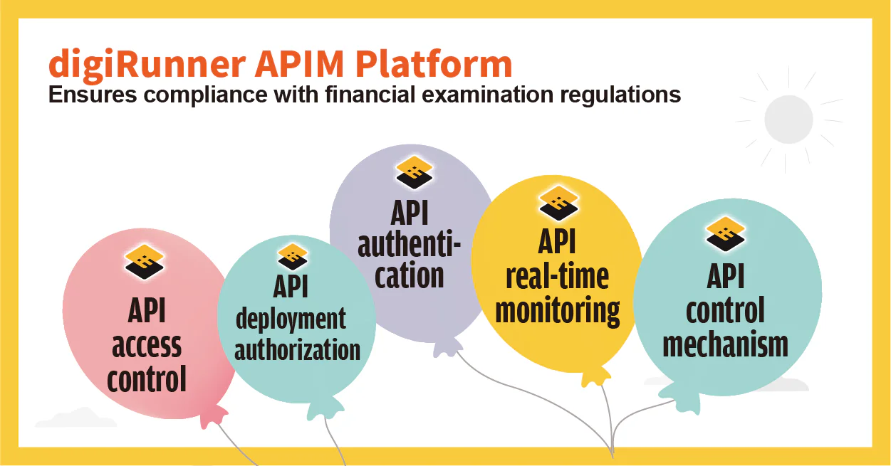

To ensure sound operations of financial markets, financial institutions are required to pass financial examinations periodically by the authorities. The examination priorities may vary across different countries, but generally the focus areas involve implementation of anti-money laundering, counter-terrorism financing, legal compliance systems, information and communication security management, financial consumer protection, personal data protection, etc.

So, what are the things to consider in order to achieve zero-defect financial examination? What does it have to do with API management (APIM) when it comes to financial examination? In fact, the practice of API management has been prevalent across various industries. In response to digitization, the development and adoption of information systems have been growing over the past 20 years, and the use of APIs plays an important role in system managing optimization. The financial sector is no exception. An increasing need for API management has been driven by the trend of online banking, mobile banking and digital-only banks in recent years, which further puts emphasis on financial examination. Here we have collected the five examination priorities related to API management which are most concerned in the financial sector:

## Rule 1: API access control with appropriate management procedures

Through API management platform, you can configure the access to view APIs, the management of API quotas and traffic, token authentication and encryption, and set API groups with different security levels, facilitating access control of internal and external units. Affiliated units can also manage permissions based on the user roles to ensure the permission levels and procedures of each API in legal compliance.

### Rule 2: API deployment authorization with assessment principles and risk avoidance

Through API management (APIM) platform, you can configure the access to view APIs, the management of API quotas and traffic, token authentication and encryption, and set API groups with different security levels, facilitating access control of internal and external units. Affiliated units can also manage permissions based on the user roles to ensure the permission levels and procedures of each API in legal compliance.

### Rule 3: API authentication and verification

Appropriate authentication, authorization procedures and key mechanisms are required for API management. digiRunner provides credential management of JWE and TLS by default. It can also be connected to other credential management systems such as HSM to meet the financial examination requirements for banks and third-party service providers (TSP).

### Rule 4: API real-time monitoring of access activities

In response to financial institutions’ needs for monitoring API access activities and generation of monitoring reports regularly, digiRunner provides API audit logs to view the header (title), body (text), transaction ID, event time, user and more; flexible time range and reports are all available for the monitoring of API access activities or transaction.

### Rule 5: API control mechanism with data encryption key management

Security mechanisms for key distribution, transmission and protection are indispensable, as third-party service providers (TSP) may access sensitive information. The API management platform does not store confidential information. The platform uses encryption mechanisms such as JWT/JWE/JWS when transmitting data; therefore, the security control mechanism can ensure compliance with the financial examination standards if a third-party service provider needs to access sensitive data.

### Two Essential Factors To Consider When Choosing API Management (APIM) Platform

To truly optimize API management, financial institutions need to make sure if the platform has a rigorous architecture design and a secure information exchange mechanism when choosing the right API management platform. 100% compliant with the OpenAPI Specification (OAS), digiRunner can connect existing APIs and support multiple API formats with full lifecycle API management. It features information security management, monitoring management, access authority control, transaction security management and more to suit your needs. ISO 27001 certified, digiRunner provides comprehensive API management and information security for financial institutions.

We invite you to visit our official page if you want to learn more about the digiRunner API management (APIM) platform. If you are interested in topics regarding API management for financial examination, please fill out the form below to get in touch.
