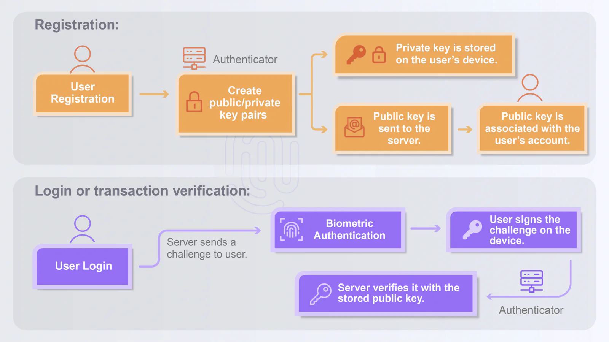

In today’s digital landscape, password-related security breaches have become widespread challenges and passwords are no longer as effective as they once were. As modern cyber threats keep evolving, organizations and users are seeking a more secure, simpler and faster approach to authentication.

FIDO (Fast IDentity Online) emerges as a better alternative. FIDO authentication leverages advanced, phishing-resistant technologies like biometrics and cryptographic key pairs to address the vulnerabilities associated with traditional passwords. By going passwordless with FIDO, businesses can enhance security and streamline the user experience by reducing the reliance on passwords, creating a safer, more efficient digital environment for both organizations and users.

## What is FIDO?

FIDO is an authentication specification developed by [the FIDO Alliance](https://fidoalliance.org/) that enables secure, strong, passwordless sign-ins by using methods like biometrics (e.g., fingerprints, facial recognition), cryptographic key pairs or device-based authentication. This passwordless approach reduces password-related vulnerabilities and streamlines digital access, making FIDO a trusted solution for tech giants like Google, Microsoft, Apple and Amazon.

### How does FIDO work?

FIDO uses **public-key cryptography to authenticate sign-ins by generating a unique key pair (public and private keys)** for each user.

Once a user registers with a FIDO-enabled service, the public key is stored on the service’s server, while the private key remains securely on the user’s registered device and is protected by biometrics. Sign-in is completed via a challenge-response from the user device and the server; the server does not see or ever store the private key. During sign-in, the server sends a challenge to the user’s device. The user must prove the possession of the private key by signing the challenge for the sign-in to be completed.

**FIDO consists of three components:**

[**1.FIDO**](http://1.fido/) **Server**: Store the user’s public key and handle login requests. During the authentication process, the server generates a unique challenge and sends it to the client for verification.

**2.Client:** Refer to the user’s device where a private key is generated and stored.

**3.Authenticator:** Verify user identity by signing the challenge sent by the server and send back the signed response.

### Authentication Specifications

The FIDO Alliance has published three sets of specifications:

-   **FIDO UAF (Universal Authentication Framework)**: FIDO UAF supports a passwordless authentication option with biometrics like fingerprints and facial recognition.

-   **FIDO U2F (Universal 2nd Factor)**: FIDO U2F allows adding a second factor to login authentication after entering the password on the device

-   **FIDO2 (WebAuthn and CTAP)**: FIDO2 enables passwordless sign-in across multiple devices and browsers using techniques based on Web Authentication (WebAuthn) specification and Client-to-Authenticator Protocol (CTAP).

### Application Scenarios of FIDO

FIDO specifications have been widely implemented for enhanced security across industries:

-   **Financial industry**: Taiwan’s Financial Supervisory Commission (FSC) announced

    [guidelines on security control regulations for financial services](https://www.biometricupdate.com/202311/taiwan-issues-new-identity-verification-rules-for-financial-industry)

    to verify user identity, logins and transactions with FIDO authentication, preventing unauthorized access and identity theft.

-   **Enterprise internal systems**: Threat actors often target internal systems within an organization and find their way to sneak into it and steal valuable information. Using FIDO authentication helps reduce the risk of identity theft and adds a layer of protection to internal data security.

-   **E-commerce and online services**: User experience is improved with FIDO authentication as it reduces the reliance on password-based verification, making logins and transactions seamless and phishing-resistant.

### Why FIDO?

Passwords are hard to remember and they are prone to phishing attacks. That’s why FIDO authentication turns out to be a better alternative as it provides a streamlined, safer login experience. The benefits include:

-   **Enhanced security**: By reducing the reliance on passwords, FIDO protects company’s critical data and mitigates security risks associated with password leaks and reuse.

-   **Improved user experience**: FIDO enables quick, simpler logins using biometrics, such as fingerprints, facial recognition or security keys, giving users a seamless login experience.

-   **Reduced maintenance costs**: FIDO-based authentication effectively eliminates password-related issues, such as forgotten passwords, account recovery or lockouts.

-   **Regulatory compliance**: FIDO specifications align its authentication protocols with the requirements of global regulations and standards for data privacy and security.

FIDO ensures operational efficiency for both enterprises and end users as it eliminates passwords as a means to safeguard against cyber threats. Users can get rid of passwords, because they can simply present a biometric to log in—that is to say, **users themselves are the password** for authentication and access across devices.

### FIDO: Paving the Way for a Passwordless Future

As the pace of digital transformation accelerates, the future of authentication is likely to be shaped by passwordless technologies like FIDO, given its alignment with the growing need for secure, user-friendly and scalable authentication mechanisms.

gadoDIDO is a FIDO-certified, passwordless solution that helps simplify logins across multiple platforms and applications, creating a highly secure, frictionless experience for enterprises and users.
