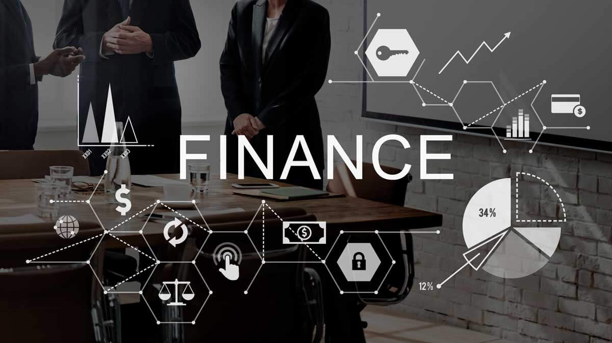

## Logs: Evidence in the Digital World

Several businesses have adopted work-from-home measures and asked their employees to come to the office on alternate weeks in response to the outbreak of COVID-19 pandemic. Six employees from a company were charged with insider trading and laid off for their misconduct, according to a news reportage. The six employees from different departments exchanged confidential customer order information through internal messaging and video conferencing platforms.

In fact, most software companies have set up VPNs (Virtual Private Networks) for employees who work remotely, and employees must connect to company VPNs to work from outside the office. All their activities in the computers were actually monitored by the company when connecting to the VPN. Simply by using keywords for searching, IT personnel can immediately access all the content from all kinds of communication software such as video conferences, social media platforms and messaging apps, and any illegal or dishonest behaviors will be exposed. From an IT security point of view, these recorded digital trajectories serve as sources of evidence for both internal and external uses.

Generally, all software and hardware such as applications, networks, firewalls, operating systems and databases used by enterprises generate logs, the digital traces of users. In a nutshell, logs are the “ironclad evidence” that record all the details of “who”, “when” and “what” in the IT environment. Log data seems complicated as it records all the details; however, with some simple programs, the system can report any anomaly in logs automatically, providing information of what’s happening in IT systems. Take “Login Error” as an example, when continuous failed login attempts are detected, the alerting system will send email alerts to notify IT personnel of the anomaly to prevent malicious attacks.

### Applications of Logs and Information Security Concerns

Nevertheless, in this era of big data, logs can be found in all kinds of apparatus and systems, which leads to log management difficulties. With a soaring number of system brands, data formats vary between different products; besides, the text file generated can be modified easily, and the regulatory compliance and log retention period can all pose a challenge to log management. It is imperative to think about the purposes and goals of the log management system when designing or planning. From the perspective of information security, the operation records of users are the evidences of events and activities occurring in a company’s information assets, which can act as important bases for the judgment on accountability or analysis of incidents.

In terms of IT management, logs provide insights into the current performance of software and usage of hardware. Logs can also be used in application performance analysis and debugging. For business decision-making, the information of “product sales” and “user behavior” of physical stores and e-commerce can be analyzed through POS, SCM, CRM systems and more.

A wide range of applications for logs can be found, especially in financial sector and large technology companies. Finance, stock market, and even litigation are all inseparable from “information security”, which emphasizes the importance of log management. When developing and planning a log management system, consider the following two points:

First, understanding the regulations is your primary duty. The auditing mechanisms and measures for the retention of records are all must-haves for enterprise log management.

Second, the regulatory compliance to ensure IT governance and strengthen the operation. The management of system user accounts and access must meet the requirements of audits and log management authentication. Therefore, companies must establish mechanisms of identity security and monitoring compliant with laws and regulations.

### Log Management Platform with Reinforced Access Control

To ensure IT governance, “identity management” and “security monitoring” should be the core of access control mechanism. “Identity management” consists of identity and account identification and role-based access control. “Security monitoring” manages digital trajectory management, real-time monitoring and auditing.

digiLogs is a “centralized log management platform” designed for enterprises with enhanced “access control”, providing role-based “function permissions”, “operation permissions”, “sensitive data masking” and more. Besides, the monitoring features “AuditLog” and “real-time alert” for identifying user accountability.

In addition to log collection and analysis, digiLogs also features real-time alert mechanism to effectively assist IT personnel in maintenance. digiLogs provides one-stop log integration and management, with log server featuring powerful query and retrieval functions and predictive alerts. digiLogs can save you the hassle of searching scattered logs, integrate cross-system operational data, support diverse data formats, and provide various query functions such as aggregation query, correlation query and contextual query, with visualized reports to help IT professionals with fast trouble-shooting and detailed analytics at a glance. The comprehensive system monitoring and alert mechanism of digiLogs can send real-time alert notifications through emails, messages and communication apps to further ensure uninterrupted enterprise information security.
