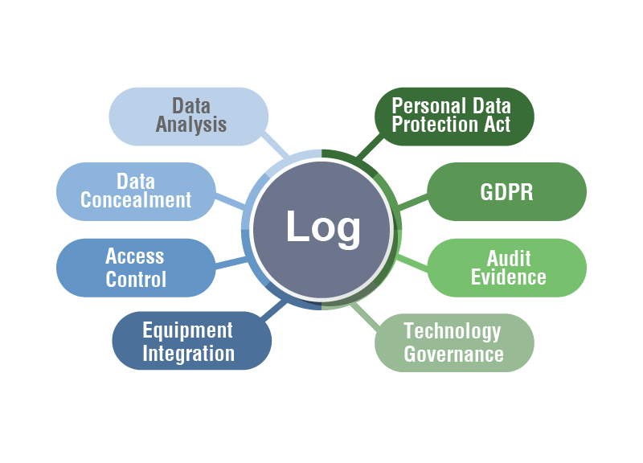
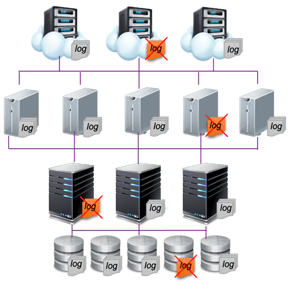
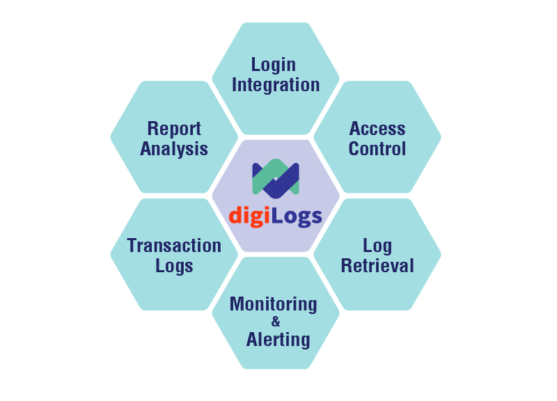

## Boost IT security and operating efficiency with robust log management System Logs can spot potential IT security threats

In Taiwan, the new version of “Personal Data Protection Act” was rolled out in October 2012, which regulated the enforcement details in the articles and specified that enterprises and organizations should have “measures for the retention of event records and log data as sources of evidence.” According to the article 5 in the Guidelines for Log Management of Information Communication System issued by the Academia Sinica, “each unit should review the analysis report automatically generated by logs on a regular basis, conduct routine inspections, analyze abnormal conditions, and identify potential IT security threats to maintain the stable operation of the system. Each unit shall establish the authority control and identity authentication mechanism for log administrators. The establishment of procedures for log reading, interpreting, and settings changing is required for examination.

The key to the success of maintenance and operations for every IT system is to have sufficient data for decision-making, that is, log management. For example, an event log helps detect issues. When an abnormal situation is identified, IT staff can be notified in real time and jump into troubleshooting immediately.

However, the primary goal of most companies in the past was not strengthening IT security, leading to few companies did well on log management. For many companies and organizations, the primary consideration is usually how to make profits for their business, reinforce product functions, reduce cost and improve service quality, etc. IT security was less recognized and less valued in their long-term focus; they chose to skip log management, unless they were convinced that they could benefit greatly from it or avoid financial risks. Therefore, if senior managers did not request IT security inspection, statistical reports review or audit records, most IT personnel did not take the initiative to work on log management.

With the implementation of the new “Personal Data Protection Act” that indicates “measures for the retention of event records and log data as sources of evidence.”, companies and organizations have become more aware of the protection of IT systems, and a greater attention to log management has been paid. In daily business operations, all types of records generated through various systems and applications must be properly stored as evidence when necessary in the future. Therefore, the importance of log retention and management cannot be overemphasized, and it is no longer an optional choice.

### Aggregation is the key to managing massive amount of log data

Since the rollout of the new act, companies and organizations have realized the importance of log management. However, in the past, most of the IT personnel failed to develop a well-defined plan when purchasing IT systems or equipment. For example, there is an upper limit for the storage of every log type in systems. When the amount of data accumulated exceeds the default maximum size, it can no longer be stored in the system. Traditionally, if the purchase of storage solutions is not carefully planned or equipped with an assisting system, a possible remedial approach is to export the logs, archive them for retention, and then re-import the log files when needed. Some systems are not even supplied with a large storage space, leaving IT personnel with no choice but to delete the records directly. An automatic compression mechanism of log files may be available for some IT systems to reduce the space occupied, but it doesn’t help much when you need to access the logs without knowing how to do it.

In addition, because there are different log types for different systems, the formats generated can be very different from each other. Simply keeping these logs does not provide senior managers with insight into the information. Just like looking for a needle in a haystack, log management requires processing procedures such as extraction, analysis, and statistics in order to improve IT management and IT security effectively.

### One-stop log management effectively enhances system operating and flexibility

Log management mainly focuses on the completeness of logging. Since modern systems are networked, recording logs through network is the most efficient way, which allows flexibility for changes of system requirements. After the huge amount of data is collected, functions such as real-time analysis, authentication and encrypted storage must be achieved with sustainable overall system performance. This is what an effective log management is like.

digiLogs can simplify the aggregation and extraction of common log files, network packets and system indicators, and effectively convert multiple source data such as logs and events. Then it centrally processes them into JSON format and sends them to Search Engine, and builds indexes with structured, unstructured, and time-stamped data for quick search and efficient analysis. Finally the data can be presented more clearly through visualization.

digiLogs is a centralized management platform that manages a large number of logs through a single browser for enterprises. It supports more than 40 data source formats, analyzes logic according to customers’ needs, extracts and stores log data, with features such as full-text, keyword and flexible query, and real-time alert. In addition to visual reports and digital dashboards, it provides flexible management analysis reports to suit your needs, which reduces time costs of IT management and increases work efficiency.

References:

-   中央研究院資通系統電子形式軌跡資料Log管理要點

-   【海量 log 資料，也能簡單管理？】彰化銀行導入 digiLogs，加速 IT 營運、數位軌跡串聯

-   Log management\_ wilipedia

-   digiLogs Assist Chang Hwa Bank to Establish Exclusive Logs Trajectory to Maximize IT Operational Efficiency
