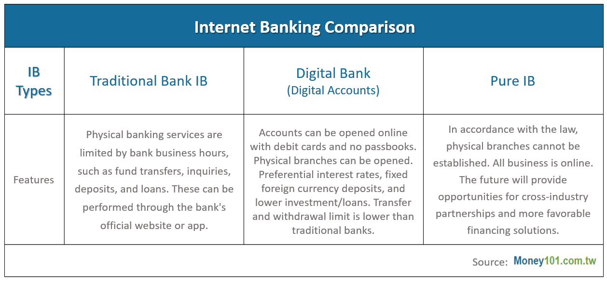

Last year, the Financial Supervisory Commission of Taiwan announced the establishment of three pure internet banking licenses. After more than a year of preparations, these banks are ready to open before the end of 2021. Now is a good time to clarify what the advantages of pure internet banking and physical banks are, as well as the differences between them.

In accordance with the Taiwanese law, purely internet-based banks are not allowed to establish physical branches, nor can they merge with physical banks in the future. This will turn the traditional banking business on its head, encouraging all financial processes to be conducted online, even processing loans. Pure internet banking will also encourage flexible ways of accessing services, from more common devices such as smartphones and computers, to new channels such as supermarkets, e-commerce platforms, and telecommunication companies.

Working hours will no longer end in the early afternoon, as certain processes will not be restricted to any designated branches or parent banks. Pure internet banking will enable financial services to be provided around the clock, accessible at any time as long as there is internet connection.

Internet banking is only limited by some potential technical and data security issues. For withdrawals and transfers, the maximum transaction amount is the same as it is for digital banks. In theory, digital banks can provide more business discounts because they reduce the costs of setting up physical branches. These discounts include free transfers, no inter-bank handling fees, and higher interest rates for deposits.

Below is a comparison of different types of banks:

The emergence of pure internet banking reflects a larger integration of financial date. Take “Ant Financial”, which was set to be in Shanghai and Hong Kong, as an example. The convenient “borrowing” function provided by Ant Financial has allowed lending to app groups which many credit card operators are unable to reach. As for ubiquitous electronic payments, Ant Financial has significantly threatened market shares of credit cards and small loans, generating huge cash and data flows and bringing unlimited possibilities to the market.

IT companies considering entering the internet banking market should be preparing to further integrate financial data into their own ecosystems. For example, Apple will want to integrate the popular iTunes Store, Amazon its shopping platform… etc. More the most effective performance, huge amounts of data must be collected on these platforms.

Pure internet banking, which involves personal finances, is only a starting point for the rising fintech trend. Investment banking giant JP Morgan has issued its own cryptocurrency, JPM Coin, which can be used to conduct global businesses on a pure internet banking platform. In time, real-time transactions, such as corporate cross-border wire transfers, real-time settlements of issued securities, and more, will greatly increase processing speed and reduce costs. Pure internet banking is also available in the B2B market, where there is significant room for growth.

Pure internet banking is a brand-new service for Taiwan, but by referencing emerging cases in other countries, pure internet banking can integrate financial services, other large amounts of data in the ecosystem, and create sparks full of imagination.
