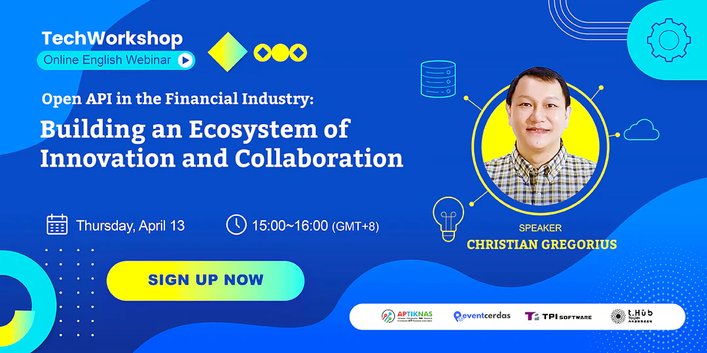

Ramping up digital transformation, the financial sector is embracing Open Finance to deliver more diversified services. Open Finance, evolving from Open Banking, refers to the secure data sharing between financial institutions and third-party service providers, as well as the integration with non-financial industries such as healthcare, which enables better access to a broader range of customer data such as transactions, credit, investments and more for customer-centric experiences. In short, Open Finance works similarly to Open Banking, but on a larger scale.

## Why Open Finance?

With data sharing in a secure way, banks are able to expand the scope of financial services across various digital platforms through integration, embed services in applications, and further build an innovative service ecosystem. Open Finance empower consumers to have better access to financial data and greater control over how they engage with their finances. For financial institutions, they can collaborate and integrate with third-party service providers to create new business models and opportunities.

One example is crowdfunding platforms; unlike card payment going through several processing intermediaries, Open Finance transactions allow instant settlement with minimal payment fees, which further lowers investors ’operating costs.

### The Backbone of Open Finance

“Sharing” opens up more innovative possibilities, and the foundation of data sharing lies in API connectivity. APIs in financial services allow the communication and integration of different applications. Therefore, adopting an API-driven approach is the key to Open Finance. The open API market is projected to reach USD 13.21 billion by 2030, according to a recent study by Straits Research. We can expect that API-enabled ecosystems will continue to thrive in the next few years.

Building an Open Finance ecosystem requires the connectivity of APIs across core systems of organizations. However, the unscalability and inefficiency of legacy architecture have hindered systems from effective communication, and core modernization has thus played an important role. A middle platform can be the solution to modernize the monolithic and legacy systems for improved connectivity with internal and external services without replacing legacy infrastructure.

The shift to microservices in the financial sector relies heavily on APIs as small independent services communicate over APIs, which results in a high demand in API management.

Moreover, with the relaxation of regulations on cloud-based financial services, financial institutions are migrating to the cloud to have better flexibility and scalability. This has also led to the growth of APIs, as data is stored and processed in remote servers and needs APIs for communication.

When it comes to the adoption of a middle platform, a full-fledged, cloud-compliant middle platform featuring mission-critical components, zero-downtime, API management and more can ensure secure data communication. TPIsoftware’s DigiFusion can unleash your potential to foster Open Finance ecosystem and create API economy.

Open Finance expands financial inclusion, encourages innovation, and optimizes customer experience. With Open Finance, people can enjoy access to financial products and services with greater transparency and efficiency.

* * *

**Want to know more about Open Finance?**

**Watch our latest Tech Workshop online event!**

✨

[April Tech Workshop | Open APIs in the Financial Industry: Building an Ecosystem of Innovation and Collaboration](https://youtu.be/rxSOFdztgnY)

*Resource: TPIsoftware*

The financial industry is leveraging fintech to provide diversified services, improve efficiency and enhance customer experience, with API-driven financial services as the key to innovation and financial inclusion. APIs enable integration of technologies and services, allowing financial institutions to collaborate in new ways and legal manner; Open API can further foster cross-border transactions. As the global API management market size is projected to reach new heights by 2030, API economy is expected to create more and more business opportunities.

In this [webinar](https://eventcerdas.com/utama/event/open-apis-in-the-financial-industry-building-an-ecosystem-of-innovation-and-collaboration/), we will explore the trends of Open Finance in the financial industry, with a focus on the role of APIs in disrupting traditional financial services and enabling an innovative Open Finance ecosystem.

**Click here to watch the recorded webinar👉**[**https://youtu.be/rxSOFdztgnY**](https://youtu.be/rxSOFdztgnY)
