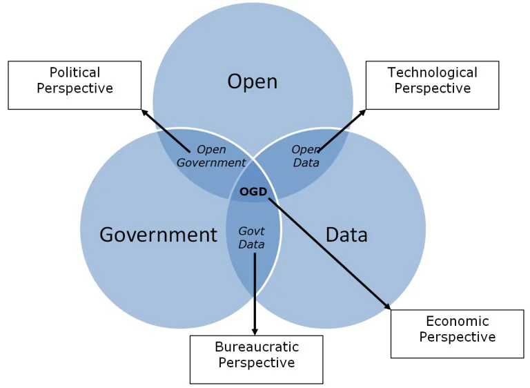
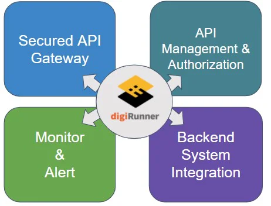
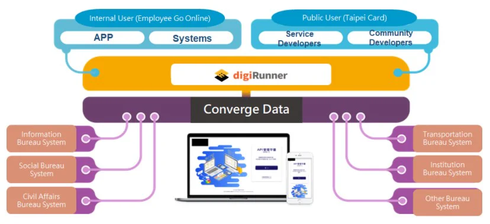

## History of an open government

The term “open government” initially was proposed by the American government during world war two. The purpose was to increase transparency of government administrations. In the recent years, this topic is once again explored in all places of the world and is being [implemented.In](http://implemented.in/) Africa, Morocco’s new constitution of 2011 outlined several goals the government wishes to achieve in order to guarantee the citizens right to information. As for Asia, Taiwan started its e-government program in 1998 and since then has had a series of laws and executive orders to enforce open government policies. It wasn’t until 2005, the plan started to have some clearer goals and legislations. In Europe, the earliest was in 1980, where the Netherlands government proposed the idea. In 2009, U.S. President Obama released a memorandum regarding transparency and open government and started the Open Government Initiative. In his memorandum, he proposed his administration’s goals to strengthen democracy through transparency, participation, and cooperation. Since the early 2000s, transparency has been an essential part of Chile’s Anti-Corruption and Probity Agenda and State Modernization Agenda. In 2008, Chile passed the Transparency Law, which led to further open government reforms.

### What is open government?

In general terms, an open government is one with high levels of transparency and mechanisms for public scrutiny and oversight in place. Therefore “transparency” is recognized as the traditional symbol for open government. In recent years, the definition of open government has expanded to include applying modern open technology to increase citizen participation and a desire to participate in government procedures, to enable the people to have a greater feeling of participation and understanding of government. When there is doubt, one could find the unit in charge and voice their opinions and participate in government legislative processes.(ref: [OpenSource.com](http://opensource.com/), What is open government?)

*Figure: Meaning of Open Government (Ref: The Multiple Meanings of Open Government Data)*

### Digitization of government

When a government is heading towards digitization and becoming a smart government, it not only needs to computerize itself, but at the same time open information is an indispensable in digitizing a government. Open information can increase the transparency of government legislation, increase citizen trust, improve public service delivery and make more effective decisions during the process with participation from all people.The Taiwanese government started pushing for computerized government in 1996. Its foundation was based on the internet and aimed to computerize and put government business and services on the internet. With the advent of smart phones and information digitization, the Taiwanese government also transformed in 2010 to take the original computerized government to a smart government. The biggest difference between the two is “open information.”Through the publication of information, a government can transform and provide more services to the public. At the same time, it can connection through data and realize the vision of an “one-stop service” government. Within the technology of open information, one must rely on Open API. Through Open API connecting government agencies and external applications (such as mobile APPs) to accomplish data exchange and sharing, as well as bring about many conveniences for the public through the connection of information. For example, in the past when you want to change your residential address, you must personally go to each of the related government department to apply. After API is open, the public only needs to change their address at one of the related departments and the address will also be changed in the other systems.API simply put is the bridge for communication between two systems. As one system’s services and information increase, the number of APIs will also increase. To increase the management efficiency of API and to connect information from each government departments, the API management platform is an indispensable helper at this point. The API management platforms on the market can all provide unified interface format and data encryption functions. Since government departments need to manage the massive amount of information internally and open to external use, as the platform provides the convenience of interface with the back-end system and the diversity for API management authorization, the API management efficiency could greatly be increased. In addition, if platforms provide figuration interfaces, allowing anyone to be able to learn to operate immediately, then that could save time for internal operation and management.Therefore, the self-developed API management platform from digiRunner becomes an indispensable helper in becoming a smart government. digiRunner complies to Open API Specifications (OAS) and allows government to unify API standards when opening API. Other than that, digiRunner also has set up strict information protection mechanisms, providing multiple API authorization modes and information encryption functions, settings that allows API attributes to be authorized and opened, this not only saves time on internal development and management, but even greatly decreases worries about information security.

*Figure: digiRunner features and is the one government need (Ref: TPI Software)*

References:

-   Wikipedia, Open Government ([https://en.wikipedia.org/wiki/Open\_government](https://en.wikipedia.org/wiki/Open_government))

-   World Justice Project, Open Government Around the World ([https://worldjusticeproject.org/open-government-around-world](https://worldjusticeproject.org/open-government-around-world))

-   National Development Council of Taiwan, Open Government ([https://www.ndc.gov.tw/Content\_List.aspx?n=0C5AB1D0FA5B64B8](https://www.ndc.gov.tw/Content_List.aspx?n=0C5AB1D0FA5B64B8))

-   [Opensource.com](http://opensource.com/), What is open government ([https://opensource.com/resources/open-government](https://opensource.com/resources/open-government))

-   Civicus Space ([https://monitor.civicus.org/](https://monitor.civicus.org/))
