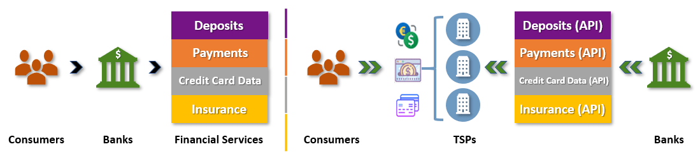
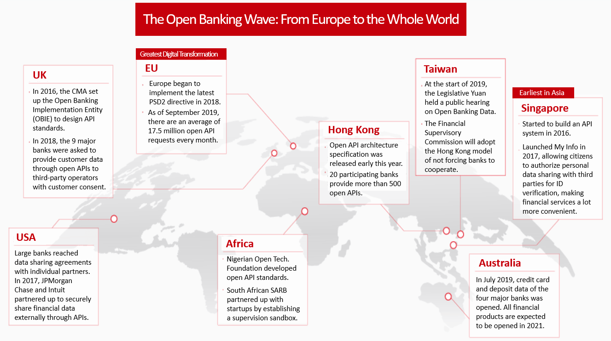
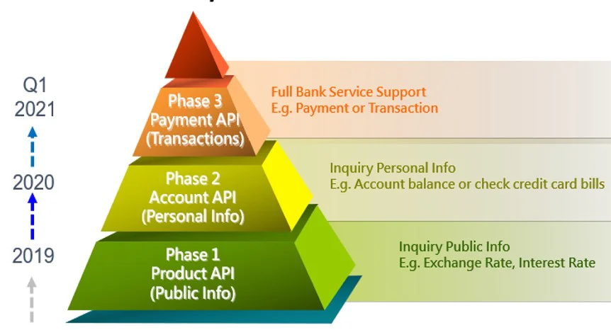
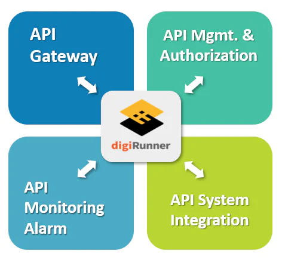

## What is Open Banking?

Have you ever felt frustrated by credit card application processes? You are asked to prepare a long list of financial documentation for the bank to review, which is not only tiresome for you, but also unreasonably time-consuming for both parties. For too long now, the power of data has been monopolized by banks. The right to use and open customer data has not been in the hands of the customer themselves but the bank the data is provided to.

Open Banking is here to change this. The essence of Open Banking is to give the power of data back to bank customers by giving them the option of opening up personal and transaction information to other businesses.

Brett King, the founder of New York online-only bank Moven, coined the phrase “Banking everywhere, never at a bank.” He was describing the concept of being able to use banking services anywhere, at any time, without being restricted to a physical bank. Open Banking is looking to develop this concept beyond banking systems and products by opening up data to third-party services and businesses.

In the past, if you did not wish to travel to a physical location to use the services of a bank, it was often necessary to use that particular bank’s own mobile app or website. Open Banking encourages banks to open up their data to third-party providers, which allows them to develop more convenient and diversified services for end users.

*Traditional banking vs. Open banking*

### The Open Banking Trend

According to Allied Market Research reports, the global Open Banking market was worth US$ 7.3 billion in 2018, and is estimated to reach US$ 43.1 billion by 2026 with a compound annual growth rate (CAGR) of 24.4%.

*Open Banking across the world (Source: Business Next)*

Open Banking was born out of the revised Payment Services Directive (PSD2) of the European Union in 2015. In August of the following year, the United Kingdom began to spearhead the movement by requiring nine of its largest domestic banks to adopt Open Banking practices, and later made it mandatory in 2018. The governments of the United States, Australia, and Singapore soon followed, also formulating relevant laws and regulations to encourage banks to join Open Banking.

The Open Banking trend has already blown all the way from Europe to Taiwan. In 2019, the Financial Supervisory Commission made a final decision to introduce Open Banking in three phases.

-   **Phase 1:** Opening up public information, such as exchange rates, mortgage interest rates, etc.

-   **Phase 2:** Opening up personal information, such as personal bank account integration and balance checking through third-party apps.

-   **Phase 3:** Complete opening up of all information, allowing payments, transactions, transfers, and more to be made through third-party products.

*3 Phases of Open Banking in Taiwan*

### How can banks join the Open Banking trend?

Open Banking requires banks to open data to third-party platforms with the consent of bank customers, allowing third-party platforms to provide more diverse and convenient services. To join the Open Banking trend, banks must start by opening up their data. Data sharing technology depends on Open APIs, which link internal data of financial institutions with third-party applications for data sharing and exchange. In addition to establishing new business models through cooperation with third-party platforms, financial institutions can also provide better user experiences, expand market applications, and build ecosystems.

According to the service type, APIs can be divided into the following categories:

-   **Product category:** Mainly public information of banks, such as interest rates, loan calculations, branch/ATM locations, etc.

-   **Sales:** Bank products, such as credit card application forms, online applications, etc.

-   **Personal information of customers:** Mainly for inquiries, such as account balance and asset allocation inquiries.

-   **Transaction type:** Used to execute transactions, such as transfers, fund orders, tax payments, bonus exchanges, etc.

-   **Other functions:** ID authentication, API information, internet connection, settings, etc.

In order to join in on this trend, financial institutions and third-party providers need to prepare their APIs in advance to ensure they comply with national laws and regulations. Although different countries have different standards for their Open Banking APIs, as a whole, common standards have been defined, covering management specifications, architecture, and security mechanisms.

In order to accelerate the growth of Open Banking adoption, financial institutions and third-party providers must also consider adopting API management platforms. API management platforms provide unified interface formats and data encryption functions as well as graphical operation interfaces, flattening the learning curve and making them easy to use. Users can quickly become familiar with the system, saving companies time and effort.

API management platforms can also provide external partner authority control, a key function for opening up APIs. For ID verification and API authorization, as most countries base their practices on OAuth2 then later strengthen their management, it is important to choose a platform which can satisfy all authentication methods and authorization specifications, as well as make additional development of related APIs easy. Because laws and regulations vary among countries, the ability to adjust the platform according to the individual needs of each enterprise should also be evaluated.

Choosing the right API management platform can not only improve the efficiency of API docking, but also greatly reduce API management time for internal personnel. It is an indispensable helper for both parties if they wish to enter and succeed in the Open Banking era.

*digiRunner provides comprehensive functions, making it an indispensable helper for entering Open Banking*
