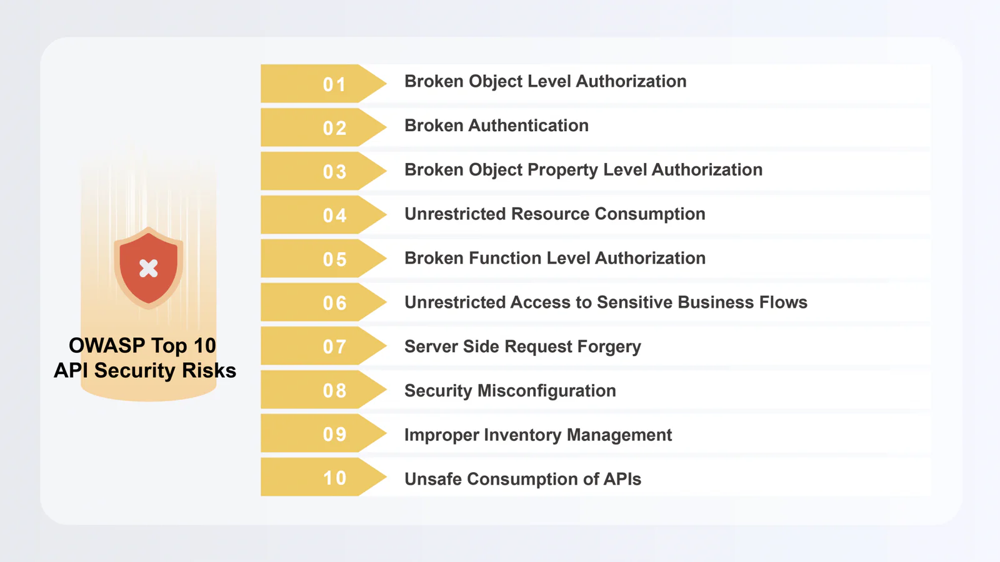

API connections are essential pillars of a modern architecture in terms of connecting internal systems and integrating external resourcaes. The number of APIs increases when businesses evolve, making it difficult to secure API management.

API security issues in recent years have highlighted the vulnerabilities lying in AI model platforms that allow threat actors to create malicious models by modifying training data. A renowned security research team scanned millions of URLs and discovered more than 18,000 API secrets were exposed, leaving businesses at risk of suffering substantial losses, regulatory penalties and severe consequences.

## What is OWASP? How Does it Relate to API Security?

The Open Worldwide Application Security Project (OWASP) is a non-profit organization dedicated to improving software security. Working towards the vision of “No more insecure software,” their projects, tools, documents, forums, and chapters are free and open to anyone interested in improving application security. Among them, the latest OWASP Top 10, published in 2023, is a well-known standard awareness document for developers and web application security. It is a comprehensive guide to understand the risks and threats associated with APIs and how they can be effectively prevented.

### OWASP Top 10 API Security Risks (2023)

Compared to the 2019 edition, the 2023 OWASP Top 10 API Security Risks list includes new entries (No.6, 7 and 10), highlighting the importance of authorization, request forgery and inventory management in securing APIs.

**1\. Authorization**

3 items (No.1, 3 and 5) on the list pertain to authorization. The “object” mentioned on the list refers to data control. APIs play an important role in connecting services and data across various platforms by using objects and attributes to exchange data. In a case where object attributes are not properly verified for access control or the authorization is too complex, vulnerabilities can arise, leaving the APIs susceptible to attacks.

**2\. Request Forgery**

Server-side request forgery vulnerabilities occur when an API fails to verify users’ identities and the legitimacy of their actions. This allows attackers to coerce the application into sending crafted requests to unexpected destinations, gaining access to back-end data even when it is protected by a firewall or VPN.

**3\. Inventory Management**

To mitigate the mentioned security risks, it is essential to implement proactive strategies for monitoring and managing APIs. Incorporating an industry-compliant API management platform into existing systems enhances efficiency and security.

### Stay Risk-Free With API Governance

What we just discussed gives us a better understanding of API security and the potential risks associated with APIs. To be devoid of API security risks, implementing API governance is where you can get started with.

API governance is the framework that ensures your APIs are high quality, consistent and compliant while aligned to your business goals. The set of practices focuses on establishing policies, regulations, processes and standards specifically for APIs to ensure proper execution and operations.

To begin with API governance, an organization should first come up with API strategies and define their goals. They will need to take a closer look at their current condition and operational needs while gauging their API maturity level in order to establish API governance guidelines based on the evaluation. Without a set of proper guidelines, the organization cannot develop concrete implementation plans aligned with the API governance framework, nor can they modernize the API architecture to improve the efficiency of API management.

To devise successful API strategies, a comprehensive APIM platform should come into play. digiRunner, a robust API management platform developed by TPIsoftware, is compliant with industry-standard protocols such as OAuth 2.0, OpenID Connect (OIDC) and API keys for authentication, with Mutual TLS (mTLS) and JWT adding an extra layer of security to data verification. digiRunner is capable of managing the entire API lifecycle and features a zero-trust security model that safeguard APIs against the top 10 security risks laid out by OWASP.

With digiRunner Composer, composing APIs has never been easier. By simply dragging and dropping nodes on the user-friendly graphical interface that supports format conversion, a new API can be created with ease. The composer also serves as the intermediary for data transformation and connectivity, inspecting and monitoring APIs when requests are made. External API calls can be categorized and published by access types through the digiRunner’s develop portal. A sandbox is incorporated to run an API test in a controlled environment using mock data without the risk of compromising real-world data.

Have your APIs actively safeguarded and stay risk-free with digiRunner. Reach out to us to learn more.
