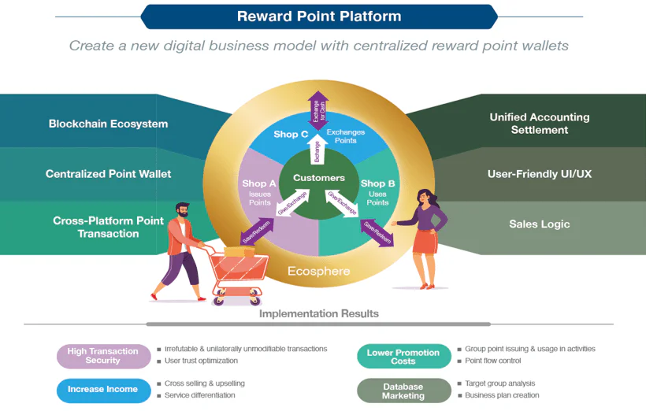
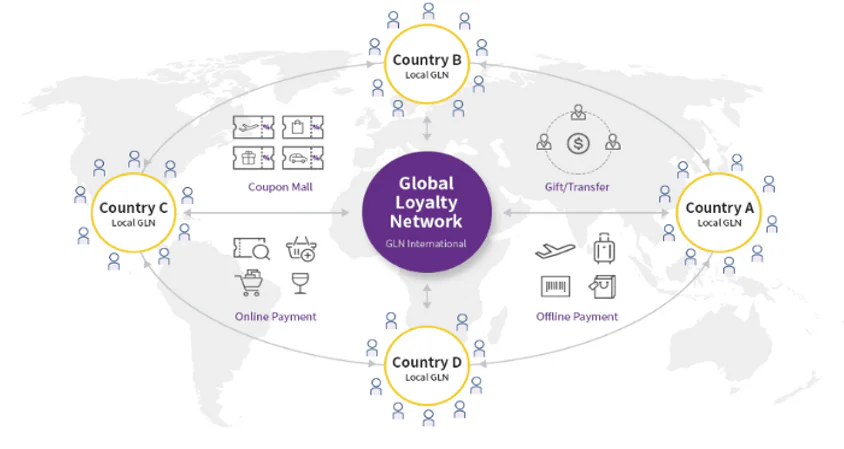

Loyalty programs and point economies are relatively new concepts which are gradually incorporating themselves into our daily lives. These trends are not only changing consumer behaviors – they are also influencing the strategies and practices of corporations. This has led the development of loyalty programs and their reward point applications to mature and become more diversified. Due to the consolidation of platforms and services, reward point applications are now more flexible for use across multiple channels and less bound to a single brand that only runs an online or offline store. Such a cross-brand and cross-platform movement is starting to make waves, driving fierce competition for market enclosure.

2020 has been the year of Fintech, Open Banking, and digital banks. This is largely due to the challenges brought upon the world by the global pandemic, which has stimulated the so-called “Zero-Touch Economy, Zero-Distance Innovation.” Almost all traditional financial institutions are actively accelerating their digital transformations to keep up.

In Taiwan, the Financial Supervisory Commission has raised the bar by allowing commercial banks to launch more sophisticated loyalty reward point programs beyond old-fashioned credit card reward points1. These new programs are more valuable to customers because they enable the exchange of points for rewards on popular platforms. These include Open Points, Line Points, UUPon, and HappyGo, among others. Traditionally, these points could only be used in their designated shops, such as Open Points only being valid for discounts in 7-Eleven stores. Once the necessary infrastructures and platforms are fully built, customers will be able to utilize their reward points more effectively by exchanging them into rewards from popular shopping channels.

The platforms use an improved point system which increases retargeting effectiveness for all businesses involved. Taking advantage of open data, big data, AI, and machine learning, all integrated with marketing technologies, the shopping behavioral pattern of customers can be identified even they are not credit card members or directly buying from the channels in question. This facilitates precision marketing application to promotions when more suitable products are released to the market.

Over the last decade, loyalty and reward programs have proven to be an effective way to drive customer retention, boost customer lifetime value, and strengthen loyalty. A truly innovative approach to customer loyalty programs can generate huge profits. For large corporations, figuring out how to utilize AI, big data, cloud sharing, fintech, or even blockchain technologies to enhance loyalty programs has become a priority. Data security and related regulations must be handled carefully during development and after launch.

Cathay Financial Holdings was one of the first in Taiwan to build its own internal digital infrastructure. In 2018, it teamed up with TPIsoftware to establish the platform on a private blockchain. This enabled the integration and mutual conversion of different rewards point programs in the banking, insurance, and third-party ecommerce industries. All the points are consolidated into “Tree Points,” available to all Cathay customers on the designated mobile app.

Do these platforms need to be built on blockchains? The short answer is no, not really. But blockchain is the right choice for applications requiring high security, immutable ledgers, and consensus between nodes. The advantages of building a reward point exchange platform on blockchain are as follows:

1.  Highly secure & unhackable. Thanks to the consensus algorithm and proof of work, attackers must spend an unrewarding amount of time and resources just to manipulate each data point. Chains cannot be attacked at a single data point unless all the nodes carrying data have been re-written and compromised.

2.  Perfect for ledgers, smart contracts, and legal documents. All exchanges and transactions require legal contracts with physical signatures, which takes up a significant amount of time. Blockchain can digitalize this process by enabling smart contracts to be created and executed directly between the relevant parties, with less lawyer involvement.

3.  For the future. Any needs or services which need to be developed on a blockchain will find flexible and agile deployment.

However, as stated previously, the relevancy of an exchange platform being built on a blockchain is purely based on strategy. “As opposed to going at it alone in execution, blockchain is much more appropriate for cross-functional, cross-industrial, and cross-organizational collaboration.”

So what comes next? How can loyalty programs and reward point platforms be managed from this point on?

Building up: While other organizations are busy trying to build their own platform, a derivative ripple effect is reaching markets and consumers. Which platform is better? Which brand of reward points has a better cost-value ratio? Comprehensive point consolidation is the key to this problem. For example, Taishin International Bank is collaborating with the Korean Hana Financial Group for the GLN (Global Loyalty Network). Members can earn points and cash reward points from overseas travel or ecommerce shopping.

If an organization can collaborate with the local government and other big brand reward points platforms to make points interchangeable via different channels and merchants, the result will not only benefit consumers, but also the entire market and economy as a whole.

Trickling down: The current market mechanism focuses on the exchange of reward points for physical products and goods. The fact is that they can also be exchanged for services and other benefits. Take Amazon Prime as an example, which allows members to exchange points for faster shipping or higher priority for limited edition products.

Being creative: There are still many innovative usages left to be discovered for reward point platforms. There is no real application yet which allows end users to donate reward points to charity. This would be a perfect scenario for blockchain to be the infrastructure and backbone of the platform, providing a clear ledger, well-listed legal documents, and highly secured capital flow. In gaming and entertainment, well-known brands like PlayStation, Google, and Microsoft have reward points which are popular among gamers. However, none of those are interchangeable among each other. It would certainly be a hit with users if they could be consolidated by trusted authorities such as IGN or Twitch.

Consolidating: Consolidating online and offline points would be a big advantage for small businesses, a big part of any country’s annual GDP. Most small businesses do not possess the abilities to digitalize their reward point programs, but partnering up with organizations who can would greatly benefit the economy. Businesses like restaurants, gas stations, supermarkets, trains, and hotels are a few potential targets which can be integrated into a well-developed reward points platform.

“Ubiquinomics” is the way of the future. Customers no longer seek out products only – they also look for experience enhancement at anytime, anywhere, from any device, with any payment method, and through any channel. Reward points platforms are becoming an important part of this. Business model and management must be constantly challenged and reinvented to keep up with the changing times. Therefore, loyalty programs must also be digitalized and integrated to keep up with evolving demands. And you never know – a successful reward point platform consolidation can be a the next bucket of gold.
