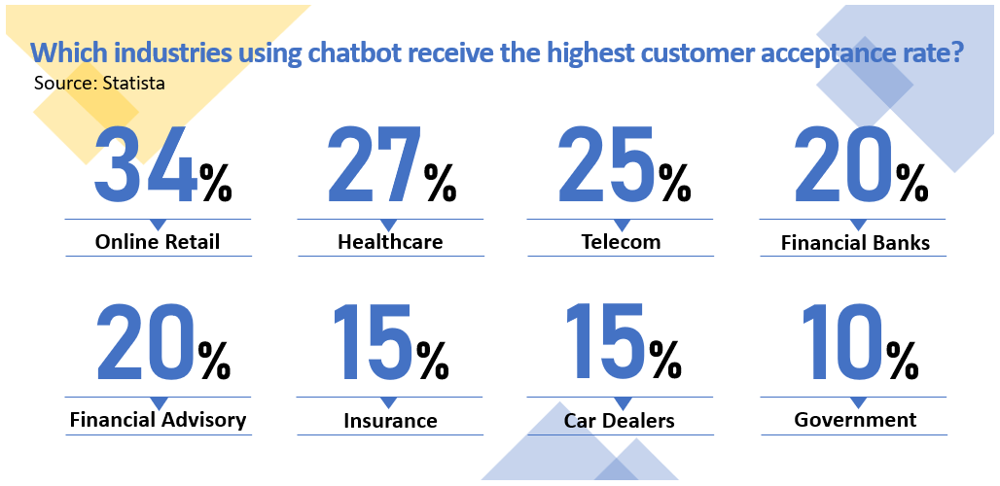

More and more retailers are introducing smart customer service chatbots to ease the burden placed on customer service staff. Statista, one of the biggest statistical databases in the world, recently announced the industries using chatbots with the highest acceptance rates among customers. Out of all the industries, retail takes the lead, and becomes the only industry with an acceptance rate over 30%.

According to data published on the official website of the American marketing consulting firm Invesp, in the past year, more than 67% of customers around the world have met their needs for products and services through chatbots. This number indicates that people have already developed a habit of using chatbots to acquire services. But in the current retail landscape, how should chatbots be built and implemented in order to reduce the burden placed on customer service staff while allowing chatbots to generate new value?

## A better consumer experience with service chatbots

To implement a chatbot in a retail business, you must first decide whether you want a chatbot specifically for marketing support or a service-based chatbot for intelligent customer service. Marketing chatbots are mostly implemented in conjunction with marketing projects and built in accordance with the theme of the social media post or promotional activity planned. Once the marketing activities are over, the lifecycle of the chatbot value ends, and product-related services cease to be provided to customers.

In comparison to the marketing type, service chatbots create a lot more value for organizations. In the retail industry, most service-oriented chatbots, such as those employed for smart customer service in many companies, can enable general information inquiries for customers via APIs or other similar connection methods. Beyond standardizing information, customers can also use chatbots to “complete” their services.

### Is your chatbot smart enough? Build a smart brain with NLU!

Beyond assisting customer service staff in handling basic tasks, chatbots come with many other advantages and can also generate additional value for companies. Why, then, do we often hear people claim that “smart chatbots are not smart at all” or “they do not understand what I am saying”?

In the past, most chatbots were established with keyword matching technology. If consumers were to ask the chatbot questions that are not preset, the chatbot would not understand them. In addition to keyword matching, there are other methods which can be used to make chatbots smarter.

Take SysTalk.Chat as an example. SysTalk.Chat is an AI conversational platform which uses natural language understanding (NLU) to perform intent classification and entity recognition. This allows the chatbot to understand conversation content and correctly grasp customer service needs and information, thus identifying subsequent corresponding service processes.

For a detailed example, think of a customer inquiring about the business hours of a retail store. If the chatbot is trained with NLU, whether the customer asks “Will your store be open at 10am?” or “I want to know your business hours,” the chatbot will understand that the customer wants to know the “business hours,” because the intention behind these two sentences is the same. On the other hand, if the chatbot is trained with keyword matching, the customer may have to say “I want to know your business hours” exactly to get the answer. This kind of input method, however, does not suit the general inquiry habits of customers and lacks the human touch of a smarter chatbot.

Create new retail value with a chatbot that can better understand customer minds and complete more services successfully. As the Statista survey indicates, 64% of companies believe that chatbots can provide a wider variety of services for customers. For the retail industry, chatbots are not only used as marketing tools – they must also be deeply rooted in consumer behavior to improve service quality.
