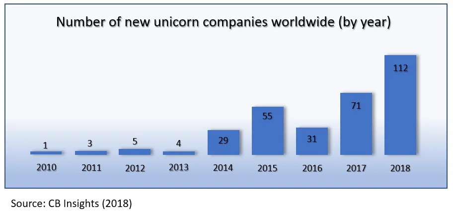

Fintech has become an increasingly hot topic in recent years, expanding its applications to many aspects of daily life. The reach of fintech today spans from self-checkouts at supermarkets, cardless cash withdrawal, and mobile phone number transfers, to AI-powered voice transfers and account detail inquiries. The global impact of the 2020 pandemic has drastically empowered the development of the so-called “stay-at-home economy,” which in turn has accelerated the rapid growth of fintech.

Large amounts of funds have been poured into the private equity market, out of which many unicorns have emerged. In business, a unicorn refers to a privately-held start-up which has not yet been listed but is valued at more than US$ 1 billion. According to statistics from CB Insights, only 39 companies managed to join the coveted unicorn club in 2013, a number which soared to 151 by 2019. Start-ups which reach much further heights and achieve valuations exceeding US$ 10 billion are called decacorns. As almost all companies valued above US$10 billion are already listed, decacorns are extremely rare.

Among existing decacorns, there is a Fintech company headquartered in Silicon Valley which offers a trading platform for cryptocurrency, stock, options, and funds. It is Robinhood, an American brokerage firm established in 2013 which claims to be a modern Robin Hood, robbing the rich to help the poor by bringing Wall Street profits to the general consumer. By enabling users to enter the securities market without handling fees or commissions, Robinhood has quickly become a favorite in the investment tool market of younger generations. Since its establishment, Robinhood has acquired a total of 13 million users, with the first seven months of 2020 adding 3 million users.

Traditionally, brokers make money by charging handling fees. Robinhood has changed the rules of the game by forcing Wall Street brokers to lower these commissions, an innovative turn in itself. Pushing for change even further, Robinhood offers a financing solution called Robinhood Gold which allows members to borrow double their account balance for as little as US$ 5 a month. Rather than charging interest, Robinhood Gold simply requires members to maintain their cash balance above US$ 2000.

For a stock trading platform, Robinhood has attracted a relatively young user base: the average user age is 31 years old. The lack of handling fees and refreshingly modern user-friendly UI has drawn many first-time investors to Robinhood, a platform which allows them to begin trading stocks with a simple process and no overwhelming amounts of information. Investment information, however, is far from sufficient for veteran investors, who may have no compelling reasons to make Robinhood their trading platform of choice. To grow its user base, Robinhood also offers a recommendation mechanism which rewards recommender and recomendee with randomly selected stocks valued anywhere from US$ 2.5 to US$ 200.

On the whole, Robinhood breaks the operational logic of traditional stock trading software, which attracts those between the ages of 20 to 35, born into the internet era and accustomed to getting everything done online. Fee-free transactions, no minimum account opening amount requirement, and fixed financing interests which do not change with interest rates make Robinhood stand out among its competitors. In addition to stocks, funds, and options, users can also invest in cryptocurrency, features which are perfectly in line with the consumer habits of younger generations. As stocks soar and continue to hit new highs, swarms of first-time investors are naturally attracted, making Robinhood the most popular investment platform in the United States.

However, public opinion on Robinhood is divided. Due to the capital market condition this year, U.S. stock prices keep reaching unprecedented highs, baiting many new investors who, in making money, often forget that investing is a risky business. In seeking to continuously increase leverage investments and generally finding available financing or options, situations can spin out of control and cause regrets. In June of this year, an American college student took his own life after mistakenly believing he had racked up big losses through Robinhood and owed US$ 730,165 in debt. The number he saw, however, was only a temporary number during the option transaction process, and his actual debt was not nearly as large, pointing at obvious flaws in a system supposedly designed for first-time investors.

Additionally, system security and load capacity are crucial when dealing with cloud-based systems. The U.S. stock market plummeted and rebounded rapidly in March, and Tesla’s August surge caused another abnormal increase in stock trading volume. Retail investors on Robinhood took advantage of these opportunities to enter the market in large numbers, paralyzing the system for several hours and slowing it down after it went back up. Because of its outsourcing mechanism and lack of customer service, many Robinhood user complaints were sent directly to the competent authorities, which led to investigations by the U.S. Securities and Exchange Commission (SEC) and the Financial Industry Regulatory Authority (FINRA).

Although Robinhood has been at the center of a fair share of controversy, its design and business model are still worthy of reference for traditional investment platforms. Just seven years into its establishment, Robinhood has become the most popular investment platform in the U.S.

Its various innovations have forced traditional brokerages to follow up, evidenced by the likes of JP Morgan, Firstrade Securities, and other firms also beginning to not charge handling fees. What innovations will follow? How will it affect the market? Robinhood is rumored to be preparing for a 2021 Q1 IPO. Whether it can succeed or not remains to be seen.
