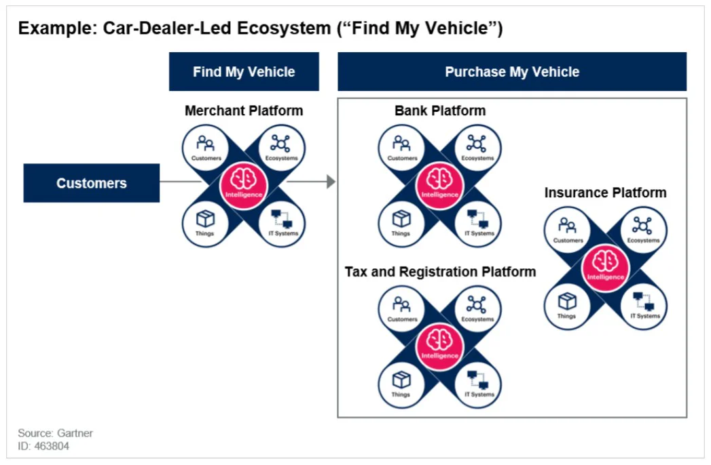
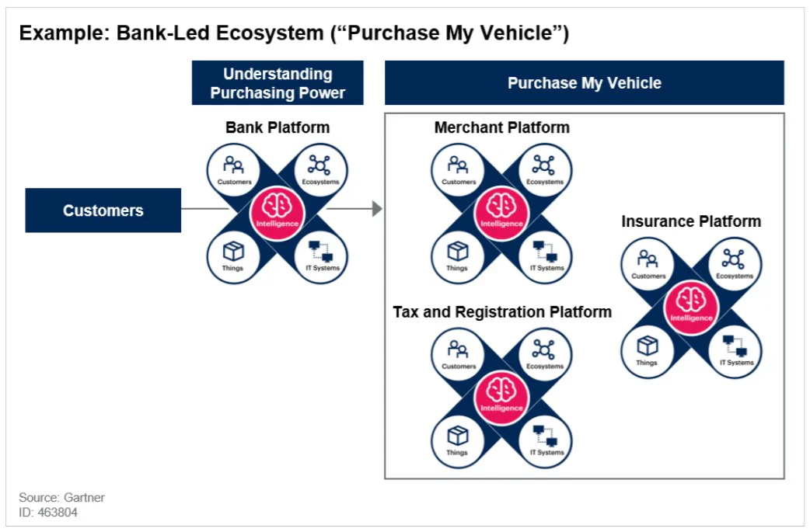

How long has it been since the last time you stepped foot in a bank? As smartphones and lifestyle apps become more deeply embedded in our everyday lives, a financial ecosystem is quietly taking form. It begins with the opening of financial services for mobile platforms, which allows banks to enable direct interaction with their customers at any time of the day, no matter where they are. By linking third-party service offerings, the ecosystem achieves a perfect equilibrium.

In the future, this ecosystem will gradually change the financial service experience in the following three aspects:

1.  Consumers will find new financial application scenarios for daily use

2.  Banks will accelerate third-party cooperation with open banking strategies

3.  Banks and third-party players familiar with fintech will spur industry innovation

## Financial Ecosystem

In the near future, the financial records of individuals and companies will no longer be limited to the sole use of banks. According to research done by Gartner, regulating bodies will be the biggest driver behind the deliberate opening up of data by banks. At present, half of the G20 countries are beginning to incorporate open banking strategies and searching for new financial product, marketing, and business models. They are also conducting Regulatory Sandbox experiments, which allow fintech startups as well as other innovators to conduct experiments in controlled environments.

However, innovations which fail to consider user consumption patterns and timing will not be effective. Finding a way to successfully embed fintech innovation into the consumption model and drive the flow of both individuals and enterprises will be an important direction in the development of the financial ecosystem. In other words, the definition of “financial scenario” will be key to the overall success of the ecosystem.

### Financial Scenario

The “financial scenario” model is built on the idea that the concept of banks needs to evolve from a physical place to a behavior, making bank services ubiquitous. The push for industry-wide adoption of fintech and open banking practices has given financial services the technology and ability necessary to make this evolution happen.

The biggest challenge of this model is finding the connection of financial business scenarios to situations which can be envisioned in real life. With consumer behavior data, services and products can be actively embedded into the lives of target customers, and incorporating the internet industry can help give way to more imaginative services and a whole new business model.

### 9 Major Field Innovations Join Hands to Accelerate Financial Scenario Realization in Taiwan

FinTechSpace, a fintech hub established by the Taiwan Financial Services Roundtable, recently held a seminar on innovatice corporate topics, inviting related institutions and start-up teams to stimulate creative sparks in fintech.

The seminar concluded with 9 innovative topics, each led by a corporate-backed lab. These were announced as follows: the Shanghai Commercial and Savings Bank “Cloud Bank Innovation Lab”, the CTBC Financial Holdings “Innovative Data Application Lab”, the Microsoft Taiwan “Intelligent Banking Lab”, the SinoPac Financial Holdings “Innovative Open API Lab”, the Cathay Financial Holdings “Blockchain Innovation Finance Lab”, the NEXT BANK “Cross-Domain Finance Lab”, the EasyCard “Cashless Life Innovation Lab”, the LINE Bank “Life on LINE Lab”, and the Far Eastern International Bank “Double B Lab BaaP by Bankee Community Bank”. The results of these labs are expected to be published by the end of the year.

According to the Taiwan Financial Services Roundtable, in the past two years since the founding of FinTechSpace, more than 140 fintech and cross-domain players, both domestic and foreign, have received coaching. In the near future, the relationship between the financial and technology industries will grow closer than ever. Using banking infrastructures and existing resources, combined with the technical assistance of important fintech players, will enable two-way cooperation which can assist the financial industry in creating more innovative products and reviving the entire marketing.

### Financial Scenario Starts with the Consumer Journey

Looking to the future, it is clear that banks will need strong leadership to participate in and support “financial scenarios” constructed by consumers, other banks, and third-party players. As these potential “scenarios” lie in the daily lives and choices of consumers, different consumer journeys must be taken into consideration.

Take the two following consumer journeys for car purchases as an example:

**Journey 1: Finding the car I want**

The journey begins when a customer wants a car with certain specifications. In this case, the customer knows what they want and can find a car which suits their needs in the market. Next, the customer needs financing and insurance services. This type of scenario is a type of ecosystem dominated by merchants (pictured below).

After consumers use car dealer services to understand vehicle specifications, bank financing, insurance fees, vehicle taxes and other fees can be paid for to complete the one-stop car purchase process.

**Journey 2: What car can I afford with my budget?**

This journey begins when a customer asks what cars they can afford with their budget. In this case, the customer is looking to understand their options based on their budget, including financing, vehicle taxes, and other expenses. These scenarios are bank-led ecosystems (pictured below).

After consumers use banking services to understand their purchasing power, the purchase of the car and payment of insurance fees, vehicle taxes, and other services take place to complete the one-stop car purchase process.

The cases above are only two examples of user journeys for car procurement. In real life, much more complex ecosystems will develop, as well as many more variations.

To complete the above-mentioned one-stop process, the opening up of API services (interfaces for calling services) by financial institutions is essential. Gartner predicts that a collaborative “open API” environment will become the key financial ecosystem growth, and that this ecosystem will provide new opportunities for payments.

**API: The Key to Financial Scenarios**

With the rise of “financial scenarios”, bank services must become available everywhere, at any time, and one of the key technologies to enable this is API. In “financial scenarios”, banks act as the API, forming the so-called “Open Banking”. In the past, customer account information and financial data were assets solely owned by banks. “Open Banking” means that banks cooperate with third parties through open APIs to share financial data, handing back the power of financial data to consumers. Consumers can obtain more diversified financial services, and third-parties can develop new applications with the open data, creating a huge “API Economy”.

In the “Open Banking” environment, private banks are moving the fastest. KGI Bank is a pioneer in the field of Open APIs, taking out the Open API service “KGI Inside” as early as November of 2017. So far, it has cooperated with accounting, individual payment, and community payment apps. Taishin Bank, which provides similar services, has also cooperated with Moneybook, Financial Information Co., NCCU, and a Japanese e-commerce website. These partnerships have allowed the bank to seize financial scenarios such as deposit interest rates, exchange rate information, handling fees, ATM locations, and more. CITIC Bank also provides APIs for the exchange of reward points, which connects with big names like 7-Eleven, the largest convenience store chain in China, as well as Chunghwa Telecom, the largest telecom service provider.

**TPIsoftware: Strategic Partner for the Financial Ecosystem**

With 15 years of experience, TPIsoftware is a trustworthy partner committed to providing software solutions which help companies successfully promote digital transformation. After years of cultivating the industry, TPIsoftware has become a digital financial technology expert, acquiring an outstanding reputation among customers in terms of security, execution and reliability. TPIsoftware provides customer-oriented services through professional teams and one-stop corporate solutions, and has successfully assisted Taiwanese domestic and foreign banks, as well as government agencies, in building online banking systems and implementing API services.

The fintech revolution is well underway, and the financial ecosystem is already sprouting. Of all the advances taking place, Open Banking is just the beginning. In the future, the opening up of APIs can reach securities investment and insurance services, allowing the entire financial industry to connect market services through APIs and satisfy changing customer needs. The convenience of one-time purchases will drive the open financial ecosystem.

**Financial Ecosystem Cases:**

Four new patents under the belt! Shin Kong Bank and TPIsoftware revolutionize finance industry with new API management applications

TPIsoftware and Taishin’s API Management Platform awarded with Global Finance award
