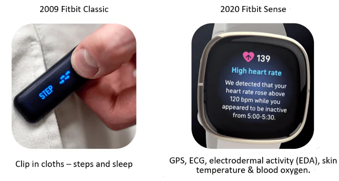
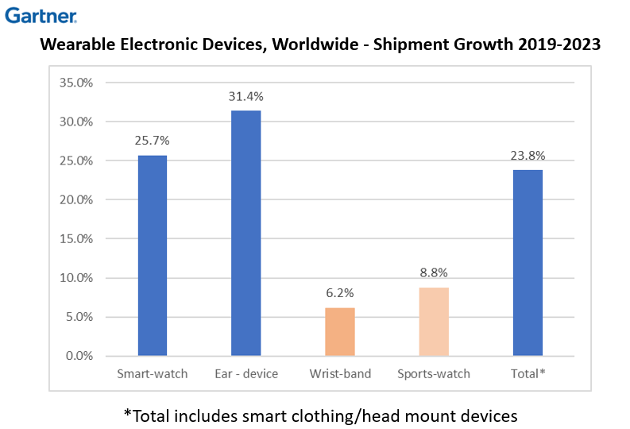
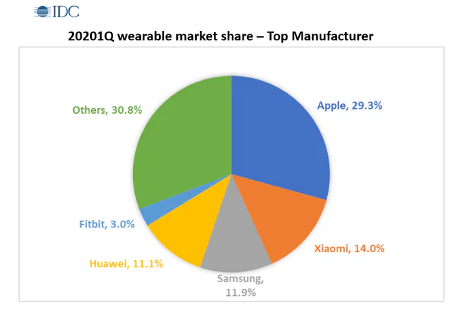
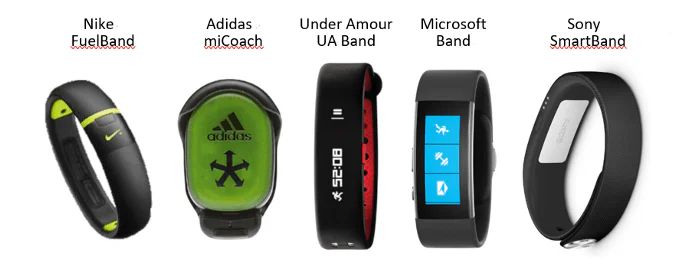
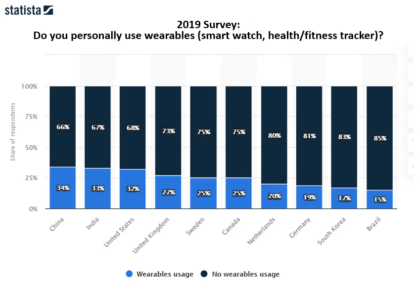
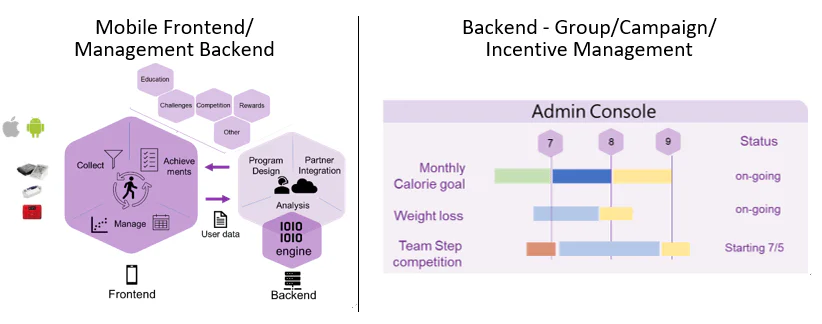

New generations of wearables are introduced every year, from big name brands to smaller, lesser known ones, all with more useful features and greater promises to make you healthier with larger amounts of data. Consumer wearables were introduced over 10 years ago as a simple yet revolutionary invention; devices that could track steps, stairs climbed, and other exercises. Most of them connected with smartphones via Bluetooth and apps.

Over the years, wearables have evolved to include temperature, sleep quality, and heart rate monitoring. With advanced sensor technology and miniaturization, devices can now also track stress, falls, blood oxygen, blood pressure, electrocardiography (ECG), and heart rate variability (HRV). Some devices have cellular signal and can work independently from a phone.

## What do the numbers really say?

In a 2019 study, Gartner predicted that 272 million wearables would be sold (US $51.5M) in 2020 and that this number would grow at 22.1% to 526 million units (US $87.9B) by 2023. Gartner predicts that the wearable device market will continue to grow, but most of this growth will come from multi-purpose smartwatches and new, trendy earbuds, such as AirPods and Samsung Galaxy Buds. Fitness trackers and other wrist bands are not expected to grow in sales, a trend recognized by the IDC.

The latest market share estimates put Apple, Huawei, Xiaomi, Fitbit and Samsung at the top of the manufacturer ranking. However, for most companies on the list, wearables do not form part of the core business, serving only as a compliment to their smartphone-centered ecosystem strategy. Fitbit, the only pure fitness tracker manufacturer in the ranking, suffered from declining revenue during the past quarters, and was acquired by Google in 2020.

As far as the statistics go, they are a clear representation of the reality which surrounds us. The average person probably does not remember the last time they discussed daily steps or other fitness measurements from wearable devices with their friends or family. Wireless earbuds like AirPods, on the other hand, are everywhere.

### Why don't wearable fitness trackers work?

Fitbit was perhaps the longest and oldest player in the “Quantified Self” revolution of the 2000s. The term “Quantified Self” refers to acquiring knowledge of the self through numbers by doing self-tracking with technology, a phenomenon which brought lifestyle data into our daily lives for the general improvement of fitness and wellbeing.

Before the ubiquitous Apple Watch, Xiaomi Bands, and Fitbit trackers, many big-name brands entered the market full force. These include Jawbones, Nike, Adidas, Under Armour, Microsoft, and Sony, among others.

As their wearable model strategy proved to be unsuccessful, all these manufacturers eventually exited the fitness tracker market. A Gartner survey showed a fitness tracker abandonment rate of 30%, with users reporting that they did not find wearables useful or interesting enough. Another finding showed that the majority of people who purchase wearables stop using them over time. Before Fitbit was acquired by Google, although it had sold over 100 million devices, only 28 million users were actually active. This indicates a large number of unused wearables, forgotten about in a drawer somewhere.

People abandon fitness trackers for the same reason they stop using home gym equipment over time: self-idealization. In aspiring to be better, we ultimately delude ourselves into thinking that a new, shiny wearable with more data output than before will help change behaviors and improve health. It is this idealization that convinces people to purchase wearables, but the reality is that after receiving more data about ourselves, we are still not motivated to make better choices in health or fitness. Wearable devices also have notification functions, but in a world where everyone always carries their smartphone on them, a wearable is a mere accessory.

### Then…what works?

Health and wellness remain very important topics as more and more people are becoming sedentary and obesity rates skyrocket. The WHO estimates that obesity has tripled since 1975, with more than 1.9 billion adults being overweight.

A 2016 Singapore study published in Lancet, a famed medical journal, might be pointing to a possible solution. The year-long randomized controlled study of 800 people compared improvement in health in result to a combination of activity trackers and cash/charity incentives. According to the study, “the cash incentive was most effective at increasing moderate-to-vigorous activity (MVPA) at 6 months, but this effect was not sustained after the incentives were discontinued.” This indicates that physical activity is motivated by attractive incentives, and that long-term incentives need to be in place in order to sustain physical activity levels.

### Motivate long-term wearable usage with healthcare management platforms

To ensure sustained improvement in fitness and health, the main causes behind fitness tracker and other wearable abandonment must be addressed. A healthcare management platform which can integrate health and activity data tracking technology with gamification and reward functions is bound to increase participation and encourage long-term usage.

HealthOn is an example of such a platform. HealthOn is a comprehensive health and wellness management solution that brings the user experience beyond a simple app to pair with a fitness tracker. It includes social features, challenges, and rewards to help users stay motivated in achieving long-term wellness and fitness objectives. The platform can be deployed in a scalable, modular way to any organization, business, or school, extending the impact of the solution beyond the personal level, thus increasing its efficiency.

The implementation of a wellness management platform by an organization, company or school may sound like a luxury, but taking employee health for granted is no longer an option. There is a real value to investing in the wellness of the people in your organization. Stay tuned for our next health management article, where we will further explore the benefits of healthcare management platforms for organizations.
