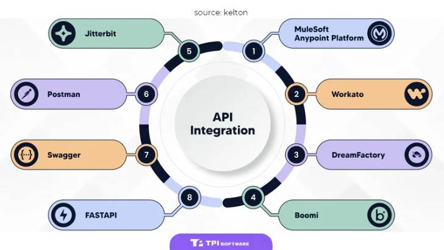

Trong kỷ nguyên số hóa bùng nổ, dữ liệu và ứng dụng phân mảnh trở thành thách thức lớn cho mọi doanh nghiệp. Làm thế nào để các hệ thống phần mềm "nói chuyện" được với nhau một cách trơn tru? Làm sao để tự động hóa quy trình, nâng cao hiệu suất và tạo ra những trải nghiệm khách hàng liền mạch? Câu trả lời nằm ở [**API Integration**](/vi/blog/api-intergration) - Tích hợp API.

Bài viết này sẽ đi sâu giải mã API Integration là gì, tại sao nó lại quan trọng đến vậy, quy trình triển khai, những thách thức và cách lựa chọn giải pháp phù hợp, đặc biệt là cho các doanh nghiệp tại Việt Nam đang trên đà chuyển đổi số mạnh mẽ.

## API Integration là gì? Giải mã thuật ngữ cốt lõi

Trước khi đi vào "Integration" (Tích hợp), hãy cùng làm rõ "API".

### Định nghĩa API (Application Programming Interface) đơn giản

Hãy tưởng tượng API như một "người phiên dịch" hoặc một "bộ quy tắc giao tiếp" giữa các ứng dụng phần mềm khác nhau. Thay vì phải xây dựng mọi thứ từ đầu, các nhà phát triển có thể sử dụng API để yêu cầu dữ liệu hoặc chức năng từ một ứng dụng khác một cách chuẩn hóa và an toàn.

Ví dụ: Khi bạn đặt xe trên ứng dụng Grab, ứng dụng này sử dụng API của Google Maps để hiển thị bản đồ và tính toán lộ trình, sử dụng API của cổng thanh toán để xử lý giao dịch. Grab không cần tự xây dựng bản đồ hay hệ thống thanh toán riêng.

### Vậy Tích hợp API (API Integration) nghĩa là gì?

**API Integration** chính là quá trình kết nối hai hoặc nhiều ứng dụng thông qua các API của chúng. Việc này cho phép các hệ thống chia sẻ dữ liệu, tương tác và thực hiện các quy trình công việc một cách tự động mà không cần sự can thiệp thủ công quá nhiều.

Nó giống như việc bạn kết nối các thiết bị điện tử khác nhau vào một ổ cắm đa năng (API Gateway/Integration Platform) thay vì phải dùng nhiều loại ổ cắm riêng lẻ. API Integration tạo ra một dòng chảy dữ liệu và chức năng liền mạch giữa các bộ phận, phần mềm trong và ngoài doanh nghiệp.

### Phân biệt các loại API phổ biến (Ngắn gọn)

-   **REST APIs (Representational State Transfer):** Phổ biến nhất hiện nay, linh hoạt, dễ sử dụng, thường dùng cho ứng dụng web và di động.

-   **SOAP APIs (Simple Object Access Protocol):** Chuẩn hóa cao hơn, bảo mật tốt, thường dùng trong các hệ thống doanh nghiệp lớn, đặc biệt là ngành tài chính (BFSI).

-   **GraphQL:** Một ngôn ngữ truy vấn cho API, cho phép client yêu cầu chính xác dữ liệu họ cần, linh hoạt hơn REST trong một số trường hợp.

## Tại sao Doanh nghiệp Việt Nam không thể bỏ qua API Integration?

Trong bối cảnh cạnh tranh ngày càng gay gắt và yêu cầu chuyển đổi số cấp thiết, API Integration mang lại những lợi ích chiến lược không thể phủ nhận:

### Phá vỡ "Ốc đảo" dữ liệu, kết nối hệ thống liền mạch

Nhiều doanh nghiệp Việt Nam vẫn đang vận hành với các phần mềm riêng lẻ cho từng bộ phận (Kế toán, CRM, Kho vận, Sản xuất...). API Integration giúp kết nối các "ốc đảo" này, tạo ra một luồng thông tin thông suốt, giúp ban lãnh đạo có cái nhìn toàn cảnh và ra quyết định chính xác hơn.

### Tự động hóa quy trình, tăng hiệu suất vượt trội

Thay vì nhập liệu thủ công giữa các hệ thống, API Integration tự động hóa việc chuyển đổi dữ liệu. Ví dụ: đơn hàng từ website TMĐT có thể tự động đẩy vào hệ thống CRM và ERP, giảm thiểu sai sót và tiết kiệm thời gian đáng kể cho nhân viên.

### Thúc đẩy đổi mới, tạo ra sản phẩm/dịch vụ đột phá

API cho phép doanh nghiệp tận dụng các dịch vụ, dữ liệu từ bên thứ ba để tạo ra các tính năng mới hoặc cải thiện sản phẩm hiện có mà không cần đầu tư xây dựng từ đầu. Điều này giúp tăng tốc độ ra mắt sản phẩm và đổi mới sáng tạo.

### Nâng cao trải nghiệm khách hàng đa kênh

Khách hàng ngày nay tương tác với doanh nghiệp qua nhiều kênh (website, app, mạng xã hội, cửa hàng...). API Integration giúp đồng bộ hóa dữ liệu khách hàng trên mọi điểm chạm, mang đến trải nghiệm cá nhân hóa và liền mạch.

### Mở rộng hệ sinh thái đối tác dễ dàng

Thông qua API, doanh nghiệp có thể dễ dàng kết nối với các đối tác, nhà cung cấp, tạo ra một hệ sinh thái kinh doanh mạnh mẽ và linh hoạt hơn.

## Quy trình triển khai Tích hợp API hiệu quả

Triển khai API Integration không chỉ là vấn đề kỹ thuật mà còn là chiến lược kinh doanh. Một quy trình bài bản thường bao gồm các bước:

1.  **Xác định nhu cầu và mục tiêu kinh doanh:** Cần tích hợp hệ thống nào? Để giải quyết vấn đề gì? Mục tiêu là tăng hiệu suất, giảm chi phí hay tạo ra doanh thu mới?

2.  **Khám phá và Lựa chọn API:** Tìm hiểu các API có sẵn (nội bộ, đối tác, công cộng) đáp ứng nhu cầu. Đánh giá tài liệu, tính năng, độ tin cậy và bảo mật của API.

3.  **Thiết kế kiến trúc tích hợp:** Lựa chọn phương pháp tích hợp phù hợp (Kết nối điểm-điểm đơn giản, mô hình Hub-and-spoke, hoặc sử dụng nền tảng tích hợp chuyên dụng như iPaaS hoặc Enterprise Service Bus - ESB).

4.  **Xây dựng và Kiểm thử (Testing):** Phát triển mã tích hợp và thực hiện kiểm thử kỹ lưỡng các kịch bản khác nhau, bao gồm cả xử lý lỗi và hiệu năng.

5.  **Triển khai (Deployment):** Đưa giải pháp tích hợp vào môi trường hoạt động thực tế.

6.  **Giám sát và Quản lý:** Theo dõi hiệu suất, phát hiện lỗi, đảm bảo an ninh và quản lý vòng đời của các API và kết nối tích hợp. *Đây là lúc việc* ***quản lý logs*** *trở nên cực kỳ quan trọng để theo dõi và gỡ lỗi.*

## Thách thức thường gặp và Giải pháp khi Tích hợp API

Mặc dù lợi ích to lớn, quá trình API Integration cũng đối mặt với không ít thách thức:

-   **Bảo mật:** API có thể trở thành cửa ngõ cho các cuộc tấn công nếu không được bảo vệ đúng cách (xác thực, ủy quyền, mã hóa, giới hạn truy cập).

-   **Quản lý phức tạp:** Khi số lượng API và kết nối tăng lên, việc quản lý, theo dõi phiên bản, tài liệu hóa và kiểm soát truy cập trở nên phức tạp. *Một nền tảng* ***quản lý API*** *chuyên dụng là rất cần thiết.*

-   **Hiệu năng và Khả năng mở rộng:** Tích hợp kém có thể gây tắc nghẽn, chậm hệ thống. Cần thiết kế để đảm bảo hiệu năng và khả năng mở rộng khi lượng truy cập tăng.

-   **Xử lý lỗi và Độ tin cậy:** Các API hoặc hệ thống kết nối có thể gặp lỗi. Cần có cơ chế xử lý lỗi linh hoạt và đảm bảo tính sẵn sàng của hệ thống.

-   **Chi phí:** Việc xây dựng, bảo trì và quản lý các tích hợp API có thể tốn kém nếu không có chiến lược và công cụ phù hợp.

## Case Study: Các Doanh nghiệp đã thành công với API Integration như thế nào?

API Integration không còn là lý thuyết mà đã được ứng dụng rộng rãi, mang lại thành công thực tế:

1.  **Ngân hàng (Open Banking):** Nhiều ngân hàng tại Việt Nam và thế giới đang mở API cho các công ty FinTech để cung cấp dịch vụ mới như quản lý tài chính cá nhân, vay ngang hàng, thanh toán sáng tạo. **Ví dụ:** Techcombank, VPBank hợp tác với các ví điện tử, FinTech qua API.

2.  **Thương mại điện tử:** Các sàn như Shopee, Lazada, Tiki tích hợp API với hàng nghìn nhà bán hàng, đơn vị vận chuyển (GHTK, GHN, Viettel Post...), cổng thanh toán (VNPay, MoMo...) để tạo ra hệ sinh thái mua sắm hoàn chỉnh.

3.  **Du lịch & Lữ hành:** Các nền tảng như Traveloka, Agoda tích hợp API của các hãng hàng không, khách sạn, nhà cung cấp tour để tổng hợp và cung cấp lựa chọn đa dạng cho người dùng từ một giao diện duy nhất.

4.  **Logistics:** Các công ty giao vận sử dụng API để tích hợp với hệ thống quản lý kho (WMS), hệ thống quản lý vận tải (TMS) của khách hàng, cung cấp khả năng theo dõi đơn hàng real-time.

5.  **Chính phủ điện tử:** Cổng Dịch vụ công Quốc gia tích hợp API với các bộ ngành, địa phương để chia sẻ dữ liệu, liên thông thủ tục hành chính, phục vụ người dân và doanh nghiệp tốt hơn.

Những ví dụ này cho thấy API Integration là nền tảng cho sự phát triển và đổi mới trong hầu hết các ngành nghề.

## Lựa chọn Nền tảng/Công cụ Tích hợp API phù hợp

Khi đứng trước bài toán API Integration, doanh nghiệp có một số lựa chọn:

-   **Tự xây dựng (In-house):** Phù hợp khi có đội ngũ kỹ thuật mạnh và yêu cầu tích hợp đặc thù, không quá phức tạp. Tuy nhiên, tốn kém thời gian, chi phí và khó quản lý khi mở rộng.

-   **Nền tảng Tích hợp dưới dạng Dịch vụ (iPaaS - Integration Platform as a Service):** Các nhà cung cấp như MuleSoft, Boomi, Zapier cung cấp nền tảng đám mây với các công cụ dựng sẵn, trình kết nối (connector) giúp tăng tốc độ tích hợp. Phù hợp cho nhiều kịch bản tích hợp khác nhau.

-   **Nền tảng Quản lý API (API Management Platform):** Các giải pháp như Google Apigee, AWS API Gateway, Azure API Management tập trung vào việc quản lý toàn bộ vòng đời API (thiết kế, bảo mật, xuất bản, phân tích). Rất quan trọng khi doanh nghiệp có nhiều API cần quản lý hoặc muốn xây dựng hệ sinh thái API.

Trong bối cảnh đó, đối với các doanh nghiệp, đặc biệt trong ngành BFSI (Ngân hàng, Tài chính, Bảo hiểm) – lĩnh vực mà TPIsoftware có vị thế số 1 tại Đài Loan – hoặc các ngành đòi hỏi quản lý vòng đời API (API Lifecycle Management) và ghi log (Logging) chặt chẽ, bảo mật cao như E-commerce, Logistics, Luật, Chính phủ,... việc sử dụng các giải pháp chuyên biệt là rất quan trọng.

Các nền tảng như [**digiRunner**](https://www.google.com/search?q=https://tpisoftware.vn/digilism/digirunner&authuser=5) của TPIsoftware, một phần của bộ giải pháp Digilism, cung cấp khả năng **quản lý API** toàn diện, giúp doanh nghiệp kiểm soát, bảo mật và tối ưu hóa các API của mình. Bên cạnh đó, việc **quản lý và phân tích log** tập trung từ các API và hệ thống tích hợp là tối quan trọng để đảm bảo vận hành ổn định và phát hiện sự cố kịp thời. Giải pháp [**digiLogs**](https://www.google.com/search?q=https://tpisoftware.vn/digilism/digilogs&authuser=5) cũng thuộc bộ Digilism của TPIsoftware, được thiết kế để giải quyết bài toán này, cung cấp khả năng thu thập, lưu trữ và phân tích log hiệu quả, đảm bảo tính tuân thủ và bảo mật.

Việc lựa chọn công cụ phù hợp phụ thuộc vào quy mô, độ phức tạp, yêu cầu kỹ thuật và ngân sách của doanh nghiệp.

## Xu hướng API Integration trong tương lai (Cập nhật 2025)

Thế giới API không ngừng phát triển. Một số xu hướng đáng chú ý:

-   **API-First Design:** Thiết kế API trước khi xây dựng ứng dụng, coi API là sản phẩm cốt lõi.

-   **Event-Driven APIs (API dựa trên sự kiện):** Thay vì yêu cầu dữ liệu liên tục, hệ thống sẽ tự động "đẩy" thông tin khi có sự kiện xảy ra, hiệu quả hơn cho các ứng dụng real-time.

-   **AI và Machine Learning:** Ứng dụng AI để tự động hóa việc khám phá, kiểm thử, bảo mật và tối ưu hóa API.

-   **Tăng cường Bảo mật API (API Security):** Trở thành ưu tiên hàng đầu khi các cuộc tấn công nhắm vào API ngày càng gia tăng.

-   **GraphQL tiếp tục phát triển:** Cung cấp sự linh hoạt hơn trong truy vấn dữ liệu.

## Kết luận: API Integration - Đòn bẩy không thể thiếu

API Integration không còn là một lựa chọn kỹ thuật đơn thuần, mà đã trở thành một chiến lược kinh doanh quan trọng, đặc biệt tại thị trường năng động như Việt Nam. Nó là chìa khóa để phá vỡ silo dữ liệu, tự động hóa quy trình, thúc đẩy đổi mới và mang lại trải nghiệm vượt trội cho khách hàng.

Việc hiểu rõ, triển khai đúng cách và lựa chọn công cụ phù hợp như các giải pháp quản lý API và quản lý Log chuyên dụng sẽ giúp doanh nghiệp khai thác tối đa tiềm năng của API Integration, tạo lợi thế cạnh tranh bền vững và bứt phá mạnh mẽ trong hành trình chuyển đổi số.

**Bạn đã sẵn sàng đưa doanh nghiệp của mình lên tầm cao mới với sức mạnh của API Integration?**

-   **Tìm hiểu thêm:** Khám phá các giải pháp quản lý API và Logs tiên tiến.

**Liên hệ tư vấn:** Đội ngũ chuyên gia của TPIsoftware sẵn sàng hỗ trợ bạn [tại đây](https://www.google.com/search?q=https://tpisoftware.vn/contact&authuser=5).
