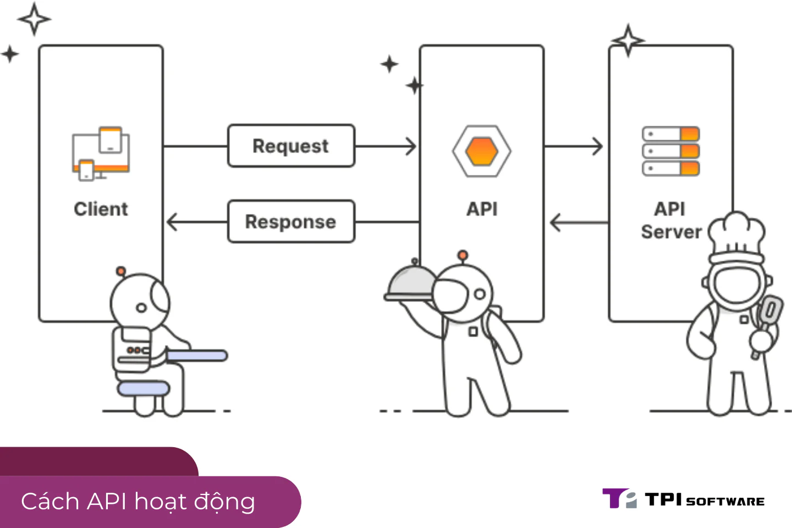

## API là gì? Định nghĩa dễ hiểu cho người mới bắt đầu

[API](/vi/blog/api), viết tắt của **Application Programming Interface** (Giao diện Lập trình Ứng dụng), là một tập hợp các quy tắc và công cụ cho phép các phần mềm giao tiếp với nhau. Nói đơn giản, API giống như một "người trung gian" giúp hai ứng dụng trao đổi dữ liệu hoặc thực hiện các chức năng mà không cần can thiệp vào mã nguồn của nhau. Ví dụ, khi bạn đặt vé máy bay trên một ứng dụng du lịch, API sẽ kết nối ứng dụng đó với hệ thống của hãng hàng không để lấy thông tin chuyến bay.

Trong thời đại số hóa, API đóng vai trò quan trọng trong việc kết nối các hệ thống, từ ngân hàng, thương mại điện tử (ecommerce) đến ứng dụng giao hàng. Đây là nền tảng giúp doanh nghiệp cung cấp dịch vụ nhanh chóng và hiệu quả hơn, đặc biệt trong các ngành như BFSI (Ngân hàng, Tài chính, Bảo hiểm) hay các ứng dụng giao đặt hàng đang phát triển mạnh tại Việt Nam.

## API hoạt động như thế nào?

API hoạt động dựa trên mô hình yêu cầu và phản hồi (request-response). Khi một ứng dụng gửi yêu cầu (request) đến API, API sẽ xử lý và trả về dữ liệu hoặc thực hiện hành động theo yêu cầu. Quá trình này thường diễn ra qua giao thức HTTP/HTTPS với các phương thức như GET (lấy dữ liệu), POST (gửi dữ liệu), PUT (cập nhật), DELETE (xóa).

Hãy tưởng tượng bạn đang ở nhà hàng:

-   Bạn (ứng dụng) gọi món ăn qua nhân viên phục vụ (API).

-   Nhân viên phục vụ mang yêu cầu đến bếp (hệ thống backend).

-   Bếp chuẩn bị món ăn và gửi lại qua nhân viên phục vụ cho bạn.

Tương tự, API giúp đơn giản hóa việc kết nối mà không cần hiểu toàn bộ cách hoạt động của hệ thống phía sau. Các loại API phổ biến bao gồm:

-   **REST API**: Nhẹ, linh hoạt, sử dụng HTTP, phổ biến nhất hiện nay.

-   **SOAP API**: Bảo mật cao, thường dùng trong ngành tài chính.

-   **GraphQL**: Cho phép lấy dữ liệu linh hoạt, đang được ưa chuộng trong ecommerce.

## Tại sao API quan trọng với doanh nghiệp và người dùng?

API không chỉ là công cụ kỹ thuật mà còn là động lực thúc đẩy sự phát triển kinh doanh. Dưới đây là những lợi ích chính:

1.  **Tăng hiệu quả vận hành**: API giúp tích hợp các hệ thống nội bộ và bên ngoài, giảm thời gian phát triển sản phẩm.

2.  **Cải thiện trải nghiệm người dùng**: Từ việc chuyển tiền qua Zalo đến đặt đồ ăn trên Baemin, API mang lại sự tiện lợi tức thì.

3.  **Mở rộng cơ hội kinh doanh**: Doanh nghiệp có thể chia sẻ dữ liệu qua API (Open API) để hợp tác với đối tác, ví dụ ngân hàng tích hợp với fintech.

Một case study thực tế: **PayPal** sử dụng API để tích hợp thanh toán vào hàng triệu website ecommerce toàn cầu, giúp tăng trưởng doanh thu lên 24% trong năm 2022 (theo báo cáo tài chính PayPal). Tại Việt Nam, các ứng dụng như MoMo hay Shopee cũng tận dụng API để kết nối với ngân hàng và đối tác logistics, tạo trải nghiệm mượt mà cho người dùng.

## Các phần mềm quản lý API phổ biến trên thị trường

Để tận dụng tối đa API, doanh nghiệp cần các công cụ quản lý hiệu quả. Dưới đây là một số giải pháp nổi bật:

-   **Apigee (Google)**: Phổ biến trong các doanh nghiệp lớn, hỗ trợ quản lý toàn vòng đời API, phù hợp với ngành BFSI. Tuy nhiên, chi phí cao có thể là rào cản với doanh nghiệp nhỏ.

-   **Postman**: Công cụ đơn giản, dễ dùng cho nhà phát triển, tập trung vào kiểm thử API hơn là quản lý toàn diện.

-   **digiRunner (TPIsoftware)**: Nền tảng từ TPIsoftware – công ty số 1 Đài Loan với gần 20 năm kinh nghiệm, đã lên sàn chứng khoán. digiRunner nổi bật với khả năng giám sát thời gian thực, bảo mật mạnh mẽ, phù hợp cho BFSI và ecommerce tại Việt Nam.

-   **Kong**: Miễn phí ở phiên bản cơ bản, linh hoạt với các hệ thống nhỏ, nhưng thiếu tính năng nâng cao so với các giải pháp trả phí.

| **Công cụ** | **Ưu điểm** | **Nhược điểm** |
| --- | --- | --- |
| Apigee | Quản lý toàn diện, tích hợp Google | Chi phí cao |
| Postman | Dễ dùng, phù hợp nhà phát triển | Ít tính năng quản lý |
| digiRunner | Bảo mật cao, giám sát realtime | Chưa phổ biến tại Việt Nam |
| Kong | Miễn phí, linh hoạt | Thiếu tính năng nâng cao |

Lưu ý: Tùy vào nhu cầu (quy mô, ngành nghề), doanh nghiệp nên cân nhắc chọn giải pháp phù hợp thay vì chạy theo quảng cáo.

## Ứng dụng thực tế của API tại Việt Nam

API đang thay đổi cách các ngành nghề vận hành tại Việt Nam:

-   **BFSI**: Ngân hàng Techcombank tích hợp API với MoMo để người dùng thanh toán hóa đơn trực tiếp trên ứng dụng, tăng 30% giao dịch không dùng tiền mặt (theo báo cáo Techcombank 2023).

-   **Ecommerce**: Shopee sử dụng API để kết nối với các đơn vị giao hàng như GHN, cập nhật trạng thái đơn hàng theo thời gian thực.

-   **Ứng dụng giao đặt hàng**: Baemin tích hợp API dự báo thời tiết để điều chỉnh thời gian giao hàng, cải thiện trải nghiệm khách hàng.

Những ví dụ này cho thấy API không chỉ là công nghệ mà còn là cầu nối giúp doanh nghiệp thích nghi với xu hướng số hóa.

## Thách thức khi sử dụng API và cách khắc phục

Dù mạnh mẽ, API cũng đi kèm thách thức:

-   **Bảo mật**: Tin tặc có thể tấn công qua API nếu không được mã hóa đúng cách.

-   **Hiệu suất**: Quá nhiều yêu cầu có thể làm chậm hệ thống.

-   **Quản lý**: Theo dõi và bảo trì API phức tạp khi quy mô tăng.

Giải pháp như **digiRunner** từ TPIsoftware cung cấp tính năng phát hiện bất thường, mã hóa dữ liệu và giám sát hiệu suất, giúp doanh nghiệp giảm thiểu rủi ro. Các công ty khác như Apigee cũng có tính năng tương tự, nhưng digiRunner nổi bật với sự tối ưu cho thị trường BFSI và ecommerce tại Việt Nam.

## Kết luận: API – Chìa khóa của tương lai số hóa

API không chỉ là một khái niệm kỹ thuật mà còn là động lực thúc đẩy sự phát triển của doanh nghiệp và cải thiện cuộc sống người dùng. Từ ngân hàng, ecommerce đến ứng dụng giao hàng, API đang hiện diện khắp nơi, mang lại sự tiện lợi và hiệu quả. Nếu bạn muốn tìm hiểu sâu hơn về cách API vận hành hoặc cần giải pháp quản lý tối ưu, đừng bỏ lỡ cơ hội khám phá các công cụ như [**digiRunner**](/vi/products/digirunner) từ TPIsoftware – một cái tên đáng chú ý từ Đài Loan nay đã có mặt tại Việt Nam. Hãy bắt đầu hành trình số hóa của bạn ngay hôm nay!
