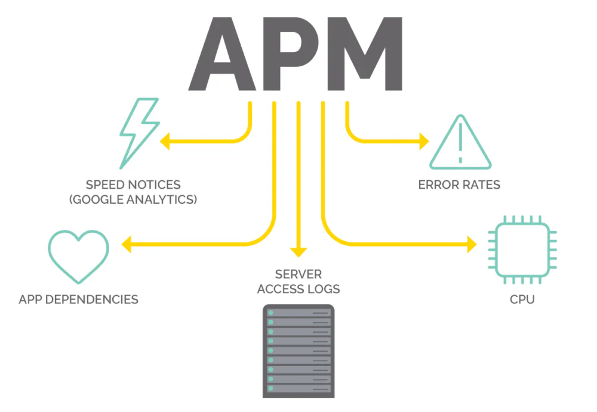
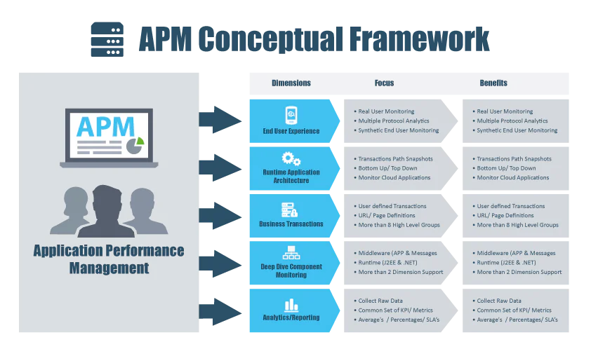

## Application Performance Monitoring (APM) Là Gì? Hơn Cả Một Công Cụ, Đây Là "Bác Sĩ" Của Doanh Nghiệp Số

Trong kỷ nguyên số, khi mọi tương tác của khách hàng, từ mua sắm, giao dịch ngân hàng đến học tập, đều diễn ra trên các ứng dụng phần mềm, thì hiệu suất của những ứng dụng đó chính là mạch máu của doanh nghiệp. Một ứng dụng chậm chạp, hay gặp lỗi, dù chỉ trong vài giây, cũng có thể khiến khách hàng thất vọng, doanh thu sụt giảm và uy tín thương hiệu bị tổn hại nghiêm trọng. Đây là lúc Application Performance Monitoring (APM) xuất hiện, không chỉ như một công cụ giám sát, mà như một "người bác sĩ" tận tụy, liên tục "khám sức khỏe" và "chẩn đoán" mọi vấn đề của hệ thống phần mềm.

Vậy APM thực sự là gì và tại sao nó lại trở thành yếu-tố-sống-còn đối với các doanh nghiệp trong ngành BFSI (Ngân hàng, Dịch vụ tài chính, Bảo hiểm), y tế, giáo dục và công nghệ? Bài viết này sẽ đi sâu giải mã mọi khía cạnh của APM, từ khái niệm cơ bản đến các ứng dụng thực tiễn, giúp các nhà lãnh đạo và đội ngũ kỹ thuật có cái nhìn toàn diện nhất.

## APM (Application Performance Monitoring): Định Nghĩa Vượt Ra Ngoài Sự Giám Sát

Ở mức độ cơ bản nhất, Application Performance Monitoring (APM) là quá trình sử dụng các công cụ và phần mềm chuyên dụng để theo dõi, đo lường và quản lý hiệu suất của các ứng dụng phần mềm. Tuy nhiên, định nghĩa này chỉ mới chạm đến bề mặt.

APM hiện đại không chỉ đơn thuần hiển thị các chỉ số như "CPU đang tải 80%" hay "thời gian phản hồi là 2 giây". Nó đi sâu vào bên trong từng dòng code, từng giao dịch (transaction), từng yêu cầu API để trả lời những câu hỏi kinh doanh quan trọng:

-   **Người dùng đang gặp phải vấn đề gì?** Giao dịch mua hàng của khách hàng X bị treo ở bước nào? Tại sao trang web tải chậm ở khu vực Y?

-   **Nguyên nhân gốc rễ (root cause) của sự cố là gì?** Liệu có phải do một câu lệnh truy vấn cơ sở dữ liệu (database query) bị viết lỗi, một API của bên thứ ba phản hồi chậm, hay do lỗi logic trong code mới được triển khai?

-   **Vấn đề này ảnh hưởng đến hoạt động kinh doanh ra sao?** Bao nhiêu giao dịch đã thất bại? Doanh thu bị ảnh hưởng là bao nhiêu? Những người dùng nào bị tác động nhiều nhất?

Một hệ thống APM toàn diện sẽ thu thập và phân tích một lượng lớn dữ liệu từ nhiều nguồn khác nhau, thường được biết đến với tên gọi "Ba trụ cột của khả năng quan sát" (Three Pillars of Observability):

1.  **Metrics (Chỉ số):** Các dữ liệu số đo lường hiệu suất hệ thống theo thời gian, ví dụ: tỷ lệ lỗi (error rate), thời gian phản hồi (response time), lượng yêu cầu mỗi phút (requests per minute).

2.  **Traces (Dấu vết):** Ghi lại hành trình đầy đủ của một yêu cầu khi nó đi qua các dịch vụ, module khác nhau trong một hệ thống phức tạp (ví dụ: kiến trúc microservices). Dấu vết giúp xác định chính xác điểm nghẽn cổ chai và nơi xảy ra lỗi.

3.  **Logs (Nhật ký):** Các bản ghi chi tiết, có dấu thời gian về mọi sự kiện xảy ra trong ứng dụng hoặc hệ thống. Logs là nguồn thông tin vô giá để điều tra sâu các sự cố sau khi chúng đã được phát hiện.

## Tại Sao Doanh Nghiệp Bạn Không Thể "Sống Thiếu" APM?

Trong môi trường kinh doanh cạnh tranh khốc liệt, việc bỏ qua APM không khác gì việc một phi công bay trong sương mù mà không có bảng điều khiển. Hậu quả có thể rất lớn.

-   **Nâng cao Trải nghiệm Khách hàng (Customer Experience):** Amazon đã tính toán rằng cứ mỗi 100 mili giây độ trễ, họ có thể mất 1% doanh số. APM giúp phát hiện và giải quyết các vấn đề về hiệu suất trước khi chúng ảnh hưởng đến hàng loạt người dùng, đảm bảo trải nghiệm mượt mà và liền mạch.

-   **Tối ưu hóa Chi phí Vận hành:** Thay vì phỏng đoán, các đội ngũ kỹ sư (DevOps, SRE) có thể sử dụng dữ liệu từ APM để xác định chính xác nguyên nhân sự cố, giảm thời gian trung bình để giải quyết (Mean Time to Resolution - MTTR) từ vài giờ xuống còn vài phút. Điều này giúp tiết kiệm chi phí nhân lực và giảm thiểu tác động tiêu cực đến kinh doanh.

-   **Tăng cường An ninh và Bảo mật:** Mọi hoạt động bất thường, chẳng hạn như số lượng yêu cầu API tăng đột biến từ một địa chỉ IP lạ hoặc tỷ lệ lỗi đăng nhập cao bất thường, đều có thể là dấu hiệu của một cuộc tấn công mạng. APM cung cấp khả năng quan sát theo thời gian thực, giúp phát hiện sớm các mối đe dọa an ninh.

-   **Ra quyết định dựa trên Dữ liệu (Data-Driven Decisions):** APM cung cấp cho các nhà lãnh đạo những insight quý giá về hành vi người dùng và hiệu suất ứng dụng. Dựa vào đó, họ có thể đưa ra các quyết định chính xác hơn về việc nâng cấp hạ tầng, phân bổ nguồn lực, hay ưu tiên phát triển các tính năng mới.

## Case Study Thực Tễn: APM Đằng Sau Thành Công Của Các "Gã Khổng Lồ"

Lý thuyết là vậy, nhưng APM đã được áp dụng trong thực tế như thế nào? Hãy cùng xem cách 3 công ty hàng đầu thế giới sử dụng APM để giải quyết các bài toán kinh doanh phức tạp.

### 1\. Netflix: Chinh Phục Sự Phức Tạp Của Kiến Trúc Microservices

**Bối cảnh:** Netflix không phải là một ứng dụng nguyên khối. Đó là một hệ sinh thái khổng lồ với hàng nghìn dịch vụ nhỏ (microservices) hoạt động độc lập nhưng liên kết chặt chẽ với nhau. Khi bạn nhấn nút "Play", yêu cầu của bạn có thể đi qua hàng chục, thậm chí hàng trăm microservices – từ dịch vụ xác thực, dịch vụ đề xuất phim, đến dịch vụ streaming nội dung.

**Thách thức:** Với kiến trúc phức tạp như vậy, một lỗi nhỏ ở một microservice gần như vô danh có thể gây ra hiệu ứng domino, làm sập cả một phần hệ thống. Việc xác định dịch vụ nào gây lỗi trong hàng nghìn dịch vụ là một nhiệm vụ bất khả thi nếu làm thủ công.

**Giải pháp APM:** Netflix đã tự xây dựng một bộ công cụ giám sát nội bộ mạnh mẽ (một phần của Netflix OSS), nhưng nguyên lý của nó tương tự các công cụ APM thương mại. Họ sử dụng **Distributed Tracing** để theo dõi một yêu cầu người dùng xuyên suốt hệ sinh thái microservices. Mỗi lời gọi giữa các dịch vụ được gán một ID duy nhất, cho phép các kỹ sư hình dung toàn bộ con đường mà yêu cầu đã đi qua. Khi có lỗi xảy ra, họ có thể nhanh chóng xác định chính xác "mắt xích" nào đã bị đứt, dịch vụ nào phản hồi chậm, từ đó khoanh vùng và khắc phục sự cố trong vài phút thay vì vài giờ hoặc vài ngày.

### 2\. Etsy: Mỗi Mili Giây Đều Trị Giá Hàng Triệu Đô

**Bối cảnh:** Etsy là một sàn thương mại điện tử toàn cầu kết nối hàng triệu nhà bán hàng thủ công với hàng chục triệu người mua. Trong e-commerce, tốc độ là tất cả. Nhiều nghiên cứu đã chỉ ra rằng chỉ cần 100 mili giây độ trễ cũng có thể làm giảm tỷ lệ chuyển đổi một cách đáng kể.

**Thách thức:** Làm thế nào để đảm bảo trang web luôn nhanh chóng và mượt mà cho mọi người dùng trên toàn cầu, đồng thời liên tục cập nhật các tính năng mới mà không làm ảnh hưởng đến hiệu suất?

**Giải pháp APM:** Etsy sử dụng APM như một công cụ cốt lõi để kết nối hiệu suất kỹ thuật với chỉ số kinh doanh. Họ dùng **Real User Monitoring (RUM)** để theo dõi thời gian tải trang thực tế của người dùng. Dữ liệu này không chỉ là những con số kỹ thuật, nó được phân tích cùng với dữ liệu kinh doanh. Ví dụ, họ có thể trả lời câu hỏi: "Khi thời gian tải trang sản phẩm tăng từ 1.5 giây lên 1.8 giây, tỷ lệ người dùng thêm hàng vào giỏ đã giảm bao nhiêu %?". Bằng cách này, đội ngũ phát triển có thể lượng hóa được tác động tài chính của mỗi thay đổi về code. APM giúp họ đưa ra quyết định dựa trên dữ liệu, ưu tiên các tác vụ tối ưu hóa mang lại lợi ích kinh doanh lớn nhất.

### 3\. Expedia: Đảm Bảo Hàng Tỷ Giao Dịch API Hoạt Động Hoàn Hảo

**Bối cảnh:** Expedia Group là một gã khổng lồ trong ngành du lịch trực tuyến, vận hành các thương hiệu như [Expedia.com](http://expedia.com/), [Hotels.com](http://hotels.com/), và Vrbo. Mô hình kinh doanh của họ phụ thuộc hoàn toàn vào việc giao tiếp qua lại giữa hàng nghìn hệ thống: hãng hàng không, chuỗi khách sạn, công ty cho thuê xe, cổng thanh toán... Tất cả đều thông qua các API.

**Thách thức:** Một giao dịch đặt vé máy bay hoặc khách sạn là một chuỗi các lời gọi API phức tạp. Chỉ cần một API của đối tác hàng không phản hồi chậm hoặc lỗi, toàn bộ giao dịch có thể thất bại, dẫn đến mất khách hàng và tổn hại uy tín.

**Giải pháp APM:** Expedia đặc biệt chú trọng đến việc giám sát hiệu suất API. Các công cụ APM giúp họ theo dõi từng lời gọi API đi và đến: thời gian phản hồi, tỷ lệ lỗi,ปริมาณ dữ liệu truyền tải. Khi một API của đối tác bắt đầu có dấu hiệu chậm đi, hệ thống APM sẽ tự động cảnh báo cho đội ngũ vận hành. Điều này cho phép họ chủ động liên hệ với đối tác để giải quyết vấn đề trước khi nó ảnh hưởng đến người dùng cuối.

Trong bối cảnh này, một nền tảng quản lý API toàn diện như [**digiRunner**](/vi/products/digirunner) trở nên cực kỳ quan trọng. Nó không chỉ giúp tạo và quản lý API mà còn cung cấp các tính năng giám sát hiệu suất, kiểm soát lưu lượng, và bảo mật mạnh mẽ, hoạt động như một "trạm kiểm soát" chất lượng cho mọi giao dịch đi qua hệ thống.

## So Sánh Các Công Cụ APM Phổ Biến: Đâu Là Lựa Chọn Tốt Nhất?

Thị trường APM rất sôi động với nhiều nhà cung cấp khác nhau. Việc lựa chọn công cụ phù hợp phụ thuộc vào quy mô, kiến trúc hệ thống và ngân sách của doanh nghiệp.

| Công cụ | Điểm mạnh | Hạn chế |
| --- | --- | --- |
| **Datadog** | Nền tảng hợp nhất mạnh mẽ (APM, logs, infrastructure). Giao diện trực quan, dễ sử dụng. Cộng đồng lớn. | Chi phí có thể tăng cao nhanh chóng khi quy mô mở rộng. Có thể quá phức tạp cho các nhu cầu cơ bản. |
| **New Relic** | Một trong những công cụ tiên phong và toàn diện nhất. Khả năng phân tích sâu, hỗ trợ nhiều ngôn ngữ lập trình. | Chi phí thuộc hàng cao nhất thị trường. Giao diện có thể hơi rối với người mới bắt đầu. |
| **Dynatrace** | Rất mạnh về tự động hóa và ứng dụng AI (có tên là Davis AI) để tự động phát hiện và chẩn đoán nguyên nhân gốc rễ. | Chi phí cao, thường nhắm đến các doanh nghiệp lớn (enterprise). Quá trình cài đặt ban đầu có thể phức tạp. |
| **TPIsoftware (digiLogs, digiRunner)** | **Chuyên sâu cho thị trường Việt Nam & Châu Á.** Tập trung vào các bài toán cốt lõi là quản lý Logs và API - hai thành phần trọng yếu của APM. **Hỗ trợ kỹ thuật tại chỗ**, am hiểu bối cảnh doanh nghiệp địa phương. Chi phí tối ưu. | Là các sản phẩm chuyên biệt, không phải một nền tảng "tất-cả-trong-một" như các đối thủ lớn. |

Trong khi các giải pháp quốc tế cung cấp một bộ tính năng khổng lồ, các doanh nghiệp tại Việt Nam, đặc biệt trong các ngành được quản lý chặt chẽ như BFSI, y tế, chính phủ, thường đối mặt với những thách thức riêng: yêu cầu về bảo mật dữ liệu, tuân thủ quy định trong nước, và nhu cầu hỗ trợ kỹ thuật nhanh chóng, am hiểu ngôn ngữ và văn hóa.

Các sản phẩm của TPIsoftware như [**digiLogs**](/vi/products/digilogs) và [**digiRunner**](/vi/products/digirunner) được phát triển để giải quyết chính xác những bài toán này.

-   **digiLogs** không chỉ là một công cụ thu thập nhật ký. Nó là một trung tâm phân tích, giúp doanh nghiệp chuẩn hóa, tìm kiếm và trực quan hóa hàng tỷ bản ghi từ nhiều nguồn khác nhau. Nền tảng này giúp phát hiện các hành vi bất thường, điều tra sự cố bảo mật và đảm bảo tuân thủ các quy định về lưu trữ dữ liệu.

-   **digiRunner** tập trung vào "mạch máu" của các ứng dụng hiện đại: API. Nó cung cấp một cổng quản lý API (API Gateway) toàn diện, giúp doanh nghiệp kiểm soát, bảo mật và theo dõi hiệu suất của tất cả các kết nối API, cả nội bộ và bên ngoài.

Kết hợp lại, bộ đôi này tạo thành một phần xương sống vững chắc cho chiến lược APM của bất kỳ tổ chức nào, giải quyết hai trong ba trụ cột quan trọng nhất của khả năng quan sát.

## Kết Luận: APM là Khoản Đầu Tư, Không Phải Chi Phí

Trong thế giới số, hiệu suất chính là một tính năng. Một ứng dụng mạnh mẽ, ổn định không còn là một lợi thế cạnh tranh, mà là một điều kiện tiên quyết để tồn tại. Application Performance Monitoring (APM) cung cấp "đôi mắt" và "bộ não" để các doanh nghiệp có thể nhìn thấu hệ thống của mình, biến dữ liệu kỹ thuật phức tạp thành những insight kinh doanh quý giá.

Đầu tư vào một chiến lược APM đúng đắn, với những công cụ phù hợp với bối cảnh và quy mô của doanh nghiệp, không phải là một khoản chi phí công nghệ. Đó là một khoản đầu tư chiến lược vào sự hài lòng của khách hàng, hiệu quả vận hành và sự tăng trưởng bền vững của doanh nghiệp trong tương lai.
