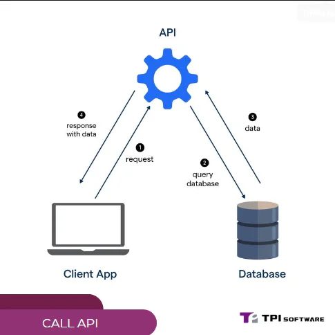

## 1\. Định nghĩa Call API

API là viết tắt của **Application Programming Interface**, có nghĩa là **Giao diện lập trình ứng dụng**. Đây là một tập hợp các quy tắc và thông số kỹ thuật cho phép các ứng dụng khác nhau giao tiếp và trao đổi dữ liệu với nhau.

**Call API** đơn giản là quá trình một ứng dụng gửi yêu cầu đến một API để truy xuất hoặc cập nhật thông tin.

Ví dụ: Khi bạn sử dụng ứng dụng đặt vé máy bay trực tuyến, ứng dụng sẽ call API của các hãng hàng không để lấy thông tin về chuyến bay, giá vé, chỗ ngồi,...

## 2\. Cách thức hoạt động của Call API

Để hiểu rõ hơn về cách thức hoạt động của Call API, hãy tưởng tượng bạn đang gọi món ăn tại một nhà hàng.

-   **Bạn (ứng dụng)** là người gọi món, gửi yêu cầu đến **nhà bếp (API)**.

-   **Menu (API documentation)** cung cấp cho bạn danh sách các món ăn (dữ liệu) có sẵn và cách gọi món (yêu cầu).

-   **Người phục vụ (API request)** sẽ nhận yêu cầu của bạn và chuyển đến nhà bếp.

-   **Nhà bếp (API)** sẽ xử lý yêu cầu và gửi món ăn (dữ liệu) bạn yêu cầu thông qua người phục vụ (API response).

Tương tự như vậy, quá trình Call API thường bao gồm các bước sau:

1.  **Gửi yêu cầu (request):** Ứng dụng gửi yêu cầu đến API, bao gồm các thông tin như phương thức (GET, POST, PUT, DELETE), URL, header, và body (nếu có).

2.  **Xác thực (authentication):** API có thể yêu cầu xác thực để đảm bảo chỉ những ứng dụng được ủy quyền mới có thể truy cập dữ liệu.

3.  **Xử lý yêu cầu:** API nhận yêu cầu và xử lý nó.

4.  **Trả về kết quả (response):** API trả về kết quả cho ứng dụng, thường ở dạng JSON hoặc XML.

## 3\. Các phương thức Call API phổ biến

Có nhiều phương thức Call API khác nhau, mỗi phương thức phục vụ một mục đích riêng. Một số phương thức phổ biến bao gồm:

-   **GET:** Lấy dữ liệu từ API.

-   **POST:** Tạo dữ liệu mới trên API.

-   **PUT:** Cập nhật dữ liệu hiện có trên API.

-   **DELETE:** Xóa dữ liệu trên API.

## 4\. Ví dụ cụ thể về Call API

**Ví dụ 1: Lấy thông tin thời tiết**

Giả sử bạn muốn lấy thông tin thời tiết của thành phố Hồ Chí Minh từ API của OpenWeatherMap. Bạn có thể sử dụng phương thức GET và gửi yêu cầu đến URL sau:

[https://api.openweathermap.org/data/2.5/weather?q=Ho%20Chi%20Minh%20City&appid={API\_KEY}](https://api.openweathermap.org/data/2.5/weather?q=Ho%20Chi%20Minh%20City&appid={API_KEY})

Trong đó, {API\_KEY} là khóa API của bạn. API sẽ trả về kết quả ở dạng JSON, bao gồm các thông tin như nhiệt độ, độ ẩm, tốc độ gió,...

**Ví dụ 2: Đăng nhập vào ứng dụng**

Khi bạn đăng nhập vào một ứng dụng, ứng dụng sẽ gửi yêu cầu POST đến API của ứng dụng đó, bao gồm thông tin đăng nhập của bạn (tên người dùng, mật khẩu). API sẽ xác thực thông tin đăng nhập và trả về kết quả cho biết đăng nhập thành công hay thất bại.

## 5\. Lợi ích của việc sử dụng API

Việc sử dụng API mang lại nhiều lợi ích cho cả nhà phát triển và người dùng, bao gồm:

-   **Tiết kiệm thời gian và công sức:** API cung cấp sẵn các chức năng và dữ liệu, giúp nhà phát triển không cần phải xây dựng lại từ đầu.

-   **Tăng tính linh hoạt:** API cho phép các ứng dụng khác nhau kết nối và trao đổi dữ liệu với nhau một cách dễ dàng.

-   **Cải thiện trải nghiệm người dùng:** API giúp cung cấp các tính năng và dịch vụ mới cho người dùng.

-   **Mở rộng khả năng kinh doanh:** API cho phép các doanh nghiệp kết nối với các đối tác và khách hàng mới.

## 6\. Các công cụ hỗ trợ Call API

Có nhiều công cụ hỗ trợ Call API, giúp nhà phát triển dễ dàng gửi yêu cầu và xử lý kết quả. Một số công cụ phổ biến bao gồm:

-   **Postman:** Công cụ phổ biến để kiểm tra và debug API.

-   **cURL:** Công cụ dòng lệnh để gửi yêu cầu HTTP.

-   **Insomnia:** Công cụ mã nguồn mở để gửi yêu cầu và kiểm tra API.

## 7\. Kết luận

Call API là một kỹ thuật quan trọng trong phát triển ứng dụng hiện đại. Hy vọng bài viết này đã giúp bạn hiểu rõ hơn về Call API, cách thức hoạt động và lợi ích của nó.
