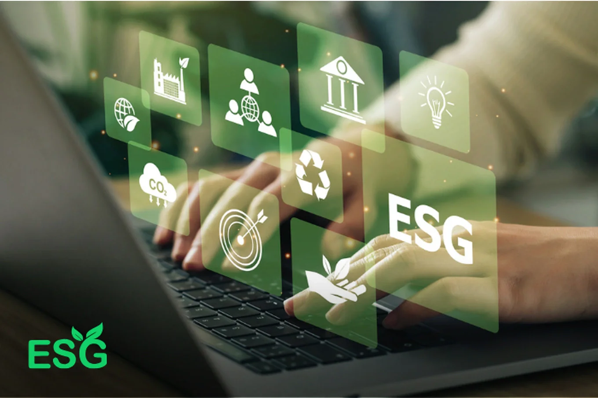

*Chính phủ vừa trình Quốc hội Dự thảo Nghị quyết về một số cơ chế, chính sách đặc thù nhằm thúc đẩy phát triển khu vực kinh tế tư nhân. Một trong những nội dung trọng tâm của dự thảo là đề xuất hỗ trợ lãi suất 2%/năm cho các doanh nghiệp vay vốn thực hiện dự án xanh, tuần hoàn, hoặc áp dụng khung tiêu chuẩn ESG (Môi trường – Xã hội – Quản trị).*

## Tăng cường ưu đãi tài chính để khuyến khích ESG

Cụ thể, Chương IV của Dự thảo nêu rõ: doanh nghiệp tư nhân sẽ được hỗ trợ lãi suất từ ngân sách nhà nước nếu triển khai các dự án đáp ứng các tiêu chí về phát triển bền vững theo hướng xanh hóa hoặc tích hợp ESG vào hoạt động sản xuất – kinh doanh. Đây được xem là công cụ tài chính nhằm khuyến khích doanh nghiệp chủ động chuyển đổi mô hình tăng trưởng phù hợp với định hướng phát triển xanh của quốc gia.

Ngoài hỗ trợ lãi suất, Dự thảo còn đề xuất củng cố vai trò của Quỹ phát triển doanh nghiệp nhỏ và vừa, hỗ trợ vốn khởi nghiệp, đầu tư đổi mới sáng tạo và tham gia vào các quỹ địa phương nhằm mở rộng nguồn lực tài chính cho khu vực tư nhân.

## Thách thức trong triển khai: Bài học từ giai đoạn trước

Ủy ban Kinh tế và Tài chính của Quốc hội lưu ý rằng chính sách hỗ trợ lãi suất 2% từng được triển khai trong gói phục hồi kinh tế sau đại dịch nhưng hiệu quả rất hạn chế. Nguyên nhân chính đến từ:

-   Tiêu chí xác định đối tượng thụ hưởng chưa rõ ràng;

-   Tâm lý e ngại thủ tục hậu kiểm, thanh tra, kiểm toán;

-   Doanh nghiệp lo ngại bị thu hồi hỗ trợ sau khi đã ghi nhận lợi nhuận và phân phối cổ tức.

Để khắc phục, Dự thảo Nghị quyết lần này yêu cầu quy định rõ tiêu chí xét duyệt, tăng cường tính tự chủ và trách nhiệm của ngân hàng thương mại, đồng thời đề xuất giới hạn triển khai hỗ trợ qua một số ngân hàng có đủ năng lực và kinh nghiệm.

*Đề xuất hỗ trợ lãi suất 2%/năm đối với các dự án xanh, dự án ESG (Ảnh: IT).*

## Giải pháp công nghệ đồng hành cùng chính sách

Việc đảm bảo tính minh bạch và hiệu quả trong thực hiện ESG đòi hỏi doanh nghiệp phải có hệ thống đánh giá, giám sát và báo cáo ESG rõ ràng. Trong bối cảnh đó, các giải pháp công nghệ ESG đóng vai trò quan trọng trong việc giúp doanh nghiệp:

-   Theo dõi và đo lường hiệu suất ESG;

-   Chuẩn hóa báo cáo, hồ sơ vay vốn;

-   Đáp ứng các yêu cầu kiểm tra, kiểm toán từ phía cơ quan quản lý.

Một ví dụ tiêu biểu là **TPIsoftware**, công ty công nghệ đến từ Đài Loan, hiện đang triển khai nền tảng **GreenSwift** – công cụ giúp doanh nghiệp đánh giá và báo cáo phát thải, tuân thủ chuẩn ESG theo thông lệ quốc tế. Nền tảng này đã được áp dụng tại Khu công nghiệp Nam Cầu Kiền (Việt Nam), cho thấy tiềm năng hỗ trợ doanh nghiệp Việt Nam không chỉ đạt chuẩn ESG mà còn tăng khả năng tiếp cận các gói hỗ trợ tài chính từ Chính phủ và nhà đầu tư quốc tế.

## Kết luận

Chính sách hỗ trợ lãi suất 2% cho dự án ESG, nếu được triển khai hiệu quả, sẽ là cú huých tài chính quan trọng thúc đẩy doanh nghiệp Việt Nam đổi mới mô hình phát triển, hướng tới kinh tế xanh và bền vững. Để hiện thực hóa mục tiêu này, cần sự phối hợp đồng bộ giữa nhà nước, ngân hàng, doanh nghiệp và đặc biệt là sự hỗ trợ từ các giải pháp công nghệ giúp đơn giản hóa quá trình đánh giá, minh chứng và báo cáo ESG.
