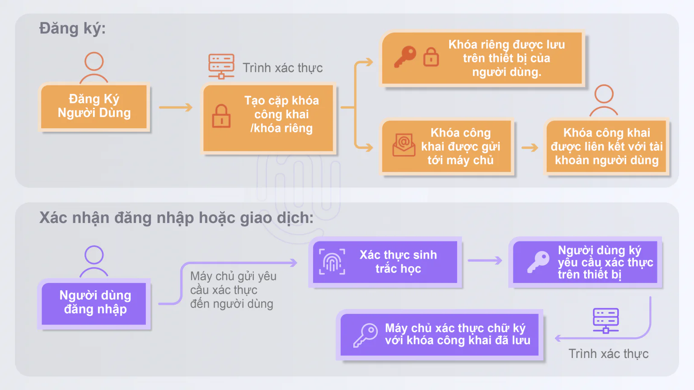

Trong thời đại số hóa, các vụ vi phạm bảo mật liên quan đến mật khẩu ngày càng gia tăng, khiến mật khẩu truyền thống không còn đủ sức đáp ứng nhu cầu bảo mật hiện nay. Trước bối cảnh các mối đe dọa mạng ngày càng tinh vi, cả cá nhân và doanh nghiệp đều hướng tới một giải pháp xác thực an toàn, nhanh chóng và tiện lợi hơn. Vậy [**FIDO là gì**](/vi/blog/fido-la-gi)? Hãy cùng khám phá công nghệ đột phá này.

## FIDO là gì?

**FIDO** (Fast IDentity Online) là một tiêu chuẩn xác thực tiên tiến do FIDO Alliance phát triển, nhằm thay thế mật khẩu truyền thống bằng các phương pháp đăng nhập không mật khẩu an toàn hơn. Công nghệ này sử dụng sinh trắc học (vân tay, nhận diện khuôn mặt), cặp khóa mã hóa hoặc thiết bị xác thực để đảm bảo bảo mật tối ưu. FIDO không chỉ giúp chống lại các cuộc tấn công phishing mà còn mang đến trải nghiệm người dùng mượt mà, được các "ông lớn" như Google, Microsoft, Apple và Amazon tin dùng.

## FIDO hoạt động như thế nào?

FIDO dựa trên mã hóa khóa công khai (public key cryptography) để xác thực người dùng. Khi đăng ký, hệ thống tạo ra một cặp khóa:

-   **Khóa công khai**: Được lưu trữ trên máy chủ dịch vụ.

-   **Khóa riêng**: Được bảo vệ bằng sinh trắc học và lưu trữ an toàn trên thiết bị cá nhân.

Quá trình đăng nhập sử dụng cơ chế **challenge-response**: Máy chủ gửi một yêu cầu xác thực (challenge) đến thiết bị người dùng. Người dùng sử dụng sinh trắc học hoặc thiết bị để "ký" yêu cầu này bằng khóa riêng, sau đó gửi phản hồi đã ký về máy chủ. Điều này đảm bảo máy chủ không bao giờ lưu trữ dữ liệu nhạy cảm như khóa riêng, tăng cường bảo mật vượt trội.

## Các thành phần chính của FIDO

1.  **FIDO Server**: Lưu trữ khóa công khai và xử lý yêu cầu xác thực.

2.  **Client**: Thiết bị người dùng (điện thoại, máy tính) nơi khóa riêng được tạo và lưu trữ.

3.  **Authenticator**: Công cụ xác minh danh tính (sinh trắc học hoặc khóa bảo mật) để ký phản hồi.

### Các bộ tiêu chuẩn FIDO

FIDO Alliance đã phát triển ba bộ tiêu chuẩn chính:

-   **FIDO UAF (Universal Authentication Framework)**: Hỗ trợ đăng nhập không mật khẩu bằng sinh trắc học.

-   **FIDO U2F (Universal 2nd Factor)**: Bổ sung yếu tố xác thực thứ hai sau mật khẩu.

-   **FIDO2 (WebAuthn & CTAP)**: Cho phép đăng nhập không mật khẩu trên nhiều thiết bị và trình duyệt, dựa trên Web Authentication và Client-to-Authenticator Protocol.

## Ứng dụng của FIDO trong thực tế

FIDO được ứng dụng rộng rãi trong nhiều lĩnh vực, đặc biệt là ngành BFSI (Ngân hàng, Tài chính, Bảo hiểm):

-   **Ngành tài chính**: Ủy ban Giám sát Tài chính Đài Loan (FSC) khuyến khích sử dụng FIDO để bảo vệ giao dịch và ngăn chặn truy cập trái phép.

-   **Doanh nghiệp**: FIDO bảo vệ hệ thống nội bộ khỏi xâm nhập và đánh cắp dữ liệu.

-   **Thương mại điện tử**: Đăng nhập nhanh chóng, an toàn, loại bỏ rủi ro từ phishing.

TPIsoftware, công ty dẫn đầu tại Đài Loan về phần mềm quản lý API và Logs, đang tích hợp công nghệ FIDO vào các giải pháp như **digiRunner** để hỗ trợ doanh nghiệp Việt Nam tối ưu hóa bảo mật và vận hành.

## Tại sao nên chọn FIDO?

So với mật khẩu truyền thống dễ bị tấn công và khó quản lý, FIDO mang lại nhiều lợi ích vượt trội:

-   **Bảo mật cao**: Loại bỏ rủi ro từ mật khẩu bị rò rỉ hay tái sử dụng.

-   **Tiện lợi**: Đăng nhập bằng vân tay hoặc khuôn mặt, không cần ghi nhớ mật khẩu phức tạp.

-   **Tiết kiệm chi phí**: Giảm chi phí khôi phục tài khoản hoặc xử lý sự cố bảo mật.

-   **Tuân thủ quy định**: Đáp ứng các tiêu chuẩn bảo mật quốc tế.

## FIDO – Tương lai của xác thực không mật khẩu

Với sự phát triển của chuyển đổi số, FIDO đang định hình tương lai xác thực, mang lại sự cân bằng giữa bảo mật và sự tiện lợi. Tại Việt Nam, các doanh nghiệp có thể tận dụng giải pháp từ [TPIsoftware](/vi) để triển khai FIDO, đảm bảo an toàn hệ thống và nâng cao trải nghiệm người dùng.

## Kết luận

**FIDO là gì?** Đây là công nghệ xác thực không mật khẩu giúp bảo vệ dữ liệu, chống phishing và cải thiện hiệu quả vận hành. Với sự hỗ trợ từ các giải pháp như [**digiRunner**](/vi/products/digirunner) của TPIsoftware, doanh nghiệp có thể bước vào kỷ nguyên số an toàn và hiện đại. Hãy khám phá FIDO để dẫn đầu trong cuộc đua bảo mật hôm nay!
