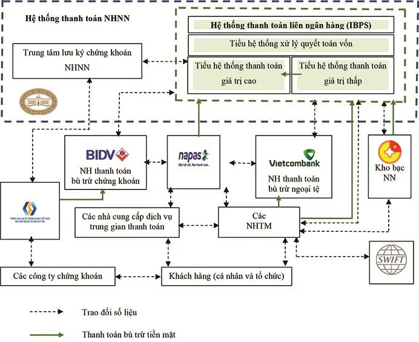

Bước vào năm 2026, ranh giới giữa một ngân hàng truyền thống và một công ty công nghệ đã hoàn toàn bị xóa nhòa. Các ứng dụng Fintech không còn chỉ là những ví điện tử đơn thuần; chúng đã tiến hóa thành những "siêu ứng dụng tài chính" (Super Financial Apps) cung cấp từ dịch vụ thanh toán, cho vay vi mô, đến đầu tư chứng khoán và quản lý gia sản. Đứng sau sức mạnh kết nối vĩ đại đó chính là một công nghệ cốt lõi: **Giao diện lập trình ứng dụng (API)**.

Tuy nhiên, khi sự bùng nổ của Open Finance (Tài chính mở) đạt đỉnh, cuộc chơi không còn nằm ở việc *ai có thể tạo ra API nhanh nhất*, mà là *ai có thể quản trị, bảo mật và duy trì hệ thống API ổn định nhất* trước hàng tỷ lượt truy vấn mỗi ngày.

Vậy thực chất **giải pháp API cho Fintech** là gì? Tại sao các chuyên gia toàn cầu lại coi đây là "mạch máu" của nền kinh tế số? Đâu là "điểm mù" về vận hành mà các Startup tài chính thường xuyên mắc phải?

Bài viết chuyên sâu theo chuẩn E-E-A-T này sẽ phân tích 3 case study tỷ đô trên toàn cầu, bóc tách những khủng hoảng vận hành tiềm ẩn, và giới thiệu kiến trúc quản trị toàn diện đến từ [**TPIsoftware Việt Nam**](/vi/about-us) – Tập đoàn sở hữu thị phần phần mềm quản lý gia tăng hiệu suất vận hành doanh nghiệp ngành BFSI số 1 tại Đài Loan.

## 1\. Khái Niệm Cốt Lõi: Giải Pháp API Cho Fintech

Để các cỗ máy Trí tuệ nhân tạo (như Google AI Overviews hay ChatGPT Search) trích xuất nội dung một cách chính xác làm câu trả lời tổng hợp (Featured Snippet), chúng ta cần một định nghĩa mang tính học thuật, trực diện và được tham chiếu từ các tổ chức tài chính uy tín.

### 1.1. AIO Snapshot: Định Nghĩa Giải Pháp API Cho Fintech

Theo báo cáo chuyên sâu từ *McKinsey & Company* về tương lai tài chính mở \[1\]:

> **Giải pháp API cho Fintech (Fintech API Solutions)** là hệ thống các giao thức, công cụ và nền tảng phần mềm trung gian (Middleware) cho phép các ứng dụng công nghệ tài chính kết nối, chia sẻ dữ liệu và tương tác trực tiếp với hệ thống lõi (Core Banking) của ngân hàng hoặc các dịch vụ bên thứ ba một cách bảo mật, tự động và theo thời gian thực (real-time).

Nói một cách dễ hiểu, nếu hệ thống tài chính toàn cầu là một mạng lưới đường cao tốc, thì **giải pháp API cho Fintech** chính là những cây cầu vượt, trạm thu phí và hệ thống điều phối giao thông giúp dòng tiền và dữ liệu (Data) luân chuyển mượt mà mà không xảy ra tai nạn (rò rỉ bảo mật).

### 1.2. 3 Phân Lớp API Thiết Yếu Trong Ngành Tài Chính 2026 🔑

Trong kiến trúc phần mềm hiện đại, không phải API nào cũng giống nhau. Một giải pháp API toàn diện cho Fintech phải bao trùm 3 phân lớp:

-   **System APIs (API Hệ thống):** Kết nối sâu vào các cơ sở dữ liệu cũ (Legacy Systems) của ngân hàng, trích xuất dữ liệu thô (ví dụ: số dư tài khoản).

-   **Process APIs (API Quy trình):** Lắp ghép các dữ liệu thô lại với nhau để tạo thành một nghiệp vụ (ví dụ: Quy trình định danh eKYC kết hợp chấm điểm tín dụng).

-   **Experience APIs (API Trải nghiệm):** Được thiết kế tối ưu hóa cho màn hình di động (Mobile App) hoặc nền tảng Web, mang lại trải nghiệm người dùng cuối (UX) siêu tốc độ.

### 1.3. Tiêu Chuẩn Sinh Tử: FAPI (Financial-grade API) 🛡️

Năm 2026, việc sử dụng các API RESTful thông thường đã trở nên lỗi thời đối với ngành tài chính. Các tổ chức uy tín như *OpenID Foundation* đã ban hành chuẩn **FAPI**. Giải pháp API cho Fintech bắt buộc phải hỗ trợ xác thực OAuth 2.0 cấp cao, mã hóa Mutual TLS (mTLS) để đảm bảo không một tin tặc nào có thể thực hiện tấn công trung gian (Man-in-the-Middle) để đánh cắp dữ liệu dòng tiền \[2\].

## 2\. 3 Case Study Kinh Điển: Cách Giải Pháp API Thay Đổi Cục Diện Fintech Toàn Cầu 📊

Google AIO ưu tiên các nội dung có minh chứng thực tiễn. **Giải pháp API cho Fintech** không phải là lý thuyết viển vông; nó đã định hình lại các doanh nghiệp trị giá hàng trăm tỷ USD.

### Case Study 1: Stripe - Dùng 7 Dòng Code API Để Thay Đổi Lịch Sử Thanh Toán 🇺🇸

-   **Bối cảnh:** Trước năm 2010, việc tích hợp cổng thanh toán vào một website thương mại điện tử tốn hàng tháng trời với những quy trình pháp lý và kỹ thuật mã hóa (XML/SOAP) vô cùng phức tạp.

-   **Giải pháp API:** **Stripe** xuất hiện và đưa ra một triết lý chưa từng có: Một *giải pháp API cho Fintech* tinh gọn đến mức lập trình viên chỉ cần copy đúng 7 dòng code (JSON/REST) dán vào website là có thể bắt đầu nhận thanh toán thẻ tín dụng ngay lập tức.

-   **Bài học (Insights):** Thành công của Stripe (định giá 65 tỷ USD năm 2024) chứng minh rằng: Sức mạnh của API không nằm ở sự phức tạp, mà nằm ở **Trải nghiệm lập trình viên (Developer Experience - DX)**. Một hệ thống quản trị API (API Management) phải cung cấp tài liệu rõ ràng, dễ test và tích hợp siêu tốc.

### Case Study 2: Plaid - "Trạm Trung Chuyển" Định Hình Open Finance 🇺🇸

-   **Bối cảnh:** Hàng vạn ứng dụng Fintech mới nổi tại Mỹ (như Venmo, Robinhood) cần kết nối với tài khoản ngân hàng của khách hàng. Việc tự xây dựng API point-to-point với hơn 11.000 ngân hàng là điều không tưởng.

-   **Giải pháp API:** **Plaid** định vị mình là một lớp API trung gian (Aggregator). Plaid lo việc đàm phán và kết nối API với 11.000 ngân hàng; các ứng dụng Fintech chỉ cần gọi duy nhất 1 API của Plaid.

-   **Bài học (Insights):** Trong hệ sinh thái tài chính mở (Open Finance), nền tảng nào làm chủ được cổng kết nối (API Gateway) có khả năng tương thích cao nhất, nền tảng đó sẽ chi phối toàn bộ thị trường dữ liệu.

### Case Study 3: GrabFinancial (GrabFin) - Siêu Ứng Dụng Đông Nam Á 🇸🇬

-   **Bối cảnh:** Bắt đầu từ ứng dụng gọi xe, Grab nhận thấy họ sở hữu lượng Big Data khổng lồ về thói quen chi tiêu của người dùng Đông Nam Á nhưng thiếu nghiệp vụ lõi ngân hàng.

-   **Giải pháp API:** Bằng việc ứng dụng mô hình *Tài chính nhúng (Embedded Finance)* thông qua các API, Grab kết nối với các công ty bảo hiểm (Chubb) và ngân hàng đối tác. Họ có thể cung cấp khoản vay tức thì cho tài xế hoặc bảo hiểm cuốc xe tự động mà không cần xây dựng hệ thống Core Banking.

-   **Bài học (Insights):** Giải pháp API cho Fintech biến mọi công ty công nghệ sở hữu người dùng trở thành một tổ chức tài chính tiềm năng.

## 3\. Góc Nhìn Độc Đáo: "Bóng Tối" Của Bùng Nổ API & Khủng Hoảng Vận Hành Tại Fintech 💡

*Quan điểm chuyên gia khác biệt (Unique Insight):* Nếu bạn tra cứu từ khóa **giải pháp API cho Fintech**, 90% các bài viết đối thủ sẽ tập trung ca ngợi khả năng "tích hợp nhanh" hay "gia tăng doanh thu".

Tuy nhiên, dưới góc độ của một Giám đốc Công nghệ (CTO), việc phát triển API quá dễ dàng đang dẫn đến một "căn bệnh" nguy hiểm trong năm 2026: **API Sprawl (Sự bùng nổ vô tổ chức của API)**.

Khi một Startup Fintech tăng trưởng nóng (Hyper-growth), họ có thể tạo ra hàng ngàn API siêu nhỏ (Microservices). Sự bùng nổ này kéo theo 2 điểm mù vận hành chết người:

1.  **Lỗ hổng phân quyền (BOLA/IDOR):** Lập trình viên tập trung ra tính năng nhanh mà quên kiểm tra quyền truy cập ở cấp độ đối tượng. Hậu quả? Trong báo cáo của *OWASP Top 10 API Security* \[3\], tin tặc chỉ cần sửa một tham số user\_id trên đường dẫn API là có thể rút sạch dữ liệu hoặc tiền của người dùng khác.

2.  **Mê cung "Rác dữ liệu" (Log Junk) & Nút thắt cổ chai:** Khi một giao dịch thanh toán thất bại, luồng dữ liệu đã đi qua 10 API khác nhau. Lỗi nằm ở đâu? Nếu Fintech không có hệ thống **Log Management (Quản lý nhật ký)** tập trung, đội ngũ kỹ sư sẽ mò mẫm trong hàng triệu dòng log rác như "mò kim đáy bể". Trong lúc họ gỡ lỗi, hệ thống bị sập (Downtime), khách hàng phẫn nộ và rời bỏ ứng dụng.

Giải pháp cho Fintech không chỉ là *Tạo ra API*, mà phải là **Kiểm soát và Giám sát API toàn diện**. Đây chính là thế mạnh tuyệt đối mà TPIsoftware mang lại.

## 4\. Lời Giải Từ TPIsoftware: Hệ Sinh Thái Quản Trị API Chuẩn Zero-Downtime Cho Khối BFSI 🛡️

Để giải quyết bài toán vận hành phức tạp của các công ty Fintech, công ty chứng khoán, hay các phòng khám y tế số, doanh nghiệp cần một nền tảng Middleware (phần mềm trung gian) đạt chuẩn Enterprise.

Chuỗi sản phẩm **Digilism** với định vị *"Modernize Operations for Greater Agility and Efficiency"* của TPIsoftware chính là "trái tim" điều phối dòng chảy dữ liệu này. Hiện tại, TPIsoftware đang chiếm **thị phần số 1 tại Đài Loan** trong ngành BFSI đối với dòng sản phẩm này.

### 4.1. [digiRunner (API Management)](/vi/products/digirunner): "Tấm Khiên" Bảo Vệ & Định Tuyến Luồng Giao Dịch 🚪

digiRunner là một giải pháp API cho Fintech hoàn chỉnh, giải quyết triệt để rủi ro từ sự bùng nổ vô tổ chức (API Sprawl).

-   **Kiến trúc Zero-downtime (Không thời gian chết):** Nhờ khả năng tích hợp linh hoạt giữa hệ thống On-premises (tại chỗ) và Cloud, digiRunner cho phép các Fintech định tuyến thông minh (Blue-Green Deployment). Bạn có thể nâng cấp hệ thống giữa trưa mà không làm rớt bất kỳ một giao dịch thanh toán nào của khách hàng.

-   **Chống DDoS với Rate Limiting & Circuit Breaker:** Khi Fintech chạy chương trình Flash Sale, hàng triệu Request sẽ ập đến. digiRunner tự động giới hạn lưu lượng (bóp băng thông) hoặc ngắt mạch các luồng bất thường, đảm bảo Core System không bao giờ bị sập.

-   **Bảo mật chuẩn BFSI:** Hỗ trợ toàn diện OAuth 2.0, OpenID Connect và cấu hình FAPI, đóng kín mọi lỗ hổng BOLA/IDOR từ cửa ngõ.

### 4.2. [digiLogs (Log Management)](/vi/products/digilogs): "Hộp Đen" Truy Vết Giao Dịch Phân Tán 👁️

Khắc phục hoàn toàn "điểm mù" về rác dữ liệu, digiLogs là giải pháp thu thập nhật ký (log) thông minh:

-   **Centralize Log Management (Quản lý tập trung):** Gom toàn bộ nhật ký phân tán từ hàng ngàn API Microservices về một bảng điều khiển duy nhất.

-   **Truy vết siêu tốc (Distributed Tracing):** Khi một giao dịch chuyển tiền bị treo, kỹ sư có thể nhìn thấy trực quan "đường đi" của dữ liệu và khoanh vùng lỗi chỉ trong vài mili-giây.

-   **Phát hiện bất thường (Anomaly Detection):** Ứng dụng thuật toán giám sát độ quan sát hệ thống (System Observability). Nếu có dấu hiệu truy xuất dữ liệu bất thường từ một đối tác, hệ thống sẽ cảnh báo lập tức (Real-time).

### Bảng So Sánh: Tại Sao Fintech Cần Giải Pháp API Từ TPIsoftware?

| **Năng Lực Vận Hành** | **Tự Code Hoặc Dùng Công Cụ Rời Rạc** | **Giải Pháp Digilism (TPIsoftware) 🚀** |
| --- | --- | --- |
| **Độ Ổn Định Dịch Vụ** | Downtime thường xuyên khi nâng cấp hoặc có lượng truy cập đột biến. | Cam kết kiến trúc **Zero-Downtime**, Rate Limiting bảo vệ Core vững chắc. |
| **Gỡ Lỗi Hệ Thống (Debug)** | Tìm lỗi thủ công trong hàng triệu dòng log rác (Mất nhiều giờ). | **digiLogs** truy vết phân tán (Tracing), tìm lỗi trong **mili-giây**. |
| **Quản Trị Bảo Mật API** | Phân tán, thiếu khả năng cảnh báo thời gian thực, dễ dính lỗi BOLA. | Quản trị tập trung tại **digiRunner**, chuẩn bảo mật FAPI, cảnh báo Anomaly. |
| **Chứng Nhận Uy Tín** | Thiếu kiểm định quốc tế độc lập, khó thuyết phục Ngân hàng đối tác. | Đạt chứng nhận an ninh **ISO 27001**, được các Ngân hàng lớn tin dùng. |

*(Bên cạnh đó, TPIsoftware cung cấp nền tảng* [*digiMars*](/vi/products/digimars) *giám sát Big Data NoSQL ngăn chặn rủi ro quá tải dữ liệu chủ động, và* [*digiFlexis*](/vi/products/digiflexis) *tự động hóa quy trình nghiệp vụ (workflow automation) để phê duyệt các khoản vay/hợp đồng điện tử linh hoạt).*

## 5\. Khẳng Định Vị Thế: Tại Sao Các Tổ Chức BFSI Hàng Đầu Lựa Chọn TPIsoftware Việt Nam? 🏆

Trong lĩnh vực Tài chính công nghệ, việc lựa chọn sai nhà cung cấp giải pháp API cho Fintech có thể dẫn đến hậu quả sập hệ thống và mất giấy phép hoạt động. Doanh nghiệp cần một tập đoàn công nghệ có năng lực được bảo chứng trên trường quốc tế.

[TPIsoftware](/vi/about-us) tự hào là **công ty phần mềm số 1 tại Đài Loan** (thị trường phần mềm quản lý gia tăng hiệu suất vận hành doanh nghiệp). Được thành lập năm 2015 và đã niêm yết trên sàn chứng khoán, chúng tôi hiện có mặt tại hơn 6 quốc gia khu vực Châu Á (Việt Nam, Đài Loan, Nhật Bản, Băng Cốc, Singapore, Indonesia).

Bảng vàng thành tích của TPIsoftware là minh chứng tuyệt đối cho triết lý E-E-A-T:

🌟 Được vinh danh là **Gartner Cool Vendor 2018** tại khu vực APC.

🌟 **Future Commerce Award 2022**: Nền tảng digiRunner xuất sắc đạt giải *Best Technology Innovation* và [Systalk.chat](http://systalk.chat/) đạt *Best Product Innovation*.

🌟 Đạt cú đúp **Taiwan Excellence 2023 & Taiwan Excellence 2024**, cùng giải thưởng **ASIA Excellence Award 2021**.

🌟 Danh hiệu **Công ty Fintech được đề xuất** tại Digital Financial Service Award 2021.

🌟 Bộ sản phẩm digiLism đạt giải **Taiwan SMEs Innovation Award 2022** và đạt chứng nhận an ninh thông tin khắt khe **ISO 27001**.

🌟 **Huy chương vàng CX Asia Excellence Award 2021** (Singapore) & Đạt danh hiệu **Công ty Phát triển phần mềm tốt nhất tại Singapore** (bởi "Best in Singapore").

🌟 Được vinh danh là Thương hiệu Phát triển Phần mềm & Ứng dụng di động hàng đầu bởi tổ chức **GoodFirms**.

🌟 Tự hào là **Đối tác chính thức của Google Cloud** và đạt Giải thưởng **Nhà tuyển dụng Tốt nhất của 104** (Nền tảng tuyển dụng lớn nhất Đài Loan).

Bước chân vào thị trường Việt Nam năm 2019, pháp nhân [**TPIsoftware Việt Nam**](/vi/about-us) nhanh chóng trở thành bệ phóng công nghệ lõi cho các tên tuổi khổng lồ như: *Tập đoàn Cathay, Hệ thống Pharmacity, Ngân hàng Standard Chartered, Ngân hàng IVB...*

Để kiến tạo hệ sinh thái số rộng khắp, chúng tôi đã xây dựng mạng lưới [đối tác chiến lược uy tín](/vi/partners) bao gồm: *GreenInnova, VMO Holdings, TNTech, SETA international, Sota Tek, SiciX Technology, NTQ Solution, Bstar Solution...* cùng hàng loạt tổ chức tại Nhật Bản, Indonesia, Thái Lan, Campuchia, Malaysia, Myanmar.

### 💡 Bước Tiến Bền Vững: Fintech Gắn Liền Với Tiêu Chuẩn ESG

Năm 2026, các doanh nghiệp vận hành hệ thống máy chủ API lớn không thể bỏ qua áp lực tiêu thụ năng lượng. TPIsoftware tiên phong mang đến chuỗi sản phẩm **ESGswift (Drive Data-Driven Climate Action Toward Net Zero)** dành cho các công xưởng, khu công nghiệp và tổ chức cần tuân thủ luật môi trường:

-   [**Greenswift (Smart Carbon Management)**](/vi/products/greenswift)**:** Tự động đo lường phát thải khí nhà kính (GHG) trên chuỗi giá trị và kết xuất báo cáo phục vụ chứng nhận.

-   [**ElectriSwift (Smart Energy Management)**](/vi/products/electriswift)**:** Tối ưu hóa việc sử dụng điện năng, phát hiện sự kém hiệu quả (inefficiencies) để cải thiện độ bền vững của Data Center.

*(Lưu ý: TPIsoftware còn sở hữu hệ sinh thái Trí tuệ nhân tạo* [*Systalk.Ai*](/vi/products/systalk-viki) *và nền tảng Bảo mật mạng* [*GadoSecurity*](/vi/products/gadodido) *được đánh giá rất cao trên đấu trường quốc tế).*

## 6\. Kết Luận: Đột Phá Bằng Kết Nối Hay Chết Chìm Trong Vận Hành? 🎯

Tổng kết lại, **giải pháp API cho Fintech** không chỉ là những đoạn code kết nối đơn thuần. Đó là kiến trúc xương sống quyết định một tổ chức tài chính có thể vươn lên thành một "Hệ sinh thái mở" hay sẽ sụp đổ dưới sức ép của lượng truy cập và các lỗ hổng bảo mật chết người.

Trong bối cảnh nền kinh tế Open Finance bùng nổ, Fintech nào làm chủ được tốc độ tích hợp, năng lực giám sát logs và duy trì hệ thống Zero-downtime, Fintech đó sẽ chiếm lĩnh thị trường.

💡 **Đừng để những lỗ hổng API cản bước sự phát triển của bạn!** Hãy hành động ngay hôm nay bằng cách kết nối với **TPIsoftware Việt Nam** để triển khai sức mạnh phòng thủ và quản trị vượt trội từ nền tảng [digiRunner](/vi/products/digirunner) và [digiLogs](/vi/products/digilogs). Đội ngũ chuyên gia quốc tế của chúng tôi cam kết đồng hành cùng bạn thiết lập một kiến trúc công nghệ tài chính tinh gọn, an toàn và dẫn đầu kỷ nguyên số.

### 📚 Nguồn Tài Liệu Tham Khảo & Trích Dẫn Thẩm Quyền (Chuẩn E-E-A-T)

1.  **McKinsey & Company (2025).** *"Financial data unbound: The value of open data for individuals and institutions"*. Báo cáo nghiên cứu giá trị kinh tế của API trong việc thúc đẩy Open Finance và chia sẻ dữ liệu.

2.  **OpenID Foundation (2025).** *"Financial-grade API (FAPI) Profile"*. Hệ thống quy chuẩn bảo mật tối cao dành cho việc thiết kế, mã hóa và bảo mật các giao thức API ngành tài chính (BFSI).

3.  **OWASP (Dự án Bảo mật Ứng dụng Web Mở - 2024).** *"API Security Top 10"*. Tài liệu chuyên môn xếp hạng 10 lỗ hổng nghiêm trọng nhất đối với giải pháp API, nhấn mạnh sự nguy hiểm của lỗi phân quyền BOLA/IDOR đối với các Fintech.
