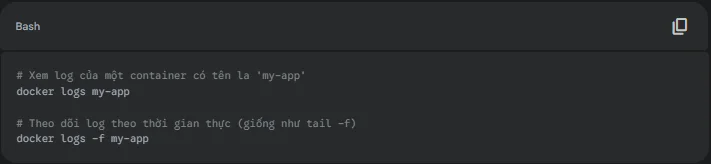
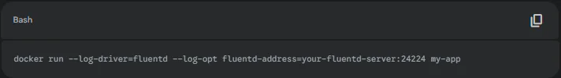

## Giám Sát Log Docker: Hướng Dẫn Toàn Diện Từ Cơ Bản Đến Nâng Cao Cho DevOps 2025

Hãy tưởng tượng một kịch bản ác mộng: một container dịch vụ thanh toán quan trọng đột ngột ngừng hoạt động vào đúng đợt khuyến mãi lớn nhất trong năm. Team DevOps của bạn lao vào tìm hiểu, nhưng khi kiểm tra, container đã bị hệ thống điều phối tự động khởi động lại, và toàn bộ dấu vết, toàn bộ log lỗi gây ra sự cố đã "bốc hơi" không một lời từ biệt. Doanh thu thất thoát, khách hàng phàn nàn, và đội ngũ của bạn bất lực vì không có dữ liệu để chẩn đoán.

Đây không phải là một câu chuyện hư cấu. Đó là thực tế phũ phàng mà rất nhiều doanh nghiệp phải đối mặt khi chuyển đổi sang kiến trúc Microservices và container hóa với Docker. Bản chất linh hoạt, năng động và "thân thiện" của Docker cũng chính là con dao hai lưỡi tạo ra một thách thức khổng lồ: **giám sát và quản lý log**.

Bài viết này sẽ là một hướng dẫn toàn diện, đi từ những khái niệm cơ bản nhất đến các chiến lược nâng cao, giúp bạn làm chủ nghệ thuật giám sát log Docker. Chúng ta sẽ khám phá các phương pháp, công cụ và cuối cùng là một giải pháp tối ưu giúp biến log từ một "điểm mù" đáng sợ thành "con mắt thần" quan sát toàn bộ hệ thống.

### Tại Sao Giám Sát Log Docker Lại Trở Thành Nhiệm Vụ Sống Còn?

Trong môi trường truyền thống với các máy chủ vật lý hay máy ảo, log thường được ghi vào các file cố định trên đĩa cứng. Nhưng với Docker, mọi thứ đã thay đổi. Các container được sinh ra và mất đi liên tục (ephemeral), và log của chúng cũng có chung số phận. Việc giám sát log Docker không còn là "nice-to-have" (có thì tốt), mà là một yêu cầu bắt buộc vì những lý do sau:

-   **Gỡ Lỗi và Xử Lý Sự Cố (Debugging & Troubleshooting):** Đây là lý do quan trọng nhất. Khi một ứng dụng trong container gặp lỗi, log là nguồn thông tin duy nhất và quý giá nhất để các lập trình viên và kỹ sư DevOps hiểu chuyện gì đã xảy ra và khắc phục nó một cách nhanh chóng.

-   **Giám Sát An Ninh và Tuân Thủ (Security & Compliance):** Log ghi lại mọi hoạt động, từ các yêu cầu truy cập hợp lệ đến những nỗ lực tấn công đáng ngờ. Việc phân tích log giúp phát hiện sớm các hành vi bất thường, các lỗ hổng bảo mật và cung cấp bằng chứng không thể chối cãi cho các hoạt động kiểm toán (audit).

-   **Phân Tích Hiệu Suất Ứng Dụng (Performance Analysis):** Log có thể tiết lộ các "nút thắt cổ chai" trong ứng dụng của bạn. Một truy vấn cơ sở dữ liệu chậm, một lời gọi API tốn nhiều thời gian... tất cả đều có thể được phát hiện qua việc phân tích log, giúp đội ngũ tối ưu hóa và cải thiện trải nghiệm người dùng.

-   **Phân Tích Kinh Doanh (Business Intelligence):** Log ứng dụng chứa đựng vô vàn thông tin kinh doanh giá trị. Người dùng đang tìm kiếm sản phẩm gì nhiều nhất? Tính năng nào ít được sử dụng? Phân tích log có thể cung cấp những insight đắt giá cho đội ngũ sản phẩm và marketing.

Thách thức lớn nhất là ở quy mô. Với một vài container, bạn có thể kiểm tra log thủ công. Nhưng với hàng trăm, hàng nghìn container chạy trên hàng chục máy chủ khác nhau, việc này là bất khả thi. Bạn cần một chiến lược tập trung hóa.

### Các Chiến Lược Thu Thập và Quản Lý Log Docker Hiệu Quả

Có nhiều cách để "thuần hóa" dòng chảy log từ các container. Hãy cùng đi từ cấp độ đơn giản nhất đến phức tạp và mạnh mẽ nhất.

#### 1\. Phương Pháp Cơ Bản: Lệnh "docker logs"

Đây là điểm khởi đầu của mọi người khi làm việc với Docker. Với một dòng lệnh đơn giản, bạn có thể xem được output (STDOUT/STDERR) của một container đang chạy.

Tuy nhiên, phương pháp này có những giới hạn chết người trong môi trường production:

-   **Log bị mất:** Ngay khi container bị xóa (docker rm), toàn bộ log của nó sẽ biến mất vĩnh viễn.

-   **Không thể tổng hợp:** Bạn phải SSH vào từng máy chủ để xem log của từng container. Không có cách nào để xem một bức tranh tổng thể.

-   **Khó phân tích:** Nó chỉ hiển thị một luồng văn bản thô, rất khó để tìm kiếm, lọc và phân tích khi có khối lượng log lớn.

#### 2\. Nâng Cao Hơn Với Docker Logging Drivers

Docker hiểu rõ những giới hạn trên và cung cấp một cơ chế mạnh mẽ hơn gọi là **Logging Drivers**. Logging driver cho phép bạn định tuyến log của container từ luồng output mặc định đến các hệ thống khác nhau.

Đây là một số driver phổ biến:

-   <strong>json-file (mặc định):</strong> Ghi log vào một file JSON trên máy chủ host. Tốt hơn việc mất log hoàn toàn, nhưng vẫn bị giới hạn ở từng host.

-   <strong>syslog:</strong> Gửi log đến dịch vụ syslog của máy chủ host. Từ đó, bạn có thể cấu hình syslog để chuyển tiếp log đến một máy chủ tập trung.

-   <strong>journald:</strong> Gửi log đến journald, hệ thống quản lý log mặc định trên nhiều bản phân phối Linux hiện đại.

-   <strong>fluentd / gelf:</strong> Đây là những driver mạnh mẽ nhất, được thiết kế để gửi log đến các công cụ thu thập log chuyên dụng như Fluentd hoặc các hệ thống tương thích với định dạng Graylog Extended Log Format (GELF).

Sử dụng logging driver là bước đầu tiên hướng tới một hệ thống logging tập trung. Ví dụ, để chạy một container và gửi log của nó đến một máy chủ Fluentd:

#### 3\. The Sidecar Pattern: Linh Hoạt Tối Đa

Đây là một mô hình kiến trúc nâng cao và rất phổ biến trong các hệ thống điều phối container như Kubernetes. Ý tưởng là chạy một container chuyên dụng cho việc thu thập log (gọi là "sidecar") ngay bên cạnh container ứng dụng chính của bạn.

-   **Container ứng dụng:** Chỉ cần tập trung vào việc ghi log ra STDOUT/STDERR như bình thường.

-   **Container sidecar:** (Sử dụng các agent như Fluentd, Vector, Logstash) sẽ đọc log từ container ứng dụng (thông qua một volume chia sẻ hoặc các cơ chế khác) và chịu trách nhiệm xử lý, định dạng và gửi chúng đến hệ thống logging tập trung.

**Ưu điểm của mô hình này:**

-   **Tách biệt trách nhiệm (Separation of Concerns):** Ứng dụng không cần "biết" gì về việc log sẽ được gửi đi đâu hay xử lý như thế nào.

-   **Linh hoạt:** Bạn có thể dễ dàng thay đổi hoặc nâng cấp agent thu thập log trong sidecar mà không cần phải build lại hay thay đổi container ứng dụng.

### Hệ Sinh Thái Công Cụ Giám Sát Log Docker

Khi bạn đã có chiến lược thu thập log, bước tiếp theo là lựa chọn công cụ để lưu trữ, phân tích và trực quan hóa chúng.

#### Bộ Đôi Quyền Lực Open-Source: ELK Stack và EFK Stack

-   **ELK Stack:** Là "bộ ba thần thánh" trong thế giới quản lý log mã nguồn mở, bao gồm **E**lasticsearch (lưu trữ và tìm kiếm), **L**ogstash (thu thập và xử lý), và **K**ibana (trực quan hóa và dashboard). Nó cực kỳ mạnh mẽ, linh hoạt và được hỗ trợ bởi một cộng đồng khổng lồ.

-   **EFK Stack:** Một biến thể phổ biến là thay thế Logstash bằng **F**luentd. Fluentd được biết đến là nhẹ hơn, hiệu quả hơn và có một hệ sinh thái plugin cực kỳ phong phú, khiến nó trở thành lựa chọn ưa thích cho việc thu thập log trong môi trường container.

**Thách thức:** Mặc dù mạnh mẽ, việc tự triển khai, cấu hình, bảo trì, và đặc biệt là mở rộng (scale) một cụm ELK/EFK là một công việc cực kỳ phức tạp và tốn kém. Nó đòi hỏi chuyên môn sâu về hệ thống và tiêu tốn rất nhiều tài nguyên vận hành.

### digiLogs: Giải Pháp Giám Sát Log Docker Tối Ưu Cho Doanh Nghiệp

Nhận thấy những thách thức mà doanh nghiệp phải đối mặt khi tự vận hành các hệ thống logging phức tạp, TPIsoftware đã phát triển [**digiLogs**](/vi/products/digilogs) – một nền tảng quản lý và phân tích log tập trung, được thiết kế để đơn giản hóa toàn bộ quy trình và mang lại sức mạnh phân tích vượt trội.

[**digiLogs**](/vi/products/digilogs) chính là câu trả lời cho bài toán giám sát log Docker, giải quyết triệt để các điểm yếu của phương pháp truyền thống và sự phức tạp của các giải pháp mã nguồn mở.

#### 1\. Logging Tập Trung Dễ Dàng Hơn Bao Giờ Hết

Với digiLogs, bạn không cần phải lo lắng về việc cài đặt hay quản lý các cụm Elasticsearch phức tạp. Nền tảng cung cấp các hướng dẫn tích hợp đơn giản với các công cụ thu thập log phổ biến nhất như Fluentd. Chỉ với vài bước cấu hình Docker logging driver hoặc một sidecar, toàn bộ log từ hàng trăm container của bạn sẽ được đẩy về một nơi duy nhất một cách an toàn và tin cậy.

#### 2\. Tìm Kiếm Tức Thì, Phân Tích Chuyên Sâu

"Mò kim đáy bể" đã là quá khứ. digiLogs trang bị một công cụ tìm kiếm mạnh mẽ, cho phép bạn truy vấn hàng terabyte dữ liệu log và nhận kết quả trong vài giây. Bạn có thể:

-   **Theo dõi log trực tiếp (Live Tail):** Xem log đang được tạo ra từ tất cả các container trong thời gian thực.

-   **Tìm kiếm và lọc nâng cao:** Sử dụng cú pháp truy vấn trực quan để tìm kiếm chính xác những gì bạn cần, ví dụ: "tất cả log có level là ERROR từ service 'payment' trong 30 phút qua".

-   **Trực quan hóa dữ liệu:** Tự động phân tích (parse) các định dạng log phổ biến và tạo ra các biểu đồ, dashboard đẹp mắt để theo dõi các chỉ số quan trọng.

#### 3\. Cảnh Báo Thông Minh và Khả Năng Mở Rộng Vượt Trội

Thay vì bị động chờ sự cố xảy ra, digiLogs giúp bạn hành động một cách chủ động. Bạn có thể thiết lập các cảnh báo thông minh dựa trên các mẫu log. Ví dụ: "Gửi cảnh báo qua Slack nếu số lượng lỗi 404 vượt quá 100 lỗi trong 5 phút".

Là một nền tảng được quản lý (managed platform), digiLogs có khả năng tự động mở rộng để xử lý bất kỳ khối lượng log nào mà hệ thống của bạn tạo ra, từ vài gigabyte đến hàng terabyte mỗi ngày, mà bạn không cần phải bận tâm đến việc nâng cấp máy chủ hay hạ tầng.

### Kết Luận: Biến Log Docker Từ Gánh Nặng Thành Lợi Thế

Giám sát log Docker không còn là một lựa chọn. Trong thế giới dựa trên container, nó là nền tảng của một hệ thống IT ổn định, an toàn và hiệu quả. Việc bỏ qua nó cũng giống như đi trong đêm mà không có đèn pin – sớm muộn bạn cũng sẽ vấp ngã.

Bạn có hai con đường: tự xây dựng hệ thống với các công cụ mã nguồn mở như ELK/EFK – một con đường mạnh mẽ nhưng đầy chông gai và tốn kém về nguồn lực; hoặc lựa chọn một giải pháp thông minh, được quản lý toàn diện để tập trung vào những gì bạn làm tốt nhất: phát triển sản phẩm.

Đừng để log Docker trở thành điểm mù trong hệ thống của bạn. Hãy trao quyền cho đội ngũ DevOps của mình với khả năng quan sát toàn diện, chẩn đoán nhanh chóng và phản ứng tức thì.
