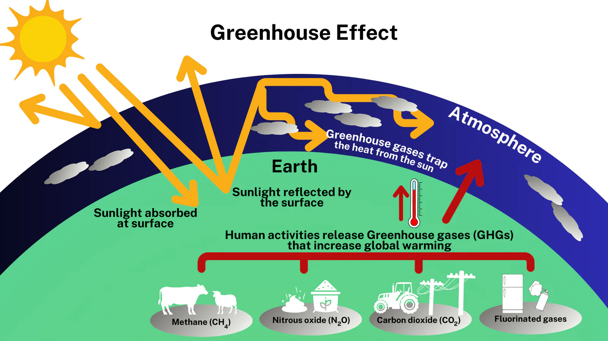

## Khí Nhà Kính: Hiểu Đúng Về "Thủ Phạm" Gây Biến Đổi Khí Hậu và Giải Pháp Hành Động Cấp Bách

Biến đổi khí hậu không còn là nguy cơ xa vời mà đã trở thành hiện thực khắc nghiệt, ảnh hưởng trực tiếp đến cuộc sống của hàng triệu người trên toàn cầu, và Việt Nam là một trong những quốc gia chịu tác động nặng nề nhất. "Thủ phạm" chính đằng sau hiện tượng này chính là [**khí nhà kính**](https://www.tpisoftware.vn/blog/digital-transformation/khi-nha-kinh). Nhưng khí nhà kính thực sự là gì? Chúng đến từ đâu? Và quan trọng hơn, làm thế nào chúng ta, đặc biệt là các doanh nghiệp, có thể hành động để giảm thiểu tác động của chúng?

Bài viết này sẽ cung cấp cho bạn cái nhìn toàn diện về khí nhà kính, từ định nghĩa, nguồn gốc, tác động đến các giải pháp quản lý và giảm phát thải hiệu quả, giúp bạn hiểu rõ vai trò và trách nhiệm của mình trong cuộc chiến chống biến đổi khí hậu.

## 1\. Khí Nhà Kính Là Gì và Hiệu Ứng Nhà Kính Hoạt Động Ra Sao?

Hãy tưởng tượng Trái Đất được bao bọc bởi một lớp "chăn" vô hình trong khí quyển. Lớp chăn này được tạo thành từ nhiều loại khí khác nhau, gọi chung là **khí nhà kính (Greenhouse Gases - GHG)**. Ánh sáng mặt trời chiếu xuống Trái Đất, một phần được hấp thụ làm ấm bề mặt, phần còn lại bị phản xạ trở lại không gian dưới dạng bức xạ hồng ngoại (nhiệt).

Các khí nhà kính trong khí quyển có khả năng hấp thụ một phần bức xạ nhiệt này, giữ lại hơi ấm cho Trái Đất, tạo điều kiện cho sự sống phát triển. Đây chính là **hiệu ứng nhà kính tự nhiên**. Nếu không có hiệu ứng này, nhiệt độ trung bình của Trái Đất sẽ lạnh hơn rất nhiều, khoảng -18°C thay vì mức 15°C như hiện tại.

Tuy nhiên, các hoạt động của con người, đặc biệt là từ sau Cách mạng Công nghiệp, đã làm gia tăng nồng độ các khí nhà kính một cách đột biến, khiến lớp "chăn" này dày lên. Kết quả là lượng nhiệt bị giữ lại nhiều hơn, gây ra sự nóng lên toàn cầu và biến đổi khí hậu – còn gọi là **hiệu ứng nhà kính tăng cường**.

## 2\. Các Loại Khí Nhà Kính Chính và Nguồn Gốc Phát Sinh

Có nhiều loại khí nhà kính khác nhau, nhưng 4 loại chính đóng góp nhiều nhất vào hiệu ứng nhà kính tăng cường bao gồm:

-   **Carbon Dioxide (CO2):**

    -   *Nguồn gốc:* Chủ yếu từ việc đốt cháy nhiên liệu hóa thạch (than đá, dầu mỏ, khí đốt) trong sản xuất điện, giao thông vận tải, công nghiệp; thay đổi sử dụng đất (phá rừng); các quy trình công nghiệp (sản xuất xi măng).

    -   *Đặc điểm:* Là khí nhà kính chiếm tỷ trọng lớn nhất và tồn tại lâu dài trong khí quyển.

-   **Methane (CH4):**

    -   *Nguồn gốc:* Từ các hoạt động nông nghiệp (trồng lúa nước, chăn nuôi gia súc nhai lại), quản lý chất thải (bãi chôn lấp), khai thác và sử dụng nhiên liệu hóa thạch.

    -   *Đặc điểm:* Có khả năng giữ nhiệt mạnh hơn CO2 khoảng 25-28 lần trong khoảng thời gian 100 năm, dù tồn tại trong khí quyển ngắn hơn.

-   **Nitrous Oxide (N2O):**

    -   *Nguồn gốc:* Chủ yếu từ hoạt động nông nghiệp (sử dụng phân bón chứa nitơ), các quy trình công nghiệp, đốt cháy nhiên liệu hóa thạch và sinh khối.

    -   *Đặc điểm:* Có khả năng giữ nhiệt mạnh hơn CO2 gần 300 lần và tồn tại rất lâu trong khí quyển.

-   **Các Khí Fluorinated (F-gases):** Bao gồm Hydrofluorocarbons (HFCs), Perfluorocarbons (PFCs), Sulfur hexafluoride (SF6), và Nitrogen trifluoride (NF3).

    -   *Nguồn gốc:* Sử dụng trong các ứng dụng công nghiệp, làm chất làm lạnh, dung môi, chất chống cháy, sản xuất nhôm và bán dẫn.

    -   *Đặc điểm:* Tuy có nồng độ thấp nhưng khả năng giữ nhiệt cực kỳ mạnh (gấp hàng nghìn đến hàng chục nghìn lần CO2) và tồn tại rất lâu.

**Bảng Tóm Tắt Các Khí Nhà Kính Chính**

| Khí Nhà Kính | Nguồn Gốc Chính | Khả Năng Gây Hiệu Ứng Nhà Kính (GWP-100 năm, so với CO2=1) |
| --- | --- | --- |
| Carbon Dioxide (CO2) | Đốt nhiên liệu hóa thạch, phá rừng, công nghiệp | 1 |
| Methane (CH4) | Nông nghiệp, chất thải, nhiên liệu hóa thạch | ~28 |
| Nitrous Oxide (N2O) | Nông nghiệp, công nghiệp, đốt nhiên liệu | ~265 |
| F-gases | Công nghiệp (chất làm lạnh, bán dẫn...) | Hàng nghìn đến hàng chục nghìn |

*(Lưu ý: Giá trị GWP có thể thay đổi nhỏ tùy theo báo cáo đánh giá của IPCC)*

## 3\. Tác Động Nghiêm Trọng Của Việc Gia Tăng Khí Nhà Kính

Sự gia tăng nồng độ khí nhà kính đang gây ra những hậu quả nghiêm trọng và ngày càng rõ rệt:

-   **Nóng Lên Toàn Cầu:** Nhiệt độ trung bình bề mặt Trái Đất tăng lên, phá vỡ các kỷ lục về nhiệt độ cao liên tục.

-   **Nước Biển Dâng:** Băng tan ở các cực và sông băng, cùng với sự giãn nở của nước biển do nhiệt độ tăng, làm mực nước biển dâng cao, đe dọa các khu vực ven biển và hải đảo. Đồng bằng sông Cửu Long của Việt Nam là một trong những nơi dễ bị tổn thương nhất.

-   **Các Hiện Tượng Thời Tiết Cực Đoan:** Tần suất và cường độ của các cơn bão, lũ lụt, hạn hán, sóng nhiệt gia tăng, gây thiệt hại nặng nề về người và của.

-   **Axit Hóa Đại Dương:** CO2 hòa tan vào nước biển làm tăng tính axit, ảnh hưởng đến các sinh vật biển có vỏ hoặc xương như san hô, động vật thân mềm.

-   **Ảnh Hưởng Hệ Sinh Thái và Đa Dạng Sinh Học:** Thay đổi môi trường sống, gây nguy cơ tuyệt chủng cho nhiều loài động thực vật.

-   **Tác Động Kinh Tế - Xã Hội:** Ảnh hưởng đến nông nghiệp, an ninh lương thực, nguồn nước, sức khỏe con người, cơ sở hạ tầng, gây bất ổn và di cư.

## 4\. Quản Lý và Giảm Thiểu Phát Thải Khí Nhà Kính: Trách Nhiệm Của Doanh Nghiệp

Trước những tác động trên, việc kiểm kê, quản lý và giảm phát thải khí nhà kính không chỉ là trách nhiệm đạo đức mà còn là yêu cầu cấp thiết đối với các doanh nghiệp, đặc biệt là các công xưởng, xí nghiệp, khu công nghiệp, kho bãi, và những ngành tiêu thụ nhiều năng lượng hoặc chịu sự quản lý của luật môi trường.

**Tại sao doanh nghiệp cần hành động?**

-   **Tuân thủ quy định:** Việt Nam đã cam kết mạnh mẽ tại COP26 về mục tiêu Net Zero vào năm 2050. Các quy định về kiểm kê GHG và giảm phát thải (như Nghị định 06/2022/NĐ-CP) ngày càng chặt chẽ hơn.

-   **Nâng cao hiệu quả:** Quản lý phát thải thường đi đôi với việc tối ưu hóa sử dụng năng lượng và tài nguyên, giúp giảm chi phí vận hành.

-   **Tăng cường uy tín và thương hiệu:** Người tiêu dùng, nhà đầu tư và đối tác ngày càng quan tâm đến yếu tố bền vững (ESG).

-   **Quản lý rủi ro:** Giảm thiểu rủi ro pháp lý, rủi ro chuỗi cung ứng và rủi ro danh tiếng liên quan đến biến đổi khí hậu.

-   **Tiếp cận tài chính xanh:** Cơ hội tiếp cận các nguồn vốn ưu đãi dành cho các dự án bền vững.

**Làm thế nào để quản lý phát thải hiệu quả?**

Bước đầu tiên và quan trọng nhất là **kiểm kê khí nhà kính** (GHG Inventory) – tức là đo lường và báo cáo lượng phát thải của doanh nghiệp theo các tiêu chuẩn quốc tế (như GHG Protocol) bao gồm: ***Phạm vi 1 (Scope 1):*** <em>Phát thải trực tiếp từ các nguồn thuộc sở hữu hoặc kiểm soát của công ty (đốt nhiên liệu tại chỗ, phương tiện vận tải của công ty, phát thải từ quy trình sản xuất...).</em> **Phạm vi 2 (Scope 2):** Phát thải gián tiếp từ việc mua điện, hơi nước, nhiệt hoặc làm mát. \* **Phạm vi 3 (Scope 3):** Tất cả các phát thải gián tiếp khác xảy ra trong chuỗi giá trị của công ty (mua nguyên vật liệu, vận chuyển thuê ngoài, đi lại của nhân viên, xử lý chất thải, sử dụng sản phẩm...).

Để thực hiện kiểm kê và quản lý dữ liệu carbon một cách chính xác, hiệu quả, đặc biệt với các doanh nghiệp có quy mô lớn hoặc quy trình phức tạp, việc ứng dụng công nghệ là rất cần thiết. Các **giải pháp và dịch vụ quản lý dữ liệu Carbon** chuyên biệt (như [**Greenswift**](/vi/products/greenswift)) giúp tự động hóa thu thập dữ liệu, tính toán phát thải theo các tiêu chuẩn quốc tế, tạo báo cáo tuân thủ và theo dõi tiến trình giảm phát thải.

Bên cạnh đó, tối ưu hóa việc sử dụng năng lượng là một trong những cách hiệu quả nhất để giảm cả chi phí và phát thải (đặc biệt là Scope 2). Các **hệ thống quản lý năng lượng thông minh, ứng dụng AI** (ví dụ như **EletriSwift**) có thể phân tích dữ liệu tiêu thụ điện năng theo thời gian thực, xác định các điểm lãng phí và đề xuất các giải pháp tối ưu hóa vận hành thiết bị, giúp doanh nghiệp tiết kiệm đáng kể năng lượng và giảm dấu chân carbon.

## 5\. Case Study: Các Doanh Nghiệp Hành Động Giảm Phát Thải Khí Nhà Kính

Nhiều doanh nghiệp tại Việt Nam và trên thế giới đã và đang triển khai các sáng kiến giảm phát thải khí nhà kính hiệu quả:

1.  **LEGO (Việt Nam):** Nhà máy trung hòa carbon đầu tiên của LEGO Group đặt tại Bình Dương được đầu tư xây dựng với mục tiêu sử dụng 100% năng lượng tái tạo (từ hệ thống năng lượng mặt trời tại chỗ và các dự án bên ngoài), thể hiện cam kết mạnh mẽ về giảm phát thải Scope 1 và Scope 2. (Nguồn: Thông cáo báo chí LEGO)

2.  **Vinamilk (Việt Nam):** Là doanh nghiệp tiên phong trong ngành sữa Việt Nam thực hiện kiểm kê khí nhà kính tại các nhà máy và trang trại theo chuẩn ISO 14064. Họ cũng triển khai nhiều giải pháp như sử dụng năng lượng sinh khối (biogas từ chất thải chăn nuôi), năng lượng mặt trời áp mái, tối ưu hóa vận chuyển để giảm phát thải. (Nguồn: Báo cáo Phát triển Bền vững Vinamilk)

3.  **HEINEKEN Việt Nam:** Cam kết sử dụng 100% năng lượng tái tạo trong sản xuất vào năm 2025. Công ty đã đầu tư vào hệ thống sinh khối sử dụng vỏ trấu, mùn cưa để cung cấp nhiệt cho sản xuất, thay thế nhiên liệu hóa thạch, giảm đáng kể phát thải CO2. (Nguồn: Báo cáo Bền vững HEINEKEN Việt Nam)

4.  **Apple (Toàn cầu):** Đã đạt được trung hòa carbon cho các hoạt động vận hành toàn cầu và đang nỗ lực hướng tới mục tiêu trung hòa carbon cho toàn bộ chuỗi cung ứng và vòng đời sản phẩm vào năm 2030. Họ yêu cầu các nhà cung cấp (bao gồm cả ở Việt Nam) chuyển đổi sang sử dụng năng lượng sạch. (Nguồn: Báo cáo Môi trường Apple)

5.  **Unilever (Toàn cầu & Việt Nam):** Đặt mục tiêu Net Zero trong toàn bộ chuỗi giá trị vào năm 2039. Tại Việt Nam, Unilever đã triển khai các dự án sử dụng năng lượng mặt trời, nồi hơi sinh khối, và các chương trình kinh tế tuần hoàn trong quản lý rác thải nhựa để giảm phát thải. (Nguồn: Kế hoạch Sống Bền vững Unilever)

Những ví dụ này cho thấy việc giảm phát thải khí nhà kính không chỉ khả thi mà còn mang lại lợi ích kinh tế và nâng cao vị thế cho doanh nghiệp.

## 6\. Giải Pháp Tổng Thể và Hành Động Của Mỗi Cá Nhân

Ngoài nỗ lực của doanh nghiệp, việc giảm phát thải khí nhà kính đòi hỏi sự chung tay của cả cộng đồng và mỗi cá nhân:

-   **Chính phủ:** Xây dựng và thực thi các chính sách khuyến khích năng lượng tái tạo, hiệu quả năng lượng, bảo vệ rừng, định giá carbon, hỗ trợ chuyển đổi xanh.

-   **Doanh nghiệp:** Như đã đề cập, cần kiểm kê, đặt mục tiêu và thực hiện các giải pháp giảm phát thải, đầu tư vào công nghệ sạch, xây dựng chuỗi cung ứng bền vững.

-   **Cá nhân:**

    -   Tiết kiệm năng lượng (tắt thiết bị điện khi không dùng, sử dụng thiết bị hiệu suất cao).

    -   Ưu tiên phương tiện giao thông công cộng, đi bộ, đi xe đạp hoặc xe điện.

    -   Giảm tiêu thụ thịt đỏ, tăng cường thực phẩm thực vật.

    -   Hạn chế rác thải, tái chế, tái sử dụng.

    -   Ủng hộ các sản phẩm và doanh nghiệp bền vững.

    -   Nâng cao nhận thức và lan tỏa thông điệp bảo vệ môi trường.

## Kết Luận

Khí nhà kính và biến đổi khí hậu là thách thức nghiêm trọng nhất mà nhân loại đang đối mặt. Hiểu rõ về nguồn gốc, tác động và các giải pháp giảm thiểu là bước đầu tiên để hành động. Đối với các doanh nghiệp tại Việt Nam, việc chủ động quản lý và cắt giảm phát thải khí nhà kính không chỉ là tuân thủ pháp luật mà còn là cơ hội để nâng cao năng lực cạnh tranh, tối ưu chi phí và xây dựng thương hiệu bền vững trong bối cảnh kinh tế xanh đang trở thành xu thế tất yếu.

Việc áp dụng các công nghệ tiên tiến như phần mềm quản lý dữ liệu carbon và hệ thống tối ưu năng lượng AI sẽ là đòn bẩy quan trọng giúp doanh nghiệp đạt được mục tiêu giảm phát thải một cách hiệu quả. Hãy cùng nhau hành động ngay hôm nay, từ những thay đổi nhỏ nhất đến các chiến lược quy mô lớn, để bảo vệ Trái Đất và đảm bảo một tương lai bền vững cho thế hệ mai sau.
