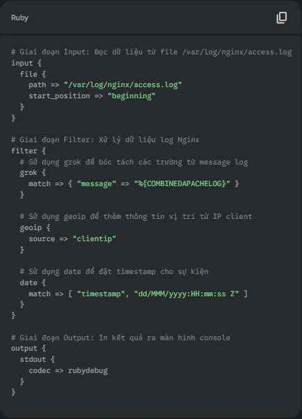

## Logstash Là Gì? Hướng Dẫn Toàn Tập A-Z Về "Trái Tim" Của ELK Stack

Trong thế giới vận hành IT hiện đại với kiến trúc microservices và hệ thống phân tán, dữ liệu log được sinh ra từ hàng trăm, hàng nghìn nguồn khác nhau: từ web server, application, database cho đến các thiết bị mạng. Chúng tồn tại ở vô vàn định dạng, nằm rải rác khắp nơi và tạo ra một mớ hỗn độn thực sự. Việc tổng hợp, chuẩn hóa và phân tích "cơn lũ" log này theo cách thủ công là một nhiệm vụ bất khả thi.

Đây chính là lúc Logstash xuất hiện như một vị cứu tinh. Nó không chỉ là một công cụ, mà là một "trung tâm thu gom và xử lý dữ liệu" đa năng, đóng vai trò trung tâm trong việc xây dựng một hệ thống giám sát và phân tích log tập trung. Bài viết này sẽ là một hướng dẫn toàn diện, đi sâu vào từng khía cạnh để trả lời câu hỏi "Logstash là gì?", từ kiến trúc cốt lõi, cách cấu hình, cho đến vai trò không thể thay thế của nó trong hệ sinh thái ELK Stack.

### Logstash Là Gì? "Trái Tim" Của Hệ Thống ELK Stack

Logstash là một công cụ mã nguồn mở, được phát triển bởi Elastic, dùng để thu thập (ingest), xử lý (process), và chuyển tiếp (forward) dữ liệu từ nhiều nguồn khác nhau đến một hoặc nhiều đích đến. Nói một cách dễ hiểu, Logstash là một **đường ống xử lý dữ liệu (data processing pipeline)** hoạt động ở phía máy chủ.

Hãy hình dung Logstash như một nhà máy chế biến đa năng:

-   **Đầu vào (Input):** Nhà máy có thể nhận nguyên liệu thô từ rất nhiều nguồn cung cấp (log file, message queue, database, syslog...).

-   **Chế biến (Filter):** Tại đây, nguyên liệu thô được làm sạch, phân loại, biến đổi, và làm giàu thông tin để trở thành một sản phẩm có cấu trúc, tiêu chuẩn hóa.

-   **Đầu ra (Output):** Sản phẩm hoàn thiện sau đó được vận chuyển đến các kho chứa hoặc các hệ thống khác để lưu trữ, phân tích hoặc hiển thị (ví dụ như Elasticsearch).

Logstash là mảnh ghép chữ **"L"** trong bộ ba huyền thoại **ELK Stack** (nay là Elastic Stack), bao gồm:

-   **Elasticsearch (E):** Một công cụ tìm kiếm và phân tích phân tán, đóng vai trò là "kho chứa" để lưu trữ và truy vấn dữ liệu log đã được xử lý.

-   **Logstash (L):** "Trái tim" của hệ thống, chịu trách nhiệm thu thập và xử lý dữ liệu trước khi đưa vào Elasticsearch.

-   **Kibana (K):** Giao diện người dùng web, là "bộ não" hiển thị, cho phép người dùng tạo các dashboard, biểu đồ trực quan để phân tích và khám phá dữ liệu trong Elasticsearch.

Cùng với Beats (tác nhân gửi log hạng nhẹ), bộ tứ này tạo thành một giải pháp toàn diện cho việc quản lý và phân tích log.

### Giải Phẫu Kiến Trúc Pipeline Của Logstash: Input - Filter - Output

Sức mạnh thực sự của Logstash nằm ở kiến trúc pipeline đơn giản nhưng cực kỳ linh hoạt. Một pipeline Logstash bao gồm ba giai đoạn bắt buộc, được định nghĩa trong một file cấu hình .conf.

#### Giai đoạn 1: Input - Cổng Tiếp Nhận Dữ Liệu Đa Nguồn

Đây là nơi Logstash nhận dữ liệu đầu vào. Nhờ vào hệ thống plugin đa dạng, Logstash có thể "lắng nghe" dữ liệu từ hầu hết mọi nguồn mà bạn có thể tưởng tượng.

-   **file:** Plugin phổ biến nhất, dùng để đọc dữ liệu log từ một file trên máy chủ, tương tự lệnh tail -f trong Linux.

-   **beats:** Lắng nghe dữ liệu được gửi đến từ các tác nhân Beats (như Filebeat, Metricbeat). Đây là kiến trúc được khuyến nghị vì Filebeat rất nhẹ, chỉ làm nhiệm vụ gửi log, còn Logstash sẽ đảm nhiệm phần xử lý nặng.

-   **tcp/udp:** Nhận dữ liệu qua các giao thức mạng TCP hoặc UDP.

-   **syslog:** Thu thập log theo chuẩn syslog, rất phổ biến cho các thiết bị mạng và máy chủ Linux.

-   **jdbc:** Lấy dữ liệu từ các cơ sở dữ liệu có hỗ trợ JDBC.

#### Giai đoạn 2: Filter - "Nhà Máy" Chế Biến Dữ Liệu Thô

Đây là giai đoạn quan trọng nhất, nơi "phép màu" xảy ra. Dữ liệu thô, vô cấu trúc từ input sẽ được biến đổi thành dữ liệu có cấu trúc, sạch sẽ và giàu thông tin.

-   **grok:** "Viên ngọc quý" của Logstash. Nó sử dụng các biểu thức chính quy (regular expression) được định nghĩa sẵn để phân tích và bóc tách các trường dữ liệu từ một chuỗi văn bản vô cấu trúc. Ví dụ, nó có thể tách một dòng log của Nginx thành các trường riêng biệt như client\_ip , request\_path , status\_code ...

-   **mutate:** Dùng để thực hiện các thay đổi trên các trường dữ liệu như đổi tên, xóa, thay thế, hoặc thêm trường mới.

-   **date:** Phân tích cú pháp của trường thời gian trong log và sử dụng nó làm timestamp chính của sự kiện, cực kỳ quan trọng cho việc phân tích log theo dòng thời gian.

-   **json:** Phân tích dữ liệu có định dạng JSON.

-   **geoip:** Dựa vào địa chỉ IP, thêm vào các thông tin về vị trí địa lý như tên thành phố, quốc gia.

#### Giai đoạn 3: Output - Cánh Cửa Phân Phối Dữ Liệu

Sau khi dữ liệu đã được xử lý hoàn chỉnh, giai đoạn output sẽ gửi nó đến đích. Một pipeline có thể có nhiều output.

-   **elasticsearch:** Plugin output quan trọng nhất, gửi dữ liệu trực tiếp vào Elasticsearch để lưu trữ và lập chỉ mục.

-   **file:** Lưu dữ liệu đã xử lý ra một file trên đĩa.

-   **s3:** Lưu trữ log dài hạn trên dịch vụ Amazon S3.

-   **stdout { codec => rubydebug }:** Một output cực kỳ hữu ích trong quá trình phát triển và gỡ lỗi, dùng để in dữ liệu đã xử lý ra màn hình console.

### Hướng Dẫn Cấu Hình Logstash Pipeline Đầu Tiên (Ví Dụ Thực Tế)

Hãy xem một ví dụ cấu hình *nginx.conf* đơn giản để thấy cách Logstash hoạt động. Giả sử chúng ta muốn đọc log truy cập của Nginx, bóc tách thông tin và in ra màn hình.

**File cấu hình** *nginx.conf*<strong>:</strong>

Với file cấu hình này, một dòng log Nginx thô sẽ được chuyển đổi thành một đối tượng JSON có cấu trúc rõ ràng, sẵn sàng để được đưa vào Elasticsearch.

### Ưu và Nhược Điểm Của Logstash: Khi Nào Nên và Không Nên Sử Dụng?

Logstash là một công cụ cực kỳ mạnh mẽ, nhưng không phải lúc nào cũng là lựa chọn hoàn hảo.

#### Ưu điểm:

-   **Siêu linh hoạt:** Với hơn 200 plugin cho input, filter và output, Logstash có thể tích hợp với gần như mọi hệ thống.

-   **Tích hợp hoàn hảo với ELK Stack:** Được thiết kế để hoạt động liền mạch với Elasticsearch và Kibana.

-   **Xử lý phức tạp:** Khả năng xử lý và làm giàu dữ liệu của các plugin filter (đặc biệt là Grok) là vô song.

-   **Đảm bảo dữ liệu:** Hỗ trợ Persistent Queues, giúp lưu trữ dữ liệu trên đĩa để tránh mất mát trong trường hợp Logstash bị tắt đột ngột.

#### Nhược điểm:

-   **Tiêu tốn tài nguyên:** Logstash chạy trên Máy ảo Java (JVM), vốn nổi tiếng là ngốn RAM và CPU, đặc biệt khi xử lý các pipeline phức tạp.

-   **Phức tạp trong vận hành:** Việc cài đặt, tinh chỉnh hiệu năng, mở rộng quy mô (scaling) và bảo trì một cụm Logstash lớn đòi hỏi kiến thức chuyên môn sâu và tốn nhiều công sức.

-   **Độ trễ xử lý:** So với các agent hạng nhẹ, Logstash có độ trễ xử lý cao hơn do phải thực hiện nhiều tác vụ phức tạp.

### Logstash và Thách Thức Vận Hành: Đã Đến Lúc Cần Một Giải Pháp Toàn Diện?

Những nhược điểm trên cho thấy, trong khi Logstash là một công cụ mã nguồn mở tuyệt vời, việc tự xây dựng và quản lý một hệ thống ELK Stack hoàn chỉnh là một công việc toàn thời gian. Các đội ngũ DevOps và SysAdmin thường phải đối mặt với các câu hỏi hóc búa:

-   Làm thế nào để scaling cụm Logstash khi lưu lượng log tăng đột biến?

-   Làm sao để đảm bảo an ninh cho toàn bộ đường ống dữ liệu?

-   Ai sẽ chịu trách nhiệm cập nhật và vá lỗi cho tất cả các thành phần (Logstash, Elasticsearch, Kibana)?

-   Làm thế nào để tối ưu hóa hiệu năng và chi phí tài nguyên cho JVM?

Đây chính là lúc các giải pháp Quản lý Log được quản lý hoàn toàn (fully-managed) như [**digiLogs**](/vi/products/digilogs) của TPIsoftware tỏa sáng.

[**digiLogs**](/vi/products/digilogs) là một nền tảng quản lý log tập trung, giúp doanh nghiệp loại bỏ hoàn toàn gánh nặng vận hành. Thay vì phải tự mình vật lộn với việc cài đặt, cấu hình và bảo trì Logstash, bạn chỉ cần gửi dữ liệu log của mình đến digiLogs. Nền tảng sẽ tự động xử lý tất cả các khâu còn lại:

-   **Thu thập log dễ dàng** từ mọi nguồn.

-   **Tự động phân tích và chuẩn hóa** dữ liệu.

-   **Lưu trữ an toàn và có khả năng mở rộng** vô hạn.

-   **Cung cấp giao diện tìm kiếm, trực quan hóa và cảnh báo** mạnh mẽ.

Với digiLogs, đội ngũ của bạn có thể tập trung 100% vào việc khai thác giá trị và insight từ dữ liệu log, thay vì lãng phí thời gian và nguồn lực quý báu để duy trì một cơ sở hạ tầng phức tạp.

### Kết Luận: Logstash - Công Cụ Mạnh Mẽ Cần Bàn Tay Bậc Thầy

Không thể phủ nhận, Logstash là một công cụ xử lý dữ liệu phi thường, là trái tim và linh hồn đã làm nên thành công của ELK Stack. Nó mang lại sức mạnh và sự linh hoạt vô hạn cho các kỹ sư trong việc xây dựng các hệ thống logging tập trung.

Tuy nhiên, sức mạnh đó đi kèm với sự phức tạp trong vận hành. Doanh nghiệp đứng trước một lựa chọn chiến lược: đầu tư nguồn lực để làm chủ công cụ mã nguồn mở mạnh mẽ như Logstash, hoặc lựa chọn một giải pháp được quản lý hoàn toàn như digiLogs để đạt được kết quả nhanh hơn, hiệu quả hơn và tập trung vào năng lực cốt lõi của mình. Sự lựa chọn này sẽ định hình khả năng quan sát và phản ứng của doanh nghiệp trong thế giới số đầy biến động.
