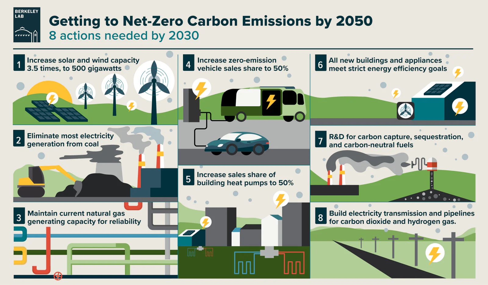

## Net Zero Là Gì? Giải Mã Cam Kết Toàn Cầu và Lộ Trình Hành Động của Việt Nam Đến Năm 2050

Trong bối cảnh biến đổi khí hậu đang diễn ra ngày càng phức tạp và khó lường, thuật ngữ "Net Zero" hay "Phát thải ròng bằng 0" đang trở thành mục tiêu cấp bách của nhiều quốc gia và doanh nghiệp trên toàn thế giới. Nhưng [**Net Zero là gì**](/vi/blog/net-zero-la-gi) mà lại có sức ảnh hưởng lớn đến vậy? Tại sao Việt Nam lại cam kết mạnh mẽ để đạt được mục tiêu này vào năm 2050? Và quan trọng hơn, doanh nghiệp của bạn cần làm gì để không đứng ngoài cuộc chơi mang tính cách mạng này?

Hãy cùng TPIsoftware đi sâu tìm hiểu về Net Zero, lộ trình thực hiện tại Việt Nam và các giải pháp công nghệ tiên tiến giúp doanh nghiệp bạn không chỉ tuân thủ quy định mà còn nắm bắt cơ hội phát triển bền vững.

## 1\. Net Zero Là Gì? Không Chỉ Là "Không Phát Thải"

Nhiều người lầm tưởng Net Zero đồng nghĩa với việc hoàn toàn không tạo ra bất kỳ khí nhà kính (Greenhouse Gas - GHG) nào. Tuy nhiên, định nghĩa chính xác của Net Zero phức tạp hơn thế.

**Net Zero (Phát thải ròng bằng 0)** là trạng thái cân bằng giữa lượng khí nhà kính do con người *gây ra* và lượng khí nhà kính được *loại bỏ* khỏi bầu khí quyển.

Điều này có nghĩa là:

-   **Không phải loại bỏ hoàn toàn phát thải:** Các hoạt động kinh tế - xã hội vẫn có thể tạo ra một lượng khí nhà kính nhất định.

-   **Cần các biện pháp loại bỏ GHG:** Lượng phát thải còn lại phải được cân bằng bằng các phương pháp loại bỏ khí nhà kính khỏi khí quyển, ví dụ như trồng rừng (hấp thụ CO2 tự nhiên) hoặc sử dụng các công nghệ thu giữ và lưu trữ carbon (Carbon Capture and Storage - CCS).

**Phân biệt Net Zero với các khái niệm khác:**

| Khái niệm | Định nghĩa | Phạm vi |
| --- | --- | --- |
| **Net Zero** | Cân bằng tổng lượng *tất cả* khí nhà kính phát thải và loại bỏ. | Tất cả các loại khí nhà kính (CO2, CH4, N2O...) |
| Carbon Neutral | Cân bằng lượng khí Carbon Dioxide (CO2) phát thải và loại bỏ (thường thông qua bù đắp carbon - offsetting). | Chỉ tập trung vào CO2 |
| Zero Emissions | Không phát thải *bất kỳ* khí nhà kính nào từ một hoạt động hoặc quy trình cụ thể. | Rất khó đạt được trên quy mô lớn |
| Climate Positive | Loại bỏ *nhiều* khí nhà kính hơn lượng phát thải ra, tạo ra lợi ích môi trường ròng. | Mục tiêu cao hơn Net Zero |

Hiểu rõ sự khác biệt này rất quan trọng để doanh nghiệp xác định đúng mục tiêu và chiến lược hành động của mình.

## 2\. Tại Sao Net Zero Lại Trở Nên Cấp Bách Toàn Cầu?

Mục tiêu Net Zero không tự nhiên xuất hiện. Nó bắt nguồn từ những cảnh báo khoa học nghiêm túc về biến đổi khí hậu và sự nóng lên toàn cầu.

-   **Thỏa thuận Paris về Biến đổi khí hậu (2015):** Đặt mục tiêu giữ cho nhiệt độ Trái Đất tăng không quá 2°C, và lý tưởng là 1.5°C so với thời kỳ tiền công nghiệp. Các nhà khoa học chỉ ra rằng để đạt được mục tiêu 1.5°C, thế giới cần đạt Net Zero phát thải CO2 vào khoảng năm 2050.

-   **Hậu quả nghiêm trọng của biến đổi khí hậu:** Các hiện tượng thời tiết cực đoan (bão lũ, hạn hán, nắng nóng gay gắt), nước biển dâng, mất đa dạng sinh học... đang ngày càng gia tăng tần suất và cường độ, gây thiệt hại nặng nề về kinh tế và xã hội.

-   **Áp lực từ cộng đồng quốc tế và nhà đầu tư:** Các quốc gia, tổ chức tài chính và người tiêu dùng ngày càng yêu cầu sự minh bạch và hành động quyết liệt từ các doanh nghiệp trong việc giảm phát thải. Các tiêu chuẩn về Môi trường, Xã hội và Quản trị (ESG) đang trở thành yếu tố quan trọng trong quyết định đầu tư.

## 3\. Cam Kết Net Zero Của Việt Nam: Cơ Hội và Thách Thức

Tại Hội nghị Thượng đỉnh về Biến đổi khí hậu của Liên Hợp Quốc năm 2021 (COP26), Thủ tướng Chính phủ Việt Nam đã đưa ra cam kết mạnh mẽ: **Việt Nam sẽ đạt mức phát thải ròng bằng 0 vào năm 2050.**

Cam kết này thể hiện quyết tâm chính trị cao của Việt Nam trong việc chung tay cùng cộng đồng quốc tế giải quyết khủng hoảng khí hậu, đồng thời mở ra những cơ hội và thách thức lớn:

-   **Cơ hội:**

    -   Thu hút đầu tư xanh, công nghệ sạch.

    -   Thúc đẩy chuyển đổi năng lượng sang năng lượng tái tạo.

    -   Nâng cao năng lực cạnh tranh của nền kinh tế và doanh nghiệp.

    -   Tạo ra các ngành nghề, việc làm mới trong lĩnh vực kinh tế xanh.

    -   Cải thiện chất lượng môi trường và sức khỏe cộng đồng.

-   **Thách thức:**

    -   Yêu cầu nguồn vốn đầu tư lớn cho chuyển đổi công nghệ và hạ tầng.

    -   Cần thay đổi cơ cấu kinh tế, đặc biệt là các ngành thâm dụng năng lượng.

    -   Thiếu hụt nguồn nhân lực chất lượng cao trong lĩnh vực năng lượng tái tạo, quản lý carbon.

    -   Cần hoàn thiện khung pháp lý và chính sách hỗ trợ.

Để hiện thực hóa cam kết, Chính phủ đã ban hành nhiều chiến lược và quy định, đáng chú ý là **Nghị định 06/2022/NĐ-CP** quy định giảm nhẹ phát thải khí nhà kính và bảo vệ tầng ozon, yêu cầu các doanh nghiệp thuộc danh mục phải kiểm kê khí nhà kính.

## 4\. Lộ Trình Đạt Net Zero: Doanh Nghiệp Cần Làm Gì?

Net Zero không chỉ là trách nhiệm của chính phủ mà còn là hành trình cần sự tham gia chủ động của cộng đồng doanh nghiệp. Các công xưởng, xí nghiệp, khu công nghiệp, kho bãi, khu du lịch, đặc biệt là các đơn vị tiêu thụ nhiều điện năng và thuộc diện kiểm kê GHG, cần bắt đầu hành động ngay hôm nay.

**Các bước chính doanh nghiệp có thể thực hiện:**

-   **Bước 1: Đo lường và Kiểm kê Khí nhà kính (GHG Inventory):**

    -   Đây là bước nền tảng, giúp doanh nghiệp hiểu rõ nguồn phát thải chính của mình đến từ đâu (Phạm vi 1: Trực tiếp; Phạm vi 2: Gián tiếp từ năng lượng mua vào; Phạm vi 3: Gián tiếp khác trong chuỗi giá trị).

    -   Việc thu thập dữ liệu chính xác và đáng tin cậy là rất quan trọng.

    -   *Thách thức:* Thu thập dữ liệu thủ công tốn thời gian, dễ sai sót, khó quản lý và báo cáo theo chuẩn quốc tế.

-   **Bước 2: Đặt Mục tiêu Giảm phát thải:**

    -   Dựa trên kết quả kiểm kê, doanh nghiệp cần đặt ra các mục tiêu giảm phát thải cụ thể, có thể đo lường, khả thi, phù hợp và có thời hạn (SMART).

    -   Nên tham khảo các mục tiêu dựa trên cơ sở khoa học (Science-Based Targets initiative - SBTi).

-   **Bước 3: Xây dựng và Thực hiện Kế hoạch Hành động:**

    -   **Tối ưu hóa hiệu quả năng lượng:** Đây thường là giải pháp "dễ hái quả" nhất. Cải tiến quy trình, thay thế thiết bị cũ bằng công nghệ tiết kiệm năng lượng, áp dụng hệ thống quản lý năng lượng thông minh.

    -   **Chuyển đổi sang năng lượng tái tạo:** Lắp đặt điện mặt trời áp mái, mua Chứng chỉ Năng lượng Tái tạo (REC), ký Hợp đồng Mua bán Điện trực tiếp (DPPA).

    -   **Cải tiến quy trình sản xuất và công nghệ:** Áp dụng công nghệ sạch hơn, giảm lãng phí nguyên vật liệu.

    -   **Tối ưu hóa chuỗi cung ứng:** Hợp tác với nhà cung cấp để giảm phát thải trong toàn bộ chuỗi giá trị (Phạm vi 3).

    -   **Đầu tư vào giải pháp loại bỏ carbon:** Trồng rừng, nông nghiệp tái tạo, hoặc đầu tư vào công nghệ CCS (nếu phù hợp và khả thi).

    -   **Sử dụng tín chỉ carbon (Carbon Offset):** Mua tín chỉ carbon từ các dự án giảm phát thải hoặc loại bỏ GHG đã được thẩm định để bù đắp cho lượng phát thải không thể cắt giảm trực tiếp. Đây nên là giải pháp cuối cùng sau khi đã nỗ lực tối đa để giảm phát thải nội tại.

-   **Bước 4: Báo cáo và Truyền thông:**

    -   Minh bạch hóa quá trình và kết quả giảm phát thải thông qua các báo cáo phát triển bền vững, báo cáo ESG.

    -   Truyền thông cam kết và hành động của doanh nghiệp đến các bên liên quan (nhà đầu tư, khách hàng, nhân viên, cộng đồng).

## 5\. Case Study: Các Doanh Nghiệp Tiên Phong Trên Thế Giới và Tại Việt Nam

Nhiều tập đoàn lớn đã và đang hành động mạnh mẽ hướng tới Net Zero:

1.  **Microsoft:** Cam kết đạt carbon âm (loại bỏ nhiều carbon hơn lượng phát thải) vào năm 2030 và loại bỏ toàn bộ lượng carbon lịch sử đã phát thải vào năm 2050. Họ đầu tư mạnh vào năng lượng tái tạo, công nghệ thu giữ carbon và các giải pháp dựa vào thiên nhiên.

2.  **Apple:** Đã đạt trung hòa carbon cho hoạt động vận hành toàn cầu và đang nỗ lực để toàn bộ chuỗi cung ứng và vòng đời sản phẩm đạt Net Zero vào năm 2030. Họ tập trung vào vật liệu tái chế, hiệu quả năng lượng và năng lượng sạch.

3.  **Unilever:** Đặt mục tiêu Net Zero trong toàn bộ chuỗi giá trị vào năm 2039. Họ đang triển khai các dự án nông nghiệp tái tạo, giảm thiểu rác thải nhựa và sử dụng năng lượng tái tạo.

4.  **Ørsted (Đan Mạch):** Từ một công ty dầu khí, Ørsted đã chuyển đổi hoàn toàn thành tập đoàn năng lượng tái tạo hàng đầu thế giới, chủ yếu là điện gió ngoài khơi, và đặt mục tiêu Net Zero trong vận hành và cung cấp năng lượng vào năm 2025.

5.  **Vinamilk (Việt Nam):** Là một trong những doanh nghiệp tiên phong tại Việt Nam công bố lộ trình tiến tới Net Zero 2050 với nhiều dự án như xây dựng trang trại sinh thái, sử dụng năng lượng mặt trời, và nghiên cứu các giải pháp bao bì bền vững.

Những ví dụ này cho thấy Net Zero không chỉ là trách nhiệm mà còn là cơ hội để đổi mới, nâng cao hiệu quả và xây dựng lợi thế cạnh tranh bền vững.

## 6\. Vai Trò Của Công Nghệ: Giải Pháp Từ TPIsoftware

Hành trình Net Zero đòi hỏi sự chính xác trong dữ liệu, khả năng phân tích sâu và quản lý hiệu quả. Công nghệ đóng vai trò then chốt trong việc hỗ trợ doanh nghiệp thực hiện các mục tiêu này.

Tại TPIsoftware, chúng tôi hiểu rõ những thách thức mà các doanh nghiệp, đặc biệt là các nhà máy, khu công nghiệp, kho bãi tại Việt Nam đang đối mặt trên con đường hướng tới Net Zero và tuân thủ các quy định về ESG. Bộ giải pháp **ESGswift** của chúng tôi được thiết kế chuyên biệt để giải quyết những vấn đề này:

-   **Greenswift (Giải pháp Quản lý Dữ liệu Carbon):**

    -   Tự động hóa việc thu thập dữ liệu phát thải từ nhiều nguồn khác nhau (hóa đơn năng lượng, quy trình sản xuất, vận tải...).

    -   Tính toán dấu chân carbon theo các tiêu chuẩn quốc tế (GHG Protocol, ISO 14064).

    -   Cung cấp báo cáo trực quan, giúp doanh nghiệp dễ dàng theo dõi tiến độ, xác định điểm nóng phát thải và đưa ra quyết định dựa trên dữ liệu.

    -   Hỗ trợ lập báo cáo kiểm kê GHG theo yêu cầu của Nghị định 06/2022/NĐ-CP và các tiêu chuẩn ESG khác.

-   **EletriSwift (Hệ thống Quản lý Năng lượng Thông minh bằng AI):**

    -   Sử dụng Trí tuệ nhân tạo (AI) để theo dõi, phân tích và dự báo mô hình tiêu thụ điện năng theo thời gian thực.

    -   Phát hiện các điểm bất thường, lãng phí năng lượng.

    -   Đề xuất các giải pháp tối ưu hóa việc sử dụng năng lượng, giúp giảm đáng kể chi phí điện và lượng phát thải Phạm vi 2.

    -   Hỗ trợ tích hợp và quản lý các nguồn năng lượng tái tạo tại chỗ (như điện mặt trời áp mái).

Bằng việc áp dụng các giải pháp công nghệ như **ESGswift**, doanh nghiệp có thể đơn giản hóa quy trình phức tạp của việc quản lý dữ liệu carbon và năng lượng, đảm bảo tính chính xác, tiết kiệm thời gian, nguồn lực và tự tin hơn trên lộ trình Net Zero.

*(Lưu ý: Bên cạnh ESGswift, TPIsoftware còn cung cấp bộ giải pháp Digilism với digiRunner (quản lý API) và digiLogs (quản lý Logs), giúp các doanh nghiệp, đặc biệt trong ngành BFSI, E-commerce, Luật... tăng cường bảo mật, tự động hóa quy trình và quản lý dữ liệu hiệu quả - những yếu tố nền tảng cho quản trị doanh nghiệp hiện đại và bền vững).*

## Kết Luận: Hành Động Ngay Hôm Nay Vì Một Tương Lai Bền Vững

Net Zero không còn là một khái niệm xa vời mà đã trở thành yêu cầu tất yếu cho sự phát triển bền vững của mỗi quốc gia và doanh nghiệp. Cam kết Net Zero 2050 của Việt Nam mở ra cả cơ hội và thách thức, đòi hỏi sự chung tay của toàn xã hội.

Đối với các doanh nghiệp, đặc biệt là các đơn vị sản xuất, công nghiệp, dịch vụ tiêu thụ nhiều năng lượng, việc chủ động xây dựng lộ trình Net Zero không chỉ giúp tuân thủ quy định, giảm thiểu rủi ro mà còn nâng cao uy tín, thu hút đầu tư và tạo lợi thế cạnh tranh trong kỷ nguyên kinh tế xanh.

Bắt đầu từ việc đo lường chính xác dấu chân carbon, tối ưu hóa năng lượng, và ứng dụng các giải pháp công nghệ phù hợp như [**Greenswift**](/vi/products/greenswift) và [**EletriSwift**](/vi/products/electriswift) từ TPIsoftware, doanh nghiệp của bạn có thể từng bước vững chắc tiến tới mục tiêu Net Zero, đóng góp vào nỗ lực chung của quốc gia và kiến tạo một tương lai bền vững hơn.

**Đừng chần chừ, hãy bắt đầu hành trình Net Zero của bạn ngay hôm nay! Liên hệ với TPIsoftware để được tư vấn giải pháp phù hợp.**
