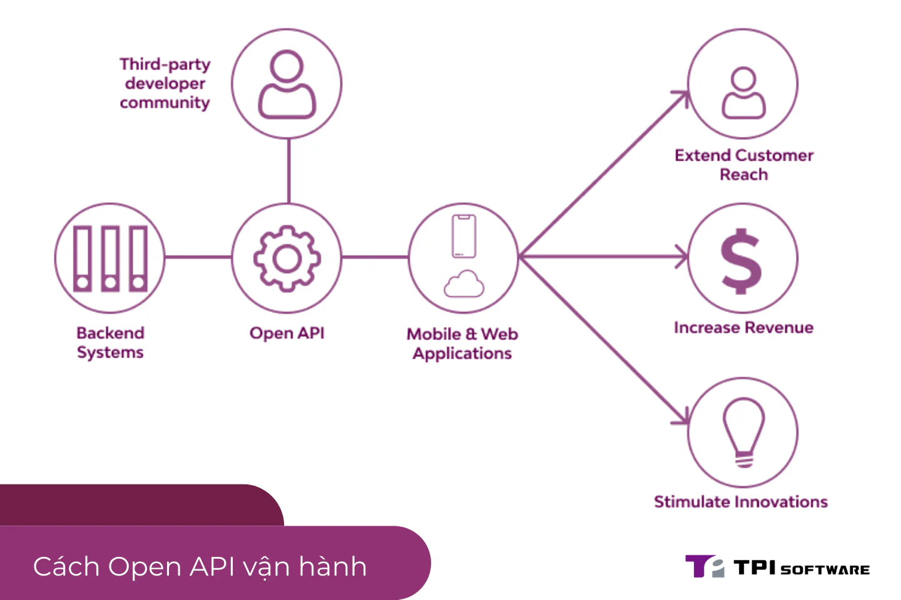

## Open API là gì?

[Open API](/vi/blog/open-api-la-gi), còn được gọi là Public API, là một loại giao diện lập trình ứng dụng (API) được công khai và có sẵn cho mọi nhà phát triển sử dụng. Open API được thiết kế để cho phép các ứng dụng khác nhau giao tiếp và trao đổi dữ liệu với nhau một cách dễ dàng và an toàn.

Đặc điểm chính của Open API là tính **mở** và **tiêu chuẩn hóa**. Open API thường được định nghĩa bằng các định dạng tiêu chuẩn như OpenAPI Specification (trước đây là Swagger Specification), cho phép các nhà phát triển dễ dàng hiểu và sử dụng API.

## Lợi ích của việc sử dụng Open API

-   **Tăng khả năng kết nối:** Open API cho phép các ứng dụng kết nối và trao đổi dữ liệu với nhau một cách dễ dàng, tạo ra hệ sinh thái ứng dụng phong phú và đa dạng.

-   **Thúc đẩy sự đổi mới:** Open API khuyến khích sự sáng tạo và đổi mới bằng cách cho phép các nhà phát triển xây dựng các ứng dụng và dịch vụ mới dựa trên dữ liệu và chức năng có sẵn.

-   **Mở rộng thị trường:** Open API giúp các doanh nghiệp mở rộng thị trường và tiếp cận khách hàng mới bằng cách tích hợp với các ứng dụng và dịch vụ phổ biến.

-   **Tăng hiệu quả kinh doanh:** Open API giúp tự động hóa các quy trình kinh doanh, giảm thiểu chi phí và tăng năng suất làm việc.

-   **Cải thiện trải nghiệm người dùng:** Open API cho phép các nhà phát triển tạo ra các ứng dụng và dịch vụ với trải nghiệm người dùng tốt hơn.

## Cách thức hoạt động của Open API

Open API hoạt động dựa trên các yêu cầu và phản hồi được tiêu chuẩn hóa. Khi một ứng dụng muốn truy cập dữ liệu hoặc chức năng từ một ứng dụng khác, nó sẽ gửi yêu cầu đến Open API của ứng dụng đó. Open API sẽ xử lý yêu cầu và trả về phản hồi với dữ liệu hoặc kết quả tương ứng.

Các yêu cầu và phản hồi thường được định dạng bằng JSON hoặc XML, giúp các ứng dụng dễ dàng xử lý và trao đổi dữ liệu.

## Các thành phần của Open API Specification

OpenAPI Specification (OAS) là một định dạng tiêu chuẩn để mô tả Open API. OAS sử dụng ngôn ngữ YAML hoặc JSON để định nghĩa các thành phần của API, bao gồm:

-   **Thông tin chung:** Tên, mô tả, phiên bản của API.

-   **Các đường dẫn (paths):** Danh sách các endpoint và các phương thức HTTP được hỗ trợ (GET, POST, PUT, DELETE...).

-   **Các tham số (parameters):** Các tham số đầu vào của API, bao gồm kiểu dữ liệu, mô tả và vị trí (query, header, path...).

-   **Các phản hồi (responses):** Các mã trạng thái HTTP và kiểu dữ liệu trả về của API.

-   **Các lược đồ (schemas):** Định nghĩa cấu trúc dữ liệu của các đối tượng được sử dụng trong API.

-   **Bảo mật (security):** Các phương thức xác thực và ủy quyền được sử dụng bởi API.

## Ví dụ về Open API

Một số ví dụ về Open API phổ biến:

-   **Google Maps API:** Cho phép các nhà phát triển tích hợp bản đồ và các tính năng liên quan vào ứng dụng của họ.

-   **Twitter API:** Cung cấp quyền truy cập vào dữ liệu Twitter, bao gồm tweet, người dùng, xu hướng...

-   **Stripe API:** Cho phép các nhà phát triển tích hợp chức năng thanh toán vào ứng dụng của họ.

-   **Spotify API:** Cung cấp quyền truy cập vào dữ liệu Spotify, bao gồm bài hát, nghệ sĩ, album...

## Kết luận

Open API đóng vai trò quan trọng trong việc kết nối các ứng dụng và dịch vụ, thúc đẩy sự đổi mới và tăng trưởng kinh tế. Bằng cách sử dụng Open API, các nhà phát triển có thể tạo ra các ứng dụng mạnh mẽ, đáp ứng nhu cầu ngày càng cao của người dùng.

**Hãy khám phá và tận dụng sức mạnh của Open API để nâng tầm ứng dụng của bạn!**
