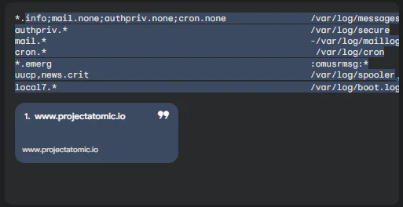

## Rsyslog là gì?

[Rsyslog](/vi/blog/rsyslog-la-gi) (viết tắt của "**r**ocket-fast **sys**tem for **log** processing") là một tiện ích mã nguồn mở, được sử dụng trên các hệ thống Unix và Unix-like để thu thập, phân tích, chuyển tiếp và lưu trữ log hệ thống. Rsyslog được biết đến với hiệu suất cao, khả năng cấu hình linh hoạt và hỗ trợ nhiều tính năng tiên tiến.

Nói một cách đơn giản, rsyslog là một "người vận chuyển" tin cậy, có nhiệm vụ thu thập log từ các nguồn khác nhau trên hệ thống và chuyển đến đích đến mong muốn, chẳng hạn như file, database, hoặc một máy chủ log tập trung.

Không giống như Syslog truyền thống, Rsyslog cung cấp tính linh hoạt cao với cấu hình tùy chỉnh, hỗ trợ nhiều định dạng log và tích hợp với các công cụ hiện đại như cơ sở dữ liệu (MySQL, PostgreSQL) hay hệ thống phân tích (Elasticsearch). Điều này đặc biệt quan trọng trong các ngành như BFSI (Ngân hàng, Tài chính, Bảo hiểm), nơi việc quản lý log không chỉ là vấn đề kỹ thuật mà còn liên quan đến bảo mật và tuân thủ quy định.

## Tại sao nên sử dụng Rsyslog?

-   **Hiệu suất cao:** Rsyslog được thiết kế để xử lý lượng lớn log với tốc độ cao, đáp ứng nhu cầu của các hệ thống quy mô lớn.

-   **Khả năng cấu hình linh hoạt:** Rsyslog cung cấp cấu hình linh hoạt, cho phép bạn tùy chỉnh cách thức thu thập, xử lý và chuyển tiếp log theo nhu cầu cụ thể.

-   **Hỗ trợ nhiều nguồn log:** Rsyslog có thể thu thập log từ nhiều nguồn khác nhau, bao gồm kernel, ứng dụng, dịch vụ hệ thống.

-   **Hỗ trợ nhiều giao thức:** Rsyslog hỗ trợ nhiều giao thức để chuyển tiếp log, bao gồm UDP, TCP, TLS, RELP.

-   **Tính năng lọc và phân tích log:** Rsyslog cho phép bạn lọc và phân tích log dựa trên các tiêu chí khác nhau, giúp bạn dễ dàng tìm kiếm thông tin quan trọng.

-   **Mở rộng với các module:** Rsyslog có thể được mở rộng với các module bổ sung, cung cấp thêm tính năng và khả năng tích hợp với các hệ thống khác.

## Cấu hình Rsyslog

Cấu hình rsyslog được thực hiện thông qua file /etc/rsyslog.conf. File này chứa các quy tắc (rule) để định nghĩa cách thức xử lý log. Mỗi quy tắc bao gồm hai phần:

-   **Selector:** Xác định nguồn và mức độ nghiêm trọng của log.

-   **Action:** Xác định cách thức xử lý log, chẳng hạn như ghi vào file, chuyển tiếp đến máy chủ khác, hoặc thực thi script.

Ví dụ:

## Các tính năng nổi bật của Rsyslog

-   **Thu thập log từ nhiều nguồn:** Rsyslog có thể thu thập log từ kernel, ứng dụng, dịch vụ hệ thống, và các nguồn khác nhau.

-   **Chuyển tiếp log đến máy chủ khác:** Rsyslog có thể chuyển tiếp log đến một máy chủ log tập trung, giúp bạn quản lý log hiệu quả hơn.

-   **Lọc log:** Rsyslog cho phép bạn lọc log dựa trên các tiêu chí khác nhau, chẳng hạn như nguồn log, mức độ nghiêm trọng, nội dung log.

-   **Phân tích log:** Rsyslog có thể phân tích log và trích xuất thông tin quan trọng, giúp bạn phát hiện lỗi và sự cố bảo mật.

-   **Lưu trữ log:** Rsyslog hỗ trợ lưu trữ log vào nhiều định dạng khác nhau, bao gồm file, database, và hệ thống quản lý log tập trung.

-   **Bảo mật log:** Rsyslog hỗ trợ các tính năng bảo mật log, chẳng hạn như mã hóa TLS và xác thực.

## Ứng dụng của Rsyslog

Rsyslog được sử dụng rộng rãi trong nhiều hệ thống Linux, bao gồm:

-   **Máy chủ web:** Thu thập và phân tích log truy cập website, phát hiện lỗi và tấn công.

-   **Máy chủ mail:** Thu thập và quản lý log mail, theo dõi hoạt động gửi và nhận email.

-   **Máy chủ database:** Thu thập và phân tích log database, giám sát hiệu suất và phát hiện lỗi.

-   **Hệ thống giám sát:** Thu thập log từ các thiết bị mạng và hệ thống, giám sát hoạt động và phát hiện sự cố.

-   **Hệ thống bảo mật:** Thu thập và phân tích log bảo mật, phát hiện các hoạt động đáng ngờ và tấn công.

## Tại sao Rsyslog quan trọng với doanh nghiệp?

Trong môi trường CNTT hiện đại, đặc biệt là các ngành BFSI, thương mại điện tử (e-commerce) và ứng dụng giao hàng, Rsyslog mang lại nhiều giá trị thiết thực:

-   **Giám sát thời gian thực**: Phát hiện sự cố tức thì, từ lỗi phần cứng đến các hành vi bất thường.

-   **Tuân thủ pháp lý**: Đáp ứng các tiêu chuẩn như ISO 27001 hay PCI DSS bằng cách lưu trữ và phân tích log an toàn.

-   **Tối ưu vận hành**: Giảm thời gian xử lý sự cố xuống đáng kể nhờ khả năng phân loại log thông minh.

Tuy nhiên, khi khối lượng log tăng lên (ví dụ: hàng terabyte mỗi tháng), việc quản lý thủ công bằng Rsyslog trở nên

## digiLogs – Nâng tầm quản lý Rsyslog cho doanh nghiệp Việt

[TPIsoftware](/vi), công ty số 1 tại Đài Loan trong lĩnh vực phần mềm quản lý log và API với gần 20 năm kinh nghiệm, đã mang sản phẩm **digiLogs** đến Việt Nam. Được thiết kế để xử lý khối lượng log khổng lồ, digiLogs tích hợp hoàn hảo với Rsyslog, mang đến giải pháp toàn diện cho doanh nghiệp.

Một trường hợp thực tế: Cathay Life Insurance, một trong những khách hàng lớn của TPIsoftware, phải xử lý 6TB log mỗi tháng. Trước khi dùng digiLogs, đội ngũ IT mất hàng giờ để tìm kiếm và phân tích log từ nhiều hệ thống. Sau khi triển khai digiLogs, thời gian khắc phục sự cố giảm từ 4-6 giờ xuống còn 20-30 phút nhờ khả năng tập trung hóa và phân tích tự động. Điều này giúp tăng hiệu suất vận hành lên 600%, một con số ấn tượng trong ngành bảo hiểm.

Với các doanh nghiệp BFSI, e-commerce hay ứng dụng giao hàng tại Việt Nam, digiLogs không chỉ hỗ trợ quản lý Rsyslog mà còn cung cấp:

-   **Tích hợp đa nguồn**: Hỗ trợ hơn 55 định dạng log, bao gồm Rsyslog, error logs, event logs.

-   **Phân tích trực quan**: Biểu đồ và dashboard giúp phát hiện vấn đề nhanh chóng.

-   **Khả năng mở rộng**: Phù hợp với hệ thống phân tán và kiến trúc microservices.

## So sánh Rsyslog và digiLogs: Khi nào cần nâng cấp?

| **Tiêu chí** | **Rsyslog** | **digiLogs (TPIsoftware)** |
| --- | --- | --- |
| **Nguồn gốc** | Mã nguồn mở, miễn phí | Phần mềm thương mại, có hỗ trợ chuyên nghiệp |
| **Khả năng xử lý** | Hàng triệu thông điệp/giây | Hàng terabyte log/tháng, tích hợp AI |
| **Tính năng nâng cao** | Cấu hình linh hoạt, cần kỹ thuật cao | Tự động hóa, dashboard trực quan |
| **Ứng dụng thực tế** | Doanh nghiệp nhỏ, hệ thống đơn giản | BFSI, e-commerce, hệ thống phức tạp |
| **Hỗ trợ** | Cộng đồng | Đội ngũ chuyên gia từ TPIsoftware |

Nếu bạn chỉ cần một giải pháp cơ bản và có đội ngũ IT mạnh, Rsyslog là đủ. Nhưng với doanh nghiệp lớn, đặc biệt tại Việt Nam – nơi TPIsoftware vừa gia nhập – digiLogs là bước tiến vượt bậc để tối ưu hóa quản lý log.

## Ứng dụng thực tế của Rsyslog tại Việt Nam

Các ngành như BFSI và e-commerce tại Việt Nam đang chứng kiến sự gia tăng nhu cầu quản lý log. Một ngân hàng lớn như Shin Kong Bank (Đài Loan) từng đối mặt với 50GB log mỗi ngày (1.5TB/tháng). Hệ thống cũ không đáp ứng được yêu cầu phân tích nhanh, nhưng sau khi tích hợp digiLogs với Rsyslog, họ chuyển sang quản lý tập trung, giảm thời gian phản hồi sự cố xuống còn vài phút. Tình huống này hoàn toàn áp dụng được cho các ngân hàng Việt Nam như Vietcombank hay Techcombank, nơi khối lượng giao dịch trực tuyến ngày càng tăng.

Trong lĩnh vực giao hàng, các ứng dụng như Giao Hàng Nhanh hay AhaMove cũng có thể tận dụng Rsyslog để theo dõi hoạt động hệ thống, từ đó kết hợp với digiLogs để tối ưu hóa quy trình vận hành và nâng cao trải nghiệm khách hàng.

## Kết luận: Rsyslog và chìa khóa thành công trong quản lý log

Rsyslog là một công cụ mạnh mẽ để ghi lại và xử lý nhật ký hệ thống, nhưng để đáp ứng nhu cầu ngày càng phức tạp của doanh nghiệp hiện đại, việc kết hợp với các giải pháp như [**digiLogs**](/vi/products/digilogs) là điều cần thiết. Với kinh nghiệm gần 20 năm và vị thế số 1 tại Đài Loan, TPIsoftware đang mang đến Việt Nam công nghệ tiên tiến, giúp doanh nghiệp BFSI, e-commerce và giao hàng vượt qua thách thức quản lý log. Hãy liên hệ TPIsoftware ngay hôm nay để trải nghiệm digiLogs và đưa hệ thống của bạn lên tầm cao mới!
