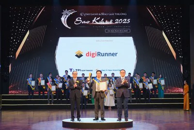

Chúng tôi vô cùng tự hào và vui mừng thông báo rằng **digiRunner**, một trong những giải pháp phần mềm chủ lực của TPIsoftware, đã chính thức được vinh danh tại **Giải thưởng Sao Khuê 2025** – giải thưởng danh giá hàng đầu của ngành phần mềm và dịch vụ công nghệ thông tin (CNTT) Việt Nam. Đây là sự công nhận to lớn cho những nỗ lực không ngừng của đội ngũ TPIsoftware trong việc đổi mới, sáng tạo và mang đến những sản phẩm công nghệ chất lượng cao, đóng góp vào công cuộc chuyển đổi số mạnh mẽ tại Việt Nam và khu vực.

**Giải thưởng Sao Khuê – Bảo Chứng Cho Chất Lượng và Uy Tín**

Được tổ chức thường niên bởi Hiệp hội Phần mềm và Dịch vụ CNTT Việt Nam (VINASA), Giải thưởng Sao Khuê từ lâu đã khẳng định vị thế là một trong những giải thưởng uy tín và danh giá nhất trong lĩnh vực CNTT tại Việt Nam. Giải thưởng nhằm tôn vinh các sản phẩm, giải pháp, và dịch vụ CNTT xuất sắc, có đóng góp nổi bật cho sự phát triển kinh tế - xã hội và công cuộc chuyển đổi số quốc gia.

Việc digiRunner được xướng tên tại Sao Khuê 2025 là một minh chứng mạnh mẽ cho chất lượng vượt trội, hiệu quả ứng dụng thực tế và tiềm năng phát triển to lớn của sản phẩm. Theo thông tin từ Yahoo Finance, digiRunner được công nhận là "Nền tảng Chuyển đổi số Xuất sắc" (Outstanding Digital Transformation Platform). Đồng thời, VietnamPlus cũng nhấn mạnh sự ghi nhận của giải thưởng đối với digiRunner trong hạng mục ứng dụng cho ngành "Bán lẻ và Phân phối", cho thấy khả năng đáp ứng đa dạng và chuyên sâu của giải pháp.

**digiRunner: Giải Pháp Quản Lý API Toàn Diện, Thúc Đẩy Chuyển Đổi Số Mạnh Mẽ**

digiRunner là nền tảng quản lý giao diện lập trình ứng dụng (API) toàn diện, được thiết kế để giúp doanh nghiệp tối ưu hóa việc xây dựng, triển khai, bảo mật và quản lý vòng đời API một cách hiệu quả. Trong bối cảnh chuyển đổi số đang diễn ra sâu rộng, API đóng vai trò như mạch máu kết nối các hệ thống, ứng dụng và dữ liệu, tạo nên một hệ sinh thái số linh hoạt và mạnh mẽ.

Những yếu tố nổi bật giúp digiRunner chinh phục Giải thưởng Sao Khuê 2025 bao gồm:

-   **Quản lý API toàn diện:** Cung cấp bộ công cụ mạnh mẽ từ thiết kế, phát triển, kiểm thử, triển khai đến giám sát và phân tích API.

-   **Tăng cường bảo mật:** Đảm bảo an toàn cho dữ liệu và hệ thống với các cơ chế xác thực, ủy quyền tiên tiến và khả năng phát hiện mối đe dọa.

-   **Tối ưu hóa hiệu suất:** Giúp tăng tốc độ phát triển ứng dụng, cải thiện khả năng tích hợp hệ thống và nâng cao trải nghiệm người dùng.

-   **Thúc đẩy đổi mới:** Tạo điều kiện cho doanh nghiệp dễ dàng kết nối với các đối tác, xây dựng các mô hình kinh doanh mới và mở rộng hệ sinh thái dịch vụ.

-   **Ứng dụng đa ngành:** Như được ghi nhận, digiRunner không chỉ là một nền tảng chuyển đổi số xuất sắc nói chung mà còn chứng minh hiệu quả cụ thể trong các lĩnh vực đòi hỏi sự linh hoạt và kết nối cao như Bán lẻ và Phân phối, cũng như thế mạnh truyền thống của TPIsoftware trong ngành BFSI (Ngân hàng, Dịch vụ Tài chính, Bảo hiểm).

**Ý Nghĩa Của Giải Thưởng Đối Với TPIsoftware và Khách Hàng**

Giải thưởng Sao Khuê 2025 dành cho digiRunner không chỉ là niềm tự hào của riêng TPIsoftware mà còn mang ý nghĩa to lớn đối với các khách hàng và đối tác đã tin tưởng đồng hành cùng chúng tôi.

-   **Khẳng định cam kết chất lượng:** Giải thưởng là sự bảo chứng cho cam kết của TPIsoftware trong việc không ngừng đầu tư vào nghiên cứu và phát triển để mang đến những sản phẩm và giải pháp công nghệ đạt tiêu chuẩn quốc tế.

-   **Tăng cường niềm tin:** Sự công nhận từ một tổ chức uy tín như VINASA củng cố thêm niềm tin của khách hàng và đối tác vào năng lực và vị thế của TPIsoftware trên thị trường.

-   **Động lực phát triển:** Đây là nguồn động viên quý báu để đội ngũ TPIsoftware tiếp tục đổi mới, sáng tạo, hoàn thiện sản phẩm và mang lại nhiều giá trị hơn nữa cho cộng đồng doanh nghiệp.

Ông \[Tên và Chức danh của Lãnh đạo TPIsoftware – *nếu có thể bổ sung quote thực tế từ lãnh đạo thì càng tốt, ví dụ:* "Chúng tôi vô cùng vinh dự khi digiRunner nhận được Giải thưởng Sao Khuê 2025. Đây là thành quả của sự cống hiến và nỗ lực không mệt mỏi của toàn thể đội ngũ TPIsoftware. Chúng tôi cam kết sẽ tiếp tục phát triển digiRunner trở thành một công cụ đắc lực, đồng hành cùng doanh nghiệp Việt Nam trên hành trình chuyển đổi số thành công."\]

**Hướng Tới Tương Lai**

Với sự công nhận từ Giải thưởng Sao Khuê 2025, TPIsoftware càng thêm vững tin trên con đường thực hiện sứ mệnh cung cấp các giải pháp công nghệ tiên tiến, giúp doanh nghiệp tối ưu hóa vận hành, nâng cao năng lực cạnh tranh và bứt phá trong kỷ nguyên số. Chúng tôi sẽ tiếp tục đầu tư mạnh mẽ hơn nữa để phát triển digiRunner cũng như các sản phẩm khác trong hệ sinh thái Digilism và ESGswift, nhằm đáp ứng tốt nhất nhu cầu ngày càng đa dạng của thị trường.

TPIsoftware xin chân thành cảm ơn Ban tổ chức Giải thưởng Sao Khuê, Quý khách hàng và Đối tác đã luôn tin tưởng và ủng hộ chúng tôi trong suốt thời gian qua.

**Tìm hiểu thêm về giải pháp quản lý API đột phá digiRunner \[Link tới trang sản phẩm digiRunner trên** [**tpisoftware.com**](/vi) **hoặc** [**tpisoftware.vn**](/vi)<strong>\] hoặc liên hệ với chúng tôi ngay hôm nay để được tư vấn chi tiết!</strong>
