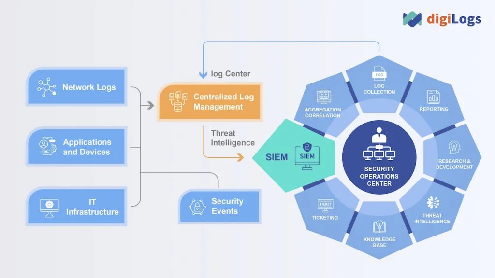
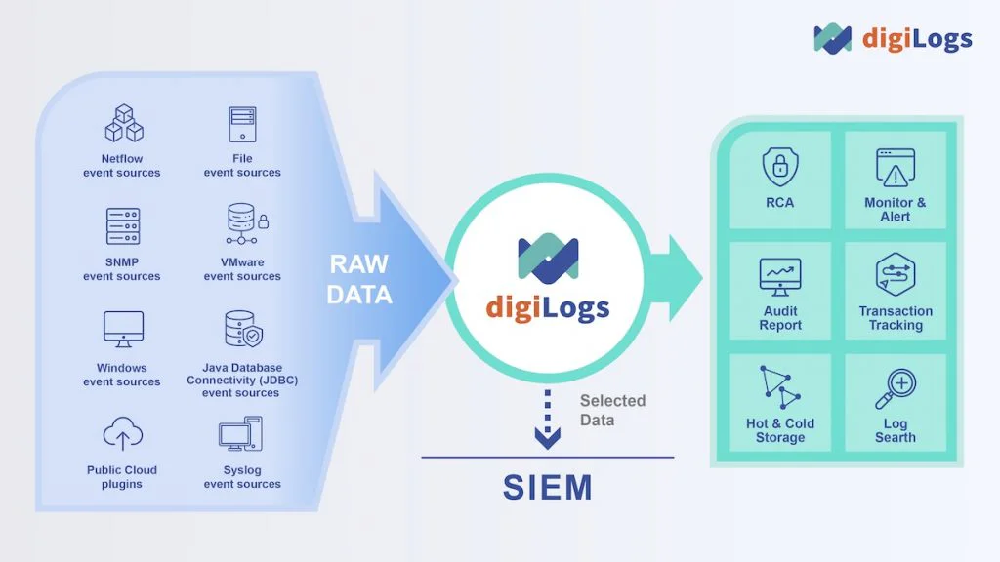

## SOC là gì?

SOC, hay **Trung tâm Điều hành An ninh (Security Operations Center)**, là một đơn vị chuyên trách giám sát, phát hiện và ứng phó với các mối đe dọa an ninh mạng trong doanh nghiệp. Với vai trò như "lá chắn" bảo vệ, SOC hoạt động liên tục 24/7 để đảm bảo an toàn thông tin, giảm thiểu rủi ro từ các cuộc tấn công mạng. Theo báo cáo “Chỉ số sẵn sàng an ninh mạng của Cisco 2024”, 52% tổ chức mất hơn 300.000 USD và 12% mất trên 1 triệu USD do sự cố bảo mật trong năm 2023, nhấn mạnh tầm quan trọng của SOC trong kỷ nguyên số.

Đặc biệt trong ngành BFSI (Ngân hàng, Tài chính, Bảo hiểm), nơi dữ liệu nhạy cảm và tuân thủ pháp luật là ưu tiên hàng đầu, SOC không chỉ là giải pháp mà còn là chiến lược cốt lõi để bảo vệ doanh nghiệp trước các mối đe dọa ngày càng tinh vi.

## SOC hoạt động như thế nào?

SOC kết hợp giữa con người, công nghệ và quy trình để giám sát hệ thống CNTT. Nhiệm vụ chính của SOC bao gồm:

1.  **Ngăn chặn sự cố an ninh mạng**

    -   Kiểm tra hệ thống, thiết bị và dữ liệu định kỳ.

    -   Cập nhật tường lửa, phần mềm bảo mật để chống lại các mối đe dọa mới.

2.  **Phát hiện mối đe dọa tiềm ẩn**

    -   Sử dụng công cụ như SIEM (Quản lý Sự kiện và Thông tin Bảo mật) để giám sát nhật ký hệ thống (Logs).

    -   Phát hiện bất thường qua phân tích dữ liệu thời gian thực.

3.  **Giải quyết sự cố bảo mật**

    -   Cô lập thiết bị bị tấn công, xóa mã độc và phân tích nguyên nhân gốc rễ (RCA) để ngăn tái diễn.

## Tại sao SOC quan trọng với doanh nghiệp?

Trong bối cảnh các quy định pháp luật như Đạo luật Bảo vệ Dữ liệu Cá nhân (PDPA) tại Thái Lan hay các tiêu chuẩn tại Việt Nam ngày càng nghiêm ngặt, SOC giúp doanh nghiệp:

-   Đảm bảo tuân thủ quy định pháp lý.

-   Bảo vệ dữ liệu khách hàng và tài sản số.

-   Giảm thiểu thiệt hại tài chính từ các cuộc tấn công mạng.

Tuy nhiên, để SOC hoạt động hiệu quả, việc quản lý nhật ký hệ thống (Logs) đóng vai trò không thể thiếu.

## Quản lý Logs – Chìa khóa nâng cao hiệu quả SOC

Quản lý Logs tập trung là nền tảng hỗ trợ SOC trong việc thu thập, lưu trữ và phân tích dữ liệu từ nhiều nguồn như máy chủ, ứng dụng và thiết bị mạng. Điều này không chỉ giúp phát hiện nhanh các bất thường mà còn đáp ứng yêu cầu tuân thủ trong ngành BFSI.

**digiLogs** từ TPIsoftware – giải pháp quản lý Logs hàng đầu Đài Loan, nay có mặt tại Việt Nam – mang đến:

-   **Tập trung hóa dữ liệu**: Quản lý Logs từ nhiều hệ thống trên một nền tảng duy nhất.

-   **Phân tích hiệu quả**: Giảm thời gian phát hiện sự cố xuống dưới 2 phút.

-   **Tiết kiệm chi phí**: Ngăn quá tải Logs, tối ưu hóa tài nguyên SIEM.

## Lợi ích của SOC kết hợp digiLogs

Với **digiLogs**, doanh nghiệp Việt Nam, đặc biệt trong lĩnh vực BFSI, có thể:

-   **Tăng tốc phản ứng**: Phân tích Logs nhanh chóng để chặn đứng mối đe dọa.

-   **Bảo vệ tính toàn vẹn dữ liệu**: Đảm bảo Logs không bị giả mạo, hỗ trợ tuân thủ pháp lý.

-   **Tối ưu chi phí**: Giảm tải hệ thống, tránh lãng phí tài nguyên lưu trữ.

Báo cáo Cisco 2024 chỉ ra 91% doanh nghiệp tăng ngân sách bảo mật từ 2022-2023, cho thấy nhu cầu cấp thiết về các giải pháp như SOC và digiLogs để đối phó với thách thức an ninh mạng.

## Kết luận

**SOC là gì?** Đó là trung tâm bảo vệ an ninh mạng không thể thiếu trong thời đại số hóa. Khi kết hợp với giải pháp quản lý Logs như [**digiLogs**](/vi/products/digilogs) từ TPIsoftware – công ty số 1 Đài Loan về phần mềm quản lý Logs – doanh nghiệp Việt Nam có thể xây dựng một hệ thống SOC mạnh mẽ, sẵn sàng đối mặt với mọi mối đe dọa. Để tìm hiểu thêm, hãy truy cập [**tpisoftware.vn**](/vi) hoặc liên hệ ngay hôm nay!
