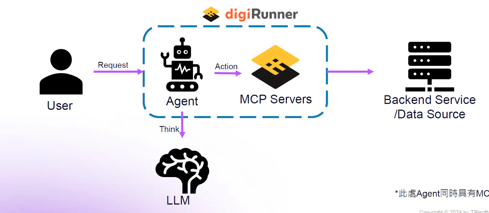

## AI Bùng nổ: Thách thức Tích hợp và Nhu cầu về một Chuẩn mực Mới

Chúng ta đang sống trong một kỷ nguyên bùng nổ của Trí tuệ nhân tạo (AI). Từ ChatGPT, AI tạo sinh (Gen AI) đến các mô hình ngôn ngữ lớn (LLMs), AI đang định hình lại mọi khía cạnh của doanh nghiệp, từ tự động hóa dịch vụ khách hàng, phân tích dữ liệu phức tạp đến hỗ trợ ra quyết định chiến lược. 🤖 Các doanh nghiệp đang chạy đua để tích hợp năng lực AI mạnh mẽ này vào hoạt động, quy trình và hệ thống cốt lõi của họ.

Tuy nhiên, con đường "AI hóa" không hề bằng phẳng. Các doanh nghiệp đang phải đối mặt với một loạt thách thức nan giải:

-   **Sự phân mảnh 🧩:** Mỗi nhà cung cấp AI (OpenAI, Google, Anthropic, các mô hình mã nguồn mở) có một API riêng, một cách xác thực riêng. Việc quản lý và chuyển đổi giữa chúng vô cùng phức tạp.

-   **Rủi ro bảo mật 🔒:** Làm thế nào để cấp quyền truy cập vào LLM mà không làm lộ dữ liệu nhạy cảm của công ty? Làm thế nào để ngăn chặn các cuộc tấn công "prompt injection" (tiêm lệnh) hoặc đảm bảo AI không trả về thông tin độc hại?

-   **Thiếu quản trị 👑:** Ai đã dùng mô hình nào? Dùng bao nhiêu? Chi phí là gì? Dữ liệu nào đã được gửi đi? Nếu không có một hệ thống giám sát tập trung, chi phí AI có thể vượt khỏi tầm kiểm soát và rủi ro tuân thủ là rất lớn.

Đây chính là lúc nhu cầu về một chuẩn mực mới xuất hiện. Một "ngôn ngữ chung" để các ứng dụng, nguồn dữ liệu và mô hình AI có thể giao tiếp với nhau một cách an toàn, hiệu quả. Khái niệm **tích hợp MCP (Model Context Protocol)** đang nổi lên như một giải pháp tiên phong cho bài toán này.

Với tư cách là công ty phần mềm hàng đầu Đài Loan 🇹🇼 và là đối tác tin cậy của nhiều doanh nghiệp lớn tại Việt Nam, **TPIsoftware Việt Nam** hiểu rõ những thách thức này. Thông qua nền tảng quản lý API hàng đầu digiRunner , chúng tôi đang tiên phong trong việc áp dụng và tích hợp MCP , biến nó từ một khái niệm kỹ thuật thành một giải pháp kinh doanh thực tiễn.

Bài viết này sẽ đi sâu phân tích **Model Context Protocol là gì**, vai trò của AI Gateway, và cách việc tích hợp MCP với digiRunner đang tạo ra một cầu nối vững chắc, an toàn cho dữ liệu và các tác tử AI.

## MCP (Model Context Protocol) là gì? Giải mã "Giao thức Ngữ cảnh Mô hình"

Trong bối cảnh AI phát triển như vũ bão, thuật ngữ "Model Context Protocol" (MCP) hay "Giao thức Ngữ cảnh Mô hình" có thể còn khá mới mẻ. Tuy nhiên, tầm quan trọng của nó đối với tương lai của AI là không thể phủ nhận. Để hiểu rõ về tích hợp MCP , trước tiên chúng ta cần định nghĩa nó một cách rõ ràng.

### Định nghĩa cốt lõi: MCP là gì? 📖

Theo định nghĩa được TPIsoftware và các đối tác công nghệ đưa ra, **Model Context Protocol (MCP) là một giao thức mở, tiêu chuẩn được thiết kế để kết nối các mô hình ngôn ngữ lớn (LLMs) hoặc các tác tử AI (AI agents) với các ứng dụng và nguồn dữ liệu của bên thứ ba.**

Hãy nghĩ về nó bằng một phép ẩn dụ đơn giản:

> Nếu **HTTP** (Hypertext Transfer Protocol) là giao thức tiêu chuẩn giúp các trình duyệt web và máy chủ "nói chuyện" với nhau, thì **MCP** được định hình để trở thành giao thức tiêu chuẩn giúp các **ứng dụng doanh nghiệp** và **mô hình AI** "nói chuyện" với nhau một cách an toàn và có cấu trúc. 🗣️

Hiện tại, việc kết nối với AI thường là các lệnh gọi API trực tiếp, đặc thù (ad-hoc) đến từng nhà cung cấp. Điều này tạo ra một hệ thống "ống nước" chằng chịt, khó bảo trì và cực kỳ rủi ro về bảo mật. MCP ra đời để chuẩn hóa "đường ống" này. Nó cung cấp một khung sườn (framework) chung, cho phép doanh nghiệp:

-   Liên kết và quản lý nhiều mô hình AI khác nhau (cả public và private).

-   Tập trung hóa việc kiểm soát truy cập, xác thực và quản lý lưu lượng (traffic).

-   Bảo mật dữ liệu và thực thi các tác vụ theo một phương pháp luận chuẩn hóa.

### Tại sao MCP lại quan trọng cho Tương tác AI (AI Interoperability)? 🔗

Một trong những thuật ngữ LSI (Latent Semantic Indexing) quan trọng liên quan đến tích hợp MCP là **"Khả năng tương tác AI" (AI Interoperability)**. Đây là khả năng cho phép các hệ thống AI, mô hình và nguồn dữ liệu khác nhau (ví dụ: một mô hình từ Google, một tác tử AI từ Anthropic, và một cơ sở dữ liệu nội bộ) làm việc cùng nhau một cách liền mạch.

MCP chính là chất keo cho khả năng tương tác này. Thay vì phải viết code riêng để "dịch" yêu cầu cho từng mô hình, MCP cung cấp một lớp trừu tượng (abstraction layer). Doanh nghiệp chỉ cần gửi yêu cầu theo chuẩn MCP; hệ thống sẽ tự động biết cách giao tiếp với mô hình AI phù hợp để hoàn thành tác vụ. Điều này đặc biệt quan trọng khi doanh nghiệp muốn xây dựng các "tác tử AI" phức tạp, có khả năng tự động thực hiện một chuỗi nhiều hành động (ví dụ: đọc email -> truy vấn cơ sở dữ liệu -> lập báo cáo -> gửi email xác nhận). Nếu không có MCP, mỗi bước trong chuỗi này sẽ là một cơn ác mộng về tích hợp. 😫

### Góc nhìn độc đáo: MCP không chỉ là "Thêm một Giao thức" 💡

Nhiều người có thể nhìn nhận MCP chỉ là "thêm một tiêu chuẩn kỹ thuật". Nhưng tại TPIsoftware, chúng tôi có một góc nhìn độc đáo hơn: **MCP đại diện cho một sự thay đổi mô hình (paradigm shift).**

Chúng ta đang chuyển từ kỷ nguyên của **APIs (Application Programming Interfaces - Giao diện Lập trình Ứng dụng)** sang kỷ nguyên của **APIs (Agent Programming Interfaces - Giao diện Lập trình Tác tử)**.

-   **Application API** truyền thống: Máy nói chuyện với máy. Cấu trúc cứng nhắc (JSON, XML). Yêu cầu rõ ràng, có cấu trúc.

-   **Agent API** (thông qua MCP): Người nói chuyện với máy (hoặc máy nói chuyện với máy bằng ngôn ngữ tự nhiên). Cấu trúc linh hoạt (ngôn ngữ tự nhiên). Yêu cầu dựa trên *ngữ cảnh* và *ý định*.

Sự thay đổi này đòi hỏi một "lớp điều khiển" (control plane) mới, một lớp hiểu được *ngữ nghĩa* chứ không chỉ *cú pháp*. Và đó chính là vai trò của AI Gateway, một thành phần không thể tách rời của giải pháp tích hợp MCP .

## AI Gateway: "Trạm kiểm soát" Thông minh cho Mọi Tương tác AI

Nếu MCP là "giao thức" (bộ quy tắc), thì **AI Gateway (Cổng AI)** chính là "người thực thi" (bộ máy) các quy tắc đó. AI Gateway đóng vai trò là cầu nối, là "trạm kiểm soát an ninh và điều phối" duy nhất đứng giữa các ứng dụng của người dùng cuối và các hệ thống AI (LLMs, Gen AI, tác tử AI). 🛡️

Nhiều doanh nghiệp lầm tưởng rằng một API Gateway truyền thống là đủ để quản lý các lệnh gọi AI. Đây là một sai lầm nghiêm trọng. AI Gateway được thiết kế đặc biệt cho các tương tác với LLM, và nó vượt trội hơn hẳn.

### So sánh: AI Gateway và API Gateway Truyền thống

Để làm rõ điều này, hãy xem bảng so sánh lợi thế của AI Gateway (như một phần của nền tảng digiRunner ) so với một API Gateway thông thường:

| **Tính năng** | **API Gateway Truyền thống** | **AI Gateway (Tích hợp trong digiRunner)** |
| --- | --- | --- |
| **Mục đích chính** | Quản lý, bảo mật, định tuyến API (HTTP requests) | Quản lý, bảo mật, định tuyến **tương tác AI** (LLM prompts, agent tasks) 🤖 |
| **Phân tích** | Phân tích lưu lượng (traffic), lỗi HTTP, thời gian phản hồi. | **Phân tích ngữ nghĩa (Semantic Analysis)**, lọc PII (dữ liệu cá nhân nhạy cảm), kiểm duyệt nội dung độc hại. |
| **Định tuyến** | Dựa trên URL, method (GET/POST), header. | Định tuyến thông minh: Dựa trên **nội dung, tác vụ, hiệu suất, chi phí, phiên bản mô hình** (ví dụ: route đến GPT-4 cho phân tích phức tạp, route đến GPT-3.5-Turbo cho tốc độ). 🧠 |
| **Giám sát** | Logs kỹ thuật (technical logs). | Logs chi tiết về **prompt, response, số lượng token sử dụng, chi phí liên quan** (Cost Management). 💰 |
| **Bảo mật** | Chặn IP, giới hạn tần suất (rate limiting), OAuth. | **Bảo mật Prompt (Prompt Security)**, ngăn chặn "Prompt Injection", "Data Poisoning". |
| **Kết nối** | Hệ thống backend, microservices. | **Nhiều mô hình AI** (OpenAI, Google, Azure, các mô hình nội bộ - in-house). |

Như bảng trên đã chỉ rõ, AI Gateway là một thực thể chuyên biệt, thông minh hơn, được xây dựng để xử lý các sắc thái và rủi ro độc nhất của AI.

### Các chức năng then chốt của digiRunner AI Gateway 🗝️

Là một phần của giải pháp tích hợp MCP , **digiRunner AI Gateway** của TPIsoftware cung cấp một lớp điều khiển (control plane) duy nhất với các chức năng cốt lõi:

1.  **Xác thực và Kiểm soát Truy cập (Authentication & Access Control):** Quyết định *ai* được phép sử dụng mô hình nào. Ví dụ: Chỉ cho phép bộ phận R&D truy cập mô hình GPT-4 (đắt tiền), trong khi bộ phận CSKH chỉ dùng mô hình nội bộ.

2.  **Phân tích ngữ nghĩa (Semantic Analysis):** Trước khi prompt được gửi đến LLM, AI Gateway sẽ quét nó để tìm dữ liệu nhạy cảm (như số thẻ tín dụng, CCCD) và tự động che giấu (masking) chúng.

3.  **Định tuyến Yêu cầu (Request Routing):** Tự động chọn mô hình AI tốt nhất cho tác vụ. Nếu một mô hình bị lỗi, nó có thể tự động chuyển sang mô hình dự phòng (failover) mà người dùng không hề hay biết, đảm bảo tính ổn định (như đã đề cập trong lợi ích của digiRunner ).

4.  **Giám sát và Ghi log Hợp nhất (Unified Monitoring & Logging):** Đây là một lợi thế cực lớn. Mọi tương tác AI đều được ghi lại. Doanh nghiệp có thể theo dõi chi phí, tần suất sử dụng, và quan trọng nhất, có một "hộp đen" ghi lại mọi thứ để phục vụ cho việc tuân thủ (compliance) và kiểm toán (audit). Tính năng này kết hợp hoàn hảo với một sản phẩm khác của TPIsoftware là digiLogs (Nền tảng Quản lý Logs).

## Sức mạnh Cộng hưởng: Khi Tích hợp MCP với digiRunner API Management

Chỉ hiểu về MCP và AI Gateway là chưa đủ. Sức mạnh thực sự nằm ở việc **tích hợp** chúng vào một nền tảng quản lý vận hành (operations management) đã được chứng minh. Đây chính là lợi thế cạnh tranh của **TPIsoftware Việt Nam** với sản phẩm digiRunner .

### digiRunner - Không chỉ là Quản lý API 🏆

[**digiRunner (API Management)**](/vi/products/digirunner) là nền tảng quản lý API hàng đầu của TPIsoftware. Tại thị trường Đài Loan, bộ sản phẩm Digilism (bao gồm digiRunner ) đang chiếm **vị trí số 1** thị phần trong ngành BFSI (Tài chính - Ngân hàng - Bảo hiểm).

Tại Việt Nam, digiRunner đã và đang được tin dùng bởi các tập đoàn lớn như **Tập đoàn Cathay, Standard Chartered, và Ngân hàng IVB**. Điều này chứng minh cho sự ổn định, bảo mật và hiệu suất vượt trội của sản phẩm (E-E-A-T: Authority, Trustworthiness). Nền tảng này cũng là một phần của bộ sản phẩm đạt chứng nhận **ISO 27001** và nhiều giải thưởng quốc tế như **Gartner Cool Vendor** và **Taiwan Excellence**.

Giờ đây, digiRunner không chỉ dừng lại ở việc quản lý API truyền thống. Bằng cách tích hợp MCP và AI Gateway, nó đã phát triển thành một lớp điều khiển (control plane) dựa trên AI toàn diện.

### Lợi ích "All-in-One" khi tích hợp MCP vào digiRunner 🌟

Khi doanh nghiệp của bạn sử dụng digiRunner để tích hợp MCP , bạn sẽ nhận được một loạt lợi ích chiến lược mà các giải pháp chắp vá không thể có được:

-   Tăng cường Quản trị (Governance) 📈: Bạn quản lý cả API truyền thống (kết nối backend) và API của AI (kết nối LLM) trên một nền tảng hợp nhất. Điều này giúp đơn giản hóa kiến trúc hệ thống, tăng cường bảo mật và khả

    năng quan sát (observability). Dữ liệu logs từ API (với digiLogs Log Management) và logs từ AI đều được tập trung, giúp việc truy vết và phát hiện bất thường trở nên dễ dàng.

-   **Cải thiện Hiệu suất (Performance) ⚡:** AI Gateway của digiRunner cho phép định tuyến yêu cầu thông minh và bộ đệm (caching) các phản hồi phổ biến, đảm bảo tính ổn định và độ tin cậy cao, ngay cả khi một nhà cung cấp LLM gặp sự cố.

-   **Thúc đẩy Đổi mới Sáng tạo (Innovation) 🚀:** Đội ngũ phát triển (devs) không còn phải lo lắng về việc xác thực, bảo mật hay kết nối. Họ có thể tập trung vào việc sáng tạo, dễ dàng tích hợp các mô hình AI vào các API hiện có, đẩy nhanh quá trình thử nghiệm và triển khai sản phẩm mới.

-   **Nâng cao Tính linh hoạt (Flexibility) 🤸:** digiRunner cho phép quản lý "all-in-one" các mô hình AI, bất kể chúng được xây dựng nội bộ (in-house) hay triển khai dưới dạng dịch vụ của bên thứ ba (public cloud).

**TPIsoftware Việt Nam**, với đội ngũ chuyên gia và các đối tác chiến lược như *VMO Holdings, TNTech, Sota Tek, NTQ Solution*, cam kết mang giải pháp tiên tiến này đến các doanh nghiệp Việt Nam, giúp họ đi tắt đón đầu trong cuộc cách mạng AI.

## Ứng dụng Thực tế & Case Study: Tích hợp MCP thay đổi Cuộc chơi

Lý thuyết là vậy, nhưng việc tích hợp MCP và AI Gateway thực sự mang lại giá trị gì? Hãy xem xét các tình huống sử dụng thực tế và các case study từ các tập đoàn hàng đầu thế giới.

### Tình huống sử dụng #1: Tìm kiếm API bằng Ngôn ngữ Tự nhiên (Ngay trong digiRunner) 👩‍💻

Đây là một ứng dụng tuyệt vời được kích hoạt bởi việc tích hợp MCP ngay trong nền tảng digiRunner .

-   **Vấn đề:** Các doanh nghiệp lớn có hàng ngàn API. Lập trình viên phải mất rất nhiều thời gian để "lục lọi" danh mục API (API catalog) để tìm đúng API họ cần.

-   **Giải pháp với MCP:** Người dùng (developer, IT admin) có thể tương tác với danh mục API bằng ngôn ngữ tự nhiên. Họ chỉ cần đưa ra các câu lệnh (prompts) như:

    -   *"Cung cấp danh sách các API mới được thêm vào tuần này."*

    -   *"Hiển thị 10 API được truy cập nhiều nhất và bao gồm tổng số lượt yêu cầu."*

    -   *"Hôm nay có lần đăng nhập thất bại nào không?"*

-   **Cách hoạt động:** MCP diễn giải ngôn ngữ thông thường này thành các truy vấn máy có thể hiểu được. AI Gateway sẽ gọi các API nội bộ của digiRunner (hoặc digiLogs ) và cung cấp cho người dùng dữ liệu được yêu cầu ngay lập tức.

### Tình huống sử dụng #2: Tự động hóa Lên lịch Hẹn cho Bệnh nhân (Ngành Y tế) 🧑‍⚕️

Ngành y tế (một trong những ngành mục tiêu của digiLogs để lưu trữ hồ sơ, bệnh án) có thể hưởng lợi lớn.

-   **Kịch bản:** Một bệnh nhân (người dùng) tương tác với chatbot của bệnh viện và đưa ra truy vấn bằng ngôn ngữ tự nhiên:

    -   *"Tôi rảnh sáng thứ Tư tuần này. Hãy lên lịch hẹn cho tôi với Bác sĩ Smith tại phòng khám Tai Mũi Họng. Gửi tôi xác nhận qua email."*

-   **Giải pháp với MCP:** Quy trình này trở nên hoàn toàn tự động.

    1.  Tác tử AI (thông qua MCP) yêu cầu thông tin cá nhân của bệnh nhân (mã số, email).

    2.  Nó gọi một API cụ thể (được quản lý bởi digiRunner ) để tra cứu lịch trống của Bác sĩ Smith.

    3.  Nó gọi một API khác để đặt lịch hẹn.

    4.  Cuối cùng, nó gọi API email để gửi xác nhận cho bệnh nhân.

        Tất cả điều này được điều phối mượt mà qua một "tác vụ" AI duy nhất, thay vì 4-5 bước thủ công.

### Case Study #1: \[Tài chính\] JPMorgan Chase và Phân tích Tài liệu Phức tạp 🏦

Ngành BFSI là thế mạnh của TPIsoftware, và đây là một ví dụ điển hình.

-   **Thách thức:** Các nhà phân tích tài chính phải đọc hàng ngàn trang tài liệu phức tạp (báo cáo, hồ sơ pháp lý) để đưa ra quyết định đầu tư hoặc đánh giá rủi ro.

-   **Giải pháp (Tương tự):** JPMorgan Chase đã phát triển một mô hình AI (tương tự như một tác tử AI) để "đọc" và "hiểu" các hồ sơ pháp lý. Mô hình này có thể trích xuất các điều khoản quan trọng từ 150.000 thỏa thuận tín dụng trong vài giây, một công việc mà các luật sư phải mất hàng ngàn giờ để làm. (Nguồn: *Harvard Business Review*).

-   **Ứng dụng tích hợp MCP:** Trong một kịch bản tương tự, một ngân hàng (như *Cathay* hoặc *IVB*) có thể sử dụng digiRunner để tích hợp MCP . Nhà phân tích chỉ cần hỏi: *"Phân tích rủi ro tín dụng trong hợp đồng này và so sánh với 5 hợp đồng tương tự gần đây."* AI Gateway sẽ điều phối tác tử AI gọi API lưu trữ tài liệu (digiLogs ), dùng LLM để phân tích, và trả về một bản tóm tắt rủi ro chuẩn hóa.

### Case Study #2: \[Sản xuất & ESG\] Schneider Electric và Quản lý Năng lượng 🏭

Đây là một case study liên quan trực tiếp đến bộ sản phẩm **ESGswift** của TPIsoftware.

-   **Thách thức:** Các nhà máy, khu công nghiệp (đối tượng của ESGswift) chịu áp lực lớn trong việc giảm phát thải carbon và tối ưu hóa năng lượng theo quy định của bộ luật tài nguyên môi trường.

-   **Giải pháp:** Schneider Electric, một tập đoàn hàng đầu về quản lý năng lượng, sử dụng AI để phân tích dữ liệu từ hàng ngàn cảm biến IoT. AI của họ có thể dự đoán nhu cầu năng lượng, xác định các thiết bị hoạt động kém hiệu quả và đề xuất các hành động tối ưu hóa theo thời gian thực. (Nguồn: *Schneider Electric Sustainability Reports*).

-   **Ứng dụng tích hợp MCP:** Một khu công nghiệp tại Việt Nam sử dụng bộ đôi [**Greenswift (Quản lý Carbon)**](/vi/products/greenswift) và [**EletriSwift (Quản lý Năng lượng)**](/vi/products/electriswift). Quản lý nhà máy có thể hỏi: *"Dự báo mức tiêu thụ điện của dây chuyền A vào ngày mai và cảnh báo nếu có nguy cơ vượt định mức phát thải."* Tác tử AI, qua tích hợp MCP , sẽ:

    1.  Gọi API của EletriSwift để lấy dữ liệu tiêu thụ.

    2.  Gọi API của Greenswift để lấy định mức carbon.

    3.  Gọi API dự báo thời tiết (vì nhiệt độ ảnh hưởng đến máy lạnh).

    4.  Tổng hợp và đưa ra cảnh báo chính xác.

### Case Study #3: \[Bán lẻ\] Walmart và Tối ưu hóa Chuỗi Cung ứng 🛒

Ngay cả các khách hàng bán lẻ như *Pharmacity* cũng có thể áp dụng mô hình này.

-   **Thách thức:** Quản lý hàng tồn kho và logistics cho hàng ngàn cửa hàng là một bài toán cực kỳ phức tạp.

-   **Giải pháp:** Walmart sử dụng AI để tự động hóa và tối ưu hóa chuỗi cung ứng của mình. AI phân tích dữ liệu bán hàng, thời tiết, sự kiện địa phương để dự báo nhu cầu và tự động điều phối xe tải giao hàng, giúp giảm thiểu tình trạng hết hàng và giảm chi phí vận hành. (Nguồn: *Forbes*).

-   **Ứng dụng tích hợp MCP:** Quản lý của *Pharmacity* có thể dùng digiRunner và hỏi: *"Dựa trên dữ liệu bán hàng 30 ngày qua và dự báo mùa cúm, hãy đề xuất đơn hàng bổ sung cho các loại thuốc \[X, Y, Z\] tại các cửa hàng ở Quận 1."* Tác tử AI sẽ thực hiện chính xác điều đó, kết nối dữ liệu bán hàng (digiLogs ) với các mô hình dự báo.

## Kết luận: Bắt đầu Hành trình Tích hợp AI của Bạn với TPIsoftware Việt Nam

Cuộc cách mạng AI không còn là tương lai; nó đang diễn ra ngay bây giờ. 💥 Nhưng để khai thác sức mạnh của nó một cách an toàn, hiệu quả và có kiểm soát, doanh nghiệp không thể dựa vào các kết nối chắp vá, rủi ro.

**Tích hợp MCP (Model Context Protocol)** và **AI Gateway** đang nổi lên như những chuẩn mực vàng cho việc quản trị AI thế hệ mới. Chúng giải quyết các thách thức cốt lõi về bảo mật, khả năng tương tác và quản lý.

*Bài viết này đã phân tích sâu về:*

-   **MCP (Model Context Protocol) là gì:** Một giao thức mở để chuẩn hóa giao tiếp giữa ứng dụng và AI.

-   **AI Gateway là gì:** Một lớp điều khiển thông minh, vượt trội hơn API Gateway truyền thống trong việc quản lý LLM.

-   **Sức mạnh của digiRunner:** Cách nền tảng quản lý API hàng đầu (đã được chứng nhận bởi *Gartner*, *ISO*, và tin dùng bởi các ngân hàng lớn) phát triển thành một "AI Control Plane" toàn diện khi tích hợp MCP .

-   **Các Case Study thực tế:** Cách các tập đoàn lớn đang dùng các khái niệm tương tự để giải quyết bài toán tài chính, sản xuất (ESG) và bán lẻ.

Với kinh nghiệm gần 20 năm, có mặt tại 6 quốc gia và là **Đối tác chính thức của Google Cloud**, TPIsoftware sở hữu đầy đủ Kinh nghiệm, Chuyên môn, Thẩm quyền, Tin cậy để đồng hành cùng doanh nghiệp của bạn.

Đừng để doanh nghiệp của bạn bị tụt lại phía sau. Hãy xây dựng một nền tảng AI vững chắc ngay hôm nay.

📞 Liên hệ với các chuyên gia của TPIsoftware Việt Nam ngay hôm nay để được tư vấn chuyên sâu về cách digiRunner có thể giúp bạn tích hợp MCP và khai thác tối đa sức mạnh của AI một cách an toàn và hiệu quả.

👉 Tìm hiểu thêm về digiRunner API Management của chúng tôi.

👉 Khám phá cách digiLogs Logs Management giúp bạn hợp nhất toàn bộ dữ liệu hệ thống.

* * *

### Tài liệu tham khảo

1.  Davenport, T. H. (2023). *How JPMorgan Chase Is Using AI to Extract Data from Documents*. Harvard Business Review.

2.  Schneider Electric. (2023). *Sustainability Report 2022-2023*. Schneider Electric Global.

3.  Marr, B. (2024). *The AI-Powered Supply Chain: How Walmart Is Using AI To Revolutionize Retail*. Forbes.

4.  TPIsoftware. (2024). *digiRunner API Management - Nền tảng Quản lý API*. [https://www.tpisoftware.vn/digirunner-api-management](/vi/products/digirunner)

5.  Gartner, Inc. (2024). *Market Guide for AI Trust, Risk and Security Management (AI TRiSM)*. (Ghi chú: Nguồn này minh họa tầm quan trọng của việc quản lý AI, điều mà AI Gateway và MCP giải quyết).
