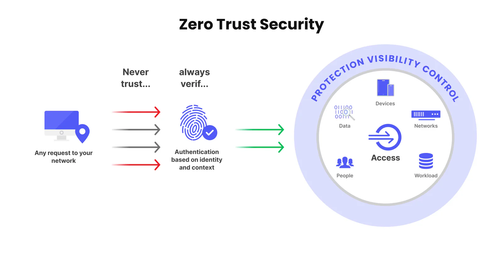

## Zero Trust là gì?

[**Zero Trust**](/vi/blog/zero-trust-la-gi) là một mô hình bảo mật tiên tiến dựa trên nguyên tắc cốt lõi: *“Không bao giờ tin tưởng, luôn xác minh”*. Khác với các phương pháp bảo mật truyền thống giả định rằng mọi thứ bên trong mạng đều an toàn, Zero Trust coi tất cả người dùng, thiết bị và kết nối – dù bên trong hay bên ngoài – đều tiềm ẩn nguy cơ. Vì vậy, mọi truy cập vào hệ thống đều phải được xác thực, ủy quyền và giám sát liên tục để bảo vệ dữ liệu nhạy cảm.

Khái niệm này được John Kindervag, chuyên gia tại Forrester Research, giới thiệu vào năm 2010, và ngày nay nó đã trở thành tiêu chuẩn vàng trong an ninh mạng. Đặc biệt, trong bối cảnh các cuộc tấn công mạng ngày càng tinh vi, như sự kiện tấn công DDoS vào các cơ quan chính phủ Đài Loan trong chuyến thăm của Nancy Pelosi tháng 8/2022, Zero Trust đang chứng minh giá trị của mình.

## Tại sao Zero Trust quan trọng với doanh nghiệp?

Vào tháng 8/2022, các trang web của Văn phòng Tổng thống, Bộ Quốc phòng và Công ty Điện lực Đài Loan đã bị tấn công DDoS quy mô lớn, trong khi các bảng quảng cáo của Đường sắt Đài Loan bị thay đổi nội dung (deface). Những sự kiện này cho thấy mối đe dọa an ninh mạng không chỉ nhắm vào chính phủ mà còn cả doanh nghiệp. Trước thực trạng đó, đến cuối năm 2023, Bộ Kỹ thuật số Đài Loan đã triển khai kiến trúc Zero Trust (ZTA) cho 20 cơ quan an ninh cấp cao như Bộ Kinh tế và Cục Đường cao tốc, với kế hoạch mở rộng vào năm 2024.

Tại Hoa Kỳ, Cơ quan An ninh mạng và Cơ sở hạ tầng (CISA) cùng Bộ Quốc phòng cũng thúc đẩy mạnh mẽ Zero Trust để đối phó với các mối đe dọa ngày càng gia tăng. Vậy, Zero Trust mang lại lợi ích gì?

1.  **Bảo vệ dữ liệu nhạy cảm**: Ngăn chặn truy cập trái phép ngay cả khi hệ thống đã bị xâm nhập.

2.  **Giảm thiểu thiệt hại**: Giới hạn phạm vi ảnh hưởng của các cuộc tấn công.

3.  **Tuân thủ quy định**: Đáp ứng các yêu cầu pháp lý khắt khe, đặc biệt trong ngành BFSI (Ngân hàng, Tài chính, Bảo hiểm).

## Zero Trust hoạt động như thế nào?

Kiến trúc Zero Trust không chỉ là một công cụ mà là một chiến lược toàn diện. Nó hoạt động dựa trên ba trụ cột chính – còn gọi là khung bảo mật 3A:

-   **Xác thực (Authentication)**: Mọi người dùng và thiết bị phải chứng minh danh tính qua các phương pháp như xác thực hai yếu tố (2FA), sinh trắc học (vân tay, mống mắt) hoặc FIDO.

-   **Ủy quyền (Authorization)**: Chỉ cấp quyền truy cập tối thiểu (least privilege) cần thiết để thực hiện nhiệm vụ, giảm nguy cơ lạm dụng quyền hạn.

-   **Ghi chép (Accounting)**: Theo dõi và ghi lại mọi hoạt động để phân tích, phát hiện bất thường và truy vết khi có sự cố.

Ví dụ, hãy tưởng tượng Zero Trust như một ngôi nhà với nhiều lớp khóa. Ngay cả khi kẻ trộm đột nhập qua cửa chính, các tài sản quan trọng như tiền bạc hay giấy tờ vẫn được bảo vệ trong két sắt riêng biệt, mỗi két cần một mã riêng để mở. Tương tự, trong hệ thống CNTT, dù kẻ tấn công vượt qua tường lửa, chúng vẫn không thể truy cập dữ liệu quan trọng mà không qua các bước xác minh bổ sung.

## Lợi ích của Zero Trust trong thực tế

Hãy xem xét ngành tài chính – một lĩnh vực chịu áp lực lớn về bảo mật. Nếu đăng nhập ngân hàng trực tuyến chỉ dựa vào tên người dùng và mật khẩu, một khi thông tin này bị rò rỉ, tài khoản có thể bị xâm phạm. Nhưng với Zero Trust, hệ thống sẽ yêu cầu thêm mã OTP qua SMS hoặc nhận diện sinh trắc học để xác minh danh tính, đảm bảo chỉ chủ tài khoản thực sự mới thực hiện giao dịch.

Một khảo sát của Gartner dự đoán rằng đến năm 2025, ít nhất 70% doanh nghiệp toàn cầu sẽ áp dụng một phần hoặc toàn bộ kiến trúc Zero Trust, nhờ khả năng giảm thiểu rủi ro và tăng cường bảo vệ trước các mối đe dọa như ransomware hay phishing.

## Zero Trust và giải pháp digiRunner từ TPIsoftware

Để triển khai Zero Trust hiệu quả, doanh nghiệp cần công nghệ tiên tiến và đối tác đáng tin cậy. **digiRunner**, sản phẩm chủ lực của TPIsoftware – công ty số 1 tại Đài Loan về phần mềm quản lý API – là giải pháp lý tưởng. Được thiết kế để đáp ứng tiêu chuẩn quốc tế và yêu cầu pháp lý trong các lĩnh vực tài chính, bảo hiểm, chính phủ, digiRunner mang lại:

-   **Xác thực và ủy quyền mạnh mẽ**: Đảm bảo mọi giao dịch và truy cập đều được kiểm soát chặt chẽ.

-   **Quản lý API toàn diện**: Theo dõi và phân quyền API theo thời gian thực, ngăn chặn truy cập trái phép vào dữ liệu backend.

-   **Bảo vệ chống phần mềm độc hại**: Phát hiện và chặn đứng các mối đe dọa trước khi chúng gây hại.

TPIsoftware, với kinh nghiệm dẫn đầu tại Đài Loan, đã đưa digiRunner đến Việt Nam, hỗ trợ doanh nghiệp trong ngành BFSI xây dựng hệ thống bảo mật vững chắc. Ví dụ, trong bối cảnh Đạo luật Bảo vệ Thông tin Cá nhân Đài Loan (sửa đổi năm 2023) tăng mức phạt lên đến 15 triệu Đài tệ cho các vi phạm bảo mật, digiRunner giúp doanh nghiệp không chỉ tránh rủi ro pháp lý mà còn bảo vệ uy tín.

## Cách triển khai Zero Trust hiệu quả

Triển khai Zero Trust không đơn giản là cài đặt phần mềm mà đòi hỏi một kế hoạch toàn diện. Dưới đây là các bước cơ bản:

1.  **Xác định tài sản quan trọng**: Xác định dữ liệu và hệ thống cần bảo vệ nhất (ví dụ: thông tin khách hàng, giao dịch tài chính).

2.  **Áp dụng xác thực đa lớp**: Sử dụng 2FA, sinh trắc học và mã hóa để bảo vệ điểm truy cập.

3.  **Giám sát liên tục**: Sử dụng công cụ như digiRunner để theo dõi hoạt động thời gian thực và phát hiện bất thường.

4.  **Đào tạo nhân viên**: Nâng cao nhận thức về an ninh mạng để giảm thiểu lỗi do con người.

Doanh nghiệp cũng cần lưu ý rằng Zero Trust không phải là giải pháp “một lần xong mãi mãi”. Nó đòi hỏi cập nhật liên tục để đối phó với các mối đe dọa mới.

## Kết luận: Zero Trust – Tương lai của bảo mật doanh nghiệp

Trong bối cảnh an ninh mạng ngày càng phức tạp, Zero Trust không chỉ là một xu hướng mà là một yêu cầu bắt buộc. Từ các cuộc tấn công DDoS tại Đài Loan đến các mối đe dọa toàn cầu, kiến trúc này cung cấp lớp bảo vệ tối ưu cho doanh nghiệp. Với [**digiRunner**](/vi/products/digilogs) từ TPIsoftware, bạn không chỉ triển khai Zero Trust hiệu quả mà còn nâng cao khả năng cạnh tranh trong môi trường số hóa. Liên hệ [TPIsoftware](/vi) ngay hôm nay để nhận tư vấn miễn phí và bắt đầu hành trình bảo mật của bạn!
