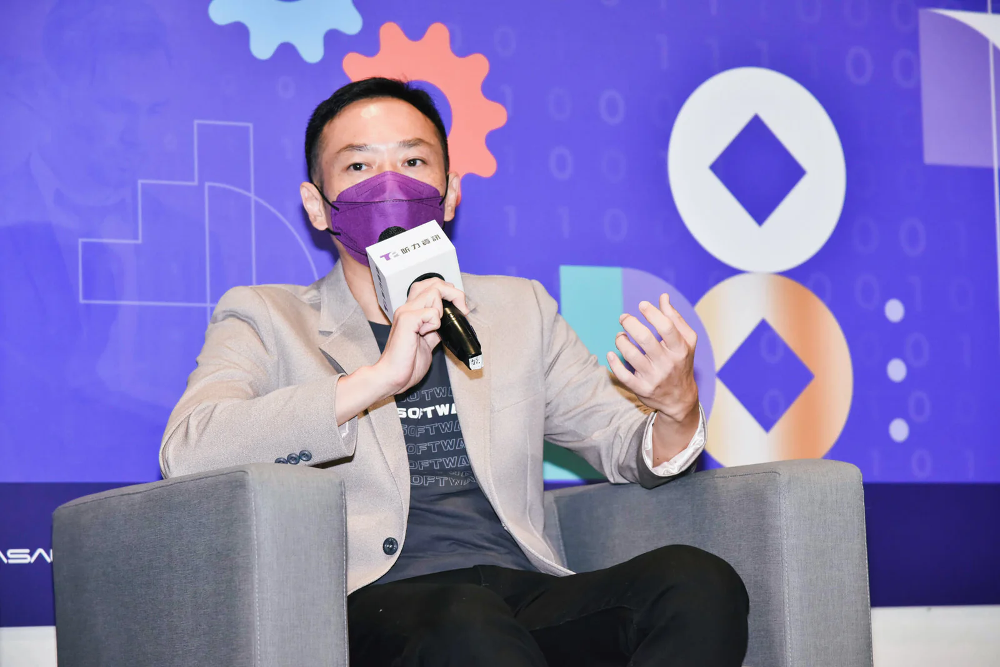

*擁有多年服務金融業者經驗的昕力資訊在 9/7舉辦以金融創新為題的 TPI DAY 趨勢論壇，邀集多位產學界重磅人物齊聚分享，一同深入解析數位轉型趨勢，以及疫情下金融業者的突圍戰略。（圖片來源：昕力資訊）*

後疫情時代加快全球金融業者推展數位化進程，據顧問公司 Grand View Research 最新調研報告指出，全球數位金融服務的市場規模預計將在 2030 年成長至 9494 億美元，而地理位置與台灣相近的東南亞市場，估計將在 2025 年時其數位金融服務市場將達到約 3000 億美元規模。

由於數位金融服務市場成長力道強勁，已吸引不少企業跨足插旗，除傳統銀行之外，近年來連科技業、零售業者都想搶進如電商、電子支付以及美食外送等數位金融服務戰場，企圖搶下這塊前景看好的大餅。

在百家爭鳴的產業趨勢下，擁有多年服務金融業者經驗的昕力資訊在 9/7 舉辦以金融創新為題的 TPI DAY 趨勢論壇，論壇上邀請多位產學界重磅人物齊聚分享，一同深入解析數位轉型趨勢，以及疫情下金融業者的突圍戰略。

昕力資訊總經理姚勝富在論壇開場時，破題點出「數據發展」、「資訊安全」、「雲端」、「 AI 人工智慧」等科技發展趨勢。姚勝富強調，業者若能抓緊這些重點科技，並將其順暢落地到應用端，在發展數位金融大餅的三大利基優勢：速度、安全、服務體驗，也會更有底氣。

## 決勝點一：加快上雲速度，營運效率高、服務更敏捷

首先在搶攻數位金融大餅的第一個決勝點「速度」上，姚勝富指出，企業將資料上雲、加速導入雲端，已是不可逆趨勢，像 Google 旗下雲端服務業務 Google Cloud 業績已連續 2 年都達到年增率超過 3 成 5 的成績，顯見企業上雲需求強勁。

政治大學金融科技研究中心副主任謝明華也引述國際調研機構報告指出， 95% 企業邁入轉型都需將資料上雲。謝明華舉例，從前金融業者認為沒辦法靠數位身份認證來處理的金融服務，疫情後也紛紛透過資料上雲，完成線上服務。

昕力資訊副總經理林秀明則分析，企業將資料上雲，除了能單點式提供創新服務外，若將後台更多營運、維護軟體上雲，更有機會全面提升營運效率。例如昕力資訊將人工智慧領域產品： AI OCR 、文本分析結合 RPA 自動化，三者整合上雲，打造出全部以雲為基礎的營運服務。

此舉不僅改善過去 AI 自動化系統，後台需龐大人力維護、更新的最大痛點，且完整的雲端 RPA 服務也能使組織更有效、流暢的運用虛擬員工服務，達到人機協作的最大綜效。

雲端也是企業打造強大 AI 的重要基礎建設。麥肯錫（McKinsey & Company）研究報告發現，自 AI 獲得巨大收益成長的企業，通常具有更先進與核心的實踐策略、更懂得利用雲端技術帶來的厚實基礎——在高績效 AI 資優企業中，有高達 64% AI 工作運行於公有雲或混合雲上。

Google 前台灣董事總經理簡立峰曾以大腦運作模式來形容雲端與 AI 之間的關聯：「雲端就像打造一個腦，但腦裡卻是空的。企業把所有 data 往裡送，腦才開始運作，這個『運作』便是 AI。」然而，根據市調機構 Accenture 調查指出，只有 37% 的公司認為上雲後有獲得預期中的價值，究其原因，與企業仍對雲端平台感到陌生，難有通盤規劃有關，因此影響了後續上雲成效。

國泰金控副總經理梁明喬則分享，作為集團數位轉型引擎的國泰數位數據暨科技發展中心（以下簡稱「數數發中心」）自 2016 年成立至今，致力於建立集團數據基礎工程，運用數據技術去改善內部作業流程，並提升客戶服務體驗，目標是加速子公司系統整合，同時訂定未來上雲規劃。梁明喬進一步表示，國泰在上雲規劃方面採行的是多雲策略，透過善用不同雲端服務廠商的優勢、達成綜效。

### 決勝點二：資安維護、穩定風控，都需更有效率的資料設計架構

再者，數位金融服務的第二個關鍵決勝點則是「安全」。姚勝富指出，未來金融業在資安方面最大挑戰是要做到分散且全面的資安管理。

*昕力資訊總經理姚勝富。（圖片來源：昕力資訊）*

他解釋，過去 IT 人員要保護資料，在單體環境相對單純，但現在不但資料會上雲，且一項服務會透過 API 經過眾多供應商，管理節點變多、資安挑戰也更趨複雜。

LINE Bank 資訊長翁銘壯認為，資安維護對使用者來說藏在看不見的後台，業者即便落實相關安全規範，但如何讓消費者用得安心卻需要下更多功夫，「取得國際認證是最快途徑，」翁銘壯舉例，像 LINE Bank 已連續兩年通過 ISO/IEC 27001 資安管理、BS 10012 個資保護雙驗證，目前營運一年多，開戶人數已超過 120 萬，為國內純網銀之冠。

除資訊安全，風險控管也是業者發展數位金融服務時需當心的一環。昕力資訊長歐采瑀在分享昕力資訊進軍越南發展「先買後付（BNPL）」支付模式的經驗時指出，由於不同地區使用的信用評分制度不同，且每個國家註冊資料、身分證件、戶政資料格式不一，要能整合出健全的資料儲存架構，需要更靈活技術。

歐采瑀指出，像昕力資訊採用的「低耦合架構設計」概念，能讓不同格式的資料在拖拉、介接時，有更靈活的節點能整合，因此，該設計架構可依不同產業、不同使用地區，彈性調整資料間的組合內容，不僅能縮短資料整合時間，也能建立更安全的風控機制。

從圖型資料庫起家的 neo4j 大中華區總經理方俊強也分享，落實智慧風控、反詐欺機制的關鍵在於找出個案間的關聯性。

方俊強解釋，反詐欺首要得先了解不同個案之間的金流如何隱藏、循環，找出這個關聯才能找到反詐欺方法。而從效率來說，圖資料庫要找到這個關聯會更快，「今天如果是 1 個關聯，傳統資料庫或許也找得到，但如果相關連的節點超過 5 個，甚至是 10 個、20 個以上，就會更需要圖形     資料庫的技術以精準預測金融詐欺、落實風控。」

### 決勝點三：服務體驗創新關鍵：AI 能做否到自主更新？

最後，林秀明分享對優化服務體驗的看法時強調：「不是有用 AI 等數位工具就是在做數位轉型。」並舉昕力旗下 AI OCR 產品為例，過去客戶使用 OCR 表格辨識工具，表格欄位一有變動就要重刻樣板，而一個新樣板動輒 10 萬、20 萬，企業客戶若有頻繁更換表單需求，容易吃不消。

因此昕力的 AI OCR，能在表格異動時自動辨識出資料應填入的位置，省去刻新樣板的成本。讓 AI 做到能自動更新、自行訓練自己，才能真正達到營運與服務體驗上的創新改變。

Seasalt.ai 總經理姚旭晨則分享自身經驗，將旗下提供的雲端客服系統，成功協助     客戶的業務拓展至數個非洲國家落地營運，以雲端平台式的智慧客服，支援客戶分布在非洲多國的金融營業據點。

姚旭晨指出，過去一個國家設一間實體客服中心往往需要 200 名以上人力，如今雲端客服平台一次就能涵蓋 7、8 個國家的客服支援服務，且搭配 AI 語音辨識技術，自動分析、抽查客服人員的服務品質，達成真正的管理自動化。

Google Cloud 大中華區合作夥伴技術總監林政君則提醒，許多金融業者礙於法規限制，牽涉個資或其他機敏資訊的資料無法快速上雲、搭建數據資料庫，使後續導入 AI 工作遭遇阻礙。

Google Cloud 目前提供 7 大方案，協助不涉及客戶資料的應用服務快速上雲，而對於涉及客戶資料的應用服務，Google Cloud 也有實際的相關經驗與合作夥伴，可以協助客戶完成報部核准的流程。

林秀明認為，企業要落實 AI 轉型，須先有 70/30 法則的觀念，也就是導入之初先套用 70% 標準化產品，剩下 30% 再逐步客製化來符合自己需求，如此才能更敏捷優化營運效率與服務體驗。

最後，麥肯錫報告預測，AI、區塊鏈、雲端運算、Low Code/No Code 以及 RPA 等技術即將在未來 10 年推動金融科技發展，並塑造金融產業競爭的未來格局，金融業者除了應即時把握這些將帶來變革的新技術脈動之外，也得在每個技術中找出「關鍵決勝點」並正確投入資源，方能搶食潛力無窮的 FinTech 新商機，並保持在金融顛覆浪潮中的領先地位。

本文轉載自[科技報橘](https://buzzorange.com/techorange/2022/09/27/tpi-day-2022/)。
