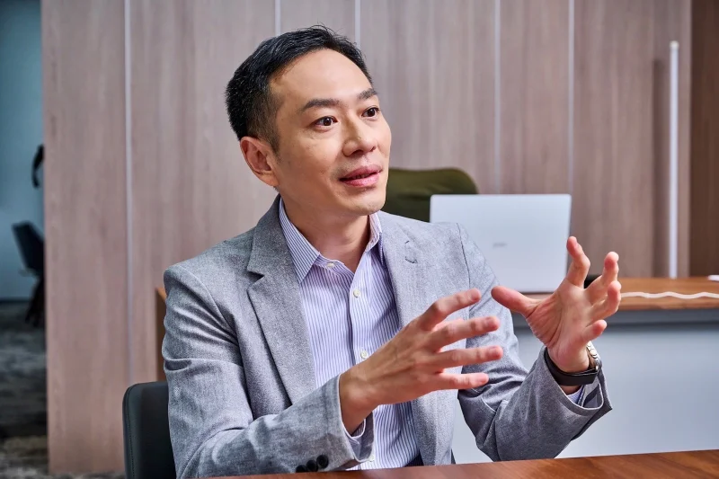

*2022年國內金融業投資於金融科技的年度金額突破300億元大關。金融產業數位轉型至今最大的挑戰有哪些？資訊產業如何扮演金融轉型的關鍵推力？*

服務客戶有過半多是大型金融業者的昕力資訊總經理姚勝富觀察，在金融業數位轉型之路上，目前最大的挑戰在於內部的跨部門溝通問題，「轉型涉及的不只有IT單位，服務的設計、產品的設計也都包含其中。轉型議題需要所有這些部門一起討論，相互合作、凝聚共識才能成功。」

## 善用外部資源 突破兩大環境挑戰

在外部環境方面，金融轉型主要的瓶頸在於法規限制以及人才不足兩大挑戰。根據金管會2022年統計，國內金融業的金融科技相關人才需求在近兩年來明顯增加，同時，金融業者與金融科技業者的合作也持續成長，領域包含資安、大數據、人工智慧等。姚勝富建議，在大環境人才整體不足的情況下，銀行與資訊服務商必須釐清各自的角色，銀行屬於策略擬定的一端，在用人時應偏向規劃型的多元人才，資訊服務商則擁有大量程式開發、系統建置的人才，透過這樣的角色劃分彼此互比，就能達到雙贏。例如昕力資訊 目前約600人的團隊，就包含了從顧問、系統的分析規劃，一直到設計、開發以及系統完成後的7X24維運團隊，提供客戶一站式的服務，爲金融業者節省大量的人力與心力。

在克服金融業數位創新的法規限制方面，資訊服務業者同樣可以幫上忙，例如昕力資訊 憑藉著近20年來深耕金融領域、一路參與台灣FinTech發展與法規開放的經驗，協助金融業者先行導入Open Banking試驗案，並持續舉辦各類研討會，向業者展示國際的創新技術與應用。此外，昕力資訊 也結合相關經驗與強大的研發能量，開發出金融科技服務中心DigiFusion，整合金融業需要的安控、API串接、內部流程管理等各方面的需求，讓業者不用從零開始，可以以更快的時程、更經濟的成本達成需求。

*圖片來源：昕力資訊*

### Banking 4.0生態圈時代來臨 非金融業者也能因金融科技受惠

「目前整個金融轉型從過去談數位金融、開放銀行等趨勢，到現在已經進入Banking 4.0，也就是Banking Anywhere服務無所不在。」姚勝富分析，Banking 4.0著重的是整體生態圈，因此銀行必須跨領域與各種產業的夥伴合作。相對地，非金融領域的業者也能連結金融相關科技，例如目前正當紅的「Buy Now Pay Later」模式，昕力資訊在國外就有一個租賃公司客戶的服務案例，透過DigiFusion中 台導入金融科技加速其流程數位化，使其商業模式更加靈活多樣，達到營業額倍數的成長。

還有一些科技是金融業率先大量導入，但事實上在各行各業都有廣泛的應用空間，例如Chatbot聊天機器人服務，雖然目前已經有大量運用，但實際使用會發現，一般問答式機器人不一定能完整了解使用者需求、流暢確實地回應解決方案。為此，昕力資訊 特別研發出「SysTalk.Chat 」以 AI 技術驅動人機協作，透過精準 的語意分析技術，讓機器人模擬真人的自然聊天，可隨時中斷、切換話題，進行流暢對話，有金融業客戶導入後，消費者只要透過AI客服 機器人就能一站式輕鬆完成壽險保單或信用卡資訊查詢等 即時交易服務，便利快捷的體驗，與一般聊天機器人的體驗大為不同。除此之外，還有不少大眾運輸、政府部門以及醫院等業者，都透過SysTalk.Chat 大幅提升客服自動化程度與客戶滿意度。

### 全新碳盤查平台上線 串連綠色金融兩端、提升減碳績效

與SysTalk 同樣從金融業轉型需求出發，卻能應用到各行各業的還有昕力資訊 最新推出的碳盤查平台。「關於ESG與碳盤查的議題，我們最早看到的是綠色金融，因為不只金融業者本身需要進行永續減碳，與銀行往來的企業也需要有ESG或碳盤查的相關績效，才能爭取到更好的貸款條件。」姚勝富分析，尤其當銀行與往來客戶都加入這樣的生態圈，雙方可以做更多的資料軌跡 分享，從中衍生出更加創新的服務與交易模式。

在實際運作上，由於碳盤查和碳足跡的計算都需要大量的數據收集和統計，透過昕力資訊的碳盤查平台的自動化工具自動串接數據，結合國際標準與認證，可以幫助企業大幅節省人力成本、提高效率。同時，藉由碳盤查平台上的儀表板工具，可以將企業的碳排等資訊以圖表、報表等方式可視化呈現，協助企業經營者檢視減碳績效，並判斷出未來的減碳著力點，持續不斷改善減碳績效。

「身為資訊業者，提供一個碳盤查資訊系統，不只是一個很大的商機，也是必要的責任。」姚勝富表示。爲了導入國際最先進的減碳節能技術，昕力資訊 不只找來專家學者擔任顧問，姚勝富還特地帶著團隊到國外考察、建立合作夥伴，例如引進日本的綠建築能耗管理系統，預計今年底前就可以導入到昕力資訊的碳盤查平台。

### 2023 TPI DAY未來金融方程式 助攻產業【決戰雲端 綠色轉型】

為了向業界展示國際的創新技術與應用，昕力資訊 每年持續舉辦各類研討會與論壇活動，今年即將舉辦的 2023 TPI DAY【未來金融方程式 決戰雲端 綠色轉型】論壇，以金融與永續雙主軸規劃，邀請了重量級來賓分享相關知識和經驗，「目前在金融科技監理沙盒部分已經慢慢有效果顯現，本次的論壇我們也邀請到相關的專家進行分享。此外，數位化其實也是節能減碳的一環，因此今年的論壇特別由金融ESG主題延伸到相關的其他行業，期盼未來持續透過政府與產業的共同努力，帶領台灣的金融科技持續前進。」

原文章出處：[商業週刊](https://www.businessweekly.com.tw/business/indep/1003533)
