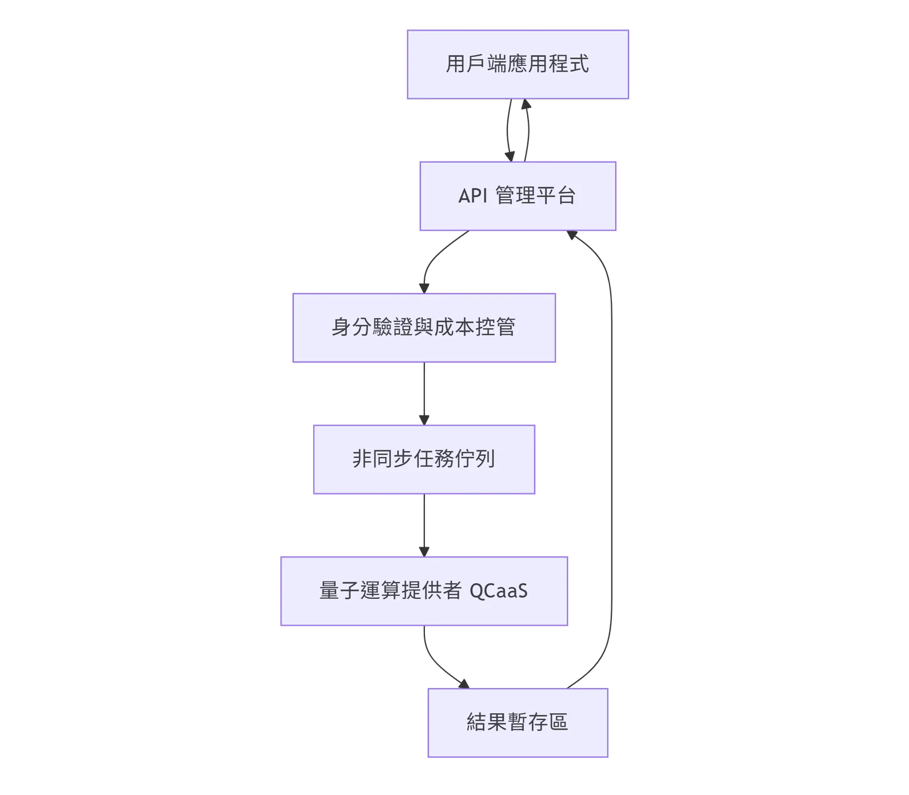

## 一、 APIM 整合量子運算的核心價值

在量子運算尚未普及至地端機房的現狀下，企業多透過雲端供應商（如 IBM Quantum, Azure Quantum, Amazon Braket ）獲取運算能力。APIM 作為中介層，能解決量子任務（Jobs）的高延遲、非同步特性與極高昂的運算成本管理問題。

## 二、 四大應用情境範例

### 1\. 量子機器學習 (QML) 增強型預測

-   **APIM 情境**：企業透過 APIM 暴露「特徵提取」接口。當傳統 AI 遇到高維度資料瓶頸時，APIM 路由至量子後端執行量子核函數（Quantum Kernel）運算。

-   **應用**：用於偵測極其隱蔽的金融詐欺行為。APIM 負責封裝複雜的權杖交換，讓前端開發者只需呼叫標準 RESTful API 即可獲得量子加速的預測結果。

#### 2\. 組合最佳化 (Optimization) 任務調度

-   **APIM 情境**：物流或供應鏈系統提交路徑規劃請求。由於量子退火（Quantum Annealing）運算需排隊，APIM 提供 Webhook 或回呼機制。

-   **應用**：跨國物流的路徑最佳化。APIM 實施「配額管理」（Quotas），確保高昂的量子運算資源優先分配給高優先級的訂單任務。

#### 3\. 複雜系統模擬 (Simulation)

-   **APIM 情境**：材料科學或藥物研發中的分子模擬。APIM 負責處理超大型 Request Payload，並將其導向量子電路模擬器。

-   **應用**：新藥開發。APIM 的快取機制（Caching）在此至關重要，針對重複的分子結構運算結果進行緩存，降低重複呼叫成本。

#### 4\. 跨組織後量子加密 (PQC) 訊息交換

-   **APIM 情境**：在現有 API 閘道中加入抗量子演算法（Post-Quantum Cryptography）插件。

-   **應用**：政府或金融體系間的資料交換。APIM 在邊際端執行加密轉換，確保數據在傳輸過程中即便遭遇量子電腦攻擊也能保持安全性。

## 三、 系統架構流程圖

以下展示標準 APIM 整合量子服務的請求生命週期：

## 四、 導入成本分級表

量子運算成本極高，必須透過 APIM 進行精細化分級：

| 級別 | 適用對象 | APIM 控制策略 | 主要成本構成 |
| --- | --- | --- | --- |
| **實驗級** | R&D 團隊 | 每日呼叫次數限制 (Rate Limiting) | 量子模擬器使用費、少量開發人力 |
| **專業級** | 核心業務部門 | 基於 API Key 的計費與優先級調度 | 雲端量子處理器 (QPU) 秒數計費、運算專家顧問費 |
| **企業級** | 跨國營運/高安防單位 | 保證頻寬、專屬後量子加密通道 | QPU 預留執行時期費用、大規模系統整合成本 |

## 五、 導入方法論 (Implementation Methodology)

1.  **評估期 (Assessment)**： 識別業務流程中屬於 NP-hard 的問題（如最佳化問題），確認其是否具備量子加速潛力。

2.  **設計期 (Design)**： 在 APIM 上定義抽象化的 API 規格，隱藏量子後端的技術細節（如 Qiskit 或 Braket 的語法差異），達成「量子屏蔽」。

3.  **原型期 (PoC)**： 優先使用量子模擬器（Simulator）串接 APIM，驗證 API 流程與非同步回傳邏輯。

4.  **優化期 (Optimization)**： 根據 APIM 的分析報告（Analytics），監控運算時長與成功率，調整請求排隊機制與計費策略。

## 六、 結語

透過 APIM 整合量子運算，企業不僅能提前佈局次世代運算技術，更能有效控管風險與預算。這不僅是技術的串接，更是將「量子能力」轉化為「商業資產」的標準化過程。
