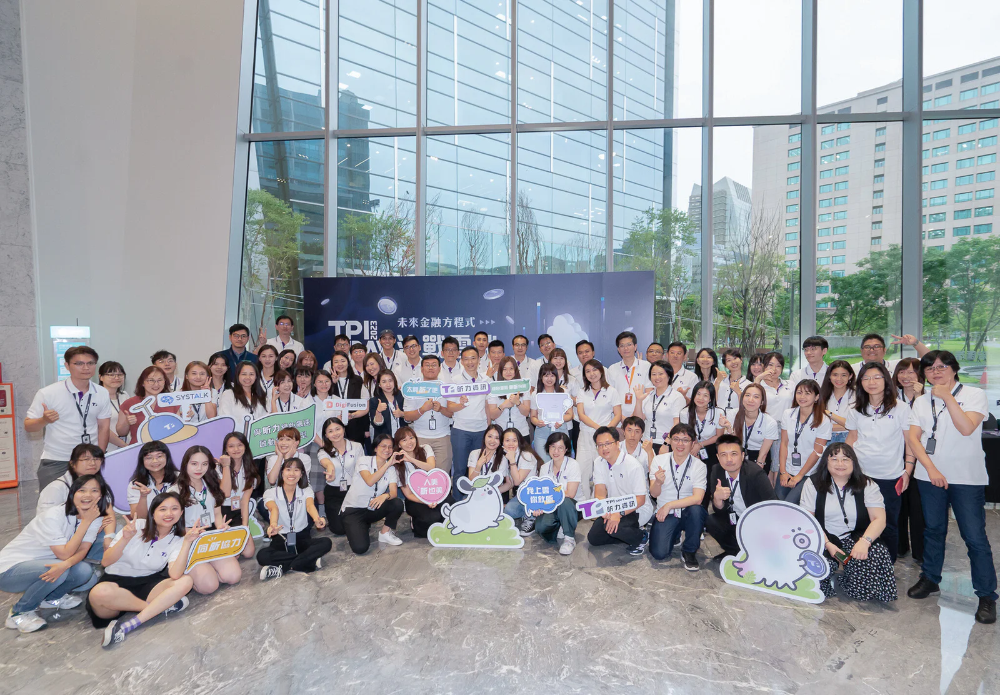
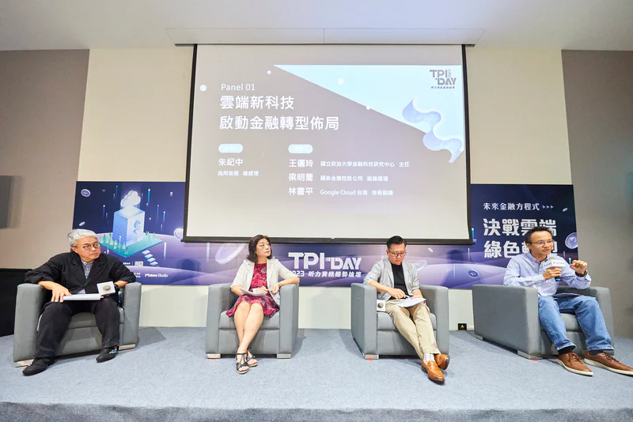
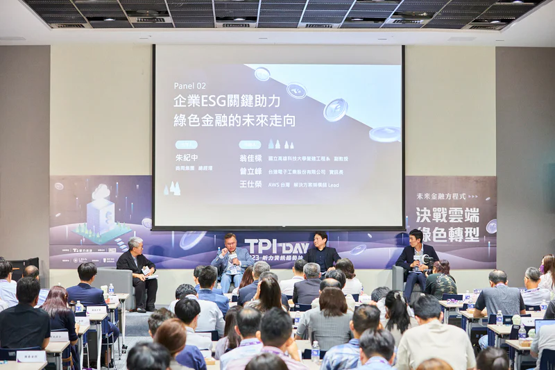

*提供金融科技解決方案近二十年的昕力資訊與商業周刊，舉辦2023 TPI DAY 趨勢論壇，以【決戰雲端 綠色轉型】爲主題，邀請產業、學界重量級領袖，分享雲端科技與綠色金融的應用趨勢。*

金管會「史上最大科技放寬措施」9月即將上路，其中最受矚目的就是雲端儲存、AI運算相關規定的鬆綁。金融上雲的鬆綁是否將為金融轉型帶來突破性進展？綠色金融ESG又將在雲端上發展出哪些新應用與商機？

處在全球金融轉型革新之時，提供金融科技解決方案逾十年的昕力資訊與商業周刊，共同舉辦2023 TPI DAY 趨勢論壇，以【決戰雲端 綠色轉型】爲主題，邀請產業、學界重量級領袖，分享雲端科技與綠色金融的應用趨勢。

* * *

根據AWS對全球金融業者的調查，有86%的業者早在2020年就開始佈局雲端服務，並有55％業者預計在未來兩年內要將集團內的應用服務佈建到雲端，目前已經可以看到金融業已經開始擴大運用雲端服務的工具導入創新金融應用場景，例如機器學習、資料倉儲工具及高算力的運算架構等，藉以強化客戶的體驗、改善營運風險分析、偵測詐欺行為的偵測……等。

*昕力資訊持續透過自主研發團隊，協助企業進行價值再造，期望藉由國際級的產品及服務協助金融產業再創新榮景。*

昕力資訊也持續透過自主研發團隊，結合昕力資訊過去十餘年在金融服務及雲端部署的經驗，協助企業進行價值再造，昕力資訊總經理姚勝富在論壇致詞中分享，昕力資訊的產品在4月份通過雲端大廠認證，此外，[昕力資訊的DigiFusion企業服務中台及SysTalk.ai](http://xn--digifusionsystalk-4g60ac9ituxsgbs5k7yay194arcfw0rz89fniyf2uqa.ai/)系列產品也陸續被Gartner跟IDC等國際第三方研究機構列入報告，充分證明昕力資訊的產品已達到國際標準，期望藉由國際級的產品及服務協助金融產業再創新榮景。

## 雲端服務領新局 擘畫金融雲藍圖

「可以預期未來5~10年內，破壞性的創新將不斷持續，並逐步取代傳統的銀行業務。」昕力資訊售前規畫經理樊博文分析，從疫情前就已經有許多金融集團開始規劃業務中台，利用API部署微服務架構；疫情開始之後，IT技術更是金融業抗疫的利器，同時透過地端及雲端的混合雲部署進一步優化成本；疫情解封之後，金融轉型的腳步毫不停歇，包括去中心化金融、生成式AI的應用場景規劃等遍地開花，如何加速上雲更是重中之重。

*台灣金融業數位轉型走過摸索期，開始進入積極前進突破的階段，通過金管會的查核，金融業者終於可以實現大規模上雲，啟動轉型佈局。*

台灣金融產業導入雲端的先驅—國泰金控副總經理梁明喬分享金融上雲的經驗，由於客戶體驗對於速度的要求越來越高，整體技術架構也持續迭代推進，使得雲端漸漸從「需要」變成了「必要」，他表示：「雲端技術架構可以幫助我們更快速發展相對應的金融科技來服務客戶。」近期金融法規雲端規範的進一步開放，爲金融業者推動上雲提供良好契機，國泰則是從一開始就定義了「Cloud Ready」和「多雲」兩大策略，「Cloud Ready」指的是在法規還未開放之前就先做好前置準備，一旦法規通過就能即刻啟動；「多雲」則是指透過地雲混合的架構，利用雲端原生的技術，達到加速開發及應用的效益，結合數據中台串連集團不同事業單位，減少核心系統負載並且拓展微服務的應用。

### 雲端新科技 金融轉型效益再升級

數位轉型的另一大挑戰—人才的培育與養成，對此，Google Cloud 台灣技術副總林書平表示，透過雲端數位轉型的方式，對於人才部分也能帶來效益，讓人才可以更快速學習到宏觀趨勢，增加IT開發的技術能力。此外，導入雲端的主要價值還有提升效益和安全性兩大面向，讓企業不用再花費大量人力、物力與時間建置環境，可以迅速地運用雲端環境進行試錯、整合大量數據，並且直接受益於全球性雲端服務大廠的頂尖資安技術，享受即時更新的安全性服務。

「在今年（法規）對AI和雲的開放之後，我相信會是台灣金融科技加速的新里程碑。」國立政治大學金融科技研究中心主任王儷玲表示，AI加雲對於國際金融科技而言原本就是重要的基礎設施，無論是企業自身的數位轉型或改善服務、甚至是企業的ESG綠色轉型都可獲益於雲端結合AI的效益，尤其雲端上的許多微服務已成為金融機構數位轉型增加彈性、降低成本的重要工具。未來值得期待的還有隨著雲端鬆綁之後的區塊鏈、IoT加速進展，以及從雲端的共享生態系延伸擴大資料共享、處理，進一步透過自動化提升整體效率與資安流程。

### 綠色金融3.0 新科技助攻能耗管理

*金管會在2022年發布「綠色金融行動方案3.0」推動重點包括推動金融機構碳盤查及氣候風險管理、促進ESG及氣候相關資訊整合，金融業的碳管理與數據整合。*

隨著國際間的減碳協議和國內的淨零政策愈趨完善，以及國際大廠對綠色供應鏈的要求、歐美的碳關稅措施上路在即，「全民碳盤查」的時代即將到來，不只上市櫃大型企業需要ESG 永續報告書，中小企業也難以避免加入減碳的行列。而在金融產業，金管會在2022年發布「綠色金融行動方案3.0」五大推動重點中包括推動金融機構碳盤查及氣候風險管理、促進ESG及氣候相關資訊整合，金融業的碳管理與數據整合也成為當務之急。

針對金融業自身營運、也就是範疇一與範疇二的減碳，建築的節能與能效管理佔有極高的比重，國立高雄科技大學營建工程系副教授翁佳樑指出，內政部已從今年7月1日開始實施「建築能效評估及標示制度」，由公有建築率先啟動，明年起納入私有建築如商辦，要求新建建築物達到一定的節能能效，後續更將逐步拓展至廣大的既有建築類群，顯現未來建築節能綠色改修的市場非常龐大。翁佳樑用國際間的「仿生建築」新趨勢說明，就像生物會本能地隨環境調節一樣，建築也可以透過傳感器和AI來自動感測，調節空調、照明等等，相關技術在國際間已陸續導入，台灣目前也陸續有「能源服務業」（簡稱ESCO）的新商業模式出現。許多企業開始積極投入，開發建築節能方面的解決方案，例如昕力資訊與日本合作即將導入的高效能AI自動控制建築節能系統，以及台達電的樓宇自動化部門等，都是未來在綠色改修市場上很重要的創新技術及服務。

舊建築導入科技，可以減少多少能耗？以台達自身在瑞光路的舊大樓為例，在能源重新規劃管理後節電高達58%，用電量不到過去的一半。身為全球電源管理與散熱解決方案的重要供應商，台達電子工業股份有限公司資訊長曾立峰表示，台達自身的綠建築就有超過30座的規模，透過經驗累積輸出而有了樓宇自動化部門的建立，主要服務包含智慧綠建築諮詢、智慧能源管理、LED照明節能規劃以及包括太陽光電、儲能和電動車充電樁等的微電網整合服務，不少百貨公司、醫院都是台達樓宇自動化的客戶。

在金融業營運的另一個用電重點—資訊設備方面，AWS 台灣解決方案架構師王仕榮也分享AWS的做法。「AWS相信科技創新將成為金融業永續發展的核心助推力。AWS透過創新技術設計高效節能、低能耗的資料中心，同時也致力於提高設施和設備的能源效率，在伺服器、儲存和網路設備的設計和製造方面持續創新以減少能耗，並高度重視提高基礎架構各個方面的效率。AWS不斷探索提高水資源利用率、減少冷卻資料中心飲用水使用、減少總體水足跡的最佳實踐。另外，AWS也在探索更加創新的自行研發的處理器及伺服器提高能源效率。這些都有助於上雲的金融業者以永續的發展方式來創新。」由己及人，AWS希望隨著雲端運算產業的發展，能與客戶和合作夥伴，共同創造更永續的未來。

### GreenSwift Platform綠色永續管理平台 企業ESG關鍵助力

針對企業減碳管理的議題，昕力資訊總經理姚勝富表示，第一步是要先了解企業的能耗狀況，接著制定改善方案，第三步則要建立回饋機制，檢討減碳方案的成效，再提出精進版的改善方案，不斷重複執行、回饋再改善，以達到ESG永續的目標。昕力資訊身為資訊業者，也為企業提供解決方案「GreenSwift Platform綠色永續管理平台」，搭配顧問公司，希望協助企業從源頭開始進行碳盤查。

「GreenSwift Platform綠色永續管理平台」如何運作？昕力資訊智慧健康管理發展處處長 杜嘉祐說明，平台擁有碳盤查、碳足跡、碳管理、ESG管理四大模組，可以協助企業以更簡便的流程、視覺化的分析進行減碳相關數據整合與分析管理，並接軌國內外最新法規，進行完整的盤查流程引導、產品碳足跡量化、資料文件化、數據分析與減碳管例，並彙整內外部ESG資訊並產出報告以供公開揭露，同時借助DigiFusion企業服務中台整合資料庫與第三方應用，進一步提升管理效能。更長遠的願景，則是期望透過平台串連企業、供應商、金融機構、投資者、政府與消費者，透過數據的揭露與串連，完善綠色金融的生態系統，實現共好的永續未來。

原文出處：[商業週刊](https://www.businessweekly.com.tw/business/indep/1003608)
