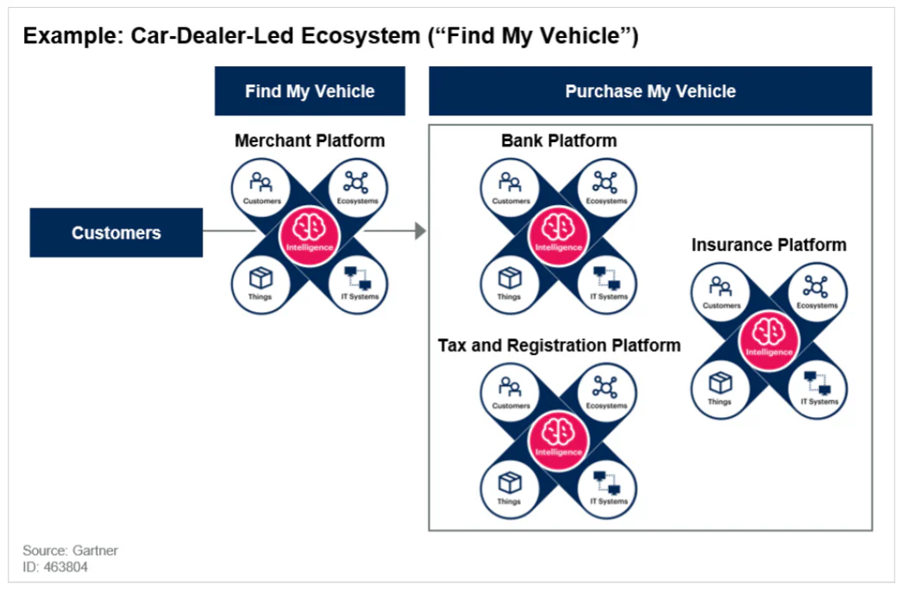
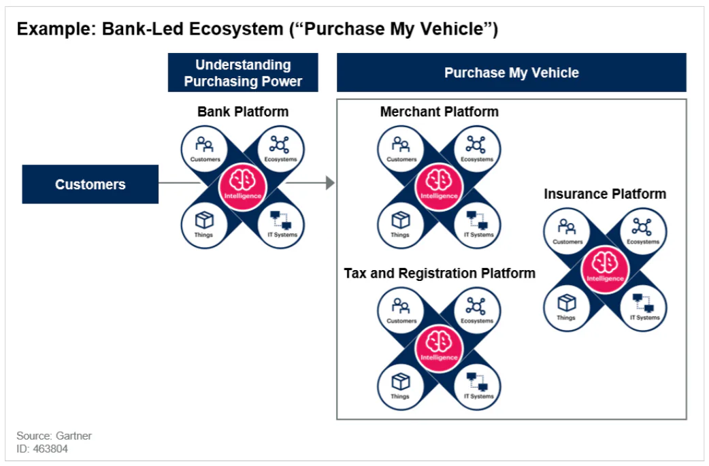

未來金融生態圈將透過以下三個面向逐漸改變金融服務體驗:

1.  消費者於日常生活，創造出金融應用場景

2.  銀行透過開放銀行策略，加速與第三方業者合作

3.  銀行或第三方業者與熟悉金融科技夥伴(供應商)，互相激盪出創新火花

## 金融生態圈 (Financial ecosystem)

未來個人和企業的財務紀錄將不再局限於現有銀行才能應用，根據Gartner研究指出，監管機關將會是促使銀行開放自有紀錄的最大推手。目前已經有一半的G20國家正朝向開放銀行策略與進行監理沙盒實驗(Regulatory Sandbox)，試圖找出金融新創產品、行銷、商業模式。

但任何的技術創新如果沒有考量到使用者的消費模式與時機，將流於技術創新但成效不彰；如何將金融科技嵌入消費模式，進而帶動個人與企業的金融循環，將是發展金融生態圈的重要方向，換言之，「場景金融」的尋找與定義，將是金融生態圈的決勝關鍵點。

## 場景金融 (Financial scene)

場景金融模式的建立，強調將銀行「從一處場所變成一種行為」，讓銀行的服務無所不在(ubiquitous)；隨著FinTech以及[開放銀行（Open Banking）](/industries/finance)的推波助瀾，金融服務已具備技術和能量，能走出封閉的金融機構。

「場景金融」的挑戰在於如何串聯、描繪出生活中各式的金融業務「場景」，以消費行為數據為基礎，主動將服務或產品「嵌入」目標客群的生活之中，運用網路產業視角，賦予該服務新的想像，打造新的商業模式。

## 台灣-八大領域新創攜手　加速實現場景金融

由台灣金融總會建置的金融科技創新園區（FinTechSpace)，日前舉辦「2020企業實證主題說明會」，邀集企業實驗室進駐機構及新創團隊共同激盪創意火花，首波公布9項創新實證主題如下：上海商銀-「Cloud Bank創新實驗室」、中國信託金控-「創新數據應用實驗室」、台灣微軟-「Intelligent Banking實驗室」、永豐金控-「開放創新APIs實驗室」、國泰金控-「區塊鏈創新金融實驗室」、將來銀行-「跨域金融實驗室」、悠遊卡公司-「無現生活創新實驗室」、LINE Bank-「Life on LINE實驗室」與遠東商銀-「雙 B 實驗室 BaaP by Bankee社群銀行」，各機構針對企業主軸進行創新議題實證與發展，會中交流熱烈，預計將於年底進行成果發表。

金融總會表示，園區成立近2年來，已輔導逾140家國內外金融科技及跨域業者於FinTechSpace場域快速對接實證，未來金融業跟科技業者間關係，會比以往更加密切，利用銀行基礎設施及既有資源，結合金融科技業者技術輔助，進行雙向合作，可協助金融業創造出更多創新金融商品，讓整個金融市場更加蓬勃發展。

## 場景金融始於消費者旅程

展望未來，銀行將需要領導，參與和支援多個由消費者、銀行或第三方業者所架構而成的場景。場景的發生在於消費者的日常生活選擇，因此需考慮不同的消費者旅程，例如以下兩個汽車採購的消費者旅程。

**旅程一 : 找到我要的車**

旅程始於客戶說：“我想要一輛具有特定規格的汽車。” 在這個在這種情況下，客戶知道了他們想要什麼，並於汽車商場找到了適合他們需求的汽車，現在他們需要融資和保險。這類場景是商家主導的生態圈形式（下圖）。

*消費者汽車採購旅程：商家主導的生態圈*

消費者使用車商服務了解車輛規格後，啟動後續購買車輛所需銀行融資，保險費用，車輛稅收以及其他費用等服務，完成一站式購車流程

**旅程2：我的預算能負擔哪種車?**

旅程始於客戶問：“我能買多少價格的車？” 在這種情況下，客戶的需求在於了解他們的預算有多少，包括融資額度，保險費用，車輛稅收以及其他費用，這類場景是銀行主導的生態圈形式（下圖）。

*消費者汽車採購旅程：銀行主導的生態圈*

消費者使用銀行服務了解自己的購買力後，啟動後續購買車輛所需車商購車、保險費用，車輛稅收以及其他費用等服務，完成一站式購車流程

上述僅是對汽車採購的兩個使用者旅程例子，現實生活中當然會發展出更複雜的生態系統，並且可能會有不同的客戶旅程驅動場景。

而要完成上述的一站式流程，金融機構所開放的API服務(呼叫服務的介面)至關重要。Gartner預測可提供協作的“開放API”環境將成為實現金融生態圈增長的關鍵。金融生態圈將為”支付”提供新的機會。

### 場景金融的轉動關鍵- API

「場景金融」崛起，讓銀行的服務必須隨處都在，而關鍵技術之一，便是API。在「場景金融」中，銀行就是API，也就是所謂的「[開放銀行(Open Banking)](/industries/finance)」。過去客戶的帳戶資料、金融數據，是銀行各自擁有的資產，「開放銀行」是指銀行透過開放 API 的方式與第三方合作，共享金融數據資料，也將金融數據的主導權還給消費者，使消費者可以獲得更多元的金融服務，藉此開發更多新應用，創造龐大的「API 經濟」。

對於「開放銀行」，民營銀行走的速度較快，凱基銀行早在 2017 年 11 月首創開放 API 服務「KGI inside」，至今已陸續與記帳、支付及社區繳費等 APP 業者合作；台新銀行也與麻布記帳、財金資訊公司、政治大學、日本「Buy 日貨」購物網站合作，搶攻存款利率、匯率資訊、手續費、ATM 位置等金融場景應用；中信卡紅利點數兌換 API ，也已與國內最大超商業者 7-ELEVEN、最大電信業者中華電信等商戶串接。

## 金融生態圈策略夥伴-昕力資訊

昕力資訊成立於2005年，致力於提供軟體解決方案，擁有豐富實戰經驗，協助企業推動數位轉型。深耕業界多年，昕力已成為數位金融科技專家，無論在安全面、執行面和可靠性皆贏得客戶信賴與良好商譽。我們以客戶利益為導向，提供專業的團隊與一站式的企業解決方案，已成功協助台灣國內外銀行與政府機關建置行網銀系統與實現API場景運用。

金融科技革命正在進行中，金融生態圈已然萌芽，開放銀行只是個開始，未來將會走向開放證券投資以及開放保險服務，使整個金融產業都可以透過API串聯整個金融市場所有服務，致力滿足消費者一次購足的便利，形成完整的開放金融生態圈。

參考資料:

1.  Gartner Inc. (2020), Predicts 2020- Ecosystems Will Empower Banking Customers and Erode Banks’ Traditional Value Propositions

2.  中華台北APEC 研究中心, 金融科技之商機趨勢(上)

3.  金融總會, FinTechSpace 企業實驗室

4.  鉅亨網, 〈銀行搶攻開放銀行〉Open Banking正夯 場景金融服務「打群架」時代來臨 ([https://news.cnyes.com/news/id/4383578](https://news.cnyes.com/news/id/4383578))

5.  經濟日報, 數位理財通／開放銀行五大應用([https://money.udn.com/money/story/9740/4431370](https://money.udn.com/money/story/9740/4431370))
