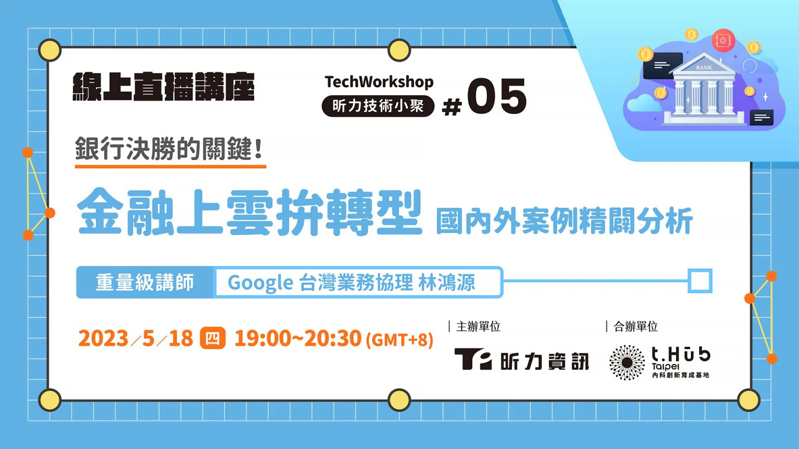

雲端服務是企業實現數位轉型的重點，而對於安全考量較多的金融業來說，也一直希望政府能夠逐步放寬限制。

2023年3月金管會公布了一件大事，銀行業者只有同時符合「重大性、消金業務資訊系統、儲存在境外」這3大條件，才需要向金管會申請審核。往後只要是非重大、非消金業務、非境外的業務，全都免申請，而運用公共雲進行雲端儲存、AI 運算，最快9月即會大幅放行。

這個重大的政策，等於在金融業數位轉型的遙控器上，按下了快轉鍵。

## GCP 雲端服務為什麼能幫助金融上雲

GCP 是 Google 的雲端計算平台 Google Cloud Platform 的縮寫，提供了銀行、金融業最需要的雲端運算、資料存儲、人工智慧、資料運算等強大功能。

GCP 現代化的雲端基礎架構，服務範圍遍布全球。同時，它也擁有金融業最需要的強大安全性，包含像是數據加密、MFA（Multi-Factor Authentication，多重要素驗證）、DDoS 防護之外，GCP 也符合多種行業的法規或是地區的合規性標準，例如：ISO/IEC 27001、SOC 2 ，Google Cloud 每年也會接受至少一項第三方稽核，確保各項產品皆符合 PCI DSS

由於 Google 在台灣已有營運據點，符合金管會「非境外」條件，得以節省你審核的時間和營運的費用，大幅加速金融上雲的速度。

而Google的GCP除了已經在台灣完成首次聯合查核，也是第一個公開服務多家金融機構上雲需求，並已接受獨立第三方單位聯合查核的公雲業者。

### GCP 金融上雲的應用情境

那麼金融業運用 GCP 的雲端服務可以做那些事呢？我們來看看幾個例子：

**1\. 資料存儲與權限控管**

客戶資料、帳戶資訊、交易資訊、保單資訊、合約…等，金融業海量的資料得以運用雲端服務便利安全的儲存，依據資料的增長去彈性增加存放空間，進行高效的資料管理。同時，也能依據不同層級的管理身分進行資料取用的控管，確保資料的安全性。管理者還須經過上面提到的 MFA（Multi-Factor Authentication，多重要素驗證），增加了多層的安全保護。

**2\. 數據運算與資料萃取**

銀行業者擁有的數據資料是非常大量的，要分析這些數據需要非常強大的運算力之外，也需要良好的資料存儲架構。運用雲端服務的好處除了儲存便利之外，還能夠將資料運用的淋漓盡致。舉例來說，你能夠將不同年齡、收入、身分、消費習慣的大量資訊進行交叉比對，將安靜沉寂的數字，活化成高價值的分析資料，作為科學決策的依據。

**3\. 投資分析與風險評估**

要訓練 AI 模型，通常會用雲端服務來進行運算，企業要自己準備硬體來運算，是非常不划算的，更不用說需要多方考量的投資風險評估，這種複雜又龐大的運算模型。金融業者可以運用 GCP 的運算能力來訓練 AI 模型，提供優秀投資標的參考，以科學數據輔助銀行的專業投資人，進行又快又精準的投資風險分析，並依據投資結果進行優化，加強投資績效。

上述提到的雲端服務，都能按用量來彈性計費，你都可以根據自己的需求，去選擇最適合的計費方式，減少建置硬體以及維護的固定成本。

### 金融上雲需要注意那些事？

金融上雲是金融業數位轉型的必經之路，但我們需要注意那些事呢？其中不外乎地雲部署決策、法規的合規性、安全性考量。

昕力資訊具備完整的地轉雲技術支援，讓你不必擔心從地到雲的轉換問題，同時昕力資訊的 digiRunner API 管理（APIM）平台可以於在地、雲、混和雲環境佈署，作為新舊系統間的橋梁，強化舊有系統與新服務間的相容性，並依據法規、企業策略幫助系統轉向現代化，同時滿足金融產業對高安全性的需求。

合規更是上雲時是非常重要的一環，我們熟悉金融資安及各種開放式架構的相關法規，為企業提供合規的雲端服務，確保複雜的系統架構、數據整合，都能夠在地、雲環境順暢運行。

digiRunner 除了提供 WAF 等級防護，產品開發流程通過 ISO27001 資訊安全認證，安全訊息交換機制上更符合金管會的檢查規範，在輔助金融上雲時是絕佳的超級幫手。若你有金融上雲的需求，歡迎聯繫我們。

* * *

### 想知道更多金融上雲的趨勢嗎？

點擊下方連結看講座直播回顧👇

✨

**昕力5月技術小聚銀行決勝的關鍵！ 金融上雲拚轉型，國內外案例精闢分析**[<strong>✨</strong>](https://youtu.be/tDnQDKOmI-8)

本次活動邀請到擁有 20 多年金融產業服務經驗的 Google 台灣業務協理 林鴻源，透過他豐富的視角帶我們一窺金融未來式，迎接開放金融上雲新世紀！活動中除了探討近期金融上雲趨勢，也有國內外同業真實案例和合規案例的分享，精彩的活動內容，馬上點擊連結看精彩[直播回顧](https://youtu.be/tDnQDKOmI-8)！保證讓你對雲端與金融有更深入的了解。

✦活動已結束囉！歡迎追蹤昕力大學活動通，相關技術講座資訊不漏接 [http://bit.ly/3B0ZKcg](http://bit.ly/3B0ZKcg)
