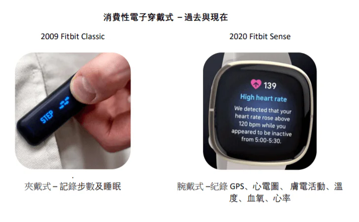
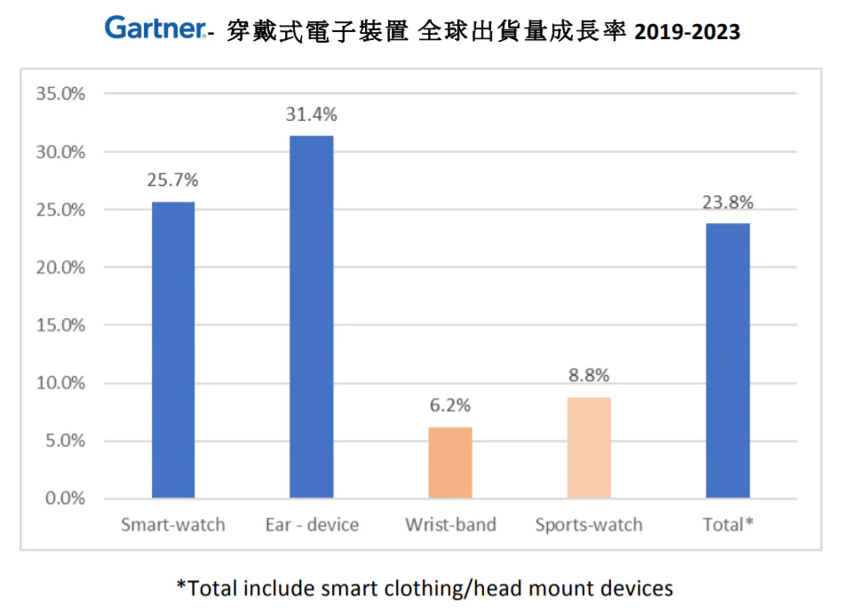
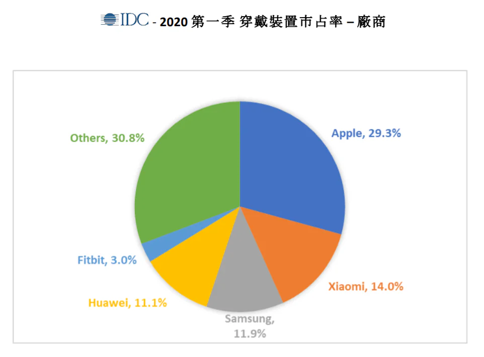
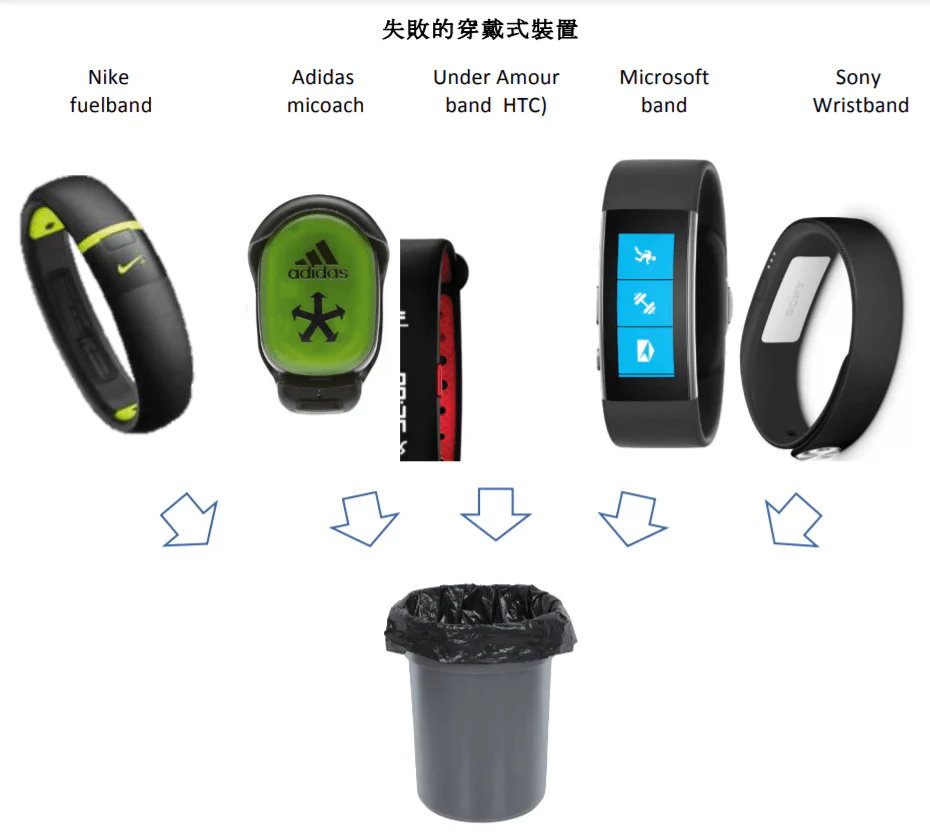
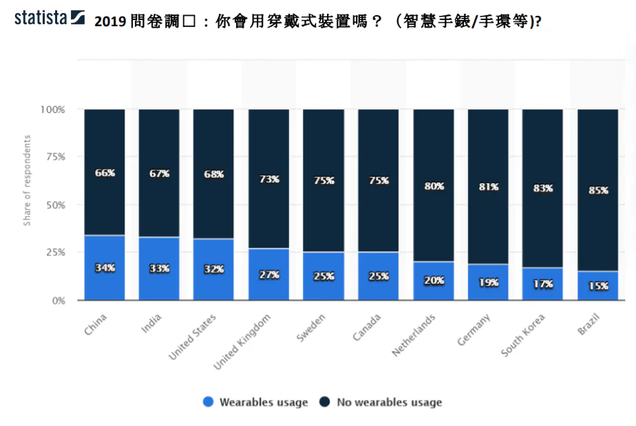
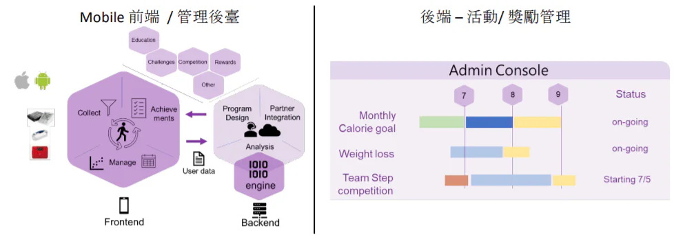

## 又潮又新奇的穿戴裝置

每年都持續有新型穿戴裝置發佈的消息，從全球知名品牌到小廠不停推陳出新，發表腕戴式、頸掛式、耳塞式及指套式等各式各樣的機型。 每個都表示有更多更有趣的功能、演算法及裝置，提供消費者更多資訊以瞭解自己及跟提升健康。 消費性連接穿戴裝置（consumer connected wearable）始於在十多年前，雖然功能簡單僅記錄步數，爬階梯數及基本運動等，資料則透過藍牙與智慧手機App連接，但在當時卻是革命性的發明。

經過數年演進，穿戴裝置也加入了心率、體溫、睡眠等偵測功能。 隨著量測科技不斷進步及微型化， 現在高階的裝置還能偵測血壓、 壓力、跌倒、血氧、血糖、心電圖(ECG)及心率變化(HRV)， 有些甚至可以獨立接受行動網路聯網運作，不再需要依賴手機。

*穿戴式產品過去與現在的樣式*

### 酷哦，但數據是真的嗎？

專業調研機構Gartner在2019 報告中預估2020穿戴裝置出貨量會達到2.7 億個及營造美金515億收入。 接下來每年會以22.1% 成長，到了2023年預計達到約5.3億個出貨量以及美金879億的收入。 雖然Gartner預估整體市場會持續成長，但大部分的成長會來自於多功能智慧手錶及目前非常流行的無線耳機 (例如Apple Airpods 及Samsung Galaxy Buds），腕戴式運動手錶的成長則十分緩慢。 IDC市場調查機構研究也看到了此趨勢。

*Gartner穿戴式電子裝置 2019-2023全球出貨量成長率*

以穿戴手錶、手環為例，從最新IDC 市場占有率分析來看，市占率最大的前五個廠商分別是 蘋果、小米、華爲、三星及Fitbit. 但同時我們可以發現穿戴式對大部分廠商來説不是核心業務。 穿戴式商品是與他們的核心手機業務及整個產品服務生態圈做搭配。 Fitbit 是五家廠商中唯一的純穿戴式廠商。 但近期他們連續數期的業績衰退。2020年Google 宣佈要併購Fibit, 結束它身為一家獨立公司的悠久歷史。

除了市場數據佐證以外，我們也能夠直覺地察覺到這個現象—應該已經不記得上次或曾經親朋好友熱烈討論手錶數據及今天走了多少步數是什麼時候了？ (當然，不能把身邊那個健身狂朋友算進來)， 但是我們到處可以看到 AirPods 及無線耳機。

*2020 第一季 穿戴式裝置廠商市佔率*

### 到底爲什麽消費性健康穿戴裝置行不通？

Fitbit 是2000年初開始的 「量化生活(Quantified Self)」 技術革命裡的始祖了。量化生活是將數據和科學技術進行應用及引入人們的日常生活，並達到健康提升的效果。 在今日Apple、Fitbit及小米手環在市場引領風騷前，其實是有很多知名的廠牌也有投入到這個市場内的。

*退出穿戴式裝置市場的廠商*

但這些廠商都已經退出穿戴裝置市場，明顯表示了該營運模式的不可行。

在Gartner的一項問卷調查中，穿戴裝置有高達30%的棄用率，因為使用者覺得他們不實用也不有趣。 其他調查也發現多數人最後都放棄使用穿戴式。Fitbit被Google併購前賣出逾一億個裝置，但只有2,800萬個活躍用戶，這代表有很多閒置的裝置深埋在許多人的抽屜裏。

某種程度上這也合乎常理，會棄用健康穿戴裝置，就像之前許多人也會試一試、然後放棄使用家用健身器材一樣。 人們懷抱自我理想、渴望和一些幻想，擁有這些時髦潮流的新事物與數據紀錄，能夠神奇地自動改變行為和健康。因此，人們看了看那些吸引人的廣告和模特兒，點擊購買，等待包裹出現後穿戴這個新潮裝置。

但現實是，人們獲得更多自身資料卻沒有為健康做出更好地選擇。

最後，穿戴裝置剩餘的唯一主要功能變成通知，每當有人來電、傳訊息、或是電話在另一個房間、口袋里還是會議中時進行提醒，裝置便會嗡嗡作響。就算現在這個幾乎每人已經有智慧手機的時代，使用穿戴裝置的人還是算少數。

*2019 Statista 穿戴式使用意願問券調查*

那要怎樣才可以？

健康仍然是一個很重要的議題。 越來越多人生活作息偏於靜態及有體型過胖的問題。 WHO 預估從1975 年至今，過胖人口成長已經超過三倍； 現在全球有19億人口是過胖的。

2016 年 一個新加坡相關研究在國際醫學期刊Lancet 發表的報告值得參考， 這是個爲期一年以800個受試對象進行的隨機對照試驗，比較以穿戴裝置與現金獎勵及慈善激勵來看是否有健康促進的效果。

「現金獎勵最有效地增加了中度至劇烈活動（MVPA），但6個月後停止獎勵，效果並無法持續下去。長期的激勵制度是必要的，用來減少活動降低及中斷。」

### HealthOn Can Help！

TPISoftware HealthOn 可以協助改善穿戴裝置遭棄用及維持用戶運動目標。 HealthOn 是個全方位的健康管理及促進平臺，帶來與一般穿戴裝置或健康 app不同、嶄新的用戶體驗，HealthOn可以模組化及快速地部署在任何規模的組織、企業及學校。 平臺中有社交、活動、獎勵及支援，更重要是協助使用者激發並維持高度動機，達到長期的健康目標。

管理者會問爲何組織、社區、企業或學校需要執行一個健康促進計劃及系統，因爲實際上對管理者來説，組織成員的健康已經是不容忽視的問題。 投資健康是具有實質回報且鮮少損失的， 我們會在之後的文章慢慢探討如何達成。
