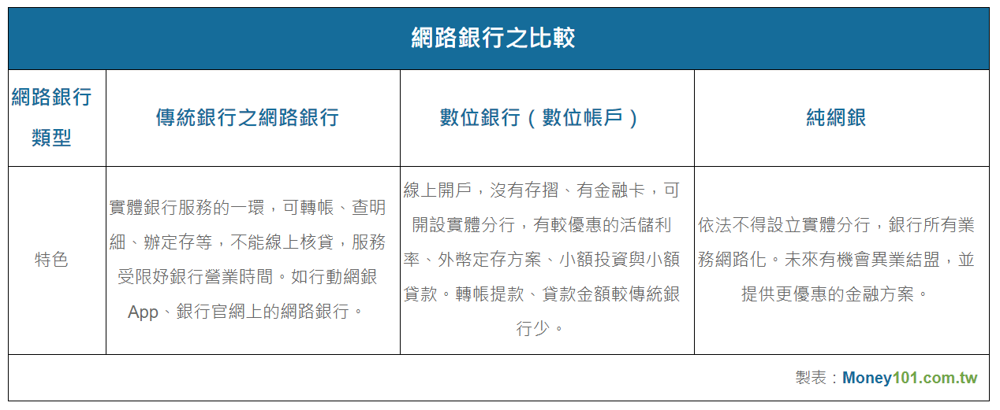

## 純網銀和實體銀行的差異

金管會去年 7 月公布三家純網銀許可設立，包括將來銀行、連線銀行及樂天國際銀行，經過一年多的籌設作業，目前年底前就要開業了，那麼純網銀和實體銀行有什麼差異呢?

純網銀依法不可設立實體分行，將來也不能併購實體銀行，且把傳統銀行的業務徹底網路化，所以所有的業務都在網路上進行，例如，未來貸款可在線上審核及辦理。也可接受靈活的上網方式，如使用手機和電腦，或在超商、電商平台及電信公司等完成。

不再受限於，要趕下午3點半前完成業務；也不會有某些業務，一定只在母行或指定分行受理的問題。金融服務變成無時無刻，只要能夠上網，就能方便得接觸到。只是受限於一些技術及資安問題，在轉帳及提款金額上，與數位銀行一樣有最高交易金額的限制。理論上，數位銀行因為少了設立實體分行的費用，所以可在業務上提供更多的優惠，例如免轉帳或跨行手續費、或提供更高利率的活儲與定存。

### 純網銀和實體銀行的比較

*傳統銀行、數位銀行與純網銀之比較*

純網銀的出現，反映的是財務資訊的另一種整合，以最近要在上海及香港火熱上市的”螞蟻金服”為例，螞蟻金服方便好用的”借唄” 功能，因為可以以更寬鬆的借貸條件，放款給很多信用卡業者接觸不到的App族群，搭配對岸無處不在的電子支付，螞蟻金服已嚴重威脅了信用卡，或小額借貸的市佔，而且產生了巨大的現金流與資訊流，其後的衍生性商品及服務，帶給市場無限聯想。因此IT業者會考慮進軍網銀，準備進一步整合自家生態圈的金流資訊，如Apple 會想結合廣受歡迎的iTunes Store、Amazon會想整合它的購物網站…等，以更有效的運用這些平台上收集到的龐大資訊。

涉足個人金融的純網銀，只是這個崛起中的Fintech的一項起手式，如投資銀行巨頭JP Morgan, 已發行了自己的加密貨幣JPM Coin，可在純網銀的平台上，用來進行全球企業間，B2B的即時內部交易，如企業跨國電匯、發行證券的即時清算等，都已被證實可大幅提升處理的速度，且降低成本。純網銀也是可在B2B的市場上，看到一展長才的空間。

純網銀對台灣而言是一個嶄新的服務，但參考了其他國家的新興案例，純網銀可把金融服務，整合生態圈的其他巨量數據，創造出充滿想像力的火花，大家準備迎接無處不在的純網銀時代了嗎？
